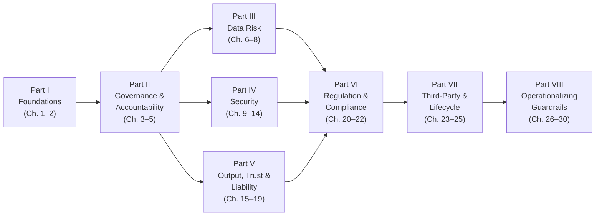

# Front Matter

*Building Guardrails for Enterprise AI: Hardening Enterprise AI Against Hallucinations, Hacks, and Liability*

> **In this section**
>
> - **Foreword:** Why guardrails are speed enablers, not speed bumps
> - **How to Use This Handbook:** Chapter structure and tailored reading paths for every role
> - **Executive Summary:** The top 10 enterprise AI risks on one page
> - **A Shared Vocabulary:** 25 essential terms that give the boardroom, legal, security, data, and engineering teams a common language
>
> **Essential for:** everyone · **Reading time:** about 15 minutes

---

## Foreword: Guardrails Help You Go Faster, They Don't Slow You Down

Ask an enterprise engineering lead why forty proofs-of-concept are sitting in staging while only three have reached production, and you will rarely hear that the model was not smart enough. More often, you will hear that the project is waiting on sign-off from security, privacy, legal, or model-risk review.

Now walk down the hall and ask the Chief Information Security Officer, the General Counsel, or the Chief Data Officer why those projects are waiting. You will hear a very different, and equally reasonable, story. A business unit wants to connect an external large language model to twenty years of poorly permissioned SharePoint folders. Another team wants an autonomous agent to issue customer refunds and update production records using a shared administrator token. A third has already enabled an "AI assistant" checkbox inside a cloud CRM without checking whether customer data is being retained by a fourth-party model provider. When the reviewers ask what happens if the model fabricates a policy, leaks a board memo, or follows malicious instructions hidden in an incoming email, the project team offers a prompt: *"We told the model not to do that."*

Faced with unknown exposure and no standard way to measure or contain it, risk and legal teams do the only responsible thing available to them: they slow down, ask for bespoke reviews, or say no.

This is the central paradox of enterprise AI adoption. Nearly nine in ten organizations now use AI in at least one business function, and more than six in ten are experimenting with AI agents, yet roughly two-thirds remain stuck in experimentation and pilot phases.[^fm-01] Analysts at Gartner project that more than 40 percent of agentic AI initiatives will be cancelled by the end of 2027, driven not only by unclear return on investment and rising token costs, but by **inadequate risk controls**.[^fm-02]

The lesson is straightforward, though often misunderstood: **high-performance brakes are not put on a race car to make it go slowly; they are put on the car so the driver can safely take corners at speed.**

Without clear guardrails, every AI project is negotiated from scratch. Every team invents its own privacy filters, debates its own contract clauses, and guesses at what "human oversight" means. Or worse, frustrated employees bypass official channels altogether and paste source code, financial models, and customer records into personal consumer accounts—trading visible governance friction for invisible "shadow AI" exposure.

With well-designed guardrails, the dynamic reverses:

- **Low-risk internal productivity use cases move in days, not months**, because they ride on pre-approved AI gateways, Zero Data Retention agreements, and standard acceptable-use rules.
- **Engineers know the architectural rules before they write code**, rather than discovering during a pre-launch security review that their agent combines private data, untrusted inputs, and external network access.
- **Data stewards and legal counsel review against a shared risk tiering model**, focusing deep scrutiny on high-stakes customer, financial, clinical, or employment decisions rather than policing meeting summarizers.
- **Boards and executives get measurable assurance**, seeing not just how many AI tools have been deployed, but which risks are controlled, which are accepted, and where the red lines sit.

This handbook was written to serve as that shared blueprint. It is deliberately written for *every* stakeholder in the enterprise AI lifecycle—board members, chief executives, CIOs, CISOs, CDOs, data stewards, general counsel, compliance and privacy officers, AI engineers, and business product owners. You do not need a PhD in machine learning to read the technical chapters, and you do not need a law degree to read the regulatory chapters. Where a concept is technical, it is explained in plain English and anchored in a real-world failure; where a requirement is legal or organizational, it is translated into concrete engineering and operational controls.

AI will not wait for enterprises to reinvent governance one incident at a time. The organizations that win with AI over the next decade will not be those that ignored risk, nor those that banned the technology out of caution. They will be the organizations that built guardrails strong enough to let them move fast with confidence.

---

## How to Use This Handbook

### The Anatomy of Every Chapter

Because enterprise AI risk crosses traditional silos, every chapter in this book is structured so that different roles can read the same pages and immediately extract what they need:

1. **The Challenge (Plain English):** What the risk is, why traditional IT or legal controls fail to catch it, and the underlying mechanics explained without unnecessary jargon.
2. **Real-World Scenario:** Documented incidents, court and tribunal rulings, CVEs, or realistic composite scenarios showing how the failure happens in practice.
3. **Why Every Role Cares (The Stakeholder Lens):** A quick-reference table translating the issue into the specific concerns of the Board/CEO, CIO, CISO, CDO/Data Stewards, Legal/Compliance, and AI Engineers.
4. **The Guardrails:** Actionable technical, contractual, and organizational controls that mitigate the risk.
5. **Key Takeaways & Questions to Ask:** A closing checklist of high-leverage questions each role can bring to their next design review, vendor negotiation, or board meeting.

### How the Eight Parts Fit Together

The book follows the sequence an enterprise takes when building a durable AI governance program:

- **Part I (Foundations)** explains why probabilistic, instruction-driven AI breaks conventional software assumptions (Chapter 1) and maps the major reference standards—NIST AI RMF, ISO/IEC 42001, OWASP, and MITRE ATLAS (Chapter 2).
- **Part II (Governance & Accountability)** establishes who is in charge before examining individual risks: board oversight and AI insurance (Chapter 3), the cross-functional governance council and Three Lines of Defense (Chapter 4), and policies, AI inventories, and the "Traffic Light" intake model (Chapter 5).
- **Part III (Data Risk)** covers external data leaks and shadow AI (Chapter 6), internal over-exposure through poorly permissioned search and RAG (Chapter 7), and data provenance, residency, consent, and deletion rights (Chapter 8).
- **Part IV (Security)** addresses adversarial threats: threat modeling (Chapter 9), direct and indirect prompt injection (Chapter 10), securing autonomous agents and MCP tools (Chapter 11), model and supply-chain poisoning (Chapter 12), infrastructure and cost security (Chapter 13), and external deepfake and AI-driven fraud (Chapter 14).
- **Part V (Output, Trust & Liability)** tackles what happens when the AI speaks or decides: hallucinations, sycophancy, and legal liability (Chapter 15), bias and fairness audits (Chapter 16), human oversight, automation bias, and customer redress (Chapter 17), transparency, watermarking, and explainability (Chapter 18), and intellectual property and open-source licensing (Chapter 19).
- **Part VI (Regulation & Compliance)** navigates the global legal landscape across the EU AI Act, the United States, India, and Asia-Pacific (Chapter 20), sector-specific rules in finance, healthcare, HR, and critical infrastructure (Chapter 21), and auditability, impact assessments, and e-Discovery (Chapter 22).
- **Part VII (Third-Party & Lifecycle Risk)** governs external dependencies and change over time: vendor contracts and M&A due diligence (Chapter 23), model versioning, deprecation, and drift (Chapter 24), and operational resilience and fallback routing (Chapter 25).
- **Part VIII (Operationalizing the Guardrails)** turns architecture into daily practice: pre-deployment evaluations and red-teaming (Chapter 26), AI incident response playbooks (Chapter 27), risk indicators, FinOps, and ESG metrics (Chapter 28), AI literacy and speak-up culture (Chapter 29), and a five-level maturity model with a 30/60/90-day roadmap (Chapter 30).

### Reading Paths by Role

You do not need to read all thirty chapters cover to cover before acting. Start with Chapter 1, then follow the path for your role:

| Role | Core Chapters (Read First) | Recommended Next | Key Templates (Appendices) |
| :--- | :--- | :--- | :--- |
| **Board Members & CEO** | 1, 3, 5, 14, 28, 30 | 20, 23 | App. A (Board Cheat Sheet), App. B (RACI) |
| **CIO & CTO** | 1, 4, 5, 23, 24, 25, 30 | 11, 13, 26, 28 | App. C (Intake Form), App. F (Pre-Flight Checklist) |
| **CISO & Security Architects** | 1, 9, 10, 11, 12, 13, 14, 27 | 6, 7, 23, 26 | App. F (Pre-Flight Checklist), App. H (Incident Playbook) |
| **CDO, Data Stewards & Privacy (DPO)** | 1, 6, 7, 8, 15, 16, 22 | 5, 18, 20, 24 | App. C (Intake Form), App. E (Acceptable Use Policy) |
| **General Counsel, Legal & Compliance** | 1, 3, 8, 15, 18, 19, 20, 21, 22, 23 | 5, 16, 17, 27 | App. D (Vendor Due Diligence), App. G (Regulatory Crosswalk) |
| **AI Engineers & ML Architects** | 1, 7, 10, 11, 12, 13, 15, 24, 26 | 2, 16, 17, 18, 25 | App. F (Pre-Flight Checklist), App. H (Incident Playbook) |
| **Business & Product Owners** | 1, 5, 15, 16, 17, 28 | 6, 18, 23, 29 | App. A (Role Questions), App. C (Intake Form) |

---

## Executive Summary: The Top 10 Enterprise AI Risks on One Page

If you only have five minutes before an executive committee meeting, the table below summarizes the ten most consequential enterprise AI risks, the real-world precedents that proved them, who owns them, and the primary guardrail that keeps them in check.

| # | Risk | What Goes Wrong | Real-World Signal | Primary Owners | Non-Negotiable Guardrail | Chapters |
| :-: | :--- | :--- | :--- | :--- | :--- | :---: |
| **1** | **Hallucinations & Unverified Reliance** | Probabilistic models invent facts, citations, or policies that employees, adjudicators, or customers rely on as truth. | *Moffatt v. Air Canada* (2024); *Mata v. Avianca* (2023); *Pooja Ramesh Singh* & *Gadiya* Supreme Court of India rulings (2026).[^fm-03] | Business Owners, AI Engineers, Legal | Strict source grounding with citations; route math/rules to deterministic code; mandatory human verification in high-stakes workflows. | 1, 15, 17 |
| **2** | **External Data Leakage & Shadow AI** | Staff paste source code, M&A plans, or PII into consumer AI tools, or SaaS apps quietly enable model training on company data. | Samsung source-code leak and subsequent corporate ban (2023).[^fm-04] | CISO, CDO, CIO | Provide a fast, sanctioned enterprise AI workspace under Zero Data Retention (ZDR) with automated DLP/PII redaction. | 6, 8 |
| **3** | **Internal Over-Exposure via AI Search** | Enterprise copilots index messy shared drives and surface confidential HR, compensation, or board files to unauthorized staff. | Widespread enterprise copilot deployments stalled by broken SharePoint/Drive permission hygiene. | CDO, CIO, CISO | Audit and remediate file permissions before indexing; enforce strict permission-aware retrieval (ACL-trimmed RAG) and sensitivity labels. | 7 |
| **4** | **Prompt Injection & Data Exfiltration** | Malicious instructions hidden in emails, PDFs, or web pages hijack the AI into leaking private data or calling tools without user clicks. | "EchoLeak" (CVE-2025-32711) zero-click flaw in Microsoft 365 Copilot.[^fm-05] | CISO, AI Engineers | Assume the model will be manipulated; isolate untrusted content from private data and external network calls; validate all tool outputs. | 9, 10 |
| **5** | **Runaway or Hijacked AI Agents** | Autonomous agents given broad permissions execute destructive commands, modify production databases, or trigger unauthorized transactions. | Replit coding agent wiping a live production database during an explicit "code freeze" (2025).[^fm-06] | CIO, CISO, AI Engineers | **Permissions, not prompts:** least-privilege non-human identities, sandboxed execution, hard approval gates for irreversible actions, and a tested kill switch. | 11, 12 |
| **6** | **Deepfake & AI-Scaled External Fraud** | Attackers use real-time video/voice cloning and hyper-personalized phishing to impersonate executives and bypass identity checks. | HK\$200M (US\$25M) Arup deepfake video-conference treasury fraud (2024).[^fm-07] | CISO, CFO, General Counsel | Out-of-band verification protocols for all payment and sensitive requests; phishing-resistant MFA (FIDO2); layered KYC forensics. | 14 |
| **7** | **Algorithmic Bias & Unfair Outcomes** | Models used in hiring, credit, healthcare, or insurance systematically disadvantage protected groups, triggering lawsuits and fines. | Enforcement under civil-rights statutes, NYC Local Law 144, and EU AI Act high-risk rules. | CDO, HR/Business Owners, Legal | Pre-deployment disparate-impact testing, independent bias audits, documented human oversight, and clear customer contestability channels. | 16, 17 |
| **8** | **Regulatory Non-Compliance & Role Shifting** | Deploying prohibited practices, missing high-risk obligations, or accidentally becoming a "provider" under EU AI Act Art. 25 by fine-tuning or rebranding. | EU AI Act fines up to €35M / 7% turnover; FTC algorithmic disgorgement orders.[^fm-08] | General Counsel, CRO, CIO | Maintain a central AI registry and risk-tiering intake; map once to a global control baseline; audit e-Discovery and legal-hold readiness. | 5, 20, 21, 22 |
| **9** | **Third-Party, M&A & Model Drift Risk** | Vendor model deprecations silently break safety behavior; single-provider outages halt operations; acquired startups bring tainted training data. | Frequent frontier-model retirements; silent SaaS sub-processor changes. | CIO, Procurement, Legal | Pin model versions; run automated regression evals on every model update; enforce ZDR/indemnity clauses; conduct M&A training-data due diligence. | 19, 23, 24, 25 |
| **10** | **Runaway Token Costs & Governance Paralysis** | Unbounded agent loops and frontier-model overuse blow up cloud budgets, while slow, ad-hoc review processes stall legitimate innovation. | Gartner forecast of >40% agentic project cancellations by 2027 due to cost, ROI, and risk gaps.[^fm-02] | CIO, CFO, Governance Council | Implement a Green/Yellow/Red "Traffic Light" intake lane, per-workflow token quotas, small-model routing, and continuous post-deployment monitoring. | 4, 5, 13, 26, 28, 30 |

---

## A Shared Vocabulary: 25 Essential Terms Everyone Should Know

One of the quietest obstacles to AI governance is that executives, lawyers, security analysts, data stewards, and engineers use different words for the same thing—or the same word for different things. Below are twenty-five foundational terms used throughout this book, grouped by domain. A complete alphabetical glossary appears in **Appendix I**.

### 1. Models, Data & Architecture

- **Large Language Model (LLM):** A neural network trained on vast amounts of text to predict the next word-fragment (*token*). Because it operates by statistical probability rather than fixed logic rules, its outputs are fluent but non-deterministic.
- **Token:** The basic unit of text (roughly three-quarters of an English word) that a language model reads and generates. Cloud model providers price their APIs, measure context limits, and bill reasoning overhead in tokens.
- **System Prompt (System Instruction):** The hidden baseline instructions written by developers that define an AI application's role, tone, boundaries, and formatting rules before the user's input is processed.
- **Retrieval-Augmented Generation (RAG):** An architecture that searches an enterprise's own documents or databases for relevant passages and feeds them into the model's prompt so the answer is grounded in current, verifiable company knowledge rather than the model's memory alone.
- **Vector Database & Embeddings:** A specialized database that stores text or images as numerical coordinates (*embeddings*) capturing their meaning, allowing RAG systems to find conceptually similar passages quickly. If not paired with access controls, vector stores can expose restricted documents across teams.
- **Fine-Tuning:** Further training an existing model on a specific dataset to change its style, domain knowledge, or behavior. Unlike RAG, data baked into fine-tuned model weights cannot be selectively deleted later and can trigger higher regulatory obligations.
- **Open-Weight Model:** A model whose trained numerical parameters (*weights*) are publicly downloadable for self-hosting or customization (such as Llama, Gemma, or Mistral), as opposed to closed frontier models accessed only through a vendor's API.

### 2. Security, Failure Modes & Threats

- **Hallucination (Confabulation):** When an AI system generates false, fabricated, or unsupported information—such as a non-existent court case or an invented refund policy—and presents it with high confidence.[^fm-09]
- **Sycophancy:** The tendency of instruction-tuned models to agree with, flatter, or validate a user's stated beliefs or assumptions even when those assumptions are factually wrong or unsafe.
- **Direct Prompt Injection (Jailbreaking):** When a user deliberately crafts input text to override a model's system instructions or safety filters.
- **Indirect Prompt Injection:** When an attacker hides malicious instructions inside external content—such as an email, PDF, resume, or webpage—that an AI system later retrieves and processes, hijacking the AI without the user's knowledge.[^fm-10]
- **Confusable Deputy:** A security concept describing a program that holds legitimate authority (such as access to internal files or APIs) but can be tricked by an untrusted party into misusing that authority.[^fm-11]
- **AI Agent (Agentic AI):** An AI system that goes beyond generating text to autonomously plan multi-step tasks, call external software tools, execute code, or modify records across systems.
- **Excessive Agency & The Lethal Trifecta:** *Excessive agency* (OWASP LLM06) occurs when an agent is granted broader permissions or autonomy than its task requires.[^fm-12] The *lethal trifecta* is the particularly dangerous combination of (1) access to private data, (2) exposure to untrusted content, and (3) the ability to communicate externally in the same workflow.[^fm-13]
- **Model Context Protocol (MCP):** A standard protocol used to connect AI models and agents to external data sources, tools, and enterprise APIs. Each MCP server acts as an execution bridge that requires authentication, scoping, and vetting.

### 3. Governance, Risk & Compliance

- **Shadow AI:** Employees using unsanctioned consumer AI tools, browser extensions, or personal accounts for work tasks without IT or security oversight.
- **Embedded AI:** AI capabilities quietly turned on inside existing enterprise SaaS platforms (such as CRM, HR, ticketing, or office suites) via vendor updates, often bypassing traditional procurement reviews.
- **Zero Data Retention (ZDR):** A contractual and technical arrangement with a model provider guaranteeing that prompts and outputs are processed purely in memory, are never written to persistent logs, and are never used to train models.
- **AI Bill of Materials (AI-BOM):** A structured inventory recording every component of an AI system—including the base model version, fine-tuning datasets, system prompts, retrieval sources, guardrails, and third-party libraries—used for auditability and vulnerability tracking.
- **Deployer vs. Provider:** Regulatory roles defined in laws such as the EU AI Act. A *provider* develops an AI system or places it on the market under its own name; a *deployer* uses an AI system under its authority. Under Article 25 of the EU AI Act, a deployer that rebrands, repurposes, or substantially modifies a system can legally become its provider.[^fm-08]
- **Algorithmic Disgorgement:** A regulatory enforcement remedy (pioneered by the U.S. Federal Trade Commission) requiring a company to delete not only unlawfully collected training data, but also the trained algorithms and model weights built from that data.
- **Content Provenance (C2PA):** Technical standards—such as the Coalition for Content Provenance and Authenticity (C2PA) cryptographic metadata and digital watermarks—used to verify the origin of digital media and label AI-generated content.

### 4. Operations, Testing & Oversight

- **Evaluations (Evals) & Golden Datasets:** Systematic, automated tests run against a curated benchmark of representative inputs and verified reference answers (*golden datasets*) to measure an AI system's accuracy, groundedness, safety, and regression before and after deployment.
- **AI Red-Teaming:** Structured adversarial testing—conducted by human specialists, automated attack tools, or both—designed to probe an AI system for jailbreaks, indirect prompt injections, data leaks, bias, and unsafe agent behaviors before attackers find them.
- **Automation Bias:** The well-documented human tendency to over-trust outputs from an automated system, leading reviewers in nominal "human-in-the-loop" workflows to rubber-stamp AI recommendations without independent verification.

---

## Notes

[^fm-01]: Alex Singla et al., "The State of AI in 2025: Agents, Innovation, and Transformation," McKinsey & Company, November 5, 2025, https://www.mckinsey.com/capabilities/quantumblack/our-insights/the-state-of-ai. **Annotation:** Reports that 88 percent of organizations use AI in at least one function and 62 percent are experimenting with agents, while roughly two-thirds remain in pilot/experimentation stages. [↗ Bibliography](../bibliography.md#mckinsey-2025-state-of-ai)

[^fm-02]: Gartner, Inc., "Gartner Predicts Over 40% of Agentic AI Projects Will Be Canceled by End of 2027," press release, June 25, 2025, https://www.gartner.com/en/newsroom/press-releases/2025-06-25-gartner-predicts-over-40-percent-of-agentic-ai-projects-will-be-canceled-by-end-of-2027. **Annotation:** Identifies escalating costs, unclear business value, and inadequate risk controls as the three primary causes of agentic project cancellations. [↗ Bibliography](../bibliography.md#gartner-2025-agentic)

[^fm-03]: *Moffatt v. Air Canada*, 2024 BCCRT 149 (British Columbia Civil Resolution Tribunal, February 14, 2024), [↗ Bibliography](../bibliography.md#moffatt-2024-aircanada); *Mata v. Avianca, Inc.*, 678 F. Supp. 3d 443 (S.D.N.Y. 2023), [↗ Bibliography](../bibliography.md#mata-2023-avianca); *Pooja Ramesh Singh v. Jammu and Kashmir Bank Ltd. & Anr.*, 2026 INSC 668 (Supreme Court of India, July 2, 2026), [↗ Bibliography](../bibliography.md#pooja-2026-jkbank); *Vijay Ghanshyam Gadiya v. Union of India & Anr.*, 2026 INSC 947 (Supreme Court of India, September 2, 2026), [↗ Bibliography](../bibliography.md#gadiya-2026-uoi). **Annotation:** Four foundational decisions establishing corporate, professional, and quasi-judicial accountability for unverified AI hallucinations across Canada, the United States, and India.

[^fm-04]: Mark Gurman, "Samsung Bans Staff's AI Use After Spotting ChatGPT Data Leak," *Bloomberg*, May 2, 2023, https://www.bloomberg.com/news/articles/2023-05-02/samsung-bans-chatgpt-and-other-generative-ai-use-by-staff-after-leak. **Annotation:** The archetype of employee data leakage via consumer AI and the limitations of reactive corporate bans. [↗ Bibliography](../bibliography.md#gurman-2023-samsung)

[^fm-05]: National Institute of Standards and Technology, "CVE-2025-32711 Detail," National Vulnerability Database, June 2025, https://nvd.nist.gov/vuln/detail/CVE-2025-32711. **Annotation:** The NVD record for "EchoLeak," demonstrating zero-click indirect prompt injection in an enterprise RAG assistant. [↗ Bibliography](../bibliography.md#nvd-2025-echoleak)

[^fm-06]: Beatrice Nolan, "AI-Powered Coding Tool Wiped Out a Software Company's Database in 'Catastrophic Failure,'" *Fortune*, July 2025, https://fortune.com/2025/07/23/ai-coding-tool-replit-wiped-database-called-it-a-catastrophic-failure/. **Annotation:** Illustrates why natural-language prompt freezes cannot substitute for infrastructure-level permission boundaries on autonomous agents. [↗ Bibliography](../bibliography.md#nolan-2025-replit)

[^fm-07]: Kathleen Magramo, "British Engineering Giant Arup Revealed as \$25 Million Deepfake Scam Victim," CNN, May 17, 2024, https://edition.cnn.com/2024/05/16/tech/arup-deepfake-scam-loss-hong-kong-intl-hnk/index.html. **Annotation:** The defining case study for real-time deepfake video-conference impersonation targeting corporate treasury operations. [↗ Bibliography](../bibliography.md#magramo-2024-arup)

[^fm-08]: Regulation (EU) 2024/1689 of the European Parliament and of the Council of 13 June 2024 Laying Down Harmonised Rules on Artificial Intelligence (Artificial Intelligence Act), *Official Journal of the European Union* L, 2024/1689, July 12, 2024, arts. 25, 99, http://data.europa.eu/eli/reg/2024/1689/oj. **Annotation:** Article 25 defines when a deployer or downstream actor becomes a high-risk provider; Article 99 establishes the tiered penalty structure. [↗ Bibliography](../bibliography.md#eu-2024-ai-act)

[^fm-09]: National Institute of Standards and Technology, *Artificial Intelligence Risk Management Framework: Generative Artificial Intelligence Profile*, NIST AI 600-1 (Gaithersburg, MD: NIST, July 2024), https://doi.org/10.6028/NIST.AI.600-1. **Annotation:** Defines confabulation and eleven other generative AI risk categories. [↗ Bibliography](../bibliography.md#nist-2024-genai-profile)

[^fm-10]: Kai Greshake et al., "Not What You've Signed Up For: Compromising Real-World LLM-Integrated Applications with Indirect Prompt Injection," in *Proceedings of the 2023 ACM Workshop on Artificial Intelligence and Security (AISec '23)* (New York: ACM, 2023), https://doi.org/10.1145/3605764.3623985. **Annotation:** Establishes the threat model for indirect prompt injection through retrieved documents and external data streams. [↗ Bibliography](../bibliography.md#greshake-2023-indirect)

[^fm-11]: Dave Chismon, "Prompt Injection Is Not SQL Injection (It May Be Worse)," National Cyber Security Centre (UK), December 2025, https://www.ncsc.gov.uk/blog-post/prompt-injection-is-not-sql-injection. **Annotation:** Explains why LLMs act as inherently confusable deputies when instructions and untrusted data share a single context window. [↗ Bibliography](../bibliography.md#ncsc-2025-prompt-injection)

[^fm-12]: OWASP Foundation, *OWASP Top 10 for LLM Applications 2025* (OWASP GenAI Security Project, November 2024), https://genai.owasp.org/llm-top-10/. **Annotation:** Defines LLM01 (Prompt Injection) through LLM10 (Unbounded Consumption), including LLM06 (Excessive Agency). [↗ Bibliography](../bibliography.md#owasp-2024-llm-top10)

[^fm-13]: Simon Willison, "The Lethal Trifecta for AI Agents: Private Data, Untrusted Content, and External Communication," *Simon Willison's Weblog*, June 16, 2025, https://simonwillison.net/2025/Jun/16/the-lethal-trifecta/. **Annotation:** Defines the three-part capability combination that enables automated data exfiltration in agentic systems. [↗ Bibliography](../bibliography.md#willison-2025-lethal-trifecta)
