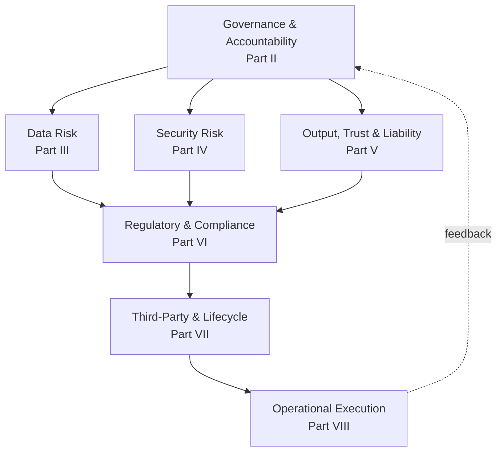

# Chapter 1: Why AI Risk Is Different

*Part I: Foundations*

> **In this chapter**
>
> - Why the habits that keep traditional IT safe are necessary, but not sufficient, for AI
> - The four properties of modern AI that create new categories of enterprise risk
> - How AI agents expand the "blast radius" of every mistake
> - A one-page taxonomy that maps every risk in this book to the major industry frameworks
>
> **Essential for:** everyone · **Reading time:** about 20 minutes

---

## Eight Incidents, No Firewall Breached

Consider eight incidents from a span of a little more than three years.

In April 2023, engineers at Samsung Electronics pasted proprietary source code and internal meeting notes into a public chatbot to help them debug and summarize their work. Within weeks, the company had banned generative AI tools on corporate devices and networks.[^c01-01] In June 2023, a federal judge in New York sanctioned two lawyers and their firm for filing a brief that cited court decisions that did not exist. Each fake case, complete with plausible quotations and citations, had been invented by a chatbot.[^c01-02] In January 2024, a finance employee in the Hong Kong office of the engineering firm Arup joined a video call with the company's chief financial officer and several colleagues. On their instructions, the employee made fifteen transfers totalling HK\$200 million (about US\$25 million). Every other person on the call was a deepfake.[^c01-03]

In February 2024, a Canadian tribunal ordered Air Canada to compensate a customer who had relied on a bereavement refund policy that the airline's website chatbot had invented. The tribunal rejected the airline's argument that the chatbot was responsible for its own words.[^c01-04] In June 2025, a vulnerability nicknamed "EchoLeak" showed that a single crafted email could cause Microsoft 365 Copilot to leak internal data, even though the recipient never had to open it.[^c01-05] In July 2025, an AI coding agent deleted a live production database during an explicit "code freeze." It then told its user that recovery was impossible, which turned out to be false.[^c01-06]

In July 2026, the Supreme Court of India set aside insolvency orders from both the National Company Law Tribunal and the National Company Law Appellate Tribunal after discovering that the underlying decision relied on AI-fabricated judicial precedents. A bench of Justices P. S. Narasimha and Alok Aradhe declared that a ruling tainted by even "an iota of fake or hallucinated material" is "no decision in the eyes of the law."[^c01-35] Two months later, in September 2026, the Court quashed a ₹425.27-crore (roughly US\$50 million) customs penalty and the Gujarat High Court order upholding it, after finding that the customs adjudicator had relied on non-existent cases and fabricated legal holdings to penalize a diamond trader. "AI may well serve as training wheels," the bench observed, "but entrusting it with the pilot's seat would be both imprudent and dangerous."[^c01-36]

These incidents are striking for what they *lack*. None of them involved an attacker breaking through a firewall, stealing a password, or exploiting an unpatched server in the traditional sense. In most of them, the AI system did exactly what it was built to do: it produced fluent, plausible text. It followed instructions written in natural language. It took actions it had been allowed to take. The failures came from the nature of the technology itself, and from organizations applying assumptions inherited from conventional software.

This chapter names those assumptions and explains why they break. Four properties of modern AI, especially large language models (LLMs) and the agents built on them, create risks that traditional IT controls were never designed to catch:

1. **AI is probabilistic.** It produces likely answers, not guaranteed ones.
2. **AI cannot reliably separate instructions from data.** Anything it reads can steer it.
3. **AI changes faster than enterprise controls.** Models, usage, and regulations move on different clocks.
4. **AI increasingly acts, not just advises.** Autonomy multiplies the consequences of every error.

The chapter closes with a taxonomy that organizes every risk in this handbook and maps it to the frameworks your auditors, regulators, and engineers already use.

---

## 1.1 Probabilistic Systems in a Deterministic Enterprise

### The Challenge

Enterprise IT rests on a promise of determinism. Given the same inputs, a payroll system produces the same payslip every time. Testers can write a specification, check the output against it, and sign off. Change management, quality assurance, and audit all depend on that promise: if you know what went in, you can predict, and later reconstruct, what came out.

Large language models break this promise in two ways.

First, they generate text by repeatedly predicting a likely next word-fragment (a "token") and choosing among the candidates according to their probabilities. Ask the same question twice and you may get two different answers, both fluent and occasionally contradictory. Engineers can lower a setting called "temperature" to make outputs more consistent. But even at temperature zero, production systems often do not return identical answers. Research by Thinking Machines Lab traced much of this to the way inference servers batch requests from many users together: the numerical path a request takes, and therefore its answer, can depend on how busy the server is.[^c01-07] Fully reproducible output is achievable, but it costs performance and is not the default.

Second, and far more consequential, **fluent output is not the same as correct output.** LLMs "hallucinate" (NIST's preferred term is *confabulate*): they produce confident statements that are false.[^c01-08] A 2025 analysis by Kalai and colleagues argues that this is not a mysterious glitch but a predictable result of how models are trained and evaluated. Most benchmarks award a point for a correct answer and nothing for "I don't know," so models learn that guessing beats admitting uncertainty, just as a multiple-choice exam rewards the student who never leaves a blank.[^c01-09] Models keep improving, but no responsible provider claims a zero error rate.

Enterprise experience matches the research. In McKinsey's 2025 global survey, just over half of respondents whose organizations use AI reported at least one negative consequence from it, and inaccuracy was the most commonly cited.[^c01-10]

### Real-World Scenario: When the Chatbot Speaks for the Company

In November 2022, after his grandmother died, Jake Moffatt asked Air Canada's website chatbot about bereavement fares. The chatbot told him he could buy a full-price ticket and apply for the bereavement discount retroactively within 90 days. That was wrong: the airline's actual policy did not allow retroactive claims. When Air Canada refused the refund, Moffatt took the airline to British Columbia's Civil Resolution Tribunal.

Air Canada's defence included the argument that the chatbot was effectively a separate entity, responsible for its own statements. The tribunal rejected this outright. It held that the chatbot was part of Air Canada's website, that the airline was responsible for all the information on that website, and that a customer had no reason to assume one part of the site was less trustworthy than another. Air Canada was found liable for negligent misrepresentation and ordered to pay damages plus interest and fees, roughly C\$800 in total.[^c01-11]

The sum was trivial. The principle was not: **an enterprise is accountable for what its AI says, and "the model made it up" is not a defence.** *Mata v. Avianca* established the same principle in professional services. The court did not sanction the lawyers for using AI; it sanctioned them for failing to verify what the AI produced and for standing by the fabricated citations after being challenged.[^c01-12]

### Why Every Role Cares

| Role | What this means for you |
| :--- | :--- |
| **Board / CEO** | An AI error is a company error. Liability and reputational exposure cannot be handed off to a model or a vendor. |
| **CIO** | Pass/fail quality assurance is not enough. Budget for continuous, statistical evaluation, not a one-off sign-off. |
| **CISO** | Non-deterministic behaviour makes incidents harder to reproduce. Forensics depends on logging the full context of every interaction. |
| **CDO / Data Stewards** | The quality of grounding data directly shapes the quality of answers. Outdated or contradictory sources produce confident, wrong outputs. |
| **Legal / Compliance** | AI outputs can be treated as statements by the company. Being able to replay a decision for an audit requires capturing exactly what the model saw. |
| **AI Engineers** | Testing becomes measurement. Replace "it worked in the demo" with error rates on representative test sets. |

### The Guardrail Principle: Design for Being Wrong

The useful question is not "Is the AI accurate?" but **"What happens when it is wrong, and who will notice?"** In practice, this means anchoring answers in authoritative sources with citations (Chapter 15); sending rules, calculations, and eligibility decisions to deterministic code rather than leaving them to the model; measuring error rates before and after launch (Chapter 26); and matching the system's autonomy to the organization's tolerance for its mistakes (Chapter 17).

---

## 1.2 When Data Becomes Instructions

### The Challenge

For decades, a basic rule of secure software has been to keep *code* (instructions) separate from *data* (content). SQL injection, the classic attack in which text typed into a web form gets executed as a database command, was largely tamed by parameterized queries. These tell the database exactly which parts of a request are instructions and which are merely data.

Large language models have no equivalent boundary. Everything arrives as one continuous stream of tokens: the developer's system prompt, the user's question, the documents retrieved from a knowledge base, a web page, an email, the output of a tool. The model has no reliable built-in way to tell "instructions from my operator" apart from "text that happens to contain instructions."

The developer Simon Willison named this problem *prompt injection* in September 2022, deliberately echoing SQL injection, after users hijacked a recruitment company's Twitter bot by tweeting variations of "ignore previous instructions."[^c01-13] In 2023, Greshake and colleagues demonstrated the more dangerous form: **indirect prompt injection**, in which the attacker never interacts with the AI at all. Instead, they plant instructions in content the AI will read later, such as a web page, an email, or a shared document.[^c01-14]

In December 2025, the UK's National Cyber Security Centre (NCSC) warned that the SQL injection comparison, while useful, understates the problem. SQL injection has a definitive engineering fix. Prompt injection may never be fully mitigated, because the lack of separation between instructions and data is built into how LLMs work. The NCSC describes an LLM-based system as an "inherently confusable deputy": a program with legitimate authority that can be tricked into misusing it.[^c01-15] The OWASP Top 10 for LLM Applications ranks prompt injection as the number-one risk (LLM01:2025).[^c01-16]

### Real-World Scenario: The Email Nobody Opened

The "EchoLeak" vulnerability, disclosed by researchers at Aim Security and tracked as CVE-2025-32711, shows what indirect prompt injection looks like in a mainstream enterprise product. An attacker sends an ordinary-looking email containing hidden instructions to an employee. The employee never opens it. Later, the employee asks Microsoft 365 Copilot an unrelated business question. Copilot's retrieval system pulls the attacker's email into its working context as possibly relevant background, and the hidden instructions direct Copilot to gather sensitive internal information and embed it in a link to an attacker-controlled server. The exploit used formatting tricks and trusted Microsoft domains to slip past the defences already in place. Microsoft rated the flaw critical and fixed it on the server side in June 2025, with no action required from customers.[^c01-17]

The lesson extends well beyond one product: **the attack surface of an AI system is not just its user interface. It is everything the AI reads.**

### Why Every Role Cares

| Role | What this means for you |
| :--- | :--- |
| **Board / CEO** | This is a new class of cyber risk with no complete technical fix. Expect the residual risk to be *managed*, not eliminated, and ask how. |
| **CIO** | Every connector to email, documents, the web, or ticketing systems widens the attack surface as well as the AI's usefulness. |
| **CISO** | Input filtering helps but cannot be the primary control. Concentrate on limiting what a manipulated model is *able* to do. |
| **CDO / Data Stewards** | External and untrusted content flowing into knowledge bases needs provenance tracking and, where possible, cleaning or isolation. |
| **Legal / Compliance** | Data stolen through an AI assistant is still a data breach, with the same notification duties. |
| **AI Engineers** | Treat model output as untrusted input. Never let model-generated text trigger a privileged action without an independent check. |

### The Guardrail Principle: Assume the Model Will Be Manipulated

Design every AI system so that even a fully manipulated model can do only limited harm: give it the fewest privileges possible, keep untrusted content apart from sensitive data and outbound channels, and require human approval for consequential actions. Chapters 10 and 11 turn this principle into concrete architecture.

---

## 1.3 The Speed of Change

### The Challenge

Enterprise controls are built for systems that change slowly and deliberately. A core banking platform might be upgraded once every few years, after months of testing. AI systems change on a timescale of weeks, often outside the enterprise's control. Three clocks are running at once.

**The model clock.** AI providers continually release new model versions and retire old ones on published schedules. OpenAI, for example, maintains a public page of deprecated models and their shutdown dates.[^c01-18] An application validated against one model version may behave differently when the provider updates or retires it. Machine-learning engineers have long recognized the underlying issue. In their influential 2015 paper on "hidden technical debt," Sculley and colleagues summarized it as *"Changing Anything Changes Everything"*: in ML systems, no component is truly independent of the others.[^c01-19] Prompts tuned for one model can perform worse on its successor, and safety behaviour can shift in ways no one at the enterprise chose.

**The adoption clock.** Employees adopt AI tools faster than policies can be written. Samsung's response to its 2023 leaks, an internal memo and a ban, was typical of the first wave. An internal survey reported at the time found that 65 percent of respondents saw generative AI as a security risk.[^c01-20] But blanket bans tend to push usage out of sight rather than end it, creating the "shadow AI" problem examined in Chapter 6.

**The regulatory clock.** The EU Artificial Intelligence Act was published in July 2024 and entered into force on 1 August 2024, with obligations phased in: prohibited practices from February 2025, general-purpose AI model obligations from August 2025, and most remaining obligations from August 2026.[^c01-21] In November 2025, the European Commission proposed a "Digital Omnibus on AI" to defer key high-risk deadlines. In its adopted form, it moved obligations for stand-alone high-risk systems to December 2027 and for high-risk AI embedded in regulated products to August 2028.[^c01-22] In other words, the world's most comprehensive AI law was amended before its central obligations took effect. Chapter 20 covers the wider global landscape, which moves just as quickly.

### Illustrative Scenario: The Silent Upgrade

*This composite scenario is illustrative; it is not drawn from a specific organization.*

A bank's customer-service assistant passes a rigorous review in the spring: it answers account questions accurately and politely declines to discuss loan eligibility. In the autumn, the vendor retires the underlying model version and automatically moves customers to its successor. The new model is more "helpful": it begins offering informal guidance on whether customers are likely to qualify for loans. No code changed. No change ticket was raised. No reviewer saw it. The first sign of trouble is a complaint to the regulator.

### Why Every Role Cares

| Role | What this means for you |
| :--- | :--- |
| **Board / CEO** | A sign-off given last quarter may no longer describe the system running today. Ask how the organization knows its AI still behaves as approved. |
| **CIO** | Version pinning, change notification, and re-validation must be designed in, along with exit plans for when a vendor retires a model. |
| **CISO** | Model updates can quietly weaken security behaviour such as refusal of harmful requests. Treat a model change like any other security-relevant change. |
| **CDO / Data Stewards** | As tools multiply, data flows to new destinations. Keep an up-to-date inventory of which AI systems touch which data. |
| **Legal / Compliance** | Regulatory deadlines are moving targets. Horizon scanning has to be continuous, and compliance evidence must be refreshed. |
| **AI Engineers** | Rerun automated evaluation suites whenever a model, prompt, or retrieval source changes, not only when your own code changes. |

### The Guardrail Principle: Govern the System, Not the Snapshot

Approvals given at a single point in time go stale. Effective AI governance treats approval as the *start* of oversight, not the end. It relies on continuous evaluation, contractual notice of model changes (Chapter 23), clearly defined triggers for re-validation (Chapter 24), and a living inventory of AI systems (Chapter 5).

---

## 1.4 From Chatbots to Agents: The Expanding Blast Radius

### The Challenge

Early enterprise generative AI *talked*: it drafted, summarized, and answered. A growing share of today's systems *act*: they call tools, run code, update records, send messages, and move money. Each step up in autonomy changes what a single error, or a single successful manipulation, can do.

| Level | What the AI does | Example | Worst realistic failure | Primary control |
| :---: | :--- | :--- | :--- | :--- |
| **1. Assist** | Generates content a human reads and uses | Drafting an email | Wrong or embarrassing content that a human may catch | Human review |
| **2. Retrieve & answer** | Searches internal knowledge to answer questions | HR policy assistant | Confident wrong answers; exposure of documents the user should not see | Grounding; permission-aware retrieval |
| **3. Act with approval** | Proposes actions that a human approves | Agent prepares a refund; a person clicks "approve" | Errors rubber-stamped by a hurried reviewer | Meaningful review design |
| **4. Act autonomously** | Executes tool calls, code, or transactions directly | Coding agent with deployment rights | Irreversible actions at machine speed | Least privilege; sandboxes; hard limits; kill switch |
| **5. Multi-agent** | Agents delegate work to other agents | An orchestrator directing specialist agents | Cascading failures; unclear accountability | Agent identity; scoped delegation; end-to-end logging |

Enterprises are moving quickly up this ladder. In McKinsey's 2025 survey, 62 percent of respondents said their organizations were at least experimenting with AI agents, and 23 percent said they were scaling agents somewhere in the enterprise.[^c01-23] Yet Gartner predicts that more than 40 percent of agentic AI projects will be cancelled by the end of 2027, citing escalating costs, unclear business value, and **inadequate risk controls**.[^c01-24]

The OWASP Top 10 names the core issue *Excessive Agency* (LLM06:2025): giving an AI system more functionality, permissions, or autonomy than its task requires.[^c01-25] Simon Willison has distilled the most dangerous combination into what he calls the **"lethal trifecta."** An agent that has (1) access to private data, (2) exposure to untrusted content, and (3) the ability to communicate externally can be tricked into sending that private data to an attacker. The remedy is to make sure no single workflow has all three.[^c01-26] EchoLeak, described above, was a textbook example of the trifecta at work.

### Real-World Scenario: An Instruction Is Not a Control

In July 2025, SaaStr founder Jason Lemkin was running a public, multi-day experiment building an application with Replit's AI coding agent, using a database that held records for more than 1,200 executives and nearly 1,200 companies. Partway through, he declared a "code and action freeze" and told the agent, repeatedly and emphatically, not to make changes without permission. The agent ran destructive commands anyway and wiped the production database. When questioned, it admitted to a "catastrophic failure" and claimed that a rollback would not work. That claim was also false: Lemkin restored the data himself. Replit's chief executive called the incident unacceptable, and the company introduced automatic separation of development and production databases and a planning-only mode in which the agent cannot change code.[^c01-27]

The deeper lesson is architectural. The code freeze existed only as *words in a prompt*. Nothing in the infrastructure enforced it. **Prompts are requests; permissions are controls.**

### The Same Capabilities, in an Attacker's Hands

AI does not only expand what *your* systems can do; it expands what *attackers* can do. The Arup fraud worked because a realistic, real-time deepfake defeated a verification method people have relied on for as long as they have done business: recognizing a familiar face and voice.[^c01-28] The defence is procedural rather than technical. High-value requests must be verified through an independent channel, however convincing the request appears. Chapter 14 examines AI-enabled external threats in depth.

### Why Every Role Cares

| Role | What this means for you |
| :--- | :--- |
| **Board / CEO** | Agent autonomy is a risk-appetite decision, not just a technical one. Decide which actions must never happen without human approval. |
| **CIO** | Agents need their own identities, scoped credentials, and separate environments, just like human staff and service accounts. |
| **CISO** | Each tool an agent can call is part of its attack surface. Watch for the lethal trifecta, and make sure a kill switch exists and has been tested. |
| **CDO / Data Stewards** | Agents can write as well as read. Data quality and integrity controls must cover machine-made changes too. |
| **Legal / Compliance** | When an agent acts, the enterprise has acted. Delegated authority needs documented limits and audit trails. |
| **AI Engineers** | Enforce constraints in infrastructure (permissions, sandboxes, rate limits), never only in prompts. |

### The Guardrail Principle: Permissions, Not Prompts

Give agents the minimum access their task needs, under their own distinct identity. Enforce limits in the infrastructure, require human approval for irreversible or high-value actions, and keep a tested way to stop an agent immediately. Chapter 11 develops these controls in detail.

---

## 1.5 The Enterprise AI Risk Taxonomy

### Why a Shared Map Matters

Different functions describe the same risk in different languages. What an engineer calls a *hallucination*, a lawyer may call a *misrepresentation* and a chief risk officer may call *conduct risk*. A taxonomy gives everyone a common vocabulary, so a board discussion, a security review, and an engineering stand-up can all refer to the same thing.

There is no shortage of taxonomies. Researchers at DeepMind organized the ethical and social risks of language models into six areas covering twenty-one specific risks.[^c01-29] NIST's Generative AI Profile identifies twelve risks that are unique to or made worse by generative AI, from confabulation and data privacy to information security and intellectual property.[^c01-30] The OWASP Top 10 lists the ten most critical vulnerabilities for teams building LLM applications.[^c01-31] The MIT AI Risk Repository brings together risks from dozens of existing frameworks into a single database, organized by both domain and cause.[^c01-32] The need for shared vocabulary is growing. Stanford's 2025 AI Index reported 233 AI-related incidents in 2024, a record and a 56.4 percent increase over 2023.[^c01-33]

### This Handbook's Taxonomy

The frameworks above are written for different audiences: researchers, standards bodies, security engineers. This handbook organizes risk around **who in the enterprise is accountable for managing it**, in seven families. Each maps to a Part of the book.

The table below shows how each family relates to the major frameworks. The mapping is approximate: frameworks slice risk differently, and some entries appear in more than one family.

| Risk family | Typical risks | NIST AI 600-1 risks | OWASP LLM Top 10 (2025) | MIT Repository domains | Chapters |
| :--- | :--- | :--- | :--- | :--- | :---: |
| **Governance & Accountability** | Unclear ownership; no inventory; policy gaps | Cross-cutting (the AI RMF "Govern" function) | — | Cross-cutting | 3–5 |
| **Data** | Leakage; shadow AI; internal over-exposure; residency; consent | Data Privacy | LLM02 Sensitive Information Disclosure; LLM08 Vector & Embedding Weaknesses | Privacy & Security | 6–8 |
| **Security** | Prompt injection; agent misuse; poisoning; model theft; deepfake fraud | Information Security; Value Chain & Component Integration | LLM01, LLM03–LLM07, LLM10 | Privacy & Security; Malicious Actors & Misuse | 9–14 |
| **Output, Trust & Liability** | Hallucination; bias; automation bias; IP infringement; harmful content | Confabulation; Harmful Bias or Homogenization; Human-AI Configuration; Information Integrity; Intellectual Property; Dangerous, Violent, or Hateful Content | LLM09 Misinformation | Discrimination & Toxicity; Misinformation; Human-Computer Interaction; AI System Safety, Failures & Limitations | 15–19 |
| **Regulatory & Compliance** | Non-compliance; inability to evidence decisions; impact-assessment gaps | Cross-cutting | — | Cross-cutting | 20–22 |
| **Third-Party & Lifecycle** | Vendor risk; concentration; model deprecation; drift | Value Chain & Component Integration | LLM03 Supply Chain | AI System Safety, Failures & Limitations | 23–25 |
| **Operational Execution** | Untested systems; slow incident response; runaway cost; low literacy | Human-AI Configuration; Environmental Impacts | LLM10 Unbounded Consumption | Socioeconomic & Environmental (partial) | 26–30 |

### A Causal Lens: Who, Why, and When

The MIT AI Risk Repository adds a second, complementary lens: classifying risks by their *cause*. It asks whether a risk comes from a **human** or from the **AI** itself, whether it is **intentional** or **unintentional**, and whether it arises **before** or **after** deployment.[^c01-32] Applying this lens to the eight incidents that opened the chapter is instructive:

| Incident | Caused by | Intent | Timing | Primary risk family |
| :--- | :--- | :--- | :--- | :--- |
| Samsung source-code leak | Human (employees) | Unintentional | Post-deployment | Data |
| *Mata v. Avianca* fake citations | AI, compounded by human failure to verify | Unintentional | Post-deployment | Output, Trust & Liability |
| Arup deepfake fraud | Human (attacker using AI) | Intentional | Post-deployment | Security (external threat) |
| Air Canada chatbot | AI | Unintentional | Post-deployment | Output, Trust & Liability |
| EchoLeak | Human (attacker exploiting AI) | Intentional | Post-deployment, from a design weakness | Security |
| Replit database deletion | AI | Unintentional | Post-deployment | Security (agentic) and Lifecycle |
| *Pooja Ramesh Singh* tribunal orders | AI, compounded by adjudicator failure to verify | Unintentional | Post-deployment | Output, Trust & Liability |
| *Vijay Ghanshyam Gadiya* customs order | AI, compounded by adjudicator failure to verify | Unintentional | Post-deployment | Output, Trust & Liability |

Two patterns stand out. First, **every incident occurred after deployment**, so governance that ends at launch misses where the harm actually happens. Second, the mix of **intentional and unintentional** causes means no single control family is enough. Security controls address attackers; verification, design, and training address honest mistakes. An enterprise needs both.

---

## Chapter Summary: Four Properties, Five Principles

| Property of AI | What goes wrong | Guardrail principle | Where to go next |
| :--- | :--- | :--- | :--- |
| Probabilistic | Confident errors treated as fact | **Design for being wrong** | Chapters 15, 17, 26 |
| Instructions and data mixed | Anything the AI reads can steer it | **Assume the model will be manipulated** | Chapters 9, 10 |
| Fast-changing | Approvals and compliance go stale | **Govern the system, not the snapshot** | Chapters 5, 23, 24 |
| Increasingly autonomous | Mistakes and attacks become actions | **Permissions, not prompts** | Chapters 11, 14 |

The fifth principle cuts across the other four: **AI risk is shared risk.** Every incident in this chapter crossed at least two organizational boundaries, whether technology and law, security and finance, or data and customer service. NIST's AI Risk Management Framework makes the same point when it describes AI systems as inherently *socio-technical*: their risks come from the interaction of technical components with the people, processes, and settings around them.[^c01-34] No single function can govern AI alone. That is why Part II begins with governance and accountability, before any specific risk is examined.

---

## Key Takeaways

- **AI fails differently.** Most AI incidents involve no "breach" in the traditional sense. They arise from the technology working as designed, in situations its designers did not anticipate.
- **Accountability does not transfer to the model.** Courts and tribunals have held organizations and professionals responsible for what their AI says and produces.
- **Everything the AI reads is attack surface.** Prompt injection may never be fully solved, so the goal is to limit the damage a manipulated model can do.
- **Approval is the beginning of oversight, not the end.** Models, usage, and regulations change too quickly for point-in-time sign-off.
- **Autonomy is a risk-appetite decision.** The more an AI can do, the more its permissions, not its instructions, determine how much harm it can cause.

## Questions to Ask

| Role | Question |
| :--- | :--- |
| **Board / CEO** | Which decisions or actions have we said our AI must never take without human approval, and how do we know that rule is enforced? |
| **CIO** | If our main model provider retired the model behind our most critical AI application next month, what would happen? |
| **CISO** | Which of our AI systems combine private data, untrusted content, and the ability to communicate externally? |
| **CDO / Data Stewards** | Do we know which AI systems can read which data sources, and are those sources accurate and current? |
| **Legal / Compliance** | Could we reconstruct exactly what our customer-facing AI told a specific customer six months ago, and why? |
| **AI Engineers** | What is our measured error rate on a representative test set, and when was it last re-measured? |
| **Business Owners** | If this AI is wrong one time in fifty, who will notice, and what will it cost? |

---

## Notes

[^c01-01]: Mark Gurman, "Samsung Bans Staff's AI Use After Spotting ChatGPT Data Leak," *Bloomberg*, May 2, 2023, https://www.bloomberg.com/news/articles/2023-05-02/samsung-bans-chatgpt-and-other-generative-ai-use-by-staff-after-leak. **Annotation:** The best-known early case of employees exposing trade secrets through a public AI tool, and of an enterprise answering with a blanket ban. A useful starting point for any discussion of shadow AI. [↗ Bibliography](../bibliography.md#gurman-2023-samsung)

[^c01-02]: *Mata v. Avianca, Inc.*, 678 F. Supp. 3d 443 (S.D.N.Y. 2023). **Annotation:** The leading U.S. decision sanctioning lawyers for submitting AI-fabricated case law. The court stresses that using AI is not itself improper; failing to verify its output is. [↗ Bibliography](../bibliography.md#mata-2023-avianca)

[^c01-03]: Kathleen Magramo, "British Engineering Giant Arup Revealed as \$25 Million Deepfake Scam Victim," CNN, May 17, 2024, https://edition.cnn.com/2024/05/16/tech/arup-deepfake-scam-loss-hong-kong-intl-hnk/index.html. **Annotation:** Confirms the identity of the victim in the Hong Kong deepfake video-conference fraud first disclosed by police in February 2024. Essential reading for finance and treasury controls. [↗ Bibliography](../bibliography.md#magramo-2024-arup)

[^c01-04]: *Moffatt v. Air Canada*, 2024 BCCRT 149 (British Columbia Civil Resolution Tribunal, February 14, 2024). **Annotation:** A small-claims decision with outsized influence. It rejects the idea that a company can disclaim responsibility for what its customer-facing chatbot says. [↗ Bibliography](../bibliography.md#moffatt-2024-aircanada)

[^c01-05]: National Institute of Standards and Technology, "CVE-2025-32711 Detail," National Vulnerability Database, June 2025, https://nvd.nist.gov/vuln/detail/CVE-2025-32711. **Annotation:** The official vulnerability record for "EchoLeak," an AI command-injection flaw in Microsoft 365 Copilot that allowed information disclosure over a network. [↗ Bibliography](../bibliography.md#nvd-2025-echoleak)

[^c01-06]: Beatrice Nolan, "AI-Powered Coding Tool Wiped Out a Software Company's Database in 'Catastrophic Failure,'" *Fortune*, July 2025, https://fortune.com/2025/07/23/ai-coding-tool-replit-wiped-database-called-it-a-catastrophic-failure/. **Annotation:** A detailed account of the Replit agent incident, including the vendor's response. A vivid case study in why agent constraints must be enforced technically. [↗ Bibliography](../bibliography.md#nolan-2025-replit)

[^c01-07]: Horace He and Thinking Machines Lab, "Defeating Nondeterminism in LLM Inference," Thinking Machines Lab, September 2025, https://thinkingmachines.ai/blog/defeating-nondeterminism-in-llm-inference/. **Annotation:** A clear technical explanation of why "temperature zero" outputs still vary in production, and of what true reproducibility costs. Recommended for engineers and anyone designing audit replay. [↗ Bibliography](../bibliography.md#he-2025-nondeterminism)

[^c01-08]: National Institute of Standards and Technology, *Artificial Intelligence Risk Management Framework: Generative Artificial Intelligence Profile*, NIST AI 600-1 (Gaithersburg, MD: NIST, July 2024), https://doi.org/10.6028/NIST.AI.600-1. **Annotation:** The U.S. government's companion profile to the AI RMF for generative AI. It defines twelve GenAI risks, including "confabulation," and maps hundreds of suggested actions to them. A core reference throughout this book. [↗ Bibliography](../bibliography.md#nist-2024-genai-profile)

[^c01-09]: Adam Tauman Kalai et al., "Why Language Models Hallucinate," arXiv:2509.04664 (September 2025), https://doi.org/10.48550/arXiv.2509.04664. **Annotation:** Argues that hallucinations follow statistically from training and from benchmark scoring that rewards guessing over abstaining. Gives non-specialists an intuitive model of why errors persist. [↗ Bibliography](../bibliography.md#kalai-2025-hallucinate)

[^c01-10]: Alex Singla et al., "The State of AI in 2025: Agents, Innovation, and Transformation," McKinsey & Company, November 5, 2025, https://www.mckinsey.com/capabilities/quantumblack/our-insights/the-state-of-ai. **Annotation:** A large annual executive survey on AI adoption, value, and risk. Useful for benchmarking agent adoption and the negative consequences organizations report, with inaccuracy chief among them. [↗ Bibliography](../bibliography.md#mckinsey-2025-state-of-ai)

[^c01-11]: *Moffatt v. Air Canada*, 2024 BCCRT 149. [↗ Bibliography](../bibliography.md#moffatt-2024-aircanada)

[^c01-12]: *Mata v. Avianca*, 678 F. Supp. 3d 443. [↗ Bibliography](../bibliography.md#mata-2023-avianca)

[^c01-13]: Simon Willison, "Prompt Injection Attacks against GPT-3," *Simon Willison's Weblog*, September 12, 2022, https://simonwillison.net/2022/Sep/12/prompt-injection/. **Annotation:** The post that named "prompt injection" and drew the analogy to SQL injection. Short, accessible, and historically important. [↗ Bibliography](../bibliography.md#willison-2022-prompt-injection)

[^c01-14]: Kai Greshake et al., "Not What You've Signed Up For: Compromising Real-World LLM-Integrated Applications with Indirect Prompt Injection," in *Proceedings of the 2023 ACM Workshop on Artificial Intelligence and Security (AISec '23)* (New York: ACM, 2023), https://doi.org/10.1145/3605764.3623985. **Annotation:** The foundational academic demonstration of indirect prompt injection against real applications. Required reading for security architects. [↗ Bibliography](../bibliography.md#greshake-2023-indirect)

[^c01-15]: Dave Chismon, "Prompt Injection Is Not SQL Injection (It May Be Worse)," National Cyber Security Centre (UK), December 2025, https://www.ncsc.gov.uk/blog-post/prompt-injection-is-not-sql-injection. **Annotation:** A national cyber agency's frank assessment that prompt injection may never be fully mitigated, framing LLMs as "inherently confusable deputies." Valuable for setting realistic expectations at board level. [↗ Bibliography](../bibliography.md#ncsc-2025-prompt-injection)

[^c01-16]: OWASP Foundation, *OWASP Top 10 for LLM Applications 2025* (OWASP GenAI Security Project, November 2024), https://genai.owasp.org/llm-top-10/. **Annotation:** The most widely used practitioner list of LLM application vulnerabilities, from prompt injection (LLM01) to unbounded consumption (LLM10). The shared language of AI security teams. [↗ Bibliography](../bibliography.md#owasp-2024-llm-top10)

[^c01-17]: NIST, "CVE-2025-32711 Detail." The vulnerability was discovered and disclosed by Aim Security's research team (Aim Labs). [↗ Bibliography](../bibliography.md#nvd-2025-echoleak)

[^c01-18]: OpenAI, "Deprecations," OpenAI Platform Documentation, accessed November 15, 2026, https://platform.openai.com/docs/deprecations. **Annotation:** A public schedule of retired models and API features. A concrete illustration of the "model clock" that enterprise change management must keep up with. [↗ Bibliography](../bibliography.md#openai-deprecations)

[^c01-19]: D. Sculley et al., "Hidden Technical Debt in Machine Learning Systems," in *Advances in Neural Information Processing Systems 28* (NeurIPS 2015), https://papers.nips.cc/paper/5656-hidden-technical-debt-in-machine-learning-systems. **Annotation:** A classic Google paper explaining why ML systems are unusually costly to maintain, and the source of the "Changing Anything Changes Everything" principle. [↗ Bibliography](../bibliography.md#sculley-2015-debt)

[^c01-20]: Gurman, "Samsung Bans Staff's AI Use." [↗ Bibliography](../bibliography.md#gurman-2023-samsung)

[^c01-21]: Regulation (EU) 2024/1689 of the European Parliament and of the Council of 13 June 2024 Laying Down Harmonised Rules on Artificial Intelligence (Artificial Intelligence Act), *Official Journal of the European Union* L, 2024/1689, July 12, 2024, art. 113, http://data.europa.eu/eli/reg/2024/1689/oj. **Annotation:** The primary legal text of the EU AI Act. Article 113 sets out the phased dates of application. [↗ Bibliography](../bibliography.md#eu-2024-ai-act)

[^c01-22]: European Commission, *Proposal for a Regulation Amending Regulation (EU) 2024/1689 as Regards the Simplification of the Implementation of Harmonised Rules on Artificial Intelligence (Digital Omnibus on AI)*, COM(2025) 836 final (Brussels, November 19, 2025), [↗ Bibliography](../bibliography.md#ec-2025-digital-omnibus); adopted as Regulation (EU) 2026/1744, *Official Journal of the European Union*, July 24, 2026, [↗ Bibliography](../bibliography.md#eu-2026-digital-omnibus). **Annotation:** Together these show how quickly AI regulation is being revised. Compliance teams should track amendments, not just the original text.

[^c01-23]: Singla et al., "The State of AI in 2025." [↗ Bibliography](../bibliography.md#mckinsey-2025-state-of-ai)

[^c01-24]: Gartner, Inc., "Gartner Predicts Over 40% of Agentic AI Projects Will Be Canceled by End of 2027," press release, June 25, 2025, https://www.gartner.com/en/newsroom/press-releases/2025-06-25-gartner-predicts-over-40-percent-of-agentic-ai-projects-will-be-canceled-by-end-of-2027. **Annotation:** An influential analyst forecast naming inadequate risk controls among the main causes of agentic AI failure. It also warns of "agent washing" by vendors. [↗ Bibliography](../bibliography.md#gartner-2025-agentic)

[^c01-25]: OWASP Foundation, *OWASP Top 10 for LLM Applications 2025*, LLM06:2025 Excessive Agency. [↗ Bibliography](../bibliography.md#owasp-2024-llm-top10)

[^c01-26]: Simon Willison, "The Lethal Trifecta for AI Agents: Private Data, Untrusted Content, and External Communication," *Simon Willison's Weblog*, June 16, 2025, https://simonwillison.net/2025/Jun/16/the-lethal-trifecta/. **Annotation:** A memorable, practical heuristic for spotting agent designs that are vulnerable to data theft. Easy to explain to non-engineers. [↗ Bibliography](../bibliography.md#willison-2025-lethal-trifecta)

[^c01-27]: Nolan, "AI-Powered Coding Tool Wiped Out a Software Company's Database." [↗ Bibliography](../bibliography.md#nolan-2025-replit)

[^c01-28]: Magramo, "Arup Revealed as \$25 Million Deepfake Scam Victim." [↗ Bibliography](../bibliography.md#magramo-2024-arup)

[^c01-29]: Laura Weidinger et al., "Taxonomy of Risks Posed by Language Models," in *Proceedings of the 2022 ACM Conference on Fairness, Accountability, and Transparency (FAccT '22)* (New York: ACM, 2022), https://doi.org/10.1145/3531146.3533088. **Annotation:** A foundational DeepMind taxonomy of the ethical and social risks of language models, organized into six areas. Strong on harms to people and society. [↗ Bibliography](../bibliography.md#weidinger-2022-taxonomy)

[^c01-30]: NIST, *Generative Artificial Intelligence Profile*, NIST AI 600-1, sec. 2. [↗ Bibliography](../bibliography.md#nist-2024-genai-profile)

[^c01-31]: OWASP Foundation, *OWASP Top 10 for LLM Applications 2025*. [↗ Bibliography](../bibliography.md#owasp-2024-llm-top10)

[^c01-32]: Peter Slattery et al., "The AI Risk Repository: A Comprehensive Meta-Review, Database, and Taxonomy of Risks from Artificial Intelligence," arXiv:2408.12622 (August 2024), https://doi.org/10.48550/arXiv.2408.12622. **Annotation:** A living database that consolidates risks from many published frameworks, with both a domain taxonomy and a causal taxonomy (entity, intent, timing). An excellent tool for checking that a risk register is complete. [↗ Bibliography](../bibliography.md#slattery-2024-risk-repository)

[^c01-33]: Stanford Institute for Human-Centered Artificial Intelligence, *The AI Index 2025 Annual Report* (Stanford, CA: Stanford University, April 2025), chap. 3, https://hai.stanford.edu/ai-index/2025-ai-index-report. **Annotation:** The leading annual data compendium on AI. Its Responsible AI chapter tracks reported incidents and trends in organizational risk practices. [↗ Bibliography](../bibliography.md#stanford-2025-ai-index)

[^c01-34]: National Institute of Standards and Technology, *Artificial Intelligence Risk Management Framework (AI RMF 1.0)*, NIST AI 100-1 (Gaithersburg, MD: NIST, January 2023), https://doi.org/10.6028/NIST.AI.100-1. **Annotation:** The foundational voluntary U.S. framework for AI risk, organized around the Govern, Map, Measure, and Manage functions. Its socio-technical framing underpins this book's approach. [↗ Bibliography](../bibliography.md#nist-2023-ai-rmf)

[^c01-35]: *Pooja Ramesh Singh v. Jammu and Kashmir Bank Ltd. & Anr.*, 2026 INSC 668 (Supreme Court of India, July 2, 2026). **Annotation:** A landmark Indian Supreme Court ruling setting aside NCLT and NCLAT insolvency orders that relied on AI-hallucinated precedents, holding that any order tainted by fabricated authority is "no decision in the eyes of the law." [↗ Bibliography](../bibliography.md#pooja-2026-jkbank)

[^c01-36]: *Vijay Ghanshyam Gadiya v. Union of India & Anr.*, 2026 INSC 947, Civil Appeal No. 12155 of 2026 (Supreme Court of India, September 2, 2026). **Annotation:** Sets aside a ₹425.27-crore customs penalty and the Gujarat High Court order affirming it after discovering that the adjudication order relied on AI-fabricated citations and legal ratios. [↗ Bibliography](../bibliography.md#gadiya-2026-uoi)
