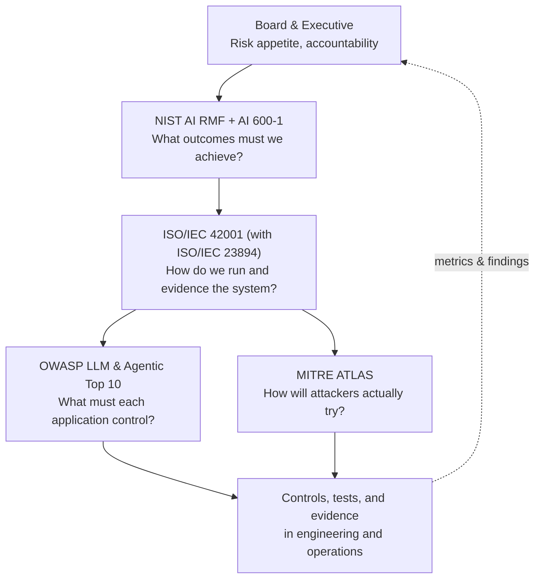

# Chapter 2: Reference Frameworks at a Glance

*Part I: Foundations*

> **In this chapter**
>
> - The five framework families every enterprise AI program will meet, and what question each one answers
> - How the NIST AI RMF, ISO/IEC 42001, ISO/IEC 23894, the OWASP Top 10 lists, and MITRE ATLAS are structured
> - What each framework does well, and where it stops
> - How the frameworks fit together, and a practical "starter stack" for organizations of different sizes
>
> **Essential for:** CIO, CISO, CRO, Legal / Compliance, AI Engineers · **Reading time:** about 25 minutes

---

## Framework Sprawl: The Problem Before the Problem

*This composite scenario is illustrative; it is not drawn from a specific organization.*

A mid-sized insurance company (TBD: OICL for example) decides to "get serious" about AI governance. Within a quarter, four teams have each picked a framework. The risk function adopts the NIST AI Risk Management Framework and starts mapping use cases to its subcategories. The compliance team, under pressure from a large European customer, commissions an ISO/IEC 42001 gap assessment. The application security team adds the OWASP Top 10 for LLM Applications to its design-review checklist. The security operations centre starts tagging detections with MITRE ATLAS technique IDs.

Each choice is sensible. Together, they produce four risk assessments, four sets of terminology, and four evidence requests landing on the same overstretched engineering team. When the board asks the simple question, "Are we managing AI risk?", nobody can give a single answer.

This chapter is an attempt to prevent that outcome. The frameworks covered here are not competitors. They operate at different altitudes and answer different set of questions:

| Question | Framework family | Primary examples |
| :--- | :--- | :--- |
| *What does good AI risk management look like across the organization?* | Risk management framework | NIST AI RMF 1.0; NIST AI 600-1 (Generative AI Profile) |
| *How do we run AI governance as an auditable, certifiable system?* | Management system standard | ISO/IEC 42001 |
| *How do we apply classic risk management methods to AI?* | Risk management guidance | ISO/IEC 23894 |
| *What can go wrong in the applications and agents we build?* | Application security checklist | OWASP Top 10 for LLM Applications; OWASP Top 10 for Agentic Applications |
| *How do real attackers target AI, step by step?* | Adversarial threat knowledge base | MITRE ATLAS |

The rest of the chapter takes each family in turn, then shows how to combine them into one program.

---

## 2.1 NIST AI Risk Management Framework and the Generative AI Profile

### What It Is

The **NIST AI Risk Management Framework (AI RMF 1.0)**, published by the U.S. National Institute of Standards and Technology in January 2023 as NIST AI 100-1, is the most widely referenced voluntary framework for managing AI risk.[^c02-01] It is not a regulation and carries no certification. Its influence comes from being clear, freely available, and sector-neutral, which is why regulators, standards bodies, and vendors on several continents reference or align with it.

The framework begins from a premise that underpins this book: AI systems are **socio-technical**. Their risks come not just from code and data but from the interaction of technology with people, processes, and the setting in which the system is used. A model that is safe in a back-office drafting tool can be dangerous in a customer-facing credit decision.

### How It Is Structured

The AI RMF Core organizes risk activities into four functions, which break down into 19 categories and 72 subcategories:

| Function | Purpose | Typical enterprise activities |
| :--- | :--- | :--- |
| **Govern** | Build a culture and structure for risk management; this function cuts across the other three | Policies, roles and accountability, risk appetite, workforce training, third-party oversight |
| **Map** | Understand the context and identify risks for a specific AI system | Use-case intake, intended purpose, affected stakeholders, legal requirements, impact assessment |
| **Measure** | Analyze, assess, and track identified risks | Evaluations, bias testing, red-teaming, performance and drift metrics |
| **Manage** | Prioritize and act on risks, and respond to incidents | Risk treatment, go/no-go decisions, monitoring, incident response, decommissioning |

The framework also defines seven characteristics of trustworthy AI: valid and reliable; safe; secure and resilient; accountable and transparent; explainable and interpretable; privacy-enhanced; and fair, with harmful bias managed. These serve as a useful vocabulary for setting acceptance criteria.

### The Generative AI Profile (NIST AI 600-1)

In July 2024, NIST published **NIST AI 600-1**, a companion "profile" that applies the AI RMF to generative AI.[^c02-02] It identifies twelve risks that are unique to or made worse by generative AI, and maps more than 200 suggested actions to the RMF's subcategories. The twelve risks are:

1. CBRN information or capabilities
2. Confabulation
3. Dangerous, violent, or hateful content
4. Data privacy
5. Environmental impacts
6. Harmful bias or homogenization
7. Human-AI configuration
8. Information integrity
9. Information security
10. Intellectual property
11. Obscene, degrading, and/or abusive content
12. Value chain and component integration

For most enterprises, the profile is the more practical of the two documents. The AI RMF tells you *what outcomes* to achieve; AI 600-1 suggests *specific actions* for the generative systems most organizations are actually deploying.

### Strengths and Limits

| Strengths | Limits |
| :--- | :--- |
| Free, plain-language, and widely recognized by regulators and auditors | Voluntary, with no certification; you cannot "pass" the AI RMF |
| Outcome-based, so it fits organizations of any size or sector | Deliberately non-prescriptive; teams must translate outcomes into concrete controls |
| Strong on governance, context, and socio-technical harms | Light on the technical detail of how specific attacks work |
| AI 600-1 gives a ready-made generative AI risk list | Some AI 600-1 risks (such as CBRN) matter far more to model developers than to typical enterprise deployers |

---

## 2.2 ISO/IEC 42001 and ISO/IEC 23894

### ISO/IEC 42001: The AI Management System Standard

**ISO/IEC 42001:2023**, published in December 2023, is the first international standard for an **AI management system (AIMS)**.[^c02-03] If the NIST AI RMF describes what good AI risk management looks like, ISO/IEC 42001 describes how to *run* it as a repeatable, auditable organizational system.

Readers who know ISO/IEC 27001 (information security) or ISO 9001 (quality) will recognize the shape. ISO/IEC 42001 follows the same harmonized structure: clauses on organizational context, leadership, planning, support, operation, performance evaluation, and improvement, built around the familiar **Plan-Do-Check-Act** cycle. This matters in practice. An organization that already runs an ISO/IEC 27001 program can often extend its existing document control, internal audit, and management review processes to cover AI, rather than building a parallel system.

The standard's **Annex A** contains 38 reference controls grouped under nine control objectives:

| Annex A objective | What it covers |
| :--- | :--- |
| A.2 Policies related to AI | An AI policy aligned with business objectives, and its review |
| A.3 Internal organization | Roles, responsibilities, and reporting of concerns |
| A.4 Resources for AI systems | Inventory of data, tools, compute, and human resources |
| A.5 Assessing impacts of AI systems | Impact assessments on individuals, groups, and society |
| A.6 AI system life cycle | Design, development, verification, deployment, operation, and monitoring |
| A.7 Data for AI systems | Data quality, provenance, and preparation |
| A.8 Information for interested parties | Documentation, transparency, and incident communication |
| A.9 Use of AI systems | Responsible use, intended purpose, and human oversight |
| A.10 Third-party and customer relationships | Suppliers, customers, and allocation of responsibilities |

As with ISO/IEC 27001, organizations select applicable controls and record their choices and justifications in a **Statement of Applicability**.

The decisive difference from the NIST AI RMF is **certification**. An accredited certification body can audit an organization against ISO/IEC 42001 and issue a certificate. For enterprises that sell AI-enabled products or services, this is increasingly requested in procurement questionnaires as independent evidence that AI governance exists and works. Chapter 22 covers certification audits in detail.

### ISO/IEC 23894: AI Risk Management Guidance

**ISO/IEC 23894:2023**, published in February 2023, provides guidance on managing risks specific to AI.[^c02-04] It extends ISO 31000, the general international risk management standard, rather than replacing it. Its value lies in showing risk professionals how familiar steps (establishing context, identifying, analyzing, evaluating, and treating risk) change when the system in question is probabilistic, data-dependent, and capable of drifting after deployment.

ISO/IEC 23894 is guidance, not a certifiable requirements standard. Think of it as the method that helps an organization fill in the risk assessment and treatment steps that ISO/IEC 42001 requires.

### Why These Standards Matter for Regulation

Under the EU AI Act, providers of high-risk AI systems that follow **harmonised European standards** benefit from a presumption of conformity with the corresponding legal requirements.[^c02-05] The European standardization bodies have been developing those harmonised standards, drawing in part on international work such as ISO/IEC 42001 and ISO/IEC 23894. Delays in that work were one reason the EU deferred high-risk obligations through the Digital Omnibus (see Chapter 1). Holding an ISO/IEC 42001 certificate does not by itself prove compliance with the AI Act, but an operating AI management system is a strong foundation for the documentation, risk management, and post-market monitoring the Act requires. Chapter 20 returns to this relationship.

### Strengths and Limits

| Strengths | Limits |
| :--- | :--- |
| Certifiable, giving customers and regulators independent assurance | Standards must be purchased, and certification audits carry real cost |
| Integrates with existing ISO/IEC 27001 and ISO 9001 programs | Management-system language can feel abstract to engineering teams |
| Annex A provides a concrete starting control set | A certificate proves a system exists and is followed, not that every AI output is safe |
| ISO/IEC 23894 gives risk teams a familiar method | Neither standard details specific attack techniques or test cases |

---

## 2.3 OWASP Top 10 for LLM Applications and for Agentic Applications

### What They Are

The **Open Worldwide Application Security Project (OWASP)** is a non-profit community best known for its Top 10 list of web application security risks. Its GenAI Security Project publishes two lists that have become the working vocabulary of AI application security teams.

The **OWASP Top 10 for LLM Applications (2025 edition)**, released in November 2024, ranks the most critical risks for applications built on large language models:[^c02-06]

| ID | Risk | Covered in |
| :--- | :--- | :---: |
| LLM01 | Prompt Injection | Ch. 10 |
| LLM02 | Sensitive Information Disclosure | Ch. 6, 7 |
| LLM03 | Supply Chain | Ch. 12, 23 |
| LLM04 | Data and Model Poisoning | Ch. 12 |
| LLM05 | Improper Output Handling | Ch. 10, 15 |
| LLM06 | Excessive Agency | Ch. 11 |
| LLM07 | System Prompt Leakage | Ch. 10 |
| LLM08 | Vector and Embedding Weaknesses | Ch. 7, 13 |
| LLM09 | Misinformation | Ch. 15 |
| LLM10 | Unbounded Consumption | Ch. 13 |

In December 2025, as autonomous agents moved into production, the project released the **OWASP Top 10 for Agentic Applications (2026)**, focused on systems that plan, keep memory, use tools, and act with delegated authority:[^c02-07]

| ID | Risk | Covered in |
| :--- | :--- | :---: |
| ASI01 | Agent Goal Hijack | Ch. 10, 11 |
| ASI02 | Tool Misuse and Exploitation | Ch. 11 |
| ASI03 | Identity and Privilege Abuse | Ch. 11 |
| ASI04 | Agentic Supply Chain Vulnerabilities | Ch. 11, 12 |
| ASI05 | Unexpected Code Execution | Ch. 11 |
| ASI06 | Memory and Context Poisoning | Ch. 12 |
| ASI07 | Insecure Inter-Agent Communication | Ch. 11 |
| ASI08 | Cascading Failures | Ch. 11, 25 |
| ASI09 | Human-Agent Trust Exploitation | Ch. 17 |
| ASI10 | Rogue Agents | Ch. 11, 27 |

### How to Use Them

The OWASP lists are best used where engineering decisions are made: in **design reviews, threat models, penetration test scopes, and pre-launch checklists**. A practical pattern is to require every new AI application to document, for each relevant Top 10 item, either the control that addresses it or the reason it does not apply. Because the lists are short and memorable, they also work well as a shared language between developers and security reviewers.

The EchoLeak vulnerability described in Chapter 1 illustrates their value. It combined indirect prompt injection (LLM01 and ASI01), sensitive information disclosure (LLM02), and an exfiltration path through improper handling of model output (LLM05).[^c02-08] A team reviewing a similar design against the lists would have had concrete prompts to ask the right questions.

### Strengths and Limits

| Strengths | Limits |
| :--- | :--- |
| Free, practitioner-written, and updated as threats evolve | Application-level focus; not a governance or management framework |
| Concrete enough to drive design reviews and testing | Ranked lists can be mistaken for complete coverage; they are a floor, not a ceiling |
| Separate agentic list addresses autonomy-specific risks | Little guidance on organizational accountability, legal duties, or societal harms |
| Common vocabulary across vendors and tools | Revised periodically, so IDs and rankings change between editions |

---

## 2.4 MITRE ATLAS

### What It Is

**MITRE ATLAS** (Adversarial Threat Landscape for Artificial-Intelligence Systems) is a free, continuously updated knowledge base of the tactics and techniques adversaries use against AI systems, grounded in real-world attacks and red-team demonstrations.[^c02-09] It began in 2020 as the Adversarial ML Threat Matrix, a collaboration between MITRE, Microsoft, and other industry and academic partners, and was relaunched as ATLAS in 2021.

ATLAS is modelled on **MITRE ATT&CK**, the knowledge base that most security operations centres already use to describe adversary behaviour against conventional IT. That design choice is its biggest practical advantage: security teams can extend familiar workflows, tools, and threat-intelligence habits to AI rather than learning a new paradigm.

### How It Is Structured

ATLAS organizes adversary behaviour into a matrix:

- **Tactics** describe the attacker's objective at each stage (the *why*), such as reconnaissance, initial access, gaining access to the AI model, staging an attack, exfiltration, and impact. Several are borrowed from ATT&CK; others, such as gaining access to a model and staging attacks against it, are specific to AI.
- **Techniques** describe how each objective is achieved (the *how*), such as LLM prompt injection, jailbreaks, poisoning training data, or extracting a model through its API. Each has a stable identifier.
- **Case studies** document real incidents and demonstrations, showing how techniques chain together into an end-to-end attack.
- **Mitigations** link techniques to defensive measures.

The knowledge base grows quickly as new attack research and incidents emerge, particularly around generative and agentic AI. Check the live site for current counts rather than relying on figures in any printed book, including this one.

### How to Use It

ATLAS is most valuable to **security operations, threat intelligence, and red teams**:

- **Threat modeling:** Walk through the matrix to ask which tactics apply to a given AI system and which techniques an attacker could realistically use (Chapter 9).
- **Red-team planning:** Use techniques and case studies to scope exercises that mirror how real adversaries operate (Chapter 26).
- **Detection engineering:** Tag alerts and detections with ATLAS technique IDs, just as SOCs do with ATT&CK, so that coverage gaps become visible.
- **Incident analysis:** Describe AI incidents in a common language that can be shared with peers and threat-intelligence partners (Chapter 27).

### Strengths and Limits

| Strengths | Limits |
| :--- | :--- |
| Grounded in real attacks and case studies | Primarily a security tool; says little about governance, fairness, or legal duties |
| Familiar ATT&CK structure for SOC and red teams | Can overwhelm non-specialists; not suitable as a board-level framework |
| Free and continuously updated | Rapid growth means mappings and counts date quickly |
| Bridges academic research and operational defence | Focuses on intentional attacks, not honest mistakes such as hallucinations |

---

## 2.5 How the Frameworks Fit Together, and Which One to Start With

### Different Altitudes, One Program

The simplest way to see how the frameworks relate is by altitude. Each answers a question at a different level of the organization, and each hands off to the next:

In practice:

- **The NIST AI RMF** gives leadership and the risk function a shared map of outcomes and a vocabulary for trustworthy AI.
- **ISO/IEC 42001** turns those outcomes into an operating system of policies, roles, controls, audits, and continual improvement, with the option of external certification. ISO/IEC 23894 supplies the risk assessment method inside it.
- **The OWASP lists** translate high-level security outcomes into concrete design and testing requirements for each application and agent.
- **MITRE ATLAS** keeps security teams grounded in how adversaries really behave, feeding threat models, red-team exercises, and detections.

Regulation sits alongside all four. The EU AI Act and other laws (Chapter 20) define legal obligations; frameworks help an organization meet and evidence them efficiently.

### Where They Overlap

The overlap between frameworks is an advantage, not a source of duplicate work, provided the organization maps its controls once and reuses the evidence. The table below shows how a few common controls satisfy several frameworks at the same time.

| Control | NIST AI RMF | ISO/IEC 42001 Annex A | OWASP | MITRE ATLAS | Chapters |
| :--- | :--- | :--- | :--- | :--- | :---: |
| Central AI inventory with named owners | Govern; Map | A.3, A.4 | LLM03, ASI04 (supply chain visibility) | Supports reconnaissance analysis | 5 |
| Use-case intake and impact assessment | Map | A.5 | — | — | 5, 22 |
| Permission-aware retrieval | Manage | A.7, A.9 | LLM02, LLM08 | Exfiltration mitigations | 7 |
| Least-privilege agent identities and approval gates | Manage | A.6, A.9 | LLM06, ASI02, ASI03 | Mitigations for model access and impact | 11 |
| Pre-deployment evaluation and red-teaming | Measure | A.6 | All items as test cases | Techniques and case studies as test scenarios | 26 |
| Vendor due diligence and contract terms | Govern | A.10 | LLM03, ASI04 | Supply-chain techniques | 23 |
| Incident response and lessons learned | Manage | A.8, plus management-system improvement clauses | ASI08, ASI10 | Case-study format for analysis | 27 |

NIST hosts a set of community-contributed crosswalks that map the AI RMF to other frameworks, including ISO/IEC 42001.[^c02-10] These are useful starting points, though NIST notes that it does not endorse the specific interpretations, and some were drafted against pre-publication versions of the standards. Appendix G of this book provides a consolidated crosswalk including the EU AI Act.

### Choosing a Starter Stack

No organization needs to implement every framework on day one. The right starting point depends on size, regulatory exposure, and how much AI the organization builds versus buys.

| Organization profile | Start with | Add next | Why |
| :--- | :--- | :--- | :--- |
| **Small or early-stage**, mostly buying AI tools | NIST AI 600-1 risk list; OWASP LLM Top 10 for any in-house builds | NIST AI RMF Govern function for policy and roles | Free, lightweight, and focused on the risks you are most likely to meet |
| **Mid-sized enterprise**, building RAG and copilots | NIST AI RMF and AI 600-1 as the outcome map; OWASP LLM and Agentic Top 10 in design reviews | ISO/IEC 42001 gap assessment; MITRE ATLAS for threat modeling | Builds a coherent program before committing to certification |
| **Large or regulated enterprise** (finance, healthcare, public sector), or selling AI to enterprise customers | ISO/IEC 42001 as the operating system, mapped to NIST AI RMF; OWASP lists as engineering requirements | MITRE ATLAS in the SOC and red team; ISO/IEC 23894 for risk methodology | Customers and regulators expect certifiable, auditable evidence |
| **Any organization with EU exposure for high-risk AI** | Everything above, plus the EU AI Act requirements mapped to your control set | Harmonised standards as they are finalized | Legal obligations set the minimum; frameworks help meet them efficiently |

### Four Rules for Avoiding Framework Sprawl

1. **Pick one primary framework as the "spine."** Use the NIST AI RMF or ISO/IEC 42001 as the master structure for policies and the risk register. Map everything else onto it.
2. **Map controls once, reuse evidence many times.** Maintain a single control library in which each control lists the frameworks and regulations it satisfies.
3. **Match the framework to the audience.** Speak NIST AI RMF to the board, ISO/IEC 42001 to auditors and customers, OWASP to developers, and ATLAS to the SOC.
4. **Treat frameworks as floors, not ceilings.** Passing a checklist or holding a certificate is evidence of discipline, not proof of safety. Keep testing real systems against real threats.

### Why Every Role Cares

| Role | What this means for you |
| :--- | :--- |
| **Board / CEO** | Ask which framework is the organization's spine, and whether you receive one consolidated view of AI risk rather than several competing ones. |
| **CIO** | ISO/IEC 42001 can extend existing ISO programs. Decide early whether certification is a customer or regulatory requirement. |
| **CISO** | Use OWASP lists for application reviews and MITRE ATLAS for threat modeling, red-teaming, and detection coverage. |
| **CDO / Data Stewards** | Data quality, provenance, and impact controls appear in NIST AI RMF (Map) and ISO/IEC 42001 (A.5, A.7). Own that evidence. |
| **Legal / Compliance** | Frameworks do not equal legal compliance, but they make it far easier to demonstrate. Map regulatory duties onto the chosen spine. |
| **AI Engineers** | Treat the OWASP LLM and Agentic Top 10 as non-negotiable design-review items, and ATLAS techniques as test scenarios. |

---

## Key Takeaways

- **The frameworks answer different questions.** NIST defines outcomes, ISO/IEC 42001 runs and certifies the system, ISO/IEC 23894 guides risk assessment, OWASP drives application controls, and MITRE ATLAS describes how attackers operate.
- **No single framework is enough.** Governance frameworks are light on attack detail; security frameworks are light on accountability and societal harm.
- **Choose one spine and map everything to it.** Framework sprawl creates duplicate work and confuses accountability.
- **Certification is a business decision.** ISO/IEC 42001 certification provides independent assurance that customers and regulators increasingly request, but it is not proof that every system is safe.
- **Frameworks change.** OWASP lists are revised, ATLAS grows monthly, and harmonised EU standards are still arriving. Build a process to track updates.

## Questions to Ask

| Role | Question |
| :--- | :--- |
| **Board / CEO** | Which single framework do we use as the backbone of AI governance, and who owns it? |
| **CIO** | Do our customers or regulators expect ISO/IEC 42001 certification, and can we extend our existing ISO programs to deliver it? |
| **CISO** | Is every AI application reviewed against the OWASP LLM and Agentic Top 10, and are our detections mapped to MITRE ATLAS? |
| **CDO / Data Stewards** | Which framework controls depend on data quality and provenance evidence that we own? |
| **Legal / Compliance** | Have we mapped our EU AI Act and other legal obligations onto our chosen framework, and where are the gaps? |
| **AI Engineers** | Which OWASP items have we explicitly addressed in our current design, and which have we marked "not applicable," and why? |
| **Business Owners** | Can I see, in one place, which controls protect the AI system I own? |

---

## Notes

[^c02-01]: National Institute of Standards and Technology, *Artificial Intelligence Risk Management Framework (AI RMF 1.0)*, NIST AI 100-1 (Gaithersburg, MD: NIST, January 2023), https://doi.org/10.6028/NIST.AI.100-1. **Annotation:** The core voluntary U.S. framework for AI risk, organized into the Govern, Map, Measure, and Manage functions with 19 categories and 72 subcategories. The recommended "spine" for organizations that do not need certification. [↗ Bibliography](../bibliography.md#nist-2023-ai-rmf)

[^c02-02]: National Institute of Standards and Technology, *Artificial Intelligence Risk Management Framework: Generative Artificial Intelligence Profile*, NIST AI 600-1 (Gaithersburg, MD: NIST, July 2024), https://doi.org/10.6028/NIST.AI.600-1. **Annotation:** Applies the AI RMF to generative AI, defining twelve GenAI-specific risks and more than 200 suggested actions. The most practical starting point for enterprises deploying LLM-based systems. [↗ Bibliography](../bibliography.md#nist-2024-genai-profile)

[^c02-03]: International Organization for Standardization and International Electrotechnical Commission, *ISO/IEC 42001:2023, Information Technology — Artificial Intelligence — Management System* (Geneva: ISO, December 2023), https://www.iso.org/standard/81230.html. **Annotation:** The first certifiable international standard for an AI management system, with 38 Annex A reference controls under nine objectives. Essential for organizations that need independent, auditable assurance of AI governance. [↗ Bibliography](../bibliography.md#iso-2023-42001)

[^c02-04]: International Organization for Standardization and International Electrotechnical Commission, *ISO/IEC 23894:2023, Information Technology — Artificial Intelligence — Guidance on Risk Management* (Geneva: ISO, February 2023), https://www.iso.org/standard/77304.html. **Annotation:** Extends the ISO 31000 risk management process to AI-specific risks. Guidance rather than a certifiable standard; useful as the risk method inside an ISO/IEC 42001 program. [↗ Bibliography](../bibliography.md#iso-2023-23894)

[^c02-05]: Regulation (EU) 2024/1689 (Artificial Intelligence Act), *Official Journal of the European Union* L, 2024/1689, July 12, 2024, art. 40, http://data.europa.eu/eli/reg/2024/1689/oj. **Annotation:** Article 40 provides that high-risk AI systems conforming to harmonised standards are presumed to conform with the corresponding requirements of the Act. [↗ Bibliography](../bibliography.md#eu-2024-ai-act)

[^c02-06]: OWASP Foundation, *OWASP Top 10 for LLM Applications 2025* (OWASP GenAI Security Project, November 2024), https://genai.owasp.org/llm-top-10/. **Annotation:** The standard practitioner list of LLM application vulnerabilities, used here as the backbone for application-level design reviews. [↗ Bibliography](../bibliography.md#owasp-2024-llm-top10)

[^c02-07]: OWASP Foundation, *OWASP Top 10 for Agentic Applications for 2026* (OWASP GenAI Security Project, December 2025), https://genai.owasp.org/resource/owasp-top-10-for-agentic-applications-for-2026/. **Annotation:** A companion list addressing risks specific to autonomous agents, from agent goal hijack (ASI01) to rogue agents (ASI10). Required reading for any team deploying agents with tool access or delegated authority. [↗ Bibliography](../bibliography.md#owasp-2025-agentic-top10)

[^c02-08]: National Institute of Standards and Technology, "CVE-2025-32711 Detail," National Vulnerability Database, June 2025, https://nvd.nist.gov/vuln/detail/CVE-2025-32711. **Annotation:** The EchoLeak record, used here to show how a single real vulnerability maps across several OWASP categories. [↗ Bibliography](../bibliography.md#nvd-2025-echoleak)

[^c02-09]: The MITRE Corporation, "ATLAS: Adversarial Threat Landscape for Artificial-Intelligence Systems," accessed November 17, 2026, https://atlas.mitre.org/. **Annotation:** A living, ATT&CK-style knowledge base of adversary tactics, techniques, case studies, and mitigations for AI systems. The primary reference for AI threat modeling, red-teaming, and detection engineering. [↗ Bibliography](../bibliography.md#mitre-atlas)

[^c02-10]: National Institute of Standards and Technology, "Crosswalks to the NIST AI RMF," NIST AI Resource Center, accessed November 17, 2026, https://airc.nist.gov/. **Annotation:** Community-contributed mappings between the AI RMF and other frameworks, including ISO/IEC 42001. Useful starting points, though NIST does not endorse their specific interpretations. [↗ Bibliography](../bibliography.md#nist-airc-crosswalks)
