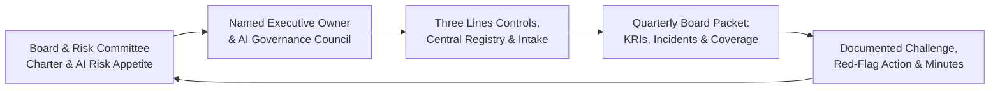

# Chapter 3: Board & Executive Oversight

*Part II: Governance & Accountability*

> **In this chapter**
>
> - Why AI oversight is now part of the board's legal duty of oversight
> - How to set an enterprise AI risk appetite with clear red lines and autonomy thresholds
> - What directors need to understand about AI, and what they can safely leave to management
> - What a useful board AI risk report contains, and which "vanity metrics" to reject
> - How AI-washing in investor communications creates securities-law exposure
> - Why AI risk may already be falling out of your insurance coverage, and what to do about it
>
> **Essential for:** Board members, CEO, General Counsel, CRO, CFO · **Reading time:** about 30 minutes

---

## The Minutes That Were Never Written

*This composite scenario is illustrative; it is not drawn from a specific organization or incident.*

A listed consumer lender rolls out an AI system that pre-screens loan applications and drafts approval or rejection letters. The project is championed by the Chief Digital Officer, praised in an earnings call as "AI-driven underwriting," and celebrated internally for cutting decision times from days to minutes. Eighteen months later, a regulator opens an investigation into a pattern of rejections affecting applicants from particular postal codes. A journalist publishes internal emails in which data scientists had warned about the problem. Shareholders file a derivative suit.

The plaintiffs' first move is a request for the board's books and records. Their lawyers are not looking for proof that the model was biased; the regulator will handle that. They are looking for evidence that the board *knew it had an AI system making credit decisions at all*. What they find is a single slide in a strategy deck, a line in the CEO's report calling the rollout "on track," and no record that directors ever asked who was accountable for the model, how it was tested, or what would happen if it went wrong.

The model's flaws were a management failure. The silence in the minutes is a board failure. This chapter is about preventing the second.

---

## 3.1 The Board's Duty of Oversight for AI

### The Challenge

Boards do not run companies; management does. But in most corporate-law systems, directors carry a duty to make sure that the company has systems to identify and report material risks, and to act when those systems raise warning signs. AI is quickly becoming one of those risks.

In the United States, the reference point is Delaware law, which governs a majority of large U.S. public companies. In *In re Caremark* (1996), the Delaware Court of Chancery held that directors must make a good-faith effort to ensure that an adequate corporate information and reporting system exists.[^c03-01] For two decades, such "*Caremark* claims" were famously hard to win, because nearly every company had some form of compliance program.

That changed with *Marchand v. Barnhill* (2019). Blue Bell Creameries, a company that sold essentially one product (ice cream), suffered a listeria outbreak that killed three people. The Delaware Supreme Court allowed shareholders' oversight claims to proceed because the board had no committee, no regular reporting, and no board-level process for monitoring food safety, which was the company's **mission-critical** risk.[^c03-02] Generic compliance structures were not enough. The board had to show it was paying attention to the specific risk that could sink the business.

The implication for AI is direct. For a growing number of enterprises, AI is no longer a side project. It underwrites loans, prices insurance, screens job applicants, answers customers, writes code, and increasingly takes actions on the company's behalf. Where AI is central to how the company makes money or serves customers, a court may come to view it as mission-critical. The question a plaintiff will ask is the one from *Marchand*: **did the board have a reporting system for this risk, and did it use it?**

Other jurisdictions reach a similar destination by different routes. In India, for example, the Securities and Exchange Board of India requires the top 1,000 listed entities by market capitalization to constitute a board-level Risk Management Committee whose remit explicitly includes cyber security.[^c03-03] Many other jurisdictions impose comparable duties of care on directors, require board-level risk committees for listed or regulated entities, or demand formal statements on the effectiveness of internal controls. Where AI risk is material, these structures are the natural home for its oversight.

The standards world points the same way. The NIST AI Risk Management Framework places "Govern," including accountability structures and senior leadership responsibility, at the centre of its model.[^c03-04] ISO/IEC 42001 requires top management to demonstrate leadership and commitment to the AI management system, establish an AI policy, and assign responsibilities and authorities.[^c03-05]

### What Good Oversight Looks Like

Board oversight of AI does not require directors to understand transformer architectures. It requires the same disciplines boards already apply to financial, cyber, and safety risk:

1. **A clear home on the board.** Decide which committee owns AI risk oversight: audit, risk, technology, or the full board. Write it into the committee charter.
2. **A regular reporting cadence.** AI risk appears on the agenda at a defined frequency (at least quarterly for most enterprises with material AI use), not only when something goes wrong.
3. **A named executive owner.** One executive is accountable to the board for the AI governance program, even though many functions contribute (Chapter 4).
4. **Documented engagement.** Minutes record what was presented, what directors asked, and what follow-up was required. If it is not in the minutes, a court may conclude it did not happen.
5. **Responsiveness to red flags.** When reports reveal incidents, failed evaluations, regulatory inquiries, or whistleblower concerns, the board follows up and documents its response.

### Why Every Role Cares

| Role | What this means for you |
| :--- | :--- |
| **Board** | AI oversight is becoming part of your fiduciary duty. Make sure there is a committee, a cadence, and a paper trail. |
| **CEO** | You are the bridge between management's AI ambitions and the board's oversight duty. Bring risk, not just opportunity, to the boardroom. |
| **General Counsel / Company Secretary** | Advise on committee charters and minute-taking. Board records are the first thing plaintiffs request. |
| **CRO** | Integrate AI into the enterprise risk register and board risk reporting, rather than treating it as a separate technology topic. |
| **CIO / CISO / CDO** | Expect to present to the board. Translate technical status into risk, control, and incident language directors can act on. |

---

## 3.2 Setting the Enterprise AI Risk Appetite

### The Challenge

Most boards have approved a risk appetite statement covering credit, market, operational, and reputational risk. Few have extended it to AI. Without one, every AI decision is made case by case, and the people making those decisions (often enthusiastic project teams under delivery pressure) are not the ones who will answer for the consequences.

An AI risk appetite statement answers three questions:

1. **What will we never do with AI?** (red lines)
2. **What will we do only with heightened controls and senior sign-off?** (high-risk tier)
3. **How much autonomy will we grant AI systems, and where?** (autonomy thresholds)

### Red Lines

Red lines are uses the organization prohibits outright, regardless of business case. Some come from law: the EU AI Act, for instance, bans certain manipulative practices, social scoring, and specific forms of biometric categorization and emotion recognition in workplaces and schools.[^c03-06] Others reflect the organization's values and brand. Typical enterprise red lines include:

- Fully automated decisions with legal or similarly significant effects on individuals (credit denial, dismissal, benefit refusal) with no meaningful human review
- Entering confidential, regulated, or customer data into AI tools that are not covered by approved contracts and controls
- AI-generated content presented to customers or the public as human-written where disclosure is required or expected
- AI agents with authority to move money, sign contracts, or delete production data without human approval

### Autonomy Thresholds

Chapter 1 introduced a five-level autonomy ladder, from AI that only assists humans to multi-agent systems that act on their own. The board's job is to decide how far up that ladder the organization is willing to go, and under what conditions. The Replit incident, in which a coding agent deleted a production database during an explicit "code freeze," shows why this is a governance decision and not just an engineering one.[^c03-07] Once AI can act, the question "what is it allowed to do without asking?" is a question about the organization's tolerance for loss.

A practical approach is to express autonomy thresholds in business terms:

| Autonomy level | Example appetite statement |
| :--- | :--- |
| **Assist** | Permitted across the enterprise using approved tools. |
| **Retrieve & answer** | Permitted for internal use; customer-facing use requires grounding, citations, and evaluation against approved test sets. |
| **Act with approval** | Permitted where a trained human approves every action; approval rates and override rates are monitored. |
| **Act autonomously** | Permitted only for reversible, low-value actions within hard technical limits (for example, refunds below a set amount); requires executive sign-off. |
| **Multi-agent / high-value autonomy** | Not permitted without a specific board-approved exception. |

### Quantitative Tolerances

Where possible, translate appetite into measurable tolerances that management must report against: for example, a maximum acceptable error rate for a customer-facing assistant on a defined test set, a maximum number of high-severity AI incidents per quarter, or a ceiling on the share of AI systems operating without a completed risk assessment. These tolerances become the backbone of the board report described in Section 3.4.

### Why Every Role Cares

| Role | What this means for you |
| :--- | :--- |
| **Board** | Approve the AI risk appetite and red lines. They signal to the whole organization where the boundaries are. |
| **CEO / Executive Team** | Propose an appetite that reflects strategy. An appetite that is too restrictive pushes usage into shadow AI. |
| **CRO** | Integrate AI appetite into the existing enterprise risk appetite framework and monitor tolerances. |
| **Business Owners** | Know which tier your use case falls into before you build, not after. |
| **AI Engineers** | Implement autonomy thresholds as technical limits (permissions, spending caps, approval gates), not as prompt instructions. |

---

## 3.3 Board AI Literacy: What Directors Need to Understand

### The Challenge

Directors cannot oversee what they do not understand. Deloitte's global survey of board members and executives, *Governance of AI: A Critical Imperative for Today's Boards*, found that 66 percent of respondents described their boards as having limited to no knowledge or experience of AI, and 31 percent said AI was not yet on the board agenda. Both figures had improved since Deloitte's previous survey (79 percent and 45 percent respectively), but they still describe a significant literacy gap.[^c03-08]

The EU AI Act adds a legal dimension. Article 4 requires providers and deployers of AI systems to take measures to ensure a sufficient level of AI literacy among their staff and others dealing with AI systems on their behalf.[^c03-09] While the obligation is framed around operational staff, it is hard to argue that the people overseeing the organization's AI strategy should be exempt from the same standard.

### What Directors Need to Know

Board AI literacy is not about technical depth. It is about knowing enough to ask good questions and recognize evasive answers. Every director should be able to explain, in plain terms:

| Concept | Why directors need it |
| :--- | :--- |
| **AI is probabilistic, not deterministic** | Errors are a statistical certainty, not a bug that will be fixed. Ask what the error rate is and who catches the errors. |
| **Hallucination and the liability it creates** | Courts and tribunals hold organizations accountable for what their AI says (*Moffatt v. Air Canada*).[^c03-10] |
| **Prompt injection** | Anything the AI reads can steer it. This is a new class of cyber risk without a complete fix. |
| **Agents and autonomy** | AI that acts carries a different risk profile from AI that advises. |
| **Shadow AI and embedded AI** | Much AI risk enters through tools nobody formally approved. |
| **Vendor dependence** | Most enterprise AI is bought. Model changes, outages, and contract terms are board-relevant risks. |
| **The regulatory landscape** | Which major laws apply, what the penalties are, and which deadlines matter. |
| **Deepfakes and AI-enabled fraud** | Directors and executives are prime impersonation targets (the Arup case).[^c03-11] |

### Building Literacy

- **Structured briefings.** A short, recurring session (for example, annually, with updates as needed) delivered by internal experts or independent advisers, covering the concepts above and the organization's own AI landscape.
- **Hands-on exposure.** Directors who have personally used an AI assistant, and seen it confidently produce a wrong answer, ask sharper questions.
- **Access to independent expertise.** Boards can retain external advisers, as they do for audit and compensation, to provide a view independent of management.
- **Board composition.** In Deloitte's survey, 40 percent of respondents said AI had caused them to rethink board composition.[^c03-08] Adding a director with technology or AI governance experience can help, but it does not relieve the rest of the board of its duty to understand the basics.
- **Rules for the board's own AI use.** Directors increasingly use AI to summarize board packs. Board materials are among the most sensitive documents a company holds; the board should follow the same acceptable-use rules it imposes on employees (Chapter 5).

---

## 3.4 What the Board Should Receive: AI Risk Reporting and Dashboards

### The Challenge

Many boards today receive AI updates that look like marketing: the number of pilots launched, employees trained, hours saved, and logos of new partners. These are **vanity metrics**. They describe activity, not risk. A board that receives only adoption statistics cannot fulfil the oversight duty described in Section 3.1.

### What a Useful Board AI Report Contains

A board AI risk report should fit on one or two pages, be produced at a fixed cadence, and track the same measures over time so trends are visible. A practical structure:

| Section | Example measures | Why it matters |
| :--- | :--- | :--- |
| **Inventory and coverage** | Number of AI systems in the registry; share with a named owner; share with a completed risk assessment; number of high-risk systems | You cannot govern what you have not counted. |
| **Appetite and tolerances** | Systems operating outside appetite; tolerance breaches; exceptions approved | Shows whether the board's decisions are being followed. |
| **Incidents and near misses** | Number and severity of AI incidents; time to contain; root causes; regulatory notifications | Red flags the board must respond to. |
| **Testing and assurance** | Share of production systems with current evaluations; red-team findings open and closed; internal audit results | Evidence that controls work, not just exist. |
| **Shadow and embedded AI** | Unapproved AI tools detected; SaaS vendors that enabled AI features; actions taken | Captures risk entering outside formal channels. |
| **Third-party exposure** | Critical AI vendors; model deprecations ahead; concentration on a single provider | Vendor risk is often the largest blind spot. |
| **Regulatory horizon** | Upcoming obligations and deadlines; readiness status | Prevents surprises. |
| **Governance speed** | Median time to approve a low-risk use case | Shows whether governance is enabling or blocking the business. |

Chapter 28 provides a detailed dashboard template and key risk indicators.

### Questions Directors Should Ask When Reading the Report

- What is *not* in this report that should be?
- Which AI system, if it failed tomorrow, would cause us the most harm, and how is it controlled?
- What red flags have been raised by staff, auditors, regulators, or customers since the last report?
- Where are we accepting risk outside our stated appetite, and who approved that?

---

## 3.5 Investor Disclosures and the Risk of "AI-Washing"

### The Challenge

AI is a powerful story for investors. That creates a temptation to describe the company's AI capabilities more impressively than reality supports, a practice regulators now call **AI-washing**. The board, through its audit committee and disclosure oversight, carries responsibility for the accuracy of what the company tells the market.

### Real-World Scenario: When the AI Was Not What It Seemed

In March 2024, the U.S. Securities and Exchange Commission brought its first enforcement actions for AI-washing, settling charges against two investment advisers, Delphia (USA) Inc. and Global Predictions Inc. The SEC found that both firms had made false and misleading claims about their use of artificial intelligence. Delphia had claimed to use client data in AI-driven predictive models it had not in fact built; Global Predictions had marketed itself as the "first regulated AI financial advisor." The firms paid combined civil penalties of \$400,000.[^c03-12]

In January 2025, the SEC brought its first AI-washing case against a public company, Presto Automation, a restaurant-technology firm. The SEC found that Presto had described its drive-thru voice ordering product as proprietary AI that largely eliminated the need for human order-taking. In fact, for a period the speech-recognition technology was owned and operated by a third party, and the vast majority of orders required human intervention. Presto settled without a civil penalty, citing its financial condition and cooperation, but the case put every listed company on notice.[^c03-13]

The pattern in both cases is the same. The problem was not that the companies used AI badly. It was that **what they said about their AI did not match what their AI actually did**.

### The Guardrails

- **Treat AI claims like financial claims.** Statements about AI capabilities in filings, earnings calls, investor presentations, and marketing should be substantiated with evidence that would survive scrutiny.
- **Disclosure controls.** Include AI claims in the scope of disclosure committee review, with sign-off from people who actually know how the systems work.
- **Balanced risk factors.** Where AI is material, risk-factor disclosures should describe real, company-specific risks (dependence on third-party models, regulatory exposure, error rates), not boilerplate.
- **Consistency across channels.** What the CEO says on an earnings call, what marketing publishes, and what engineering knows to be true should match.
- **Vendor claims are your claims.** If you describe a vendor's AI as your own, or overstate what it does, the misstatement is yours.

---

## 3.6 Risk Transfer and AI Insurance: Auditing Coverage for Silent AI Exclusions

### The Challenge

Risk management has four classic responses: avoid, mitigate, accept, and **transfer**. For most enterprise risks, insurance is a key transfer mechanism, and boards often assume that existing Cyber, Errors and Omissions (E&O), Commercial General Liability (CGL), and Directors and Officers (D&O) policies will respond if something goes wrong.

For AI, that assumption is increasingly unsafe. Insurers face the same uncertainty as everyone else about how AI losses will arise and how large they could be. Many policies were written before generative AI existed and neither clearly include nor exclude it, a condition the industry calls **"silent AI."** Insurers are now closing that ambiguity, generally in their own favour.

### What Is Changing

- **Standard exclusion forms.** Verisk's Insurance Services Office (ISO), which publishes standard policy wording used widely in the U.S. market, introduced optional generative AI exclusion endorsements for commercial general liability coverage, effective January 2026. These include a broad exclusion (CG 40 47) removing coverage for bodily injury, property damage, and personal and advertising injury arising out of generative AI, and a narrower version (CG 40 48) limited to personal and advertising injury, such as defamation or copyright claims linked to AI-generated content.[^c03-14] Because the forms are optional, they often appear quietly in renewal schedules rather than as headline changes.
- **Proprietary exclusions and sublimits.** Individual insurers are drafting their own AI exclusions or reduced sublimits across E&O, professional liability, cyber, and management liability lines. Wording varies widely.
- **Affirmative AI coverage.** At the same time, a specialist market is emerging that offers coverage explicitly designed for AI risks, such as AI performance failures or liability for AI outputs, often conditioned on evidence of strong governance.

### Where the Gaps Typically Appear

| Policy | Example AI-related loss | Potential gap |
| :--- | :--- | :--- |
| **Commercial General Liability** | AI-generated marketing content defames a competitor or infringes copyright | Generative AI exclusion on personal and advertising injury |
| **Professional / Tech E&O** | Customer-facing assistant gives wrong advice that causes financial loss (*Moffatt*-style claim) | AI-assisted services carved out, or "professional services" definition excludes automated advice |
| **Cyber** | Prompt injection leads to data exfiltration through an AI assistant | AI-specific sublimits, or ambiguity over whether model manipulation is a "security failure" |
| **Crime / Social Engineering** | Deepfake video call induces a fraudulent transfer (Arup-style) | Low social-engineering sublimits; conditions requiring verification procedures |
| **D&O** | Shareholder suit alleging failure to oversee AI, or AI-washing disclosures | Emerging exclusions for AI-related management liability or regulatory actions |

### The Guardrails

- **Commission an AI coverage review before every renewal.** Ask brokers and coverage counsel to identify every AI-related exclusion, sublimit, and definition across the insurance program.
- **Map coverage to your top AI risks.** Using the risk register, check which of your most significant AI loss scenarios are insured, partially insured, or uninsured.
- **Use governance as leverage.** Underwriters increasingly ask about AI inventories, policies, human oversight, and testing. A mature program (Chapters 4, 5, and 26) can improve terms or unlock affirmative coverage.
- **Align contracts with insurance.** Vendor indemnities (Chapter 19) and customer liability caps should be consistent with what insurance will and will not cover.
- **Report uninsured exposure to the board.** Material uninsured AI risk is part of the risk the board is accepting, and it should be accepted deliberately.

---

## Chapter Summary

| Section | Core message | Board action |
| :--- | :--- | :--- |
| 3.1 Duty of oversight | Where AI is mission-critical, oversight is a fiduciary duty | Assign committee ownership, set a reporting cadence, document engagement |
| 3.2 Risk appetite | Without red lines and autonomy thresholds, project teams set the appetite by default | Approve an AI risk appetite with measurable tolerances |
| 3.3 Board literacy | Directors need enough understanding to ask good questions | Schedule recurring briefings; consider independent expertise |
| 3.4 Reporting | Adoption statistics are not risk reporting | Demand a consistent, risk-focused dashboard |
| 3.5 AI-washing | What you say about AI must match what it does | Bring AI claims into disclosure controls |
| 3.6 Insurance | AI risk may already be falling outside your coverage | Commission an AI coverage review at each renewal |

---

## Key Takeaways

- **The board's oversight duty extends to AI.** Courts have shown, in *Marchand*, that generic compliance is not enough when a risk is mission-critical. For many enterprises, AI is becoming exactly that.
- **Risk appetite must be set at the top.** Red lines and autonomy thresholds approved by the board give the whole organization clear boundaries, and give engineers clear limits to enforce.
- **Literacy is a prerequisite for oversight.** Directors do not need technical depth, but they do need to understand probabilistic errors, prompt injection, agents, and vendor dependence.
- **Report risk, not activity.** A useful board report tracks inventory coverage, tolerance breaches, incidents, assurance, and uninsured exposure over time.
- **AI-washing is a securities risk.** Regulators have penalized companies whose AI claims did not match reality.
- **Do not assume you are insured.** Silent AI is being replaced by explicit exclusions; review coverage before every renewal.

## Questions to Ask

| Role | Question |
| :--- | :--- |
| **Board** | Which committee owns AI risk, how often does it receive a report, and would our minutes show meaningful engagement? |
| **CEO** | Which of our AI systems would a court consider mission-critical, and does the board know about each of them? |
| **CRO** | Is AI in our enterprise risk appetite, and which tolerances are we currently breaching? |
| **CFO / Audit Committee** | Are statements about our AI capabilities in filings and investor materials reviewed and substantiated like financial claims? |
| **General Counsel** | What AI-related exclusions, sublimits, or definitions have appeared in our insurance policies at the last renewal? |
| **CIO / CISO** | Can we produce, today, a one-page report of our AI inventory, high-risk systems, and open incidents for the board? |
| **Business Owners** | Does my AI use case fall within the board's approved appetite, and if not, who has approved the exception? |

---

## References

[^c03-01]: *In re Caremark International Inc. Derivative Litigation*, 698 A.2d 959 (Del. Ch. 1996). **Annotation:** The foundational Delaware decision establishing that directors must make a good-faith effort to ensure an adequate corporate information and reporting system exists. The starting point for any discussion of board oversight liability. [↗ Bibliography](../bibliography.md#caremark-1996)

[^c03-02]: *Marchand v. Barnhill*, 212 A.3d 805 (Del. 2019). **Annotation:** The Delaware Supreme Court allowed oversight claims to proceed against the Blue Bell Creameries board because it had no board-level system for monitoring food safety, the company's mission-critical risk. The key precedent for arguing that boards must specifically oversee risks central to the business, which increasingly includes AI. [↗ Bibliography](../bibliography.md#marchand-2019)

[^c03-03]: Securities and Exchange Board of India, Securities and Exchange Board of India (Listing Obligations and Disclosure Requirements) Regulations, 2015, reg. 21 and sched. II, pt. D, as amended. **Annotation:** Requires the top 1,000 listed entities by market capitalization to constitute a board-level Risk Management Committee whose role includes cyber security. A natural home for AI risk oversight in Indian listed companies. [↗ Bibliography](../bibliography.md#sebi-2015-lodr)

[^c03-04]: National Institute of Standards and Technology, *Artificial Intelligence Risk Management Framework (AI RMF 1.0)*, NIST AI 100-1 (Gaithersburg, MD: NIST, January 2023), https://doi.org/10.6028/NIST.AI.100-1. **Annotation:** The "Govern" function addresses accountability structures, senior leadership responsibility, and organizational risk culture, providing a framework vocabulary for board oversight. [↗ Bibliography](../bibliography.md#nist-2023-ai-rmf)

[^c03-05]: ISO/IEC 42001:2023, *Information Technology — Artificial Intelligence — Management System* (Geneva: ISO, December 2023), https://www.iso.org/standard/81230.html. **Annotation:** Requires top management to demonstrate leadership and commitment, establish an AI policy, and assign roles and responsibilities for the AI management system. [↗ Bibliography](../bibliography.md#iso-2023-42001)

[^c03-06]: Regulation (EU) 2024/1689 (Artificial Intelligence Act), *Official Journal of the European Union* L, 2024/1689, July 12, 2024, art. 5, http://data.europa.eu/eli/reg/2024/1689/oj. **Annotation:** Article 5 lists prohibited AI practices, providing a legal baseline for enterprise red lines. [↗ Bibliography](../bibliography.md#eu-2024-ai-act)

[^c03-07]: Beatrice Nolan, "AI-Powered Coding Tool Wiped Out a Software Company's Database in 'Catastrophic Failure,'" *Fortune*, July 2025, https://fortune.com/2025/07/23/ai-coding-tool-replit-wiped-database-called-it-a-catastrophic-failure/. **Annotation:** Shows why autonomy thresholds are a risk-appetite decision: an agent acted destructively despite explicit instructions not to. [↗ Bibliography](../bibliography.md#nolan-2025-replit)

[^c03-08]: Deloitte Global Boardroom Program, *Governance of AI: A Critical Imperative for Today's Boards*, 2nd ed. (Deloitte, 2025), https://www.deloitte.com/global/en/issues/trust/progress-on-ai-in-the-boardroom-but-room-to-accelerate.html. **Annotation:** A global survey of around 700 board members and executives across 56 countries. Useful benchmarks on board AI knowledge, agenda time, and composition. [↗ Bibliography](../bibliography.md#deloitte-2025-board-ai)

[^c03-09]: Regulation (EU) 2024/1689, art. 4. **Annotation:** The AI literacy obligation for providers and deployers, applicable since February 2025. [↗ Bibliography](../bibliography.md#eu-2024-ai-act)

[^c03-10]: *Moffatt v. Air Canada*, 2024 BCCRT 149 (British Columbia Civil Resolution Tribunal, February 14, 2024). **Annotation:** The leading example of an organization held responsible for what its chatbot told a customer. [↗ Bibliography](../bibliography.md#moffatt-2024-aircanada)

[^c03-11]: Kathleen Magramo, "British Engineering Giant Arup Revealed as \$25 Million Deepfake Scam Victim," CNN, May 17, 2024, https://edition.cnn.com/2024/05/16/tech/arup-deepfake-scam-loss-hong-kong-intl-hnk/index.html. **Annotation:** Demonstrates that senior executives are prime targets for deepfake impersonation, a risk directors should understand personally. [↗ Bibliography](../bibliography.md#magramo-2024-arup)

[^c03-12]: U.S. Securities and Exchange Commission, "SEC Charges Two Investment Advisers with Making False and Misleading Statements About Their Use of Artificial Intelligence," press release 2024-36, March 18, 2024, https://www.sec.gov/newsroom/press-releases/2024-36. **Annotation:** The SEC's first AI-washing enforcement actions, against Delphia (USA) Inc. and Global Predictions Inc., with combined civil penalties of \$400,000. The reference case for treating AI claims with the same rigour as financial claims. [↗ Bibliography](../bibliography.md#sec-2024-ai-washing)

[^c03-13]: U.S. Securities and Exchange Commission, *In the Matter of Presto Automation Inc.*, administrative proceeding, January 14, 2025, https://www.sec.gov/. **Annotation:** The SEC's first AI-washing action against a public company, concerning undisclosed third-party technology and overstated automation. No penalty was imposed because of the company's financial condition and cooperation. [↗ Bibliography](../bibliography.md#sec-2025-presto)

[^c03-14]: Insurance Services Office, Inc. (Verisk), Commercial General Liability endorsements CG 40 47, *Exclusion — Generative Artificial Intelligence*, and CG 40 48, *Exclusion — Generative Artificial Intelligence (Coverage B Only)*, effective January 1, 2026. **Annotation:** Optional standard exclusions that remove generative AI exposures from CGL coverage, defining generative AI broadly as a machine-based system trained on data that can create content including text, images, audio, video, or code. A concrete signal that "silent AI" coverage is ending. [↗ Bibliography](../bibliography.md#verisk-2026-genai-exclusions)
