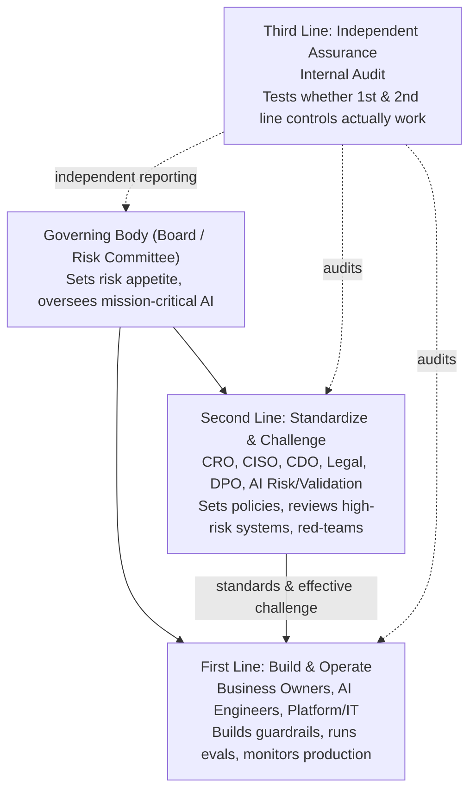
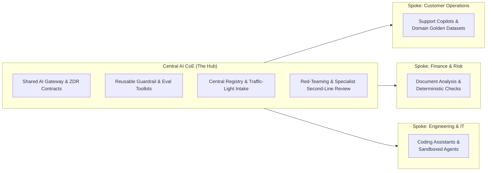

# Chapter 4: The AI Governance Operating Model

*Part II: Governance & Accountability*

> **In this chapter**
>
> - How to charter a cross-functional AI Governance Council with clear decision rights and fast escalation paths
> - Where accountability sits across the CEO, CIO, CISO, CDO, CRO, General Counsel, DPO, AI leads, and business owners
> - How to adapt the IIA Three Lines Model and banking's "effective challenge" discipline to generative and agentic AI without paralyzing delivery
> - How to choose between centralized, federated, and hub-and-spoke Centers of Excellence—and evolve the model as AI adoption matures
>
> **Essential for:** CEO, CIO, CISO, CDO, CRO, General Counsel, AI Leads · **Reading time:** about 25 minutes

---

## Everybody's Problem, Nobody's Decision

*This composite scenario is illustrative; it is not drawn from a specific organization.*

A global logistics company launches an internal AI assistant that drafts customs declarations and answers queries related to shipping documentation and procedures by querying internal pricing tables and historical shipment records. Before launch, the project lead dutifully books review meetings.

The CISO's team inspects the API gateway and signs off on encryption and key management, noting that "legal should check customer data terms." General Counsel reviews the model vendor's master agreement and confirms Zero Data Retention, noting that "data governance should verify whether historical invoices can be indexed." The CDO's team confirms the data warehouse is classified as internal, noting that "the business unit owns output accuracy." Three weeks after launch, the assistant misapplies a tariff exemption rule on forty shipments, triggering customs penalties and a compliance hold.

In the post-mortem, every function produces its sign-off email. Every function did its narrow job. Yet nobody owned the whole system: nobody checked whether the assistant was allowed to calculate tariff eligibility without deterministic code, nobody verified who would monitor its error rate after launch, and nobody had the authority to pause it once complaints began arriving.

This is **diffusion of responsibility**, the single most common failure mode of early AI governance. Board oversight (Chapter 3) sets the direction and risk appetite, but strategy dies in the gap between executive intent and daily operations unless the enterprise builds a clear **operating model**: who decides, who builds, who challenges, who audits, and how those roles work together at the speed of modern software delivery.

---

## 4.1 The Cross-Functional AI Governance Council

### The Challenge

Because AI risk crosses technology, security, data, legal, and commercial boundaries (Chapter 1), no single executive silo can govern it alone. Place AI governance exclusively under the CIO, and legal or bias exposures get underweighted. Place it exclusively under Legal or Risk, and technical subtleties—like indirect prompt injection or agentic tool permissions—are missed while review queues stretch to months.

The standard institutional answer is a **cross-functional AI Governance Council** (sometimes called an AI Governance Board or Responsible AI Committee). Public-sector and regulatory models increasingly codify this pattern. Under U.S. Office of Management and Budget Memorandum M-25-21 (issued in April 2025, replacing M-24-10), civilian federal agencies must maintain internal AI Governance Boards chaired by a senior executive such as a Deputy Secretary, with the Chief AI Officer as vice-chair, bringing together IT, privacy, civil rights, legal, and procurement leaders.[^c04-01] ISO/IEC 42001 similarly requires top management to assign clear cross-functional roles, authorities, and reporting lines for the AI management system.[^c04-02]

Yet many corporate AI councils fail within a year. They fail in one of two opposite ways: either they become **talking shops** that meet monthly to watch demos without binding authority, or they become **bottlenecks** that insist on reviewing every minor chatbot and prompt tweak, driving business units straight into shadow AI.

### Designing a Council That Actually Works

An effective AI Governance Council is defined by four elements: a written charter, right-sized membership, explicit decision rights, and strict turnaround commitments.

**1. Charter and Mandate**
The council's charter—approved by the executive committee and noted by the board—should state plainly what the council *does* and *does not* do:
- **Does:** Set enterprise AI policies and risk-tiering criteria (Chapter 5); approve high-risk (Red Lane) deployments and exceptions to risk appetite; resolve deadlocks between functions; review AI incidents and quarterly risk trends; and report consolidated status to the board.
- **Does not:** Review low-risk (Green Lane) productivity tools, micromanage model architecture, or replace existing software release processes.

**2. Core Membership**
Keep voting membership small enough to decide (typically seven to nine people) while inviting domain specialists as needed:

| Member | Primary perspective brought to the council |
| :--- | :--- |
| **Executive Chair (COO, CRO, or Deputy CEO)** | Breaks ties between commercial speed and risk restraint; owns escalation to the CEO and board |
| **CIO / CTO (or Chief AI Officer)** | Platform architecture, vendor strategy, operational resilience, and engineering feasibility |
| **CISO** | Adversarial threats, agent permissions, supply-chain security, and incident response |
| **CDO** | Data provenance, permission hygiene, classification, and grounding quality |
| **General Counsel / Chief Compliance Officer** | Regulatory obligations, IP, contracts, liability, and disclosure controls |
| **Data Protection Officer (DPO)** | Personal data rights, DPIAs, cross-border transfers, and retention |
| **Business Unit Representatives (rotating or key divisions)** | Commercial context, workflow impact, and customer harm |
| **Internal Audit (observer, non-voting)** | Independent visibility without compromising third-line objectivity (Section 4.3) |

**3. Decision Rights and Escalation Paths**
Ambiguity about who can say "no"—and who can override a "no"—is what creates endless email threads. Define three clear escalation tiers:
- **Standard approvals (Green and Yellow Lanes):** Delegated to automated intake templates and functional reviewers (Chapter 5). They never consume council agenda time.
- **High-risk approvals and cross-functional disputes (Red Lane):** Decided by the council within a published service-level agreement (for example, ten business days from a complete submission).
- **Risk-appetite exceptions:** If a business unit wants to deploy a system outside the board-approved appetite—for example, granting autonomous financial execution above the normal threshold—the council cannot simply wave it through. It submits a written risk-acceptance memo to the CEO or the designated board committee.

**4. Guarding Against Bureaucracy**
Measure the council on **speed as well as safety**. Track median approval time by risk tier (Chapter 28). If Red Lane reviews regularly take six weeks, the problem is usually not that risk teams are obstructive; it is that reusable guardrails (approved gateways, standard contract addenda, pre-tested evaluation suites) do not yet exist. Every recurring council objection should become a reusable standard so the next team does not hit the same wall.

---

## 4.2 Roles and Accountability: Preventing Diffusion of Responsibility

### The Challenge

A council is a collective forum, not a substitute for individual accountability. When a system fails in production, regulators, auditors, and courts do not ask which committee met in March; they ask **who owned the system and had the authority to stop it**.

The NIST AI Risk Management Framework makes accountability across the AI lifecycle a core requirement of its Govern function, stressing that roles must be explicitly documented and understood by everyone who designs, deploys, or operates an AI system.[^c04-03]

### Executive and Functional Ownership Boundaries

The table below clarifies how core AI governance duties divide across an enterprise's leadership team. Smaller organizations will combine several of these hats, but every responsibility still needs a named owner. (Appendix B provides a full RACI matrix template.)

| Role | Accountable for | Must not be left to own alone |
| :--- | :--- | :--- |
| **CEO** | Enterprise AI strategy, tone from the top, cross-functional alignment, and board escalation | Day-to-day technical risk sign-offs |
| **CIO / CTO** | Sanctioned AI platforms and gateways, model lifecycle management, vendor technical integration, and operational resilience | Legal risk acceptance or business-outcome accountability |
| **Chief AI Officer (CAIO)** *(where appointed)* | Coordinating AI strategy, Center of Excellence execution, AI inventory completeness, and governance council operations | Auditing their own deployments (avoiding self-review conflict) |
| **CISO** | AI threat modeling, prompt-injection and agentic security controls, AI supply-chain vetting, red-teaming, and AI incident response | Defining business fairness thresholds or approving legal disclosures |
| **CDO & Data Stewards** | Data classification, permission hygiene, grounding-data quality, lineage, and synthetic-data standards | Application security or vendor contract negotiation |
| **CRO** | Integrating AI into enterprise risk appetite, KRIs, independent challenge (second line), and risk reporting to the board | Building production AI guardrails |
| **General Counsel & Compliance** | Regulatory mapping (EU AI Act, sector rules), IP and indemnification, vendor contract clauses, e-Discovery, and investor disclosure controls | Technical evaluation design |
| **Data Protection Officer (DPO)** | Privacy impact assessments (DPIAs), consent and purpose limitation, cross-border transfers, and data-subject deletion rights | General cybersecurity architecture |
| **AI Engineering Leads** | Implementing technical guardrails in code (permissions, sandboxes, logging, evals, fallback routing) and maintaining AI-BOMs | Deciding how much business or legal risk the company will accept |
| **Business / Product Owners** | **Named single-point owner of each deployed AI system:** intended purpose, business value, human-oversight staffing, ongoing accuracy monitoring, and kill-switch authority | Bypassing security or privacy intake under delivery pressure |

### The Single-Named-Owner Rule

Of all the rows above, the last is the most frequently missed and the most important: **no AI system enters production without a named business owner.**

Engineers build systems and move on to the next project. Vendors sell tools and update them on their own schedules. Only a named business owner—the head of customer support for a support chatbot, the head of underwriting for a credit assistant, the head of HR operations for a recruiting tool—has the operational context to notice when outputs drift, to staff human reviewers properly, and to justify keeping the system running.

When that owner changes jobs, ownership transfers formally in the central AI registry (Chapter 5). Any system in the registry without an active named owner is treated as an orphan and scheduled for review or decommissioning (Chapter 24).

### Why Every Role Cares

| Role | What this means for you |
| :--- | :--- |
| **Board / CEO** | Demand a named executive owner for the governance program and a named business owner for every high-risk system. |
| **CIO / CAIO** | Clarify the boundary between platform ownership (yours) and use-case risk ownership (the business unit's). |
| **CISO / CDO / Legal** | Clear boundaries let you set binding standards once instead of negotiating ad-hoc sign-offs on every project. |
| **AI Engineers** | You are responsible for building controls that work, not for guessing the company's legal risk appetite. |
| **Business Owners** | Owning the upside of an AI tool means owning its failure modes, review staffing, and ongoing monitoring too. |

---

## 4.3 Applying the Three Lines Model to AI

### The Challenge

Regulated enterprises—especially banks, insurers, and healthcare organizations—already rely on the **Three Lines Model** to separate building and operating systems from challenging and auditing them. Updated by the Institute of Internal Auditors (IIA) in July 2020 (replacing the older "Three Lines of Defense" label), the model emphasizes creating and protecting value across six principles: governance, governing-body oversight, first- and second-line management roles, independent third-line assurance, and clear alignment with stakeholder interests.[^c04-04]

In financial services, this structure has long been reinforced by **Model Risk Management (MRM)** guidance. For fifteen years, U.S. banking regulators anchored that discipline in Federal Reserve **SR 11-7** (2011), whose core concept was **effective challenge**: critical analysis by objective, informed parties who combine competence, organizational independence, and enough influence to require changes before a model is used.[^c04-05]

Applying that discipline directly to generative and agentic AI, however, quickly exposes a tension. Traditional MRM was built for a few dozen high-value quantitative models (credit scoring, capital adequacy, market risk) that changed once a year and underwent months-long mathematical replication by a separate validation team. Modern enterprises deploy hundreds of LLM-backed workflows whose prompts, retrieval indexes, and vendor models evolve weekly. Running a six-month SR 11-7-style validation on every internal copilot paralyzes delivery.

Regulators themselves have begun recognizing this shift. In April 2026, the Federal Reserve, OCC, and FDIC jointly issued updated Model Risk Management guidance (**SR 26-2**, OCC Bulletin 2026-13, and FDIC FIL-15-2026) superseding SR 11-7.[^c04-06] Two features of that update are instructive for every industry, not just banking: first, it shifts away from rigid calendar-based review schedules toward **materiality-based, proportional oversight**; second, it explicitly places generative and agentic AI outside the narrow traditional MRM perimeter while expecting institutions to govern them through broader enterprise risk management.

The lesson for enterprise governance is clear: **keep the principle of independent challenge, but scale its weight to the risk of the system.**

### Mapping the Three Lines to AI

| Line | Who sits here | Core AI responsibilities | How it avoids paralyzing delivery |
| :--- | :--- | :--- | :--- |
| **First Line** *(Own & operate)* | Business unit owners, product managers, AI/ML engineers, platform IT, procurement | Register every AI use case; implement approved guardrails (gateways, permission-aware RAG, least-privilege agent credentials); run automated pre-deployment and regression evals; operate human oversight and incident containment | Uses pre-approved platform templates and automated checks so Green Lane tools ship without manual gates |
| **Second Line** *(Set standards & challenge)* | CRO / Enterprise Risk, CISO / AppSec, CDO / Data Governance, Legal, Compliance, DPO, independent AI validation | Define risk-tiering rules, acceptable-use policies, and security baselines; perform proportional effective challenge on Yellow and Red Lane systems; lead or scope adversarial red-teaming; monitor enterprise KRIs and regulatory changes | Focuses deep review on high-impact systems; delegates routine checks to automated CI/CD gates built with the first line |
| **Third Line** *(Assure independently)* | Internal Audit (and external auditors where required) | Independently test whether the AI registry is complete, whether intake and approval rules are actually followed, whether production guardrails match what was approved, and whether incidents are properly escalated; report directly to the Audit Committee | Audits *systems and control effectiveness* on a risk-based schedule rather than acting as a pre-launch approval gate |

### Preserving Independence Without Creating Silos

Two practical traps undermine the Three Lines in AI programs:

1. **The "Self-Reviewing CAIO" Trap.** If the same team that has a revenue or adoption target for launching AI products also has final sign-off authority on whether those products are safe, effective challenge collapses. The IIA explicitly allows first- and second-line roles to collaborate closely, especially in smaller firms, but high-risk approval authority must remain independent of delivery incentives.
2. **The "Under-Skilled Second Line" Trap.** Effective challenge requires *competence* as well as independence. A second-line risk team that cannot read an evaluation report, inspect a system prompt, or understand how an MCP tool connector works will either rubber-stamp dangerous designs or block safe ones out of uncertainty. Invest in dedicated technical AI risk specialists inside the second line—or rotate senior engineers into second-line validation roles for twelve-month tours.

---

## 4.4 Centralized, Federated, or Hub-and-Spoke: Choosing a Center of Excellence Model

### The Challenge

Once an enterprise clarifies who governs AI, it still has to decide **where AI governance and engineering talent physically sit**. Do you put every AI architect, guardrail builder, and risk reviewer in one central team? Do you let each business unit hire and govern its own? Or do you split the difference?

There is no single permanent answer. The right structure depends on the organization's size, regulatory intensity, and current stage of AI adoption.

### Comparing the Three Operating Models

| Dimension | Centralized | Federated | Hub-and-Spoke (Center of Excellence) |
| :--- | :--- | :--- | :--- |
| **How it works** | One central team builds, approves, and operates all AI systems and guardrails | Each business unit builds, buys, and governs AI independently under broad principles | A central **Hub** sets policies, runs shared guardrail platforms, and handles Red Lane review; embedded **Spokes** in business units build and operate domain use cases |
| **Strengths** | Tightest risk control; consistent architecture; efficient use of scarce AI specialists | Fastest local experimentation; deep business-domain alignment | Balances enterprise-wide guardrails with business-unit speed; avoids duplicated platform spend |
| **Failure modes** | Becomes a severe backlog; disconnected from business reality; breeds shadow AI | Fragmented vendors; inconsistent privacy/security; duplicated mistakes; blind spots for the board | Role confusion between hub and spokes if decision rights are not written down |
| **Best suited for** | Early-stage adoption, smaller enterprises, or highly regulated firms starting their first high-risk deployments | Rarely suitable for enterprise-wide AI governance; works only for isolated R&D labs with strict sandboxes | Most mid-sized and large enterprises scaling beyond initial pilots |

### What Belongs in the Hub vs. the Spokes

For most enterprises, the **hub-and-spoke Center of Excellence (CoE)** is the durable target state. Its secret is not adding another layer of reviewers; it is **turning governance rules into reusable paved roads**.

**Keep in the Hub (build once, reuse everywhere):**
- Enterprise AI gateway, approved model endpoints, and Zero Data Retention vendor contracts
- Reusable technical guardrails: PII redaction pipelines, permission-aware RAG patterns, input/output classifiers, immutable logging, and evaluation harnesses
- The central AI registry, risk-tiering rubric, and Traffic Light intake workflow
- Deep specialist capabilities that business units cannot justify hiring individually (adversarial red-teamers, AI legal/regulatory specialists, bias auditors)

**Push to the Spokes (close to the customer and data):**
- Identifying business use cases and defining domain-specific "golden datasets" for evaluation (Chapter 26)
- Curating and cleaning source documents and file permissions before indexing (Chapter 7)
- Staffing meaningful human-in-the-loop review and customer contestability workflows (Chapter 17)
- Day-to-day operational ownership of deployed systems and monitoring domain accuracy

### Evolving the Model as Maturity Grows

Operating models should not stay frozen:

1. **Stage 1 — Early Adoption (Months 0–6): Centralized.** Concentrate scarce talent to stand up the sanctioned workspace, acceptable-use policy, initial registry, and first two or three production patterns.
2. **Stage 2 — Scaling (Months 6–24): Hub-and-Spoke.** As demand outstrips a single team, embed AI product owners and engineers in major business units while keeping platforms, contracts, and high-risk standards in the hub.
3. **Stage 3 — Embedded Maturity (Year 2+): Paved-Road Federation.** Once automated CI/CD guardrails, continuous monitoring, and AI literacy are embedded across engineering and business teams, the central CoE shrinks back into a lean standards, platform, and assurance function—just as early cloud CoEs eventually merged into standard IT and security operations.

### Why Every Role Cares

| Role | What this means for you |
| :--- | :--- |
| **Board / CEO** | Fund the shared "paved road" (gateway, eval tooling, registry), not just a review committee. Governance without tooling becomes bureaucracy. |
| **CIO** | Use a hub-and-spoke CoE to avoid paying for five overlapping model gateways and five separate vendor contracts. |
| **CISO** | Centralizing the AI gateway and logging infrastructure gives you one place to enforce security controls across every spoke. |
| **CDO / Data Stewards** | Spokes know their domain data best; equip them with central classification and permission-hygiene playbooks. |
| **AI Engineers** | A strong hub lets you focus on business logic instead of reinventing PII filters, audit logs, and auth wrappers on every project. |

---

## Chapter Summary

| Section | Core question | Operating-model anchor |
| :--- | :--- | :--- |
| 4.1 Governance Council | How do functions decide together without stalling delivery? | Small voting council with clear charter, delegated Green/Yellow lanes, and SLAs for Red Lane review |
| 4.2 Roles & Accountability | Who is personally answerable when a system fails? | Clear executive boundaries plus a mandatory named business owner for every production AI system |
| 4.3 Three Lines Model | How do we ensure independent challenge without six-month queues? | Proportional challenge scaled to risk tier, backed by technical competence in the second line and independent third-line audit |
| 4.4 CoE Structure | Where should governance and platform talent sit? | Start centralized, scale through a hub-and-spoke CoE that builds reusable guardrail platforms |

---

## Key Takeaways

- **Governance fails in the gaps between silos.** Without a defined operating model, every function signs off on its own slice while nobody owns end-to-end system safety.
- **Keep the AI Governance Council small, empowered, and fast.** Reserve council meetings for policy, high-risk approvals, exceptions, and incident trends—never low-risk routine tools.
- **No named business owner, no production launch.** Technical teams build and maintain platforms; business owners are accountable for the risk and performance of the AI systems they operate.
- **Apply the Three Lines proportionally.** Keep the principle of independent effective challenge, but automate routine checks and scale review depth to materiality rather than rigid calendars.
- **Build paved roads, not toll booths.** A hub-and-spoke Center of Excellence succeeds when it makes the safe, governed architecture the fastest path for business-unit teams to ship.

## Questions to Ask

| Role | Question |
| :--- | :--- |
| **Board / CEO** | Does our AI Governance Council have binding decision rights and a published turnaround SLA, or is it only an advisory forum? |
| **CIO / CAIO** | What reusable guardrail components (gateway, logging, eval harness) does our hub provide so spokes do not rebuild them from scratch? |
| **CISO** | Where does our second-line security review sit relative to delivery incentives, and can we block an unsafe Red Lane launch? |
| **CDO / Data Stewards** | Are data-steward responsibilities embedded in the business-unit spokes where source documents actually live? |
| **CRO / Internal Audit** | Does our second line have the technical skill to challenge LLM and agent designs, and is Internal Audit independent of pre-launch sign-off? |
| **General Counsel** | If an AI system fails tomorrow, can we identify its single named business owner in the registry within five minutes? |
| **Business Owners** | Which decisions can I make within my spoke, and which ones require escalation to the AI Governance Council? |

---

## Notes

[^c04-01]: Office of Management and Budget, *Accelerating Federal Use of AI through Innovation, Governance, and Public Trust*, Memorandum M-25-21 (Washington, DC: Executive Office of the President, April 3, 2025), https://www.whitehouse.gov/wp-content/uploads/2025/02/M-25-21-Accelerating-Federal-Use-of-AI-through-Innovation-Governance-and-Public-Trust.pdf. **Annotation:** Replaces OMB M-24-10 and formalizes the Chief AI Officer role and cross-functional agency AI Governance Boards. A concrete institutional blueprint for structuring executive AI councils in large organizations. [↗ Bibliography](../bibliography.md#omb-2025-m25-21)

[^c04-02]: International Organization for Standardization and International Electrotechnical Commission, *ISO/IEC 42001:2023, Information Technology — Artificial Intelligence — Management System* (Geneva: ISO, December 2023), clause 5.3 and Annex A.3, https://www.iso.org/standard/81230.html. **Annotation:** Requires top management to assign and communicate roles, responsibilities, and authorities for the AI management system, and includes internal organization controls in Annex A.3. [↗ Bibliography](../bibliography.md#iso-2023-42001)

[^c04-03]: National Institute of Standards and Technology, *Artificial Intelligence Risk Management Framework (AI RMF 1.0)*, NIST AI 100-1 (Gaithersburg, MD: NIST, January 2023), Govern 2, https://doi.org/10.6028/NIST.AI.100-1. **Annotation:** The Govern 2 category establishes that accountability structures must be in place so the appropriate teams and individuals are empowered, responsible, and trained for mapping, measuring, and managing AI risks. [↗ Bibliography](../bibliography.md#nist-2023-ai-rmf)

[^c04-04]: The Institute of Internal Auditors, *The IIA's Three Lines Model: An Update of the Three Lines of Defense* (Lake Mary, FL: IIA, July 2020), https://www.theiia.org/en/content/position-papers/2020/the-iias-three-lines-model-an-update-of-the-three-lines-of-defense/. **Annotation:** Updates the classic Three Lines of Defense into six principles centred on creating and protecting value, elevating the governing body, clarifying first- and second-line management roles, and preserving third-line audit independence. [↗ Bibliography](../bibliography.md#iia-2020-three-lines)

[^c04-05]: Board of Governors of the Federal Reserve System and Office of the Comptroller of the Currency, *Supervisory Guidance on Model Risk Management*, SR 11-7 / OCC Bulletin 2011-12 (Washington, DC, April 4, 2011), https://www.federalreserve.gov/supervisionreg/srletters/sr1107.htm. **Annotation:** The foundational U.S. banking guidance that defined "effective challenge" as critical analysis by objective, informed parties combining competence, independence/incentives, and influence. Superseded in April 2026 by SR 26-2, though its challenge principles remain influential across industries. [↗ Bibliography](../bibliography.md#fed-2011-sr11-7)

[^c04-06]: Board of Governors of the Federal Reserve System, Office of the Comptroller of the Currency, and Federal Deposit Insurance Corporation, *Revised Guidance on Model Risk Management*, SR 26-2 / OCC Bulletin 2026-13 / FIL-15-2026 (Washington, DC, April 17, 2026), https://www.federalreserve.gov/supervisionreg/srletters/sr2602.htm. **Annotation:** Supersedes SR 11-7, shifting banking model risk management toward materiality-based proportionality and explicitly placing generative and agentic AI outside its narrow scope while expecting governance under broader enterprise risk management. [↗ Bibliography](../bibliography.md#fed-2026-sr26-2)
