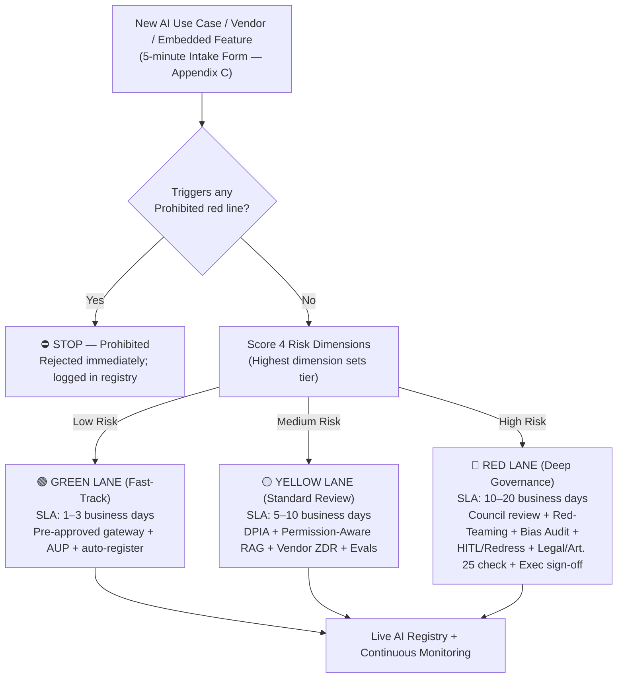

# Chapter 5: Policies, Inventory & Risk Tiering

*Part II: Governance & Accountability*

> **In this chapter**
>
> - How to replace vague "Responsible AI principles" with testable, enforceable policies
> - What belongs in an employee AI Acceptable Use Policy that people actually read and follow
> - How to build a central AI registry and a live AI Bill of Materials (AI-BOM)
> - A practical four-tier risk-scoring method (Prohibited, High, Medium, Low) aligned to major regulations
> - The Traffic Light intake process (Green, Yellow, and Red lanes) that speeds up safe projects while focusing scrutiny on high-risk ones
> - How architectural choices—SaaS, RAG, fine-tuning, or custom training—change your governance and legal duties, including the EU AI Act Article 25 "deployer-to-provider" trap
>
> **Essential for:** CIO, CISO, CDO, General Counsel, CRO, AI Architects, Business Owners · **Reading time:** about 30 minutes

---

## The Seven-Page Ethics Charter Nobody Could Use

*This composite scenario is illustrative; it is not drawn from a specific organization or incident.*

A consumer retail group publishes a glossy "Responsible AI Charter" on its intranet. Its five principles are unimpeachable: AI will be *fair*, *transparent*, *human-centric*, *privacy-preserving*, and *accountable*.

Two weeks later, a marketing manager asks whether she can paste customer survey transcripts into a free browser chatbot to draft a campaign brief. A software engineer asks whether he can enable an AI code-completion plugin on a repository containing payment-gateway code. A recruiting lead asks whether the company's existing applicant tracking vendor can turn on its new "AI candidate ranking" module.

Not one of those three people can find an answer in the five principles. Nobody knows where to register the tools, how long a review takes, or who can say yes. The marketing manager uses her personal account anyway. The engineer enables the plugin. The recruiting lead clicks "Accept" on the vendor's pop-up banner—quietly activating a high-risk automated hiring system with no bias audit, no legal review, and no entry in any corporate inventory.

Principles are easy to publish and impossible to enforce. Chapter 4 defined *who* governs AI; this chapter builds the **operational machinery** they run every day: enforceable policies, a single source of truth for every AI system, a consistent way to score risk, and an intake lane that treats a meeting summarizer differently from a loan-underwriting agent.

---

## 5.1 Turning Responsible AI Principles into Policies You Can Enforce

### The Challenge

High-level principles serve a purpose: they signal executive intent to employees, customers, and regulators. ISO/IEC 42001 explicitly requires top management to establish an AI policy aligned with organizational objectives (Annex A.2).[^c05-01] But a principle is not a rule. "Our AI will be fair" tells an engineer nothing about which test to run before launch. "Our AI will be transparent" tells a product manager nothing about whether a chatbot needs a disclosure banner.

If a policy cannot be **audited**, **tested**, or **violated unambiguously**, it is a slogan, not a control.

### The Translation Test

Every Responsible AI principle should map to concrete, testable policy rules—each with a named **policy owner**, an **enforcement mechanism**, and a documented **exception path**:

| Aspirational principle | Testable, enforceable policy rule | Enforcement trigger | Policy owner |
| :--- | :--- | :--- | :--- |
| *Privacy-preserving* | Confidential, regulated, or customer personal data must never be submitted to any AI tool without a signed Zero Data Retention (ZDR) agreement and gateway DLP enabled. | Technical block at AI gateway / CASB + disciplinary policy | CISO & DPO |
| *Transparent* | Every customer-facing AI interface must display a clear disclosure that the user is interacting with AI before the first exchange. | Pre-launch UI checklist + automated QA check | General Counsel & Product |
| *Fair* | Any AI system influencing hiring, credit, pricing, or insurance decisions must pass disparate-impact testing before launch and annually thereafter. | Red Lane release gate + annual audit calendar | CDO & Compliance |
| *Human-centric* | No AI agent may execute irreversible financial transfers, record deletions, or external customer commitments without explicit human approval above defined thresholds. | Infrastructure permission boundary + approval workflow | CIO & CISO |
| *Accountable* | Every AI system in production—internal, vendor-hosted, or embedded—must be listed in the central AI registry with a named business owner. | Procurement gate + quarterly registry reconciliation | CRO / CAIO |

### Writing Policies That Survive Contact with Reality

- **Keep the policy short; put details in standards.** A three-page Enterprise AI Policy approved by the board or Governance Council should rarely change. Put fast-moving technical specifics (approved model list, prompt-logging schemas, evaluation thresholds) in companion standards updated quarterly by the Center of Excellence.
- **Define a real exception process.** Policies without a formal exception path are silently ignored. Every exception should have a written business justification, compensating controls, a named executive approver, and a **hard expiry date** (typically 90 to 180 days) after which it automatically closes unless renewed.
- **Link policies to existing gates.** Do not rely on voluntary compliance. Wire AI policy checks into procurement intake, software architecture review, vendor onboarding, and CI/CD release pipelines.

---

## 5.2 The Employee AI Acceptable Use Policy

### The Challenge

Most early AI data leaks—including Samsung's 2023 source-code incident—did not come from malicious insiders. They came from conscientious employees trying to debug code, polish emails, or summarize meeting notes faster, using whatever consumer tool was open in their browser.[^c05-02]

When organizations respond with either silence or a blanket ban, employees are left guessing—or pushed into shadow AI. An effective **AI Acceptable Use Policy (AUP)** replaces fear and ambiguity with crisp, everyday rules. (Appendix E provides a ready-to-use template.)

### What a Practical AI AUP Covers

Organize the AUP into four short sections that any employee can read in five minutes:

1. **Green-Light Tools (What You *May* Use):** Name the sanctioned enterprise AI workspace, approved coding assistants, and enterprise-licensed office copilots—and link directly to where staff can request access.
2. **Data Rules (What You *May* and *May Not* Paste):** Tie directly to the company's existing data-classification levels so staff do not have to learn a second taxonomy:
   - *Public data:* Permitted in approved tools.
   - *Internal / Confidential data:* Permitted **only** in enterprise-sanctioned tools covered by Zero Data Retention.
   - *Restricted data (customer PII, health/financial records, source code secrets, board/M&A materials):* Prohibited in general-purpose tools unless the specific workflow has passed Yellow or Red Lane review.
   - *Personal accounts:* Never use personal consumer AI accounts for company data or work outputs, even on personal devices.
3. **Output & Verification Duties (You Own What You Ship):**
   - Treat every AI output as a draft produced by an intern who occasionally invents facts.
   - Verify all factual claims, numbers, citations, and code before sending them to customers, regulators, courts, or production repositories (echoing the verification duty enforced in *Mata v. Avianca* and the 2026 Indian Supreme Court rulings in Chapter 1).[^c05-03]
   - Never represent unverified AI-generated work as independently researched where accuracy or originality is relied upon.
4. **Code, IP, and Third-Party Content:**
   - Do not paste proprietary source code into unapproved tools.
   - Run AI-generated code through standard security, secret-scanning, and open-source license checks before merging (Chapter 19).
   - Do not upload third-party copyrighted material or client confidential files in breach of client NDAs.

### Communicate for Adoption, Not Fear

Publish a one-page "Do / Don't" quick-reference card alongside the formal AUP, require annual acknowledgment during onboarding and compliance training (supporting EU AI Act Article 4 literacy obligations), and always pair a restriction with the approved alternative. "Don't paste contracts into consumer chatbots; use our sanctioned enterprise workspace at `ai.company.com`" works ten times better than "AI is prohibited."

---

## 5.3 The Central AI Registry and AI Bill of Materials (AI-BOM)

### The Challenge

You cannot govern what you cannot count. When a regulator asks which systems process EU residents' data, when a security researcher discloses a critical flaw like EchoLeak in a widely used copilot, or when a vendor announces it is retiring a frontier model in ninety days, an organization without an AI inventory is flying blind.

Both international standards and public-sector directives treat an inventory as foundational. ISO/IEC 42001 (Annex A.4) requires organizations to identify and document the resources—models, data, tooling, and compute—used across AI systems.[^c05-01] U.S. OMB Memorandum M-25-21 requires federal agencies to maintain and publish annual AI use-case inventories.[^c05-04]

### Two Complementary Layers: Registry vs. AI-BOM

Organizations often conflate a **use-case registry** with a technical **Bill of Materials**. Both are needed, and they serve different audiences:

| Dimension | Central AI Registry (Governance Layer) | AI Bill of Materials / AI-BOM (Technical Layer) |
| :--- | :--- | :--- |
| **Primary audience** | Board, CRO, Legal, Compliance, Business Owners | CISO, AI Engineers, AppSec, Platform IT |
| **What it tracks** | Every AI *system or use case*—internal builds, third-party SaaS, and **embedded AI** features turned on inside existing tools | Every technical *component* inside a system: base model ID and version, weights/hashes, LoRA adapters, datasets, vector stores, system-prompt version, guardrails, MCP servers, and Python libraries |
| **Core fields** | System ID; named business owner; technical owner; intended purpose; risk tier; legal role (deployer vs. provider); data classification; status (pilot, production, retired); last review date | Machine-readable component graph linking models, training/grounding datasets, licenses, known vulnerabilities, and evaluation artifacts |
| **How it stays current** | Updated at intake, procurement renewal, and quarterly owner attestation | Generated automatically in CI/CD pipelines on every model, prompt, or dependency change |

### Adopting Emerging AI-BOM Standards

Two open standards have converged to make AI-BOMs machine-readable and compatible with existing software security tooling:

- **OWASP CycloneDX ML-BOM** (introduced in v1.5 and expanded in v1.6, standardized as ECMA-424): treats AI models, datasets, and training environments as first-class components alongside regular software packages, capturing model formats (e.g., Safetensors, GGUF), hashes, licenses, and embedded model cards.[^c05-05] It fits naturally into application-security and vulnerability-management pipelines.
- **Linux Foundation SPDX 3.0** (released in 2024, extending ISO/IEC 5962): introduces dedicated **AI** and **Dataset** profiles built on a modular graph model, well suited to deep license compliance, data provenance, and legal tracking.[^c05-06]

Whichever format engineering chooses, the governance rule is simple: **no system moves to production without a registry entry, and no custom or high-risk build deploys without a current AI-BOM.**

### Populating the Registry Beyond Self-Reporting

Relying purely on teams to volunteer their AI tools guarantees an incomplete inventory. Combine four discovery feeds:
1. **Traffic Light intake** (new internal projects)
2. **Procurement and SaaS renewal reviews** (catching vendor and embedded AI features)
3. **API gateway and cloud billing logs** (spotting LLM API calls, GPU clusters, and vector databases)
4. **CASB / DNS / browser telemetry** (surfacing shadow AI tools in active use)

---

## 5.4 Risk-Tiering Method: Low, Medium, High, and Prohibited

### The Challenge

If every AI project goes through the same thirty-page review, low-risk productivity tools stall and high-risk systems drown in paperwork. Proportional governance requires a repeatable **risk-tiering method** that classifies every use case in minutes—before engineering spends months building it.

### Four Scoring Dimensions

Rather than relying on gut feel, score every proposed AI use case across four concrete dimensions, using the **highest-risk dimension** (not the average) to determine the tier:

| Dimension | Low Risk | Medium Risk | High Risk | Prohibited |
| :--- | :--- | :--- | :--- | :--- |
| **1. Data Sensitivity** | Public or non-sensitive internal data | Confidential business data or internal employee/customer PII under ZDR | Special-category / regulated data (health, biometric, financial, children's data) or fine-tuning on personal data | Unlawfully obtained data or data lacking legal basis |
| **2. Audience & Exposure** | Internal employees only | Internal workflows shaping external deliverables (human-reviewed) | Direct customer-facing or public-facing outputs (chatbots, advice, marketing claims) | Deceptive impersonation or undisclosed manipulation |
| **3. Autonomy Level** | Assist only (drafting, summarizing, search) | Retrieve & answer; or act with mandatory, unhurried human approval | Autonomous execution of transactions, code deployment, or multi-agent delegation | Unbounded autonomous authority over safety-critical or irreversible financial/legal actions |
| **4. Legal & Harm Impact** | Minimal impact if wrong; easy to spot and fix | Moderate operational, contractual, or reputational harm | Legal or similarly significant effects on individuals (hiring, credit, insurance, medical, legal adjudication) or EU AI Act Annex III scope | Banned practices (e.g., EU AI Act Art. 5: social scoring, workplace emotion recognition, subliminal manipulation)[^c05-07] |

### Aligning Internal Tiers with Regulatory Classifications

Aligning your four internal tiers with the **EU AI Act** risk pyramid (Prohibited, High-Risk, Limited/Transparency-Obligation, Minimal) and **NIST AI RMF** Map function lets one intake form satisfy multiple regimes at once.[^c05-07][^c05-08] A use case that lands in **High Risk** automatically triggers checks for statutory duties—such as EU AI Act conformity assessments, Fundamental Rights Impact Assessments, NYC Local Law 144 bias audits, or sector-regulator rules (Chapters 20–22).

---

## 5.5 The Traffic Light Intake Process (Green, Yellow, and Red Lanes)

### The Challenge

Risk tiering only speeds up the business when it drives a **differentiated intake workflow**. The **Traffic Light model** turns the four risk tiers into three clear approval lanes (plus an immediate stop for Prohibited uses), each with published review steps and turnaround commitments.

### What Happens in Each Lane

| Lane | Typical examples | Required controls & sign-off | Target SLA |
| :--- | :--- | :--- | :---: |
| **🟢 Green Lane** *(Fast-Track)* | Internal meeting summarizer on sanctioned workspace; coding assistant on non-sensitive repos; internal drafting helper | Uses pre-approved AI gateway and ZDR contract; named business owner registered; automated AUP acknowledgment. **No council meeting required.** | **1–3 days** |
| **🟡 Yellow Lane** *(Standard Review)* | Internal knowledge-base RAG touching SharePoint/Drive; internal HR or finance drafting assistant; SaaS vendor AI feature using confidential data | Functional sign-off by CISO, CDO, and DPO; permission-hygiene check and ACL-aware RAG verification; DPIA if personal data involved; baseline evaluation suite; vendor ZDR confirmed. | **5–10 days** |
| **🔴 Red Lane** *(Deep Governance)* | Customer-facing chatbot or voice agent; automated hiring, credit, or claims screening; autonomous agents with write/payment access; fine-tuning on sensitive data | Full AI Governance Council review; adversarial red-teaming (Ch. 26); bias/fairness audit (Ch. 16); deterministic guardrails and kill switch; customer disclosure and contestability workflow (Ch. 17–18); EU AI Act Art. 25 role check; executive sign-off. | **10–20 days** |

The operational goal of the Traffic Light model is **inversion of volume**: 60 to 70 percent of enterprise requests should qualify for the Green Lane through pre-approved platforms, freeing risk, legal, and security specialists to spend their real energy on the 10 to 15 percent of Red Lane systems that carry existential exposure.

---

## 5.6 Architectural Risk Selection: SaaS, RAG, Fine-Tuning, and Custom Models

### The Challenge

Governance teams often evaluate *what* an AI system does without evaluating *how* it is built. Yet the choice of architecture—buying off-the-shelf SaaS, grounding a foundation model with RAG, fine-tuning weights on company data, or training a custom model—dramatically alters your data-privacy burden, security surface, maintenance cost, and **legal classification**.

### The EU AI Act Article 25 "Deployer-to-Provider" Trap

Under the EU AI Act, **deployers** (organizations using an AI system under their authority) face meaningful but manageable duties—such as human oversight, monitoring, and logging. **Providers** (organizations developing or placing a high-risk AI system on the market) carry far heavier obligations under Article 16: full quality management systems, formal conformity assessments, exhaustive technical documentation, CE marking, and regulatory registration.

Many enterprises assume that because they buy models from a frontier lab or SaaS vendor, they are safely a deployer. **Article 25 ("Responsibilities along the AI value chain")** breaks that assumption. Under Article 25(1), a deployer, importer, or distributor legally **becomes the provider** of a high-risk AI system—inheriting full Article 16 duties—if they trigger any of three conditions:[^c05-09]

1. **Rebranding — Article 25(1)(a):** Putting your own name or trademark on a high-risk AI system already placed on the market (for example, white-labelling a vendor's recruiting or credit-scoring model under your own product brand).
2. **Substantial Modification — Article 25(1)(b):** Making an unplanned change to an existing high-risk AI system that affects its compliance or alters its assessed purpose—such as heavily fine-tuning a vendor's high-risk model on proprietary data outside the vendor's original validation envelope.
3. **Changing the Intended Purpose — Article 25(1)(c):** Taking a non-high-risk or general-purpose AI system (such as a standard commercial LLM) and repurposing it for a high-risk Annex III use case (such as screening job resumes or scoring loan eligibility).

There is an even sharper catch in **Article 25(2)**: when a deployer flips into a provider, the original vendor is normally required to cooperate and supply technical documentation—*unless* the original vendor explicitly specified in its terms that the system must not be modified into a high-risk system.[^c05-09] If an enterprise ignores that restriction and builds a high-risk hiring tool on top of a general-purpose API anyway, it inherits full provider liability **without** the underlying model documentation it needs to pass a conformity assessment.

### Comparing Governance Burdens Across Architectures

Use this comparison during Yellow and Red Lane intake to push teams toward the **lowest-burden architecture that solves the business problem**:

| Architecture | Data Deletion ("Right to Be Forgotten") | IP & Leakage Exposure | EU AI Act Role Risk (Art. 25) | Operational & Drift Maintenance | Governance Verdict |
| :--- | :--- | :--- | :--- | :--- | :--- |
| **1. Off-the-Shelf SaaS / Enterprise Workspace** | Handled via vendor DPA & ZDR | Low if ZDR + DLP enforced; watch for silent "embedded AI" opt-ins | Normally **Deployer** (unless repurposed into high-risk under Art. 25(1)(c)) | Lowest; vendor manages model updates (track deprecation) | **Default starting point** for general productivity |
| **2. Prompting + RAG (over API or hosted model)** | **Easy** — delete or revoke chunks in the vector store immediately | Must enforce permission-aware RAG and indirect prompt-injection defences | **Deployer** for low/medium use; **Provider** if built into a high-risk Annex III system | Moderate; maintain retrieval freshness, evals, and model version pinning | **Preferred enterprise pattern** for proprietary and personal data |
| **3. Fine-Tuning / LoRA Adapters** | **Hard** — personal data baked into weights cannot be selectively erased | High memorization and training-data extraction risk; vendor IP terms vary | High risk of **Substantial Modification** (Art. 25(1)(b)) flipping you to **Provider** | High; must re-tune and re-validate every time base model updates | Use only for **style, format, or domain jargon**—never for personal data or dynamic facts |
| **4. Self-Hosted Open-Weight or Custom-Trained Model** | Full control over training corpora, but deletion still requires retraining | Full control over residency/ZDR; must audit open-weight licenses & scan model files (Ch. 12, 19) | **Provider** if deployed for high-risk use or placed on market | Highest; own GPU infrastructure, patching, red-teaming, and AI-BOM | Justified only for strict data sovereignty, extreme scale, or core IP differentiation |

### Why Every Role Cares

| Role | What this means for you |
| :--- | :--- |
| **Board / CEO** | Policies without an inventory and intake lanes do not protect the company. Ask what percentage of AI use cases flow through the Traffic Light process. |
| **CIO** | Steering teams toward RAG over fine-tuning cuts both engineering maintenance cost and regulatory compliance burden. |
| **CISO** | An up-to-date AI-BOM lets you answer within minutes whether a newly disclosed model or library vulnerability affects production systems. |
| **CDO / Data Stewards** | The four-dimension risk rubric makes data sensitivity a first-class trigger for review, not an afterthought. |
| **General Counsel / DPO** | Check every Yellow and Red Lane intake for EU AI Act Article 25 triggers—especially white-labelling, fine-tuning, and repurposing general-purpose tools into HR or credit. |
| **AI Engineers** | Start with the simplest compliant architecture (RAG on an approved gateway) so you qualify for faster lanes and avoid weight-deletion nightmares. |

---

## Chapter Summary

| Section | Core deliverable | Primary governance payoff |
| :--- | :--- | :--- |
| 5.1 Enforceable Policies | Short board policy + testable rules + time-bound exceptions | Replaces vague ethics slogans with auditable controls |
| 5.2 Employee AUP | Clear Do/Don't rules tied to data classification and approved tools | Cuts shadow AI and sets clear human verification duties |
| 5.3 Registry & AI-BOM | Central use-case inventory + machine-readable CycloneDX/SPDX AI-BOM | Eliminates blind spots during audits, outages, and security disclosures |
| 5.4 Risk Tiering | Four-dimension rubric (Prohibited, High, Medium, Low) | Aligns internal governance with EU AI Act and NIST risk levels |
| 5.5 Traffic Light Intake | Green / Yellow / Red lanes with published SLAs | Fast-tracks safe tools in days while focusing deep review on high-risk systems |
| 5.6 Architectural Selection | SaaS vs. RAG vs. Fine-Tuning vs. Custom governance matrix | Prevents accidental Article 25 deployer-to-provider legal flips and weight-deletion traps |

---

## Key Takeaways

- **Principles are not policies.** Every Responsible AI commitment must translate into a testable rule with a named owner, an automated or procedural gate, and a time-bound exception process.
- **Pair every "don't" with a safe "do."** An employee Acceptable Use Policy only reduces shadow AI when it points directly to fast, sanctioned enterprise tools.
- **Maintain both a registry and an AI-BOM.** Business owners and boards need a live use-case registry; engineers and security teams need automated, machine-readable AI-BOMs (CycloneDX ML-BOM or SPDX 3.0).
- **Let the highest risk dimension set the tier.** Never average a low autonomy score with a high data-sensitivity score.
- **Architecture is a governance decision.** Choosing RAG over fine-tuning—and checking EU AI Act Article 25 before rebranding, fine-tuning, or repurposing general-purpose AI—can save months of compliance work and prevent unintended provider liability.

## Questions to Ask

| Role | Question |
| :--- | :--- |
| **Board / CEO** | What share of our active AI tools—including embedded SaaS features—are currently captured in our central AI registry? |
| **CIO** | What is our median turnaround time for Green Lane requests, and where are Yellow/Red Lane reviews getting stuck? |
| **CISO** | Can we query our AI-BOM today to find every system using a specific open-weight model, MCP server, or vector store? |
| **CDO / Data Stewards** | Are any teams fine-tuning models on personal or customer data where RAG would solve the problem cleanly? |
| **General Counsel** | Have we checked our high-risk and white-labelled AI projects against EU AI Act Article 25 to ensure we have not accidentally become a "provider"? |
| **AI Engineers** | Does our CI/CD pipeline automatically generate and update an AI-BOM whenever we change a model version, prompt, or dataset? |
| **Business Owners** | Can every member of my team explain in thirty seconds which data they are allowed to paste into our enterprise AI workspace? |

---

## References

[^c05-01]: International Organization for Standardization and International Electrotechnical Commission, *ISO/IEC 42001:2023, Information Technology — Artificial Intelligence — Management System* (Geneva: ISO, December 2023), Annex A.2 and A.4, https://www.iso.org/standard/81230.html. **Annotation:** Annex A.2 requires a documented, reviewed AI policy; Annex A.4 requires maintaining an inventory of AI system resources including data, models, tooling, and compute. [↗ Bibliography](../bibliography.md#iso-2023-42001)

[^c05-02]: Mark Gurman, "Samsung Bans Staff's AI Use After Spotting ChatGPT Data Leak," *Bloomberg*, May 2, 2023, https://www.bloomberg.com/news/articles/2023-05-02/samsung-bans-chatgpt-and-other-generative-ai-use-by-staff-after-leak. **Annotation:** Illustrates how well-intentioned employees leak proprietary code when clear acceptable-use rules and sanctioned alternatives are absent. [↗ Bibliography](../bibliography.md#gurman-2023-samsung)

[^c05-03]: *Mata v. Avianca, Inc.*, 678 F. Supp. 3d 443 (S.D.N.Y. 2023), [↗ Bibliography](../bibliography.md#mata-2023-avianca); *Pooja Ramesh Singh v. Jammu and Kashmir Bank Ltd. & Anr.*, 2026 INSC 668 (Supreme Court of India, July 2, 2026), [↗ Bibliography](../bibliography.md#pooja-2026-jkbank); *Vijay Ghanshyam Gadiya v. Union of India & Anr.*, 2026 INSC 947 (Supreme Court of India, September 2, 2026), [↗ Bibliography](../bibliography.md#gadiya-2026-uoi). **Annotation:** Together these decisions reinforce why employee Acceptable Use Policies must mandate independent human verification of AI outputs before reliance or publication.

[^c05-04]: Office of Management and Budget, *Accelerating Federal Use of AI through Innovation, Governance, and Public Trust*, Memorandum M-25-21 (Washington, DC: Executive Office of the President, April 3, 2025), https://www.whitehouse.gov/wp-content/uploads/2025/02/M-25-21-Accelerating-Federal-Use-of-AI-through-Innovation-Governance-and-Public-Trust.pdf. **Annotation:** Requires civilian federal agencies to maintain and publish annual AI use-case inventories alongside compliance plans and high-impact risk controls. [↗ Bibliography](../bibliography.md#omb-2025-m25-21)

[^c05-05]: OWASP Foundation and Ecma International, *CycloneDX Specification (ML-BOM)*, v1.6 / ECMA-424 (2024), https://cyclonedx.org/capabilities/mlbom/. **Annotation:** Extends the CycloneDX SBOM standard to treat AI models, datasets, weights, hashes, and model cards as first-class components compatible with existing security scanners. [↗ Bibliography](../bibliography.md#cyclonedx-2024-mlbom)

[^c05-06]: Linux Foundation, *SPDX Specification Version 3.0 (AI and Dataset Profiles)* (2024), https://spdx.dev/use/specifications/. **Annotation:** Introduces dedicated AI and Dataset profiles on a modular RDF graph model, supporting granular data provenance, license compliance, and legal tracking. [↗ Bibliography](../bibliography.md#spdx-2024-v3)

[^c05-07]: Regulation (EU) 2024/1689 (Artificial Intelligence Act), *Official Journal of the European Union* L, 2024/1689, July 12, 2024, arts. 5–6 and Annex III, http://data.europa.eu/eli/reg/2024/1689/oj. **Annotation:** Article 5 defines prohibited AI practices; Article 6 and Annex III define high-risk AI categories—providing a legal baseline for enterprise risk tiering. [↗ Bibliography](../bibliography.md#eu-2024-ai-act)

[^c05-08]: National Institute of Standards and Technology, *Artificial Intelligence Risk Management Framework (AI RMF 1.0)*, NIST AI 100-1 (Gaithersburg, MD: NIST, January 2023), Map function, https://doi.org/10.6028/NIST.AI.100-1. **Annotation:** The Map function structures context establishment, intended-purpose documentation, and risk identification during use-case intake. [↗ Bibliography](../bibliography.md#nist-2023-ai-rmf)

[^c05-09]: Regulation (EU) 2024/1689 (Artificial Intelligence Act), art. 25 and art. 3(23). **Annotation:** Article 25(1) specifies the three triggers (rebranding, substantial modification, or changing intended purpose to high-risk) that legally convert a deployer into a high-risk provider; Article 25(2) includes the original vendor's contractual opt-out exception. [↗ Bibliography](../bibliography.md#eu-2024-ai-act)
