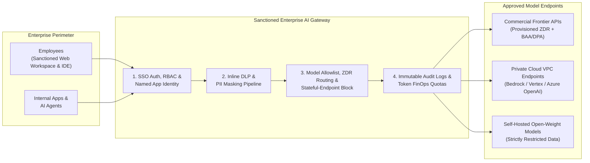

# Chapter 6: Data Leakage & Shadow AI

*Part III: Data Risk*

> **In this chapter**
>
> - How proprietary code, strategy memos, and customer data leave the enterprise through prompts and model training pipelines
> - Why consumer AI accounts, commercial APIs, and Zero Data Retention endpoints treat your data differently
> - Why blanket AI bans push usage underground, and how to discover and redirect "shadow AI"
> - How "embedded AI" inside approved SaaS tools creates silent data-sharing exposure outside procurement review
> - How to route all AI traffic through a sanctioned enterprise gateway with Zero Data Retention enforced technically
> - How to build layered Data Loss Prevention (DLP) and PII redaction pipelines without breaking developer and analyst productivity
>
> **Essential for:** CISO, CDO, Data Stewards, CIO, DPO, AI Engineers · **Reading time:** about 30 minutes

---

## Three Leaks Before Lunch

*This composite scenario is illustrative; it is not drawn from a specific organization or incident.*

On a Tuesday morning at a mid-sized financial software firm, three employees open their laptops to get ahead of a busy week. None of them intends to break a policy, and none of them bypasses a firewall.

First, a backend engineer hits a stubborn concurrency bug in a payment-reconciliation service. Six months earlier, the company banned public chatbots on corporate devices, so the engineer switches to a personal laptop beside her desk, signs into a free consumer AI account, and pastes three hundred lines of proprietary code along with a redacted—mostly redacted—stack trace containing two customer account identifiers. She gets a working patch in ninety seconds and closes the tab.

Second, a sales operations analyst logs into the company's approved cloud CRM to prepare a quarterly pipeline review. A cheerful banner announces a new "AI Deal Insights" assistant, pre-enabled for the workspace after an overnight vendor update. The analyst clicks through the one-line prompt and asks the tool to summarize sensitive enterprise renewal negotiations. Neither procurement nor the Data Protection Officer has reviewed the feature's updated terms of service or checked which sub-processor now receives CRM notes.

Third, a product team ships an internal document-triage workflow wired to a major commercial LLM API. Before launch, the tech lead checked the vendor's marketing page, saw that "API data is not used for model training," and told the CISO that the integration retained no customer data. Nobody noticed that the vendor still stores prompts and responses for up to thirty days in abuse-monitoring logs—or that the team uploaded bulk contracts to a stateful Files endpoint that retains files until explicitly deleted.

In a single morning, sensitive data left the enterprise perimeter through three distinct doors: **shadow AI**, **embedded SaaS AI**, and **misunderstood API retention defaults**. Part II established who governs AI and how systems enter the registry. Part III turns to the enterprise's most valuable asset—its data—beginning with how to stop it from leaking outside the building.

---

## 6.1 External Data Leakage and Model-Training Risk

### The Challenge

Every prompt sent to an external AI model is an outbound data transfer. Unlike a web search query of four or five keywords, generative AI rewards context: employees paste full customer emails, board drafts, unannounced M&A spreadsheets, HR grievances, and proprietary source code because better context produces better answers. The OWASP Top 10 for LLM Applications ranks **Sensitive Information Disclosure** (LLM02:2025) as the second highest risk for LLM systems, while the NIST Generative AI Profile (NIST AI 600-1) flags **Data Privacy**—including inadvertent exposure of sensitive information and training-data memorization—as a core generative AI hazard.[^c06-01][^c06-02]

The enterprise risk first became front-page news in April 2023, when engineers at Samsung Electronics uploaded proprietary semiconductor source code, internal test data, and meeting notes into ChatGPT on at least three occasions to debug errors and generate summaries. Samsung responded within weeks by banning generative AI tools on corporate devices and internal networks, noting in an internal memo that data transmitted to external servers could not easily be retrieved or deleted.[^c06-03]

Samsung's concern pointed to a critical technical asymmetry between ordinary cloud storage and AI model training: **you can delete a file from a database, but you cannot selectively unlearn a trade secret once it is baked into a foundation model's weights.**

In a landmark 2021 USENIX Security study, Nicholas Carlini and colleagues demonstrated that large language models memorize and regurgitate individual training sequences verbatim—a phenomenon they termed *eidetic memorization*.[^c06-04] Querying GPT-2 solely through black-box input-output prompts, the researchers extracted personally identifiable information (names, phone numbers, email addresses), source code, 128-bit UUIDs, and private chat logs. Crucially, many leaked strings appeared in **just a single document** in the training corpus, and larger models memorized strictly more data than smaller models. Once sensitive corporate text enters a shared training pipeline, the risk is permanent and effectively impossible to audit.

### Consumer Accounts vs. Commercial APIs vs. Enterprise Agreements

A widespread misconception among engineering and business leaders is treating all access to a model provider as having identical privacy guarantees. In practice, a provider's data-handling posture changes sharply across product tiers. OpenAI's enterprise privacy documentation illustrates how standard commercial guarantees work across major frontier labs:[^c06-05]

- **Consumer Tiers (Free / Individual Plans):** On many consumer interfaces, user prompts and thumbs-up/thumbs-down feedback may be used by default to train and improve future models unless the user manually toggles training off, and conversation histories persist in the user's cloud account.
- **Standard Commercial API:** By default, major enterprise-ready model APIs (including OpenAI's API and ChatGPT Enterprise/Team) **do not train models on customer inputs or outputs**. However, "no training" does *not* automatically mean "no retention." To enforce usage policies and catch automated abuse, providers commonly retain prompts and completions in encrypted **abuse-monitoring logs for up to 30 days**, where authorized safety personnel or automated classifiers may review flagged traffic.
- **Enterprise Zero Data Retention (ZDR) Endpoints:** For regulated industries (healthcare under HIPAA, banking, legal services), providers offer Zero Data Retention agreements that eliminate the 30-day server-side abuse logging on eligible stateless endpoints. Critically, ZDR is rarely a self-serve checkbox; it requires vendor security review, formal contract addenda, and explicit organization-level provisioning, and **stateful features** (such as file uploads, batch jobs, fine-tuning datasets, or persistent assistant threads) often sit outside ZDR coverage.

| Deployment Tier | Used for Model Training? | Server-Side Prompt Retention | Stateful Feature Risk | Governance Verdict |
| :--- | :--- | :--- | :--- | :--- |
| **Consumer Free / Personal Plan** | Often **yes by default** (opt-out) | Indefinite history + safety logs | High (shared personal accounts, plugins) | **Prohibit** for any non-public company data |
| **Standard Commercial API / Team Workspace** | **No by default** | Typically **up to 30 days** for abuse monitoring | Files, batches, threads persist until deleted | Acceptable for internal/confidential data if DPA signed and stateful APIs restricted |
| **Enterprise API with ZDR** | **No** | **Zero persistent retention** on eligible stateless endpoints | Stateful endpoints still persist data unless blocked at gateway | **Target baseline** for sensitive enterprise workloads and customer PII |
| **Private Cloud VPC / Self-Hosted Open-Weight** | **No** (customer-controlled) | Customer controls all logs and retention | Full customer control over vector stores and weights | Required for strict data sovereignty, classified data, or zero-egress mandates |

---

## 6.2 The Shadow AI Problem

### The Challenge

When confronted with external leakage risk, many leadership teams reach for the obvious control: block AI domains at the corporate firewall and issue a stern email forbidding generative AI. That approach reliably fails—not because employees are malicious, but because AI delivers an immediate, undeniable productivity advantage to anyone trying to clear an overloaded inbox or hit an aggressive sprint deadline.

Three empirical benchmarks capture the scale of **shadow AI**—the use of unsanctioned AI tools, personal accounts, or browser extensions outside IT and security oversight:

1. **Employees are bringing their own AI anyway.** Microsoft and LinkedIn's *2024 Work Trend Index* found that **78 percent of AI users bring their own AI tools to work (BYOAI)**—a pattern spanning every generation, from Gen Z (85 percent) and Millennials (78 percent) to Gen X (76 percent) and Boomers (73 percent). At the same time, 60 percent of leaders acknowledged their organizations lacked a clear vision or plan to implement AI.[^c06-06]
2. **Personal accounts dominate enterprise traffic.** Netskope's *Cloud and Threat Report: Generative AI 2025* reported that while roughly 94 percent of surveyed organizations had employees using generative AI applications, **72 percent of workplace GenAI users relied on personal accounts** rather than corporate-managed instances.[^c06-07]
3. **Shadow AI directly inflates breach costs.** According to the IBM and Ponemon Institute *Cost of a Data Breach Report 2025*, **20 percent (one in five)** of studied organizations suffered a data breach involving shadow AI security incidents, and organizations with high levels of shadow AI incurred an average of **\$670,000 in additional breach costs** compared to peers with low or no shadow AI.[^c06-08]

### Real-World Scenario: Why Bans Create Blind Spots

When Samsung banned ChatGPT on corporate networks in May 2023, an internal survey cited at the time showed that 65 percent of employees themselves viewed generative AI services as a security risk.[^c06-03] Yet across industries, organizations that blocked popular AI URLs without offering an approved, equally capable internal workspace quickly discovered a familiar pattern: employees switched to mobile hotspots, personal laptops, or obscure wrapper websites hosted on newly registered domains. Blocking the top five consumer chatbots did not stop data leakage; it simply pushed the leakage off corporate DNS logs and onto unmonitored consumer extensions and third-party PDF summarizers.

### The Guardrails: Visibility and Redirection, Not Pure Prohibition

An effective anti-shadow-AI strategy pairs passive **discovery** with frictionless **redirection**:

- **Network and Web Telemetry (DNS, Proxy, SWG):** Maintain an updated category list of generative AI web apps, API domains, and "AI wrapper" sites (meeting recorders, PDF chat tools, slide generators) in your Secure Web Gateway (SWG) to measure actual usage before deciding controls.
- **CASB Tenant Restrictions:** Use a Cloud Access Security Broker (CASB) or identity proxy to distinguish between corporate-managed AI accounts and personal consumer accounts on the *same* provider domain—allowing logins authenticated via corporate Single Sign-On (SSO) while blocking personal `@gmail.com` or free logins.
- **Browser Extension & IDE Plugin Audits:** Enforce browser and IDE allowlists. Unvetted AI browser extensions routinely request broad permissions to read every open webpage—including internal CRM records, HR portals, and webmail.
- **Expense-Report & SaaS Spend Discovery:** Cross-check corporate credit card feeds and SaaS management platforms for recurring \$20/month AI subscriptions billed by individuals or departments.
- **Coach and Redirect Instead of Silent Blocking:** When an employee visits an unapproved AI site, display an explanatory coaching interstitial (*"This tool is not approved for company data. Click here to launch our enterprise AI workspace with Zero Data Retention"*). As Chapter 5 noted, usage drops sharply once the sanctioned alternative is one click away and equally fast.

---

## 6.3 "Embedded AI": When Existing SaaS Tools Quietly Add AI Features

### The Challenge

Even an organization that bans consumer chatbots and builds a secure internal AI gateway can leak data through a back door that procurement already approved years ago: **embedded AI**.

Every major enterprise SaaS vendor—across CRM, HR, email, video conferencing, chat, project tracking, and document storage—is racing to ship built-in AI features. Rather than negotiating a new contract, vendors frequently introduce these features through routine product updates, quiet Terms of Service revisions, or workspace toggles switched on by default. Because traffic flows to an already allowlisted vendor domain, traditional firewalls and CASB shadow-AI detectors miss it entirely.

### Real-World Scenarios: Terms of Service Surprises

Two widely publicized SaaS controversies show how easily embedded AI triggers enterprise governance failures:

1. **Zoom's Terms of Service Backlash (August 2023):** Observers spotted updated language in Section 10 of Zoom's Terms of Service that appeared to grant the company broad, perpetual rights to use customer data—including audio, video, chat logs, and screen shares—to train machine learning and AI models, with no clear opt-out for individual meeting participants. Following rapid backlash from corporate buyers, privacy advocates, and healthcare users, Zoom published an explanation and amended Section 10 within days to state explicitly that it does not use audio, video, or chat customer content to train AI models without customer consent, placing AI-training data sharing behind explicit account-owner controls.[^c06-09]
2. **Slack's Default Opt-In and Manual Opt-Out Friction (May 2024):** Users uncovered language on Slack's Privacy Principles page indicating that workspaces were opted in by default to contribute customer data toward training machine-learning models—and that to opt out, a workspace owner had to send a manual email to `feedback@slack.com` with a specific subject line. Following intense scrutiny from CISOs and privacy professionals, Slack clarified a critical technical distinction: its global ML models (used for channel recommendations, search, and emoji suggestions) relied on aggregated, de-identified interaction data and did *not* expose private message text, nor did Slack train third-party LLMs for its generative "Slack AI" search and summarization features.[^c06-10] Even so, Slack acknowledged it could have communicated more clearly—and for enterprise buyers, the episode exposed a major governance blind spot: **a global opt-out buried behind a manual email request means most busy IT teams never discover it until headlines break.**

### The Guardrails

ISO/IEC 42001 explicitly requires governance over third-party and customer relationships across the AI lifecycle (Annex A.10).[^c06-11] Managing embedded SaaS AI requires three operational habits:

- **Enforce "Default-Off" in Vendor Admin Consoles:** Instruct SaaS administrators across core platforms (productivity suites, CRM, HRIS, ticketing, conferencing) to disable newly released beta or preview AI features globally until they pass Yellow or Red Lane review.
- **Monitor Terms of Service and Sub-Processor Updates:** Subscribe Legal and Procurement to automated change alerts on key vendors' Privacy Policies, Data Processing Addenda (DPAs), and AI sub-processor lists (detailed further in Chapter 23).
- **Quarterly Embedded-AI Registry Sweeps:** Run a quarterly audit across your top twenty SaaS vendors to record newly enabled AI features in the central AI registry (Chapter 5). When a vendor adds a new LLM sub-processor or changes data retention, the system's risk tier must be re-evaluated.

---

## 6.4 Sanctioned AI Gateways and Zero Data Retention (ZDR)

### The Challenge

Policy and discovery tell you what is happening; **architecture** determines what is possible. If every engineering team integrates separately with OpenAI, Anthropic, Google, or Bedrock—generating scattered API keys, writing custom logging, and negotiating separate privacy settings—the CISO loses visibility and the CFO loses cost control.

The enterprise answer is a **sanctioned AI gateway**: a single internal proxy sitting between every employee workspace, internal RAG application, and autonomous agent on one side, and external or self-hosted models on the other.

### Enforcing Zero Data Retention—and Avoiding the Stateful-Endpoint Trap

Routing traffic through a gateway only eliminates vendor-side leakage if the downstream endpoint enforces **Zero Data Retention (ZDR)** both contractually and technically. Using OpenAI's ZDR architecture as an illustrative benchmark, security architects and procurement teams must watch four details:[^c06-05]

1. **ZDR Must Be Explicitly Provisioned:** Standard API keys do *not* automatically carry zero-day retention. Confirm in writing—and verify via vendor organization-level headers or admin console status—that the 30-day abuse-monitoring log window is disabled on the account tied to your gateway.
2. **Understand Privacy-Preserving Safety Architectures:** Because vendors still need to detect severe platform abuse (such as CSAM or cyberattack generation) without reading customer data, modern providers use architectures like OpenAI's **Private Safety Processing (PSP)**. Under PSP, interactions flagged by automated safety classifiers are encrypted and stored inside **customer-controlled cloud storage**, evaluated only inside hardware-attested, isolated runtimes with zero human access, returning only bounded safety signals to the vendor.[^c06-05]
3. **Block Stateful Endpoints by Default:** ZDR almost always applies only to **stateless inference endpoints** (such as Chat Completions). Stateful endpoints—such as `/files` uploads, batch-processing queues, persistent Assistants/threads, prompt caching beyond short memory TTLs, or hosted fine-tuning jobs—inherently write data to vendor disk. Configure the AI gateway to **drop or reject calls to stateful endpoints** unless an application has explicit Yellow/Red Lane approval.
4. **Close Direct Egress Paths:** A gateway is optional unless the network enforces it. Block outbound HTTPS calls to public AI API domains from corporate workloads and developer laptops except through the gateway's static egress proxies, and ban individual vendor API keys from secret vaults.

### Hosting Options Compared

Most enterprises land on a **tiered routing policy** inside the gateway:
- **Public / Internal / Confidential (under ZDR):** Route to ZDR-enabled commercial frontier APIs or private cloud VPC deployments (AWS Bedrock, Google Vertex AI, Azure OpenAI) hosted in the enterprise's approved region.
- **Restricted / Regulated / National-Security / Crown-Jewel Code:** Route exclusively to self-hosted open-weight models inside the enterprise's own virtual private cloud or on-premises GPU cluster, where zero bytes leave company-controlled infrastructure.

---

## 6.5 Data Loss Prevention (DLP) and PII Redaction Pipelines

### The Challenge

Even with Zero Data Retention contracts and a private VPC model endpoint, sending raw secrets or unnecessary PII across an API creates avoidable blast radius. If a prompt containing an AWS production secret key or a customer's national ID is written into an application's observability trace, stored inside an internal conversation history, or accidentally echoed in a model output, an internal leak has still occurred.

Inline **DLP and PII redaction pipelines** sitting inside the AI gateway inspect every outbound prompt—and attached document—*before* it leaves the enterprise perimeter.

### A Layered Detection Pipeline

Single-method DLP fails in opposite directions: pure regular expressions miss unstructured names and context, while heavyweight LLM-based scanners add unacceptable latency to every chat turn. Effective enterprise pipelines combine three fast layers:

1. **Layer 1 — Deterministic Pattern & Entropy Detectors (< 5 ms):**
   High-precision regex rules, prefix signatures, and Shannon-entropy checks catch structured secrets that have zero legitimate reason to enter a general prompt: cloud access keys (`AKIA...`), GitHub/Slack/OpenAI tokens, PEM private keys, database connection strings, payment card numbers (validated via Luhn checksums), and national identifiers (SSNs, Aadhaar, PAN, passport patterns).
2. **Layer 2 — Lightweight NLP / NER Classifiers (20–60 ms):**
   Local named-entity recognition (NER) models detect unstructured PII—person names, street addresses, phone numbers, email addresses, medical record numbers, and organization names. Open-source frameworks such as **Presidio** (originally created by Microsoft and maintained under the Data Privacy Stack community) provide a widely adopted modular baseline combining **Presidio Analyzer** (regex + checksums + spaCy/transformer NER), **Presidio Anonymizer**, **Presidio Image-Redactor** (OCR-based masking for screenshots and medical images), and **Presidio Structured** for tabular payloads.[^c06-12]
3. **Layer 3 — Sensitivity Labels & Custom Dictionaries:**
   Block prompts carrying corporate sensitivity headers (e.g., `Classification: Strictly Confidential — M&A`) or internal project code names registered by the CDO.

### Three Enforcement Actions: Block, Mask, or Coach

Blocking every prompt that mentions a person's name makes an AI assistant unusable for drafting emails or summarizing meeting notes. Configure the gateway to match the response to the severity of the match:

| Detected Content | Recommended Action | How It Works |
| :--- | :--- | :--- |
| **Hard Secrets & Credentials** (API keys, private keys, DB passwords) | **Hard Block** | Reject request immediately (`HTTP 400`); return a clear message explaining which secret pattern triggered the block; alert SecOps if repeated. |
| **Structured Regulated PII** (credit cards, SSNs, health IDs, bank account numbers) | **Mask or Block** (by tier) | Block on general workspaces; mask in approved analytics workflows. |
| **Unstructured PII in Summarization / Drafting** (customer names, emails, phone numbers) | **Pseudonymize & Re-hydrate** | Replace `Priya Nair` with `<PERSON_1>` and `priya@acme.com` with `<EMAIL_1>` in a short-lived local session map before calling the LLM; automatically restore the real values in the response returned to the user. |
| **Borderline Business Data** (internal financial tables, legal clauses) | **Warn & Log** | Allow on ZDR endpoints only; display a subtle reminder and log metadata for security telemetry. |

### Avoiding the False-Positive Trap

The biggest operational risk in AI DLP is **false-positive fatigue**. If regex rules falsely block legitimate 16-digit product SKUs as credit card numbers or flag legal case citations as sensitive names, developers and analysts will find workarounds—returning straight back to shadow AI.

Keep DLP useful by enforcing four engineering practices:
- **Measure inline latency budgets:** Keep text inspection under 100 ms per request so interactive chat remains responsive.
- **Validate with checksums and context words:** Require Luhn validation on card numbers and nearby context clues (`account`, `SSN`, `DOB`) before triggering blocks on ambiguous numeric strings.
- **Inspect multimodal attachments, not just text:** Employees routinely bypass text DLP by uploading a screenshot, PDF, or CSV spreadsheet. Run document text extraction and OCR image redaction (such as Presidio Image-Redactor) at the gateway before files reach any model.
- **Separate redaction logs from raw secrets:** Never log the raw intercepted secret inside DLP alert logs—log the rule triggered, user/app identity, and a redacted snippet or cryptographic hash so the DLP log itself does not become a credential treasure trove.

---

## Why Every Role Cares

| Role | What this means for you |
| :--- | :--- |
| **Board / CEO** | Shadow AI turns invisible productivity tools into an average \$670,000 extra breach cost; fund a fast sanctioned workspace so staff do not need personal accounts. |
| **CIO** | Consolidate fragmented LLM API keys and SaaS AI pilots behind one enterprise AI gateway, and require "default-off" admin baselines on existing SaaS suites. |
| **CISO** | Pair CASB tenant restrictions and SWG discovery with gateway DLP and egress blocking so sensitive prompts cannot bypass Zero Data Retention. |
| **CDO / Data Stewards** | Provide sensitivity labels, custom dictionaries (project code names), and PII redaction standards so engineering does not invent classification rules ad hoc. |
| **Legal / Compliance / DPO** | Verify ZDR addenda, stateful-endpoint exclusions, and vendor Terms of Service changes—especially embedded SaaS AI features that quietly opt workspaces in by default. |
| **AI Engineers** | Route every model call through the sanctioned gateway, block stateful file/batch endpoints where ZDR is required, and implement reversible PII masking to protect utility. |

---

## Chapter Summary

| Section | Core risk | Primary guardrail |
| :--- | :--- | :--- |
| 6.1 External Leakage & Training | Prompts sent to consumer accounts can be absorbed into model weights permanently; standard APIs retain 30-day abuse logs | Ban consumer tiers for company data; distinguish "no training" from Zero Data Retention; keep secrets out of training sets |
| 6.2 Shadow AI | 72% of enterprise GenAI users rely on personal accounts; blanket bans drive usage off monitored networks | Discover usage via SWG/CASB/IDE/spend telemetry; enforce tenant restrictions; coach and redirect users to a fast sanctioned workspace |
| 6.3 Embedded SaaS AI | Existing SaaS tools quietly enable AI features or revise Terms of Service outside procurement | Enforce "default-off" toggles in SaaS admin consoles; track vendor ToS/sub-processor alerts; run quarterly registry sweeps |
| 6.4 Sanctioned Gateways & ZDR | Direct vendor API integrations bypass privacy settings and expose stateful file/batch endpoints | Route all traffic through one SSO-authenticated gateway; provision ZDR/PSP contracts; block stateful endpoints and direct egress |
| 6.5 DLP & PII Redaction | Unmasked credentials and PII enter external APIs, observability traces, and conversation histories | Combine fast regex/checksums with lightweight NER (e.g., Presidio); hard-block secrets; pseudonymize and re-hydrate PII |

---

## Key Takeaways

- **"No training" is not "zero retention."** Standard commercial LLM APIs avoid model training by default, yet still retain prompts in abuse-monitoring logs (often 30 days) and stateful file/batch endpoints unless Zero Data Retention is formally provisioned and stateful APIs are gated.
- **Once data enters weights, you cannot rely on deletion.** Memorization research proves LLMs can regurgitate single-occurrence training secrets; keep proprietary IP and regulated personal data out of shared training pipelines entirely.
- **Bans without alternatives create expensive blind spots.** Shadow AI drives 1 in 5 breaches and adds \$670,000 in average breach costs; beat shadow AI by making the sanctioned workspace faster and easier than personal accounts.
- **Watch the tools you already pay for.** Embedded AI inside video, chat, CRM, and office suites can bypass procurement through overnight updates and default opt-ins.
- **Enforce architecture at the gateway.** One sanctioned AI proxy—combining SSO identity, ZDR routing, stateful-endpoint blocking, and low-latency PII masking—gives every stakeholder visibility and protection without slowing teams down.

## Questions to Ask

| Role | Question |
| :--- | :--- |
| **Board / CEO** | What percentage of our employees have fast access to an approved, Zero-Data-Retention AI workspace instead of relying on personal accounts? |
| **CIO** | Which of our top twenty SaaS platforms rolled out embedded AI features this quarter, and were they switched off by default until reviewed? |
| **CISO** | Can a developer or employee today send corporate data directly to a public LLM API without passing through our gateway and DLP pipeline? |
| **CDO / Data Stewards** | Do our DLP classifiers cover local national IDs, project code names, and uploaded images/PDFs—not just English names and credit cards? |
| **Legal / Compliance / DPO** | For each commercial LLM provider we use, have we executed a ZDR addendum, verified it is active on our org ID, and checked stateful endpoints like `/files` and `/batches`? |
| **AI Engineers** | Are our agents and RAG services configured to mask or strip raw credentials and unnecessary PII before prompts ever leave our network? |
| **Business Owners** | Does anyone on my team expense personal AI subscriptions or paste client files into unapproved PDF/meeting summarizers to get work done faster? |

---

## References

[^c06-01]: OWASP Foundation, *OWASP Top 10 for LLM Applications 2025* (OWASP GenAI Security Project, November 2024), LLM02:2025 Sensitive Information Disclosure, https://genai.owasp.org/llm-top-10/. **Annotation:** Ranks sensitive information disclosure second among LLM application risks, highlighting confidential data and PII exposure via prompts, training data, and outputs. [↗ Bibliography](../bibliography.md#owasp-2024-llm-top10)

[^c06-02]: National Institute of Standards and Technology, *Artificial Intelligence Risk Management Framework: Generative Artificial Intelligence Profile*, NIST AI 600-1 (Gaithersburg, MD: NIST, July 2024), https://doi.org/10.6028/NIST.AI.600-1. **Annotation:** Defines Data Privacy as one of the twelve core generative AI risks, addressing exposure of private data, memorization, and unauthorized reuse. [↗ Bibliography](../bibliography.md#nist-2024-genai-profile)

[^c06-03]: Mark Gurman, "Samsung Bans Staff's AI Use After Spotting ChatGPT Data Leak," *Bloomberg*, May 2, 2023, https://www.bloomberg.com/news/articles/2023-05-02/samsung-bans-chatgpt-and-other-generative-ai-use-by-staff-after-leak. **Annotation:** Documents the April 2023 source-code and meeting-note leaks at Samsung Electronics and the company's subsequent ban across corporate networks. [↗ Bibliography](../bibliography.md#gurman-2023-samsung)

[^c06-04]: Nicholas Carlini et al., "Extracting Training Data from Large Language Models," in *Proceedings of the 30th USENIX Security Symposium (USENIX Security 21)* (August 2021), https://www.usenix.org/conference/usenixsecurity21/presentation/carlini-extracting. **Annotation:** Landmark security paper proving that black-box prompting can extract verbatim PII, source code, and secrets memorized from single training documents—and that larger models memorize more. [↗ Bibliography](../bibliography.md#carlini-2021-extracting)

[^c06-05]: OpenAI, "Enterprise Privacy and Data Controls (API Data Retention and Zero Data Retention)," OpenAI Platform Documentation, accessed November 21, 2026, https://platform.openai.com/docs/guides/your-data. **Annotation:** Details the distinction between "no training by default," the 30-day abuse-monitoring log window, approval-gated Zero Data Retention (ZDR), Private Safety Processing (PSP), and stateful endpoints that retain data separately. [↗ Bibliography](../bibliography.md#openai-2025-enterprise-privacy)

[^c06-06]: Microsoft and LinkedIn, *2024 Work Trend Index Annual Report: AI at Work Is Here. Now Comes the Hard Part* (May 8, 2024), https://www.microsoft.com/en-us/worklab/work-trend-index/ai-at-work-is-here-now-comes-the-hard-part. **Annotation:** Global workplace study finding that 78 percent of AI users bring their own AI tools to work across all generations while 60 percent of leaders report lacking a clear AI plan. [↗ Bibliography](../bibliography.md#microsoft-2024-work-trend)

[^c06-07]: Netskope Threat Labs, *Cloud and Threat Report: Generative AI 2025* (Santa Clara, CA: Netskope, 2025), https://www.netskope.com/netskope-threat-labs/cloud-threat-report. **Annotation:** Telemetry report showing that although ~94 percent of enterprises use GenAI apps, 72 percent of users access them via personal accounts outside corporate management. [↗ Bibliography](../bibliography.md#netskope-2025-genai)

[^c06-08]: IBM Security and Ponemon Institute, *Cost of a Data Breach Report 2025* (Armonk, NY: IBM, 2025), https://www.ibm.com/reports/data-breach. **Annotation:** Finds that 20 percent of studied organizations experienced a breach tied to shadow AI, adding an average of \$670,000 in extra breach costs where shadow AI usage was high. [↗ Bibliography](../bibliography.md#ibm-2025-breach)

[^c06-09]: Zoom Video Communications, "How Zoom's Terms of Service and Practices Apply to AI Features," Zoom Blog, August 2023, https://news.zoom.us/zoom-terms-of-service-ai/. **Annotation:** Recounts the August 2023 Section 10 Terms of Service controversy and Zoom's rapid update locking audio, video, and chat content behind explicit customer consent for AI training. [↗ Bibliography](../bibliography.md#zoom-2023-tos-ai)

[^c06-10]: Slack Technologies, "How Slack Uses Data for AI and Machine Learning (Privacy Principles Clarification)," Slack Blog, May 2024, https://slack.com/trust/data-management/privacy-principles. **Annotation:** Clarifies the May 2024 controversy over default global ML opt-in and email-based opt-outs (`feedback@slack.com`), distinguishing aggregated/de-identified ML features from Slack AI's LLM features while exposing embedded SaaS governance friction. [↗ Bibliography](../bibliography.md#slack-2024-privacy-principles)

[^c06-11]: International Organization for Standardization and International Electrotechnical Commission, *ISO/IEC 42001:2023, Information Technology — Artificial Intelligence — Management System* (Geneva: ISO, December 2023), Annex A.10, https://www.iso.org/standard/81230.html. **Annotation:** Annex A.10 governs third-party and customer relationships, requiring clarity on supplier AI responsibilities and data use across the lifecycle. [↗ Bibliography](../bibliography.md#iso-2023-42001)

[^c06-12]: Microsoft and Data Privacy Stack, *Presidio: Data Protection and De-Identification SDK*, GitHub repository and documentation, accessed November 21, 2026, https://github.com/data-privacy-stack/presidio. **Annotation:** Widely adopted open-source framework for PII detection and anonymization across text, structured data, and images (Analyzer, Anonymizer, Image-Redactor, Structured), combining regex, checksums, and NLP classifiers. [↗ Bibliography](../bibliography.md#presidio-oss)
