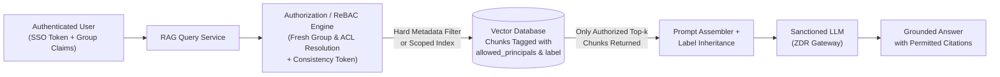

# Chapter 7: Internal Over-Exposure & Permission-Aware AI

*Part III: Data Risk*

> **In this chapter**
>
> - Why connecting an AI assistant to internal drives ends "security by obscurity" overnight
> - How to quantify oversharing and execute a pre-rollout permission-hygiene sprint across SharePoint, Google Drive, Slack, and wikis
> - How four-tier data classification, index exclusion, usage rights, and sensitivity label inheritance protect derived AI content
> - Why sensitivity labels alone can fail (and the lesson of Microsoft 365 Copilot advisory CW1226324)
> - How to architect permission-aware Retrieval-Augmented Generation (RAG) using index-time metadata pre-filtering, live ReBAC (the Zanzibar pattern), and physical collection isolation
>
> **Essential for:** CDO, Data Stewards, CIO, CISO, AI Engineers, DPO · **Reading time:** about 30 minutes

---

## The Severance Spreadsheet Nobody Remembered

*This composite scenario is illustrative; it is not drawn from a specific organization or incident.*

An enterprise software company finishes everything the CISO asked for in Chapter 6. It deploys an internal AI knowledge assistant inside its own cloud tenant, enforces Zero Data Retention, strips personal API keys, and connects the assistant via corporate Single Sign-On (SSO) to SharePoint, Google Drive, Slack, and Confluence. No data leaves the company's perimeter. The Traffic Light review team marks the launch complete.

Three days later, a newly hired product operations analyst types a routine question into the workspace: *"What severance multipliers and notice terms did the company use during last year's restructuring?"*

Within four seconds, the assistant returns a neat summary table listing director-level severance formulas, two side-letter retention bonuses, and the full names of three departed vice presidents. None of the documents had been flagged as compromised. The analyst did not exploit a privilege escalation bug. Eighteen months earlier, an HR business partner had dropped a draft restructuring workbook into a project folder configured with *"Everyone except external users"* access, forgotten it existed, and moved on.

For eighteen months, that file sat harmlessly buried six folders deep—protected entirely by the fact that no junior analyst had the patience to click through four hundred SharePoint sites to look for it. The enterprise AI assistant destroyed that implicit protection in a single afternoon.

Chapter 6 showed how to stop sensitive data from leaking *outside* the enterprise. This chapter addresses the quieter, often larger risk inside the firewall: **how AI turns messy historic file permissions into instant internal over-exposure.**

---

## 7.1 The "Insider Access" Problem: AI as a Super-Search Engine

### The Challenge

For twenty years, enterprise collaboration platforms operated on an unspoken compromise: employees routinely chose *"Anyone with the link"* or *"Everyone except external users"* because clicking through granular security groups slowed work down. Security teams tolerated the sprawl because traditional keyword search was clumsy. Unless you knew the exact filename or folder path, buried spreadsheets remained effectively invisible—a fragile condition known as **security by obscurity**.

Generative AI assistants and semantic RAG search permanently end security by obscurity. Two technical shifts create the **"insider access" problem**:

1. **Discovery friction drops to zero.** Instead of hunting through years of nested SharePoint libraries, Google Drives, Jira comments, and Slack threads, an employee asks a natural-language question and receives a ranked answer in seconds.
2. **Synthesis amplifies small fragments.** Traditional search returned a list of links; an AI assistant reads ten separate documents, connects a board slide with an old Slack thread and a forgotten spreadsheet, and synthesizes a clear narrative or summary table—turning scattered clues into plain-English disclosures.

Empirical security telemetry shows how widespread the underlying permission debt really is. According to Varonis's *2025 State of Data Security Report*, **99 percent** of studied organizations have sensitive data exposed or vulnerable to AI tools, and **90 percent** have sensitive files exposed to *every* employee via Microsoft 365 Copilot—averaging **more than 25,000 sensitive folders** accessible across the entire workforce—while **only one in ten** organizations properly use file labeling and categorization.[^c07-01]

The OWASP Top 10 for LLM Applications captures both halves of this exposure: **LLM02:2025 (Sensitive Information Disclosure)** covers confidential data surfacing to unauthorized recipients, while **LLM08:2025 (Vector and Embedding Weaknesses)** specifically flags permission bypasses and cross-context leaks inside RAG vector stores.[^c07-02] NIST's Generative AI Profile (NIST AI 600-1) likewise treats unauthorized internal exposure of private data within enterprise deployments as a core **Data Privacy** hazard.[^c07-03]

### Three Internal Leakage Surfaces

When an enterprise audits its internal AI connectors, oversharing almost always enters through one of three patterns:

| Leakage Surface | How Exposure Happens | Typical Culprits |
| :--- | :--- | :--- |
| **1. Overshared Source Repositories** | The AI assistant honors source permissions faithfully—but those source permissions were left open to the entire company years ago. | Legacy SharePoint sites (*Everyone except external users*), *"Anyone in org with the link"* Drive docs, public Slack channels carrying HR/finance CSVs |
| **2. Flat, ACL-Blind Vector Indexes** | Engineers build a custom RAG app whose ingestion pipeline reads everything using an admin service account and writes chunks into one shared vector collection without storing Access Control Lists (ACLs). | Custom internal chatbots, Slack/Confluence Q&A bots built during hackathons or quick pilots |
| **3. Cross-Department Inference & Synthesis** | Individually innocuous documents (travel approvals, calendar titles, project budgets) are combined across teams by an AI agent into confidential insights (such as an unannounced acquisition or layoff). | Multi-source enterprise copilots indexing email, calendars, wikis, and financial drives together |

---

## 7.2 Fixing File Permissions Before Rollout

### The Challenge

Because employees will immediately ask an AI assistant questions they never bothered typing into a legacy search bar, **permission hygiene must happen before AI indexing—not after an incident forces an emergency takedown.**

Trying to clean up ten years of permission sprawl across tens of thousands of sites at once, however, can stall an enterprise AI rollout indefinitely. The practical pattern—documented in Microsoft's Purview and SharePoint Advanced Management readiness architecture—is a **phased permission-hygiene sprint** paired with temporary search containment.[^c07-04]

### Running a Four-Step Permission-Hygiene Sprint

1. **Discover and Quantify Oversharing:**
   Before connecting any enterprise AI copilot, run automated Data Access Governance (DAG) reports and cloud-drive permission scans. Focus first on high-blast-radius indicators: sites or folders shared with *"Everyone except external users"*, active *"Anyone with the link"* external links, orphaned sites whose owners have left the company, stale guest accounts, and public Slack/Teams channels containing sensitive attachments.[^c07-04]
2. **Apply Temporary Search Containment:**
   Do not delay low-risk adoption while cleaning up legacy archives, and do not index messy legacy drives blindly. Use temporary allow-list containment—such as **Restricted SharePoint Search (RSS)**, which restricts organization-wide search and Copilot retrieval to a curated allow-list of up to 100 audited SharePoint sites while allowing users to continue working with their personal OneDrive files, chats, and emails.[^c07-04] **Crucial caveat:** Treat Restricted SharePoint Search strictly as a **short-term operational safety valve**, *not* a long-term security boundary—it leaves personal files and unmanaged channels outside site scopes untouched, and must never replace real permission remediation.
3. **Remediate High-Risk Repositories and Lock Sharing Defaults:**
   Audit HR, Legal, Finance, Executive/Board, M&A, and R&D repositories first. Strip org-wide sharing links, convert broad access into explicit Entra ID / Okta security groups, assign active site owners for quarterly access attestations, and change tenant-wide default sharing settings from *"People in your organization"* to *"People with existing access"* or *"Specific people."*
4. **Audit Crawler and Bot Identities:**
   Inventory every service account, OAuth connector, and Slack/Confluence bot used by internal AI pipelines. Confirm that ingestion crawlers hold read-only least privilege and explicitly exclude executive DMs, confidential HR mailboxes, and restricted sites.

### Pre-Rollout Permission Hygiene Checklist

| Collaboration Platform | Key Oversharing Risks to Check | Pre-Rollout Fix |
| :--- | :--- | :--- |
| **SharePoint & OneDrive** | *"Everyone except external users"* permissions; org-wide edit/view links; orphaned sites without active owners | Run SharePoint DAG reports; enable Restricted SharePoint Search temporarily while auditing; require two named owners per site and quarterly access reviews |
| **Google Workspace (Drive)** | Shared Drives open to *"Entire domain"* or discoverable in search; legacy *"Anyone on the internet with link"* files | Scan for domain-wide and public links; restrict Shared Drive membership to named groups; disable link-discoverability by default |
| **Slack & Microsoft Teams** | Sensitive payroll, legal, or incident discussions posted in public channels; guest accounts retained after vendor contracts end | Convert sensitive channels to private; exclude ephemeral/unvetted public channels from RAG ingestion; enforce automated guest expiry |
| **Confluence & Jira** | Space permissions left at *"All logged-in users"* on security, HR, or customer-escalation boards; sensitive attachments in tickets | Restrict sensitive Confluence spaces and Jira projects to explicit project roles; exclude attachment blobs containing credentials or PII from indexing |

---

## 7.3 Data Classification and Sensitivity Labels

### The Challenge

Fixing folder permissions tells you *who* currently has access; **data classification and sensitivity labels** tell the AI pipeline *how sensitive the content is* and *what the AI is allowed to do with it*.

ISO/IEC 42001 explicitly requires governance over data quality, provenance, and preparation across the AI lifecycle (Annex A.7), paired with controls governing responsible use and access boundaries (Annex A.9).[^c07-05] In practice, organizations need a concise, four-tier classification scheme that maps cleanly onto both human habits and automated AI controls:

| Tier | Description | Example Content | AI Indexing & Copilot Policy |
| :--- | :--- | :--- | :--- |
| **Public** | Approved for external release | Published whitepapers, press releases, public docs | Permitted in all sanctioned AI workspaces and RAG indexes |
| **Internal** | Routine day-to-day work; low harm if seen internally | SOPs, team wikis, general engineering notes | Permitted in permission-aware RAG and enterprise workspaces |
| **Confidential** | Business-sensitive; harmful if exposed broadly inside or outside | Customer contracts, pricing models, unreleased roadmaps, HR policies | Permitted **only** with strict ACL-enforced RAG, encryption/usage rights verified, and label inheritance active |
| **Restricted** | Severe regulatory, legal, or existential impact | M&A deal rooms, board minutes, executive compensation, trade-secret IP, raw PII/PHI vaults | **Hard-blocked from general AI indexing**; isolated in dedicated, air-gapped repositories if AI is ever used |

### Three Label-Driven AI Guardrails

Using Microsoft Purview Information Protection as a concrete enterprise reference architecture, sensitivity labels enforce three protective mechanisms across generative AI workflows:[^c07-04]

1. **Hard Index Exclusion for Restricted Data:** Configure ingestion connectors and DLP policies to skip any file or email carrying a `Restricted` (or custom `No-AI`) label. If an HR director accidentally drops a restricted file into an overshared folder, the sensitivity label acts as an independent backstop blocking AI indexing.
2. **Usage-Rights Verification (`VIEW` and `EXTRACT`):** When documents are encrypted with sensitivity labels, an AI assistant should only be permitted to process and summarize the file on a user's behalf if the user holds **both** `VIEW` and `EXTRACT` permissions—preventing users with read-only or "view-only without copy/extract" restrictions from laundering protected text through an AI summarization prompt.[^c07-04]
3. **Sensitivity Label Inheritance:** Without label inheritance, an employee can ask an AI assistant to summarize three `Confidential` contracts into a brand-new unlabelled document and email it across the company. With label inheritance enabled, any new document or chat response synthesized by the AI automatically inherits the **highest-priority (most restrictive)** sensitivity label—and accompanying encryption—from the source files referenced.[^c07-04]

### Real-World Scenario: Why Labels Alone Are Never Enough (Advisory CW1226324)

Sensitivity labels and DLP rules are vital controls, but relying on them as your *only* defense against internal over-exposure creates a single point of failure.

In late January 2026, enterprise administrators noticed a troubling anomaly: Microsoft 365 Copilot's "work tab" chat feature was reading and summarizing confidential emails sitting in users' **Sent Items and Drafts** folders—even when those messages carried **Microsoft Purview sensitivity labels** and **DLP policies** explicitly configured to prohibit Copilot from processing them. Tracked by Microsoft under Service Health Advisory **CW1226324** and publicly reported in February 2026, the issue stemmed from a server-side code defect that bypassed label and DLP enforcement on those folders until Microsoft pushed a configuration fix across affected tenants in early February 2026.[^c07-06]

Notice two lessons from CW1226324—one reassuring, one sobering. First, the defect did *not* break cross-user access boundaries: Copilot still respected mailbox access, reading only emails in the signed-in user's own Sent Items and Drafts rather than someone else's inbox. Second, **any single software control—even a mature enterprise label and DLP engine—can suffer a regression.** That is why **defense in depth** matters: keep truly restricted crown-jewel data physically separate from AI-connected repositories (Section 7.4), enforce least-privilege access at the source, and monitor audit logs for anomalous retrieval patterns.

---

## 7.4 Permission-Aware Retrieval (RAG That Respects Access Control)

### The Challenge

When organizations use off-the-shelf SaaS copilots (such as Microsoft 365 Copilot or Google Workspace Gemini), the vendor manages the retrieval permission layer—assuming the organization cleaned up its underlying folder permissions first.

The moment an engineering team builds a **custom internal RAG application** using an open-source orchestrator and a vector database (Pinecone, Qdrant, pgvector, OpenSearch, Milvus), that built-in protection disappears. In far too many custom builds, an ingestion job runs with a service account that pulls every file from Confluence, SharePoint, and S3, splits them into 500-token chunks, embeds them as vectors, and drops them into a single shared collection. Once those chunks sit in a flat vector database, **anyone who can query the chatbot can search across everyone else's data**—a textbook **OWASP LLM08:2025 (Vector and Embedding Weaknesses)** failure.[^c07-02]

### Designing Permission-Aware RAG

Securing custom RAG requires preserving the identity and access boundaries of the source system all the way from ingestion through vector search and LLM prompt assembly:

### Comparing Four Permission Enforcement Patterns

AI architects generally choose among four patterns—and only three of them hold up in production:

| Pattern | How It Works | Strengths | Failure Modes & Limits | Verdict |
| :--- | :--- | :--- | :--- | :--- |
| **1. Post-Retrieval Filtering** | Retrieve global `top-k` vector matches first, then drop unauthorized chunks in application code before calling the LLM | Easy to bolt onto an existing prototype | **Broken utility & leakage:** if `top-k` chunks are all restricted, the user gets zero results ("denial of context") while ranking signals still hint that hidden docs exist | **Anti-pattern**—avoid for strict permissions |
| **2. Index-Time Metadata Pre-Filtering (In-Filtering)** | Attach ACL metadata (`allowed_groups`, `tenant_id`, `sensitivity`) to every chunk at ingestion; enforce hard filters *inside* the vector query | Fast single-hop query; zero "denial of context" because `top-k` comes strictly from permitted chunks | **ACL sync lag:** if an employee loses HR access at 9:00 AM and vector metadata syncs nightly, stale permissions persist for hours; per-user lists bloat on huge docs | **Good default** for stable group-based RBAC with near-real-time ACL sync |
| **3. Live ReBAC Authorization (Zanzibar Pattern)** | Query a centralized relationship-based authorization service alongside a candidate pre-filter (or check expanded group IDs at query time) | Solves stale permissions, deep nested groups, and folder-inheritance changes immediately | Adds an extra infrastructure component and network hop (must stay < 10 ms at scale) | **Gold standard** for dynamic enterprise permissions & multi-system RAG |
| **4. Physical Collection / Index Isolation** | Maintain completely separate vector indexes, namespaces, or databases per tenant or sensitivity tier (e.g., `corp-general` vs. `hr-restricted`) | Eliminates cross-tenant or cross-tier bleed mathematically; trivial to audit and delete | Operational overhead if multiplied into hundreds of silos; awkward for cross-domain search | **Required** for multi-tenant SaaS customers and `Restricted` enclaves |

### Lessons from Google's Zanzibar for AI Engineers

Enterprise RAG engineers often discover three subtle distributed-systems traps when scaling permission-aware retrieval: **nested group expansion** (Alice is in `Team-A`, which is nested inside `Dept-Eng`, which has read access to `Folder-X`), **permission sync lag**, and **time-of-check-to-time-of-use races**.

Google's 2019 **Zanzibar** paper—describing the global authorization system protecting Drive, Docs, Calendar, Cloud, and YouTube across trillions of ACL rules at sub-10-millisecond 95th-percentile latency and >99.999% availability—offers three battle-tested patterns that directly solve these RAG problems (now widely implemented in open-source engines such as OpenFGA and SpiceDB):[^c07-07]

1. **Relationship Tuples (`object#relation@subject`) and Folder Inheritance:** Model document permissions as graph edges (`doc:q3_plan#viewer@group:finance#member` or inheriting `parent_folder` access) instead of copying flat lists of 5,000 employee emails onto every 500-token chunk.
2. **Pre-Computed Group Closures (Leopard Indexing):** Deeply nested enterprise identity groups cannot be traversed naïvely during a real-time vector query without blowing up latency. Pre-computing transitive group memberships asynchronously lets the RAG query layer pass a flat list of a user's resolved `group_ids` straight into the vector database's metadata filter in under 10 milliseconds.
3. **Consistency Tokens ("Zookies"):** When an administrator revokes someone's access to a confidential folder, the user expects that revocation to apply *immediately*. Zanzibar issues an opaque snapshot timestamp token (*zookie*) on permission updates so subsequent authorization checks never evaluate against a stale replica. In RAG pipelines, **pair index-time group pre-filtering with an event-driven CDC/webhook stream** from SharePoint, Drive, or Okta so revocations invalidate stale access within seconds—not on a midnight batch job.

### Two Extra Traps in Vector Governance

- **Vector Stores Are Plaintext Equivalents:** Under **OWASP LLM08**, attackers with read access to raw embeddings can run *embedding inversion* or similarity-probing attacks to reconstruct sensitive text.[^c07-02] Never treat a vector database as "anonymized math"—encrypt it at rest, isolate tenants, and apply the same access controls as the source document store (covered further in Chapter 13).
- **Group-Limit Overflows:** Most vector databases cap metadata array sizes. Storing individual user IDs on chunks breaks as soon as 10,000 employees share a corporate policy repository. Store **security group IDs** and sensitivity tiers on chunks, or pair a coarse bucket filter with a fast ReBAC verification call over candidate document IDs.

---

## Why Every Role Cares

| Role | What this means for you |
| :--- | :--- |
| **Board / CEO** | Enterprise AI copilots eliminate "security by obscurity." Rolling out internal search before cleaning permissions exposes executive pay, M&A plans, and HR records across the company. |
| **CIO** | Sequence copilot rollouts behind a permission-hygiene sprint and temporary containment (such as Restricted SharePoint Search) rather than turning on tenant-wide indexing on day one. |
| **CISO** | Reject custom RAG architectures built on flat, ACL-blind vector stores; require pre-filtered or ReBAC-enforced retrieval, source-crawler least privilege, and defense in depth beyond labels alone. |
| **CDO / Data Stewards** | Own the four-tier classification taxonomy (`Public`, `Internal`, `Confidential`, `Restricted`), block `Restricted` libraries from AI connectors, and enforce site-owner quarterly access attestations. |
| **Legal / Compliance / DPO** | Internal over-exposure of employee health, payroll, or customer PII to unauthorized staff violates data-minimization and least-privilege duties under GDPR, DPDP, and HIPAA—even if nothing leaves the firewall. |
| **AI Engineers** | Never build post-retrieval filtering or nightly-only ACL syncs for sensitive corpora; propagate source ACLs and sensitivity labels to every chunk, enforce hard DB pre-filtering or live ReBAC checks, and preserve label inheritance on generated outputs. |

---

## Chapter Summary

| Section | Core risk | Primary guardrail |
| :--- | :--- | :--- |
| 7.1 The Insider Access Problem | AI collapses discovery friction and synthesizes buried, over-shared files (90% of orgs have sensitive files exposed via Copilot) | Acknowledge the end of security by obscurity; govern internal AI exposure alongside external leaks |
| 7.2 Fixing File Permissions | Legacy *"Everyone except external users"* and open links turn copilots into instant internal leak engines | Run a Permission-Hygiene Sprint (DAG scan → temporary allow-list containment → revoke org-wide links → audit crawler tokens) |
| 7.3 Classification & Sensitivity Labels | Confidential outputs get summarized into unlabelled drafts, and single controls can experience bugs (CW1226324) | Enforce 4-tier labels, block `Restricted` files from AI indexing, require `VIEW + EXTRACT` rights, enable label inheritance, and layer defenses |
| 7.4 Permission-Aware RAG | Custom RAG pipelines strip source ACLs into flat vector indexes (OWASP LLM08), or fail via post-filtering and ACL sync lag | Enforce index-time metadata pre-filtering or live ReBAC (Zanzibar pattern) with near-real-time revocation sync and physical isolation for `Restricted` silos |

---

## Key Takeaways

- **Internal over-exposure is a permission-debt crisis, not an AI bug.** In most incidents, the AI faithfully retrieves documents the employee technically already had permission to open—even though nobody realized those permissions existed.
- **Clean permissions before you connect the AI.** Use Data Access Governance scans and temporary search allow-lists (like Restricted SharePoint Search) as short-term safety valves while remediating org-wide links—never as a permanent boundary.
- **Labels travel with derived outputs, but labels are not invincible.** Pair `Restricted` index exclusion, `VIEW + EXTRACT` checks, and automatic sensitivity-label inheritance with physical isolation of crown-jewel repositories so a single label or DLP defect (like CW1226324) cannot expose sensitive records.
- **Never ship an ACL-blind RAG pipeline.** Every chunk in a custom vector database must preserve source authorization boundaries through index-time metadata pre-filtering, live ReBAC authorization (the Zanzibar pattern), or physical collection isolation—never post-retrieval filtering alone.
- **Revocations must propagate quickly.** A permission-aware RAG pipeline is only as accurate as its ACL sync latency; use group IDs and event-driven revocation streams so removed access disappears in seconds, not overnight.

## Questions to Ask

| Role | Question |
| :--- | :--- |
| **Board / CEO** | Did we audit and clean up company-wide SharePoint, Drive, and Slack permissions before turning on enterprise AI search? |
| **CIO** | If we are using a temporary search allow-list (such as Restricted SharePoint Search), what is our concrete deadline and owner to finish full site remediation? |
| **CISO** | Does every custom RAG application in our registry enforce access controls *inside* the vector query or live authorization layer, and how fast does a terminated or transferred employee lose query access? |
| **CDO / Data Stewards** | Which repositories are classified `Restricted` (M&A, Board, Payroll, Legal), and have we verified they are completely excluded from general AI connectors? |
| **Legal / Compliance / DPO** | When an AI assistant summarizes a `Confidential` contract or HR memo, does the generated output automatically inherit the source file's sensitivity label and encryption? |
| **AI Engineers** | Are we using group-based metadata pre-filtering or live ReBAC instead of post-retrieval filtering, and how are vector databases isolated across tenants and sensitivity tiers? |
| **Business Owners** | When did I last review who has access to my department's shared drives and Slack channels—and are there legacy *"Anyone with the link"* folders we forgot to lock down? |

---

## References

[^c07-01]: Varonis Systems, *2025 State of Data Security Report: Quantifying AI's Impact on Data Risk* (June 2025), https://www.varonis.com/state-of-data-security. **Annotation:** Empirical telemetry study finding that 99 percent of organizations have sensitive data exposed to AI tools, 90 percent expose sensitive files to all employees via Microsoft 365 Copilot (averaging 25,000+ sensitive folders), and only 10 percent properly classify and label data. [↗ Bibliography](../bibliography.md#varonis-2025-data-security)

[^c07-02]: OWASP Foundation, *OWASP Top 10 for LLM Applications 2025* (OWASP GenAI Security Project, November 2024), LLM02:2025 Sensitive Information Disclosure and LLM08:2025 Vector and Embedding Weaknesses, https://genai.owasp.org/llm-top-10/. **Annotation:** Defines authorization failures, cross-context data leaks, embedding inversion, and multi-tenant isolation gaps across RAG and vector pipelines under LLM02 and LLM08. [↗ Bibliography](../bibliography.md#owasp-2024-llm-top10)

[^c07-03]: National Institute of Standards and Technology, *Artificial Intelligence Risk Management Framework: Generative Artificial Intelligence Profile*, NIST AI 600-1 (Gaithersburg, MD: NIST, July 2024), https://doi.org/10.6028/NIST.AI.600-1. **Annotation:** Addresses unauthorized disclosure and private-data exposure within enterprise generative AI deployments under its Data Privacy risk category. [↗ Bibliography](../bibliography.md#nist-2024-genai-profile)

[^c07-04]: Microsoft Corporation, "Microsoft Purview Data Security and Compliance Protections for Generative AI Apps / SharePoint Data Access Governance," Microsoft Learn Documentation, accessed November 21, 2026, https://learn.microsoft.com/en-us/purview/ai-microsoft-purview. **Annotation:** Reference enterprise documentation detailing SharePoint Data Access Governance (DAG) oversharing reports, temporary Restricted SharePoint Search (up to 100 sites), `VIEW + EXTRACT` rights enforcement, and automatic sensitivity-label inheritance for AI-generated outputs. [↗ Bibliography](../bibliography.md#microsoft-purview-copilot)

[^c07-05]: International Organization for Standardization and International Electrotechnical Commission, *ISO/IEC 42001:2023, Information Technology — Artificial Intelligence — Management System* (Geneva: ISO, December 2023), Annex A.7 and A.9, https://www.iso.org/standard/81230.html. **Annotation:** Annex A.7 governs AI data preparation, quality, and provenance, while Annex A.9 governs responsible use and access boundaries across AI systems. [↗ Bibliography](../bibliography.md#iso-2023-42001)

[^c07-06]: Sergiu Gatlan, "Microsoft Says Bug Causes Copilot to Summarize Confidential Emails," *BleepingComputer*, February 18, 2026, https://www.bleepingcomputer.com/news/microsoft/microsoft-says-bug-causes-copilot-to-summarize-confidential-emails/. **Annotation:** Reports Microsoft Service Health Advisory CW1226324 (January–February 2026), in which a server-side defect allowed Copilot's work-tab chat to summarize confidential Sent Items and Drafts emails while bypassing Purview sensitivity labels and DLP policies—illustrating why defense in depth is mandatory. [↗ Bibliography](../bibliography.md#gatlan-2026-copilot-bug)

[^c07-07]: Ruoming Pang et al., "Zanzibar: Google's Consistent, Global Authorization System," in *Proceedings of the 2019 USENIX Annual Technical Conference (USENIX ATC '19)* (July 2019), https://www.usenix.org/conference/atc19/presentation/pang. **Annotation:** Foundational systems paper describing Google's relationship-based authorization architecture (`object#relation@subject`), pre-computed Leopard group indexing for sub-10ms checks, and "zookie" external consistency tokens that eliminate stale-permission races after revocation. [↗ Bibliography](../bibliography.md#pang-2019-zanzibar)
