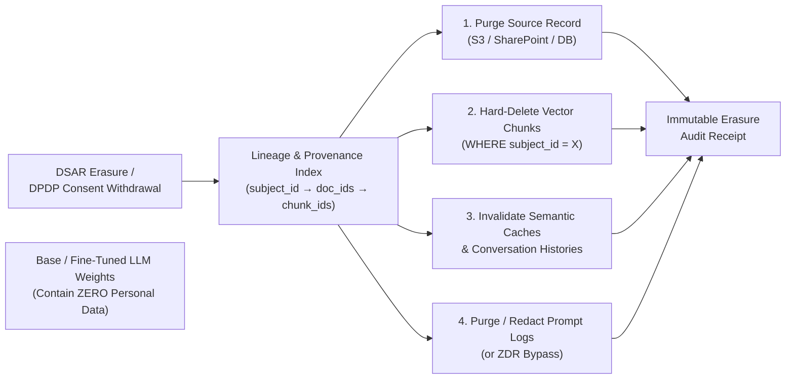

# Chapter 8: Data Provenance, Consent & Sovereignty

*Part III: Data Risk*

> **In this chapter**
>
> - How to track data lineage, rights, and freshness across training datasets and RAG knowledge bases
> - Why lawful possession of data for service delivery does not grant permission to train or repurpose AI—and how "algorithmic disgorgement" wipes out tainted models
> - How cross-border residency rules (*Schrems II*, *Latombe*, and India's DPDP framework) apply to prompts, embeddings, and failover endpoints
> - Why personal data cannot reliably be erased from fine-tuned model weights, and how to design cascading erasure across RAG vector stores
> - Where synthetic data adds real value—and why it fails as an automatic privacy fix or recursively collapses model quality
>
> **Essential for:** CDO, Data Stewards, General Counsel, DPO, CIO, AI Engineers · **Reading time:** about 30 minutes

---

## Three Data Debts Coming Due at Once

*This composite scenario is illustrative; it is not drawn from a specific organization or incident.*

A global B2B SaaS provider launches a multilingual customer-support AI suite across Europe, North America, and India. Within six months, three separate problems converge on the Chief Data Officer and Data Protection Officer in the same week.

First, enterprise customers complain that the support assistant is quoting expired cancellation penalties. An audit of the Retrieval-Augmented Generation (RAG) pipeline reveals that the vector store indexed three conflicting versions of the company's master refund policy—including an unowned 2022 PDF scraped from an internal archive folder—with no timestamps, no owner metadata, and no expiration rule.

Second, a European privacy regulator asks for the lawful basis behind a custom domain-tuned support model. Two quarters earlier, an engineering squad fine-tuned an open-weight model on five years of EU and Indian support tickets—tickets collected strictly to resolve technical incidents under service-delivery terms, with zero customer notice or consent for model training.

Third, a long-standing customer terminates its contract and submits an erasure demand under GDPR Article 17. Engineering deletes the customer's row in PostgreSQL within an hour. Three weeks later, a QA engineer discovers that the departed customer's configuration guides, contact emails, and custom SLA terms are still sitting inside forty-two chunked records in the vector database—and worse, nobody has a lineage map showing which chunks or fine-tuned model weights came from that customer's records.

Chapters 6 and 7 focused on keeping data from leaking *out* or over-exposing *inside*. This chapter completes Part III by governing the **lifecycle legitimacy** of AI data: where it came from, whether you are legally allowed to use it, which borders it crosses, whether you can truly delete it, and what happens when you replace it with synthetic substitutes.

---

## 8.1 Lineage and Provenance for Training and Grounding Data

### The Challenge

Every enterprise understands "garbage in, garbage out." With generative AI, the failure mode is more deceptive: **stale, contradictory, or unverified input produces fluent, authoritative, and confident wrong outputs.** When a RAG retriever pulls two conflicting HR policies—say, a 2021 remote-work draft and a 2026 final handbook—neither the model nor the user can reliably tell which document carries legal authority unless **provenance metadata** travels alongside the text.

For models that are trained or fine-tuned, provenance carries equal legal weight. Both regulators and standards bodies now treat dataset documentation as a core governance requirement rather than an academic exercise:

- **Datasheets for Datasets:** In a foundational 2021 paper, Timnit Gebru and colleagues proposed accompanying every dataset with a standardized "datasheet" documenting its motivation, composition, collection process, preprocessing, intended uses, distribution terms, and maintenance plan—mirroring the safety datasheets standard in the electronics industry.[^c08-01]
- **EU AI Act Article 53(1)(d) and the GPAI Training Data Summary Template:** The EU AI Act requires every provider of a General-Purpose AI (GPAI) model to draw up and publish a sufficiently detailed summary of the content used for training.[^c08-02] On July 24, 2025, the European Commission and EU AI Office issued the mandatory **Explanatory Notice and Template** operationalizing Article 53(1)(d) (with enforcement powers taking effect in August 2026 and legacy models facing an August 2027 deadline).[^c08-03] The template organizes provenance disclosure into three parts: (1) *General Information* (model versions, modalities, broad data size and language scope), (2) *List of Data Sources* (public datasets, web-scraped content and top domains, licensed commercial datasets, user-generated data, and synthetic data), and (3) *Relevant Data Processing Aspects* (how copyright opt-outs such as `robots.txt` and EU Digital Single Market TDM reservations were respected, and how illegal content was filtered).
- **ISO/IEC 42001 and SPDX 3.0:** ISO/IEC 42001 Annex A.7 mandates formal controls for data acquisition, quality, and provenance across the AI lifecycle,[^c08-04] while the Linux Foundation's **SPDX 3.0** specification introduces dedicated **AI** and **Dataset** profiles to capture dataset origin, licensing, and collection metadata in a machine-readable graph.[^c08-05]

### The Guardrails: Provenance in Enterprise RAG and Fine-Tuning

Even enterprises that never build frontier models need practical provenance pipelines for their RAG indexes and fine-tuning corpora:

1. **Enforce Mandatory Chunk Metadata at Ingestion:** Reject any document entering a production RAG pipeline that lacks core provenance fields: `source_uri`, `authoritative_owner`, `effective_date`, `expiry_ttl` (or next review date), `content_hash`, `license_or_contract_scope`, and `classification_label`.
2. **Separate "Golden Truth" from Informal Chatter:** Keep curated, owner-attested policy repositories (HR handbooks, product specs, approved legal templates) logically separated from informal Slack threads, draft Google Docs, and stale Jira comments—or weight authoritative sources explicitly ahead of unvetted internal chatter.
3. **Automate Supersession and Expiry:** When a 2026 policy document is published, pipeline automation should automatically archive or remove the 2024 version from the active vector collection rather than leaving both competing for top similarity scores.
4. **Maintain Dataset Datasheets for Any Fine-Tuning:** Before any engineering team fine-tunes a model or LoRA adapter, require a one-page datasheet linked to the system's AI-BOM (Chapter 5) recording source systems, filtering scripts, date ranges, and copyright/license clearance.

---

## 8.2 Consent and Purpose Limitation: Is This Data Allowed to Be Used for AI?

### The Challenge

One of the costliest legal misconceptions in enterprise AI is assuming that **because you already hold a dataset legitimately, you can use it to train or ground AI.**

Modern privacy statutes draw a hard boundary around **purpose limitation**. Under the EU General Data Protection Regulation (GDPR), personal data must be collected for specified, explicit, and legitimate purposes and not further processed in a manner incompatible with those original purposes (Article 5(1)(b)), and every processing activity requires a valid legal basis under Article 6.[^c08-06]

In **Opinion 28/2024** (adopted December 17, 2024), the European Data Protection Board (EDPB) resolved several high-stakes questions on how the GDPR applies to AI models:[^c08-07]

1. **Trained AI models are not automatically anonymous.** Because language and vision models can absorb and regurgitate training data, an AI model counts as truly anonymous only if a controller can prove on a case-by-case basis that—considering all means reasonably likely to be used—the likelihood of both *direct (including probabilistic) extraction* and *query-based extraction* of training individuals' personal data is negligible.
2. **Legitimate interest (Article 6(1)(f)) is not a blank check.** Organizations cannot treat legitimate interest as a default legal basis for scraping or repurposing personal data into AI training sets. They must document a strict three-step test (legitimate interest, necessity, and balancing against data-subject rights), where **reasonable expectations** carry decisive weight. If customers or employees could never reasonably expect support logs or scraped profiles to train generative AI, their fundamental rights will routinely override commercial convenience.
3. **Unlawful development taints downstream deployment.** If personal data was collected or processed unlawfully during training or fine-tuning, moving the resulting model into production does *not* wash the defect clean. Enterprises deploying or acquiring third-party models must verify that upstream training data had a lawful basis.

India's **Digital Personal Data Protection (DPDP) Act, 2023**—operationalized by the **DPDP Rules notified in November 2025** (phasing into full enforcement through May 2027)—enforces an equally crisp consent standard under **Section 6**:[^c08-08]
- Consent must be **free, specific, informed, unconditional, and unambiguous**, signaled by clear affirmative action, and strictly limited to the specified purpose.
- Every consent request must be preceded or accompanied by a standalone, plain-language notice accessible in **English and any language listed in the Eighth Schedule of the Constitution of India**.
- **Bundled consent is prohibited:** a service cannot force users to accept unrelated AI model training as a mandatory condition of using a core service, and withdrawing consent must be as easy as giving it.

### Real-World Scenario: Algorithmic Disgorgement (*FTC v. Everalbum*, 2021)

The commercial penalty for ignoring consent and purpose limitation is no longer just a fine—it can mean destroying the model itself.

Everalbum, Inc., operator of the photo-storage app "Ever," launched a "Friends" feature that ran facial recognition on user-uploaded photos. Although Everalbum told users it would not apply facial recognition without affirmative consent, the U.S. Federal Trade Commission (FTC) found that the feature was switched on by default for most users outside the EU and specific U.S. states—and that Everalbum used those images to train its facial-recognition algorithms while retaining photos of users who thought they had deleted their accounts.

Under the final 2021 consent order, the FTC did not stop at ordering Everalbum to delete the improperly retained user photos. It mandated what legal scholars and regulators now call **algorithmic disgorgement**: Everalbum was ordered to **delete and destroy the facial-recognition models and algorithms** built using the deceptively collected photos.[^c08-09] The precedent is unmistakable for every enterprise CDO and board: **ill-gotten or unconsented training data taints the entire derived model.**

### The Guardrails: Purpose-Limitation Decision Matrix

Before approving an AI workflow in the Yellow or Red Lane, map the exact data use against your privacy notices, customer contracts (including enterprise SaaS DPAs forbidding secondary model training), and copyright licenses:

| Proposed AI Use | Typical Legal & Contractual Status | Required Controls |
| :--- | :--- | :--- |
| **1. Stateless Service Delivery** *(e.g., summarizing a customer's ticket on request)* | Generally covered under existing contract performance / service-delivery basis | Enforce ZDR with model provider; log only non-sensitive telemetry; no training reuse |
| **2. Internal RAG Grounding** *(e.g., indexing support knowledge or internal project files)* | Often compatible with original purpose if access stays scoped to authorized staff | Enforce permission-aware retrieval (Ch. 7); check customer MSAs for "no cross-customer indexing" clauses; propagate retention schedules |
| **3. Fine-Tuning / Custom Model Training on Customer or Employee Data** | **Rarely covered** by legacy service-delivery notices or employment contracts | Obtain explicit, unbundled, opt-in consent (or strictly documented legal basis + DPIA); scrub/anonymize PII beforehand; maintain full dataset datasheet |
| **4. Vendor Product Improvement / Global Training** | **Prohibited** by standard enterprise customer contracts and DPDP/GDPR expectations | Default opt-out / ZDR addenda; verify embedded SaaS features do not silently opt tenants in (Ch. 6) |

---

## 8.3 Data Residency, Sovereignty, and Cross-Border Transfers

### The Challenge

In legacy IT, data residency was easy to verify: if the PostgreSQL cluster sat in an EU or Indian region, the data stayed there. In modern AI pipelines, **geography fractures silently**.

Even when an enterprise keeps its documents in Frankfurt or Mumbai, an AI workflow can quietly push personal or regulated data across borders in five places: (1) calling a foundation-model API whose primary or **overflow failover region** sits in the United States, (2) storing vector embeddings in a multi-region managed SaaS vector database, (3) passing prompts through an external safety classifier or guardrail proxy hosted abroad, (4) logging observability traces to a third-party U.S. LLMOps SaaS tool, or (5) routing tickets through an embedded SaaS AI sub-processor.

### Navigating Global Transfer Regimes

Enterprises operating across jurisdictions must align AI infrastructure with diverging transfer rules:

- **European Union (*Schrems II* to *Latombe*):** In ***Schrems II*** (Case C-311/18, July 16, 2020), the Court of Justice of the European Union (CJEU) invalidated the EU-U.S. Privacy Shield, holding that third countries receiving EU personal data must provide protection **"essentially equivalent"** to the GDPR and EU Charter of Fundamental Rights.[^c08-10] Following U.S. surveillance reforms under Executive Order 14086 and the creation of the Data Protection Review Court (DPRC), the European Commission adopted the **EU-U.S. Data Privacy Framework (DPF)** in July 2023. In ***Latombe v. Commission*** (Case T-553/23, September 3, 2025), the EU General Court dismissed an annulment challenge and upheld the DPF at first instance.[^c08-11] Crucially, however, the challenger appealed to the CJEU on October 31, 2025 (Case C-703/25 P)—meaning prudent enterprises should treat the DPF as helpful legal continuity today while maintaining Standard Contractual Clauses (SCCs), Transfer Impact Assessments, and **in-region EU inference endpoints** as durable engineering insurance.
- **India (DPDP Act Section 16 & Sectoral Localization):** India takes a different structural path. Under **Section 16** of the DPDP Act, 2023, cross-border transfers of personal data are **permitted by default** unless the Central Government specifically restricts a country or territory via notification (a "negative list" model).[^c08-08] Yet **Section 16(2)** includes a decisive carve-out: **stricter Indian sectoral data-localization mandates override the DPDP default.** Reserve Bank of India (RBI) rules requiring end-to-end payment system data to remain stored exclusively in India—and Department of Telecommunications (DoT) licensing conditions—still apply with full force to AI prompts, vector stores, and logs containing regulated financial or telecom records.
- **Sovereign & Public-Sector Mandates:** Defense, healthcare, energy, and sovereign agencies across Europe, the Middle East, and Asia-Pacific increasingly mandate **sovereign AI clouds**—guaranteeing not only physical in-country storage and compute, but also customer-managed encryption keys (CMEK) and in-country support personnel.

### The Guardrails: Four Sovereignty Controls for AI Architects

1. **Pin Inference *and Failover* Regions at the Gateway:** Many cloud LLM providers offer "EU" or "India" endpoints whose fine print notes that during peak capacity or outages, requests may fail over to U.S. or global pools. Disable cross-border failover in gateway configurations for regulated traffic—even if it means queueing or degrading gracefully locally (Chapter 25).
2. **Co-Locate Vector Databases, Guardrails, and Observability Traces:** Residency breaks if the LLM runs in Frankfurt while your vector database, PII redactor, or prompt-logging platform runs in Virginia. Pin the entire data path—embeddings, guardrail classifiers, and LLMOps traces—to the same jurisdiction.
3. **Map Fourth-Party Sub-Processor Geography:** Audit every SaaS AI vendor's sub-processor list (Chapter 23) to verify where prompts, attachments, and abuse logs are processed.
4. **Apply Gateway PII Masking Before Any Cross-Border Call:** Where a global model endpoint must be queried across borders, strip direct personal identifiers at the local gateway *before* the outbound call (Chapter 6) so cross-border payloads carry anonymized tokens rather than raw personal records.

---

## 8.4 The "Right to Be Forgotten" in Vector Stores and Model Weights

### The Challenge

Privacy laws give individuals the right to force organizations to erase their data: **GDPR Article 17** ("right to erasure"), CCPA deletion rights in California, and mandatory processing-halt obligations upon **consent withdrawal** under India's DPDP Act.[^c08-06][^c08-08]

In a relational SQL database, deletion is straightforward: run `DELETE FROM customers WHERE customer_id = ...`, verify cascade constraints, and let backup retention expire. In AI systems, statutory deletion hits an architectural wall—**because AI scatters a person's data across two very different storage layers:**

1. **Trained or Fine-Tuned Model Weights:** When personal records are used to train or fine-tune a neural network, that information is blended across billions of numerical weights. In a landmark 2021 IEEE Symposium on Security and Privacy paper, Lucas Bourtoule and colleagues introduced **Machine Unlearning** and the **SISA** (*Sharded, Isolated, Sliced, and Aggregated*) training architecture, showing that isolating training shards reduces the cost of exact retraining-based removal.[^c08-12] Yet for massive, monolithically trained foundation models and enterprise LoRA adapters, exact unlearning remains computationally prohibitive. Meanwhile, heuristic "approximate unlearning" methods offer no rigorous guarantee that an adversary cannot still extract memorized records via black-box prompting[^c08-13]—and will struggle to satisfy regulators applying EDPB Opinion 28/2024's strict anonymity threshold.[^c08-07]
2. **Chunked Vector Indexes, Caches, and Prompt Logs:** Even when you avoid fine-tuning and keep data in RAG, a single customer PDF gets split into fifty overlapping text chunks, embedded into vectors, duplicated into semantic response caches, and captured in prompt observability logs. Deleting the original PDF in SharePoint or S3 leaves orphaned chunks sitting live in the vector index.

### The Core Architectural Rule: Prefer RAG Over Weight Memorization

This is why Chapter 5 established one of the most consequential guardrails in the entire handbook: **never bake personal data, customer records, or time-bound facts into fine-tuned model weights.** Keep base models strictly free of identifiable user data, and store all mutable, erasable knowledge inside external RAG indexes and databases where deletion can actually be executed and audited.

### Designing an Erasure-Ready AI Architecture

### The Guardrails for Cascading Vector Erasure

- **Tag Every Vector Chunk with Identity Lineage:** At ingestion, attach `subject_id`, `tenant_id`, and `source_doc_id` metadata to every chunk so deletion queries (`delete where subject_id == X`) execute deterministically across the vector index without scanning millions of vectors blindly.
- **Maintain a Reverse Deletion Queue & Dead-Letter Alert:** Wire DSAR/consent-withdrawal events directly into an automated pipeline that deletes source files, vector chunks, and semantic prompt caches together—retrying on failure and alerting data stewards if any store lags.
- **Expire Observability Traces and Backups on Schedule:** Align prompt-log retention (Chapter 13) and vector-database backup snapshots with statutory deletion windows (such as GDPR's typical 30-day response cycle), and document snapshot expiry clearly in privacy notices.
- **Handle Fine-Tuned Legacy Models Honestly:** If a team *already* fine-tuned a model on personal data without unlearning support, plan to retire and retrain it on cleaned/RAG-separated data rather than pretending prompt-level "refusal filters" count as deletion.

---

## 8.5 Synthetic Data: Benefits, Limits, and Re-Identification Risk

### The Challenge

Blocked by consent, residency, and deletion rules, engineering teams frequently propose an appealing shortcut: *"Let's generate synthetic data using a generative model, then use it freely for fine-tuning, vendor testing, and analytics without privacy rules!"*

Synthetic data—artificially generated records or conversations modeled on real distributions or specifications—has genuine value in enterprise AI. It lets teams seed non-production staging environments without copying live customer databases, expand underrepresented edge cases in golden evaluation datasets (Chapter 26), and generate adversarial test prompts for red-teaming.

Yet treating synthetic data as a **risk-free privacy and quality silver bullet** runs headlong into two empirical findings from security and machine-learning research:

1. **The Privacy Illusion ("Anonymisation Groundhog Day"):** In a landmark 2022 USENIX Security study, Theresa Stadler, Bristena Oprisanu, and Carmela Troncoso rigorously benchmarked generative synthetic data against classical anonymization methods such as k-anonymity and differential privacy.[^c08-14] Their conclusion was blunt: **synthetic data does not escape the fundamental privacy-utility trade-off.** Generative models memorize outliers and subtle statistical combinations from training records, leaving synthetic datasets vulnerable to *membership inference* (proving a specific person was in the source dataset) and *attribute inference* (reconstructing sensitive attributes via linkage attacks). Even worse, unlike classical mathematical mechanisms, synthetic generators behave unpredictably: it is hard to foresee which outliers a generator memorized and which analytical signals it silently dropped.
2. **Model Collapse and Bias Erasure:** In a July 2024 *Nature* paper, Ilia Shumailov and colleagues proved that recursively training generative models on model-generated synthetic data triggers **model collapse**—an irreversible degradation in which the model loses information about the tails of the real distribution.[^c08-15] Rare edge cases, minority dialects, unusual fraud patterns, and infrequent medical presentations disappear first, leaving an overly narrow, homogenized model that amplifies majority biases while failing catastrophically on edge cases.

### The Guardrails

- **Never Presume Anonymity by Calling Data "Synthetic":** Under GDPR and EDPB Opinion 28/2024, synthetic data derived from personal data remains regulated unless you formally verify—via quantitative distance-to-closest-record (DCR), memorization/linkage attack testing, or mathematically bounded **differential privacy**—that individuals cannot be singled out or re-identified.[^c08-07][^c08-14]
- **Generate Test Data from Specs, Not Memorized PII:** When building evaluation suites or staging databases, prefer rule-based generators or frontier-model synthetic generation seeded from **abstract schemas and public specifications** rather than fine-tuning a generator directly on raw production customer records.
- **Preserve Verified Real Anchor Data:** Never train iterative model generations purely on prior synthetic outputs. Keep a clean, verified human-authored baseline dataset in every training and evaluation mix to prevent model collapse and tail erasure.[^c08-15]
- **Track and Disclose Synthetic Lineage:** Tag every synthetic dataset in your AI-BOM and datasheet (`origin: synthetic`, generator model, seed sources, differential-privacy epsilon if used), and record synthetic training data usage cleanly in compliance documentation—including EU AI Act Article 53(1)(d) training-content summaries where applicable.[^c08-03]

---

## Why Every Role Cares

| Role | What this means for you |
| :--- | :--- |
| **Board / CEO** | Training or fine-tuning AI on unconsented data risks **algorithmic disgorgement**—regulatory orders forcing the company to delete the entire model and its commercial value. |
| **CIO** | Enforcing RAG over weight memorization and pinning *both* primary and failover endpoints to approved regions prevents expensive model-retirement and cross-border rebuilds. |
| **CISO** | Every RAG store, semantic cache, and LLMOps log creates shadow copies that complicate DSAR deletion; unvetted synthetic generators can leak outliers via membership and linkage attacks. |
| **CDO / Data Stewards** | Own dataset datasheets, mandatory RAG chunk provenance (`authoritative_owner`, `effective_date`, `expiry_ttl`), and automated retirement of superseded documents. |
| **General Counsel / Compliance / DPO** | Verify purpose limitation before reusing customer or employee data (GDPR, EDPB Opinion 28/2024, India DPDP Section 6), track EU-U.S. DPF appeals and RBI/DoT localization rules, and verify synthetic-data anonymity claims. |
| **AI Engineers** | Never fine-tune on identifiable personal data; propagate `subject_id`/`source_doc_id` lineage into vector chunks for cascading deletes; co-locate vector DBs, guardrails, and traces in-region; anchor synthetic pipelines on real human data. |

---

## Chapter Summary

| Section | Core risk | Primary guardrail |
| :--- | :--- | :--- |
| 8.1 Data Lineage & Provenance | Stale, conflicting, or unvetted sources trigger confident errors and fail EU AI Act Art. 53(1)(d) transparency duties | Enforce mandatory RAG chunk metadata (`owner`, `effective_date`, `expiry_ttl`), automate document supersession, and maintain dataset datasheets / SPDX 3.0 profiles |
| 8.2 Consent & Purpose Limitation | Repurposing service-delivery or scraped data for AI training violates GDPR/DPDP and invites FTC-style algorithmic disgorgement | Separate stateless service inference from training; require explicit, unbundled consent or documented legal basis + DPIA before any fine-tuning |
| 8.3 Residency & Sovereignty | Unpinned inference failover, external vector stores, or sub-processors silently push regulated data across borders | Pin primary *and* failover endpoints, co-locate vector stores/guardrails/logs, track EU DPF appeals and India DPDP Sec. 16(2) sectoral mandates |
| 8.4 Right to Be Forgotten | Personal data baked into weights resists exact unlearning, while orphaned chunks linger in vector stores and caches | Keep personal data out of weights (prefer RAG); wire DSAR/withdrawal events into cascading deletion across sources, vector chunks, caches, and logs |
| 8.5 Synthetic Data | Naive synthetic datasets leak outliers via re-identification attacks and trigger recursive "model collapse" | Test linkage/memorization risk or apply differential privacy before claiming anonymity; preserve real human anchor data; tag synthetic lineage |

---

## Key Takeaways

- **Possession is not permission.** Having customer or employee data on hand to deliver a service does not authorize fine-tuning or training AI models on it—and unlawful collection can trigger **algorithmic disgorgement** destroying the entire model.
- **Keep personal data out of weights.** Exact deletion from large neural-network weights remains impractical; store mutable, erasable personal information in RAG vector indexes tagged with `subject_id` and `source_doc_id` lineage for deterministic cascading erasure.
- **Provenance prevents confident stale answers.** Enforce owner, effective-date, and expiry metadata on every ingested RAG document so retired 2022 policies never outrank current 2026 rules.
- **Verify the entire cross-border path, including failover.** Residency fails if your primary model sits in Frankfurt or Mumbai while fallback routing, vector indexes, guardrail proxies, or prompt logs cross borders unmonitored.
- **Synthetic data is a tool, not an automatic compliance exemption.** Without quantitative privacy checks or differential privacy, synthetic sets still risk re-identification—and recursive synthetic training erodes rare edge cases through model collapse.

## Questions to Ask

| Role | Question |
| :--- | :--- |
| **Board / CEO** | Could any proprietary AI model we are building—or acquiring—be exposed to an algorithmic disgorgement order because its training data lacked valid consent? |
| **CIO** | For our EU and Indian workloads, have we verified that both primary *and* disaster-recovery failover LLM endpoints remain inside approved jurisdictions? |
| **CISO** | If a user exercises deletion or consent withdrawal today, do our vector stores, semantic caches, and prompt logs purge all derived chunks within our statutory SLA? |
| **CDO / Data Stewards** | Does every document entering our enterprise RAG index carry an authoritative owner and expiration rule so superseded policies are retired automatically? |
| **General Counsel / DPO** | Have we documented purpose-limitation reviews under GDPR / EDPB Opinion 28/2024 and unbundled consent notices under India's DPDP Act Section 6 for every AI workflow? |
| **AI Engineers** | Are we strictly using RAG rather than fine-tuning for any personal or customer-attributable data, and how do we test synthetic test sets against memorization and tail erasure? |
| **Business Owners** | Can I see a one-page datasheet showing where my AI assistant's grounding data comes from, how fresh it is, and whether we have customer permission to use it? |

---

## References

[^c08-01]: Timnit Gebru et al., "Datasheets for Datasets," *Communications of the ACM* 64, no. 12 (December 2021): 86–92, https://doi.org/10.1145/3458723. **Annotation:** Proposes standardized dataset documentation covering motivation, composition, collection, preprocessing, intended uses, distribution, and maintenance—now a foundational governance practice across ML and RAG. [↗ Bibliography](../bibliography.md#gebru-2021-datasheets)

[^c08-02]: Regulation (EU) 2024/1689 (Artificial Intelligence Act), *Official Journal of the European Union* L, 2024/1689, July 12, 2024, art. 53(1)(d), http://data.europa.eu/eli/reg/2024/1689/oj. **Annotation:** Requires providers of General-Purpose AI (GPAI) models to draw up and publish a sufficiently detailed summary of training content. [↗ Bibliography](../bibliography.md#eu-2024-ai-act)

[^c08-03]: European Commission and European AI Office, *Explanatory Notice and Template for the Public Summary of Training Content for General-Purpose AI Models* (Brussels, July 24, 2025), https://digital-strategy.ec.europa.eu/en/library/explanatory-notice-and-template-public-summary-training-content-general-purpose-ai-models. **Annotation:** Operationalizes EU AI Act Article 53(1)(d) into a mandatory three-part public summary covering model metadata, data sources (public, scraped, licensed, user, synthetic), copyright opt-out compliance, and illegal-content filtering. [↗ Bibliography](../bibliography.md#ec-2025-gpai-template)

[^c08-04]: International Organization for Standardization and International Electrotechnical Commission, *ISO/IEC 42001:2023, Information Technology — Artificial Intelligence — Management System* (Geneva: ISO, December 2023), Annex A.7, https://www.iso.org/standard/81230.html. **Annotation:** Establishes auditable management-system controls for AI data acquisition, quality, provenance, and preparation. [↗ Bibliography](../bibliography.md#iso-2023-42001)

[^c08-05]: Linux Foundation, *SPDX Specification Version 3.0 (AI and Dataset Profiles)* (2024), https://spdx.dev/use/specifications/. **Annotation:** Provides standardized machine-readable graph profiles for documenting dataset lineage, collection methods, and licensing constraints alongside software dependencies. [↗ Bibliography](../bibliography.md#spdx-2024-v3)

[^c08-06]: European Parliament and Council of the European Union, Regulation (EU) 2016/679 of 27 April 2016 (General Data Protection Regulation), *Official Journal of the European Union* L 119 (May 4, 2016), arts. 5(1)(b), 6, and 17, http://data.europa.eu/eli/reg/2016/679/oj. **Annotation:** Establishes EU purpose limitation (Art. 5(1)(b)), lawful-basis requirements (Art. 6), and the right to erasure (Art. 17) governing AI training, RAG indexing, and logging. [↗ Bibliography](../bibliography.md#gdpr-2016)

[^c08-07]: European Data Protection Board, *Opinion 28/2024 on Certain Data Protection Aspects Related to the Processing of Personal Data in the Context of AI Models* (adopted December 17, 2024), https://www.edpb.europa.eu/our-work-tools/our-documents/opinion-board-art-64/opinion-282024-certain-data-protection-aspects_en. **Annotation:** Rejects automatic anonymity claims for trained AI models, sets strict three-step conditions and reasonable-expectation tests for legitimate interest, and confirms that unlawful development taints downstream deployment. [↗ Bibliography](../bibliography.md#edpb-2024-opinion28)

[^c08-08]: Parliament of India and Ministry of Electronics and Information Technology, *The Digital Personal Data Protection Act, 2023* (Act No. 22 of 2023) and *Digital Personal Data Protection Rules, 2025* (notified November 2025), secs. 6 and 16. **Annotation:** Section 6 mandates free, specific, informed, unconditional consent with plain-language notices in English and Eighth Schedule languages; Section 16 adopts a default-allow "negative list" cross-border transfer regime while Section 16(2) preserves stricter sectoral localization rules (such as RBI and DoT mandates). [↗ Bibliography](../bibliography.md#india-2023-dpdp)

[^c08-09]: Federal Trade Commission, *In the Matter of Everalbum, Inc.*, Decision and Order, Docket No. C-4743 (May 6, 2021), https://www.ftc.gov/legal-library/browse/cases-proceedings/1923172-everalbum-inc-matter. **Annotation:** Landmark FTC settlement ordering not only deletion of deceptively collected photos but also destruction of facial-recognition models and algorithms trained on them—popularizing "algorithmic disgorgement." [↗ Bibliography](../bibliography.md#ftc-2021-everalbum)

[^c08-10]: *Data Protection Commissioner v. Facebook Ireland Ltd and Maximillian Schrems* (*Schrems II*), Case C-311/18, ECLI:EU:C:2020:559 (Court of Justice of the European Union, July 16, 2020). **Annotation:** Invalidated the EU-U.S. Privacy Shield and established that cross-border transfers under the GDPR require protection "essentially equivalent" to EU law. [↗ Bibliography](../bibliography.md#schrems-ii-2020)

[^c08-11]: *Latombe v. Commission*, Case T-553/23 (General Court of the European Union, September 3, 2025; appeal pending as Case C-703/25 P). **Annotation:** First-instance judgment upholding the EU-U.S. Data Privacy Framework (DPF) and Data Protection Review Court safeguards; an appeal filed on October 31, 2025 keeps long-term transfer resilience essential for global AI deployments. [↗ Bibliography](../bibliography.md#latombe-2025)

[^c08-12]: Lucas Bourtoule et al., "Machine Unlearning," in *2021 IEEE Symposium on Security and Privacy (SP)* (IEEE, 2021), 141–159, https://doi.org/10.1109/SP40001.2021.00019. **Annotation:** Introduces exact machine unlearning and the SISA (Sharded, Isolated, Sliced, and Aggregated) training architecture, demonstrating why removing individual training records from monolithically trained models is structurally difficult and expensive. [↗ Bibliography](../bibliography.md#bourtoule-2021-unlearning)

[^c08-13]: Nicholas Carlini et al., "Extracting Training Data from Large Language Models," in *Proceedings of the 30th USENIX Security Symposium (USENIX Security 21)* (August 2021), https://www.usenix.org/conference/usenixsecurity21/presentation/carlini-extracting. **Annotation:** Demonstrates black-box extraction of single-occurrence training strings from LLM weights, underscoring why heuristic unlearning does not guarantee erasure. [↗ Bibliography](../bibliography.md#carlini-2021-extracting)

[^c08-14]: Theresa Stadler, Bristena Oprisanu, and Carmela Troncoso, "Synthetic Data – Anonymisation Groundhog Day," in *Proceedings of the 31st USENIX Security Symposium (USENIX Security 22)* (August 2022), https://www.usenix.org/conference/usenixsecurity22/presentation/stadler. **Annotation:** Empirically proves that generative synthetic data faces the same unpredictable privacy-utility trade-offs as classical anonymization and remains vulnerable to membership- and attribute-inference re-identification attacks. [↗ Bibliography](../bibliography.md#stadler-2022-synthetic)

[^c08-15]: Ilia Shumailov et al., "AI Models Collapse When Trained on Recursively Generated Data," *Nature* 631 (July 2024): 755–759, https://doi.org/10.1038/s41586-024-07566-y. **Annotation:** Proves that recursively training generative models on synthetic outputs degrades distribution tails ("model collapse"), erasing rare edge cases and minority patterns unless anchored on real human data. [↗ Bibliography](../bibliography.md#shumailov-2024-collapse)
