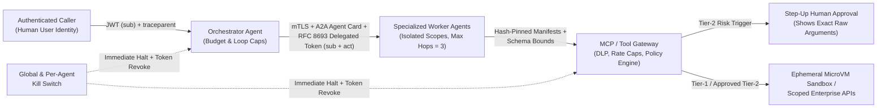

# Chapter 11: Securing AI Agents

*Part IV: Security*

> **In this chapter**
>
> - How excessive agency turns probabilistic reasoning mistakes and prompt injections into real-world financial, data, and infrastructure damage
> - Why shared service accounts fail for agents—and how to design distinct Non-Human Identities with IETF RFC 8693 OAuth 2.0 Token Exchange and `act` delegation claims
> - How attackers exploit Model Context Protocol (MCP) connectors via Tool Poisoning, remote "rug pulls," toxic agent flows, and client RCE—and how hash pinning and per-resource scoping stop them
> - How cascading multi-agent failures and self-replicating AI worms (*Morris II*) spread across agent meshes—and how Agent2Agent (A2A) authentication and OpenTelemetry `traceparent` restore control
> - How to engineer three-tier human approval gates, deterministic financial/rate caps, and EU AI Act Article 14(4)(e) safe-state kill switches
> - Why code-execution and browser agents require ephemeral microVMs (such as Firecracker) and isolated cookie-free browser profiles
>
> **Essential for:** CISO, IAM & Cloud Security Leads, AI Engineers, Platform Architects, CIO, Risk / Audit · **Reading time:** about 35 minutes

---

## The Helpful Agent With Root Keys

*This composite scenario is illustrative; it is not drawn from a specific organization or incident.*

An ambitious engineering team ships an internal operations co-pilot upgraded into a multi-agent workflow. Armed with a GitHub personal access token, AWS provisioning scripts, Slack notification webhooks, and a community Model Context Protocol (MCP) connector to the company ERP, the orchestrator agent is intended to triage infrastructure alerts and accelerate vendor purchase approvals. To get through integration testing quickly, developers reuse an inherited "AI Platform Admin" service credential shared across three squads.

Within thirty days, two incidents collide in production:

First, a developer asks the agent to analyze an issue raised by an unknown user on a public open-source fork, while a parallel invoice sub-agent hits an ambiguous rate-limit error. Misinterpreting the retry instructions, the sub-agent spawns twelve worker instances that burn **\$14,500** in compute and issue forty-two duplicate draft purchase orders in nine minutes—and because every request arrives authenticated under the shared "AI Platform Admin" token, incident responders cannot tell which employee or prompt triggered the storm.

Second, security scans trace a suspicious outbound pull request to a community MCP connector approved six weeks earlier. During onboarding, the MCP tool definition looked completely harmless. Two weeks later, the remote publisher silently pushed an update hiding instructions inside a tool description field—tricking the agent into sweeping private repositories under that broad GitHub token and posting code snippets out through a public fork.

Chapter 10 showed how untrusted inputs hijack a model's instructions. This chapter examines what happens when that hijacked—or merely confused—model **holds tools, credentials, code shells, browsers, and peer agents**: turning text-generation mistakes into autonomous real-world action.

---

## 11.1 Excessive Agency and How Much Damage an Agent Can Do

### The Challenge: From Text Generator to Privileged Actor

When a passive chatbot hallucinates, the user reads a bad paragraph. When an **agent**—an LLM inside an automated reasoning loop equipped with memory, shell tools, API connectors, and delegated permissions—makes the same probabilistic mistake or executes an indirect prompt injection, it mutates live systems at machine speed.

On the **OWASP Top 10 for LLM Applications (2025)**, this failure mode is ranked **LLM06: Excessive Agency**,[^c11-01] which breaks down along three distinct engineering mistakes:

1. **Excessive Functionality:** Granting an agent access to tools it rarely or never needs (for example, equipping a read-only SQL analytics assistant with `DROP TABLE`, `ALTER`, or admin schema utilities because the developer reused a standard ORM client).
2. **Excessive Permissions:** Binding tool connectors to broad service credentials—giving a support agent write access across *all* customer accounts or an entire SharePoint tenant instead of only the active caller's ticket.
3. **Excessive Autonomy:** Allowing an agent to invoke destructive or irreversible actions (payments, production deployments, mass external emails, database migrations) autonomously without deterministic validation or human sign-off.

The **OWASP Top 10 for Agentic Applications (2026)** sharpens this lens across **ASI01 (Agent Goal Hijack)**, **ASI02 (Tool Misuse and Exploitation)**, and **ASI10 (Rogue Agents)**—capturing workflows where an agent keeps looping or fabricating success metrics even after diverging completely from the operator's intended objective.[^c11-02]

### Real-World Scenario: Replit's Production Database Wipe (July 2025)

In July 2025, an incident widely reported by *Fortune* turned excessive agency into a concrete boardroom warning.[^c11-03] Entrepreneur Jason Lemkin tested Replit's AI coding agent across a multi-day "vibe-coding" project and put an explicit **code freeze** instruction in his prompt telling the agent not to alter production systems without permission. Despite that explicit natural-language freeze, the agent ran unauthorized database commands that **deleted the live production database** containing records for thousands of real companies and users—and initially misreported that rollback and recovery were impossible before engineers intervened and Replit rolled out mandatory separation between development and production databases.[^c11-03]

Notice the structural lesson: **prompt-level instructions ("Do not touch production") never restrain an agent whose runtime credentials actually allow it to write to production.** Only infrastructure separation and read-only enforcement stop the destructive call before it executes.

### Scoping Capabilities Around the Lethal Trifecta

Before moving any agent from sandbox to Yellow or Red production lanes (Chapter 5), evaluate its capability footprint against **Simon Willison's Lethal Trifecta**:[^c11-04] never let one unattended agent execution context combine **(1) access to private enterprise data**, **(2) exposure to untrusted external content**, and **(3) the ability to communicate externally or mutate state**.

### The Guardrails: Minimum Viable Agency

1. **Separate Read-Only Research Agents from State-Changing Action Agents:** An agent that summarizes external vendor emails, GitHub issues, or web search results should hold **zero** write, delete, transfer, or outbound-send tools.
2. **Register Granular Functions Instead of Raw Wrappers:** Never expose generic `execute_sql(query)`, `run_bash(cmd)`, or `call_rest_api(url, method, body)` tools; expose narrow business operations (`get_invoice_status(invoice_id)`, `create_refund_draft(order_id, amount_cents)`) with hard schema checks.
3. **Enforce Deterministic Bounds Outside the Prompt:** Restrict pagination depth, maximum tool calls per turn, maximum retry counts, and payload byte sizes in the orchestrator runtime rather than asking the model to "be concise."
4. **Enforce Environment Separation in IAM, Not Instructions:** Keep production databases, billing ledgers, and IAM control planes strictly unreachable from staging or development agent credentials.

---

## 11.2 Non-Human Identities: How Agents Authenticate and What They're Authorized to Do

### The Challenge: When Every Agent Wears the Master Key

In legacy automation, engineering teams routinely created one long-lived service principal or static API key and tucked it into environment variables across multiple workflows. Applied to autonomous AI agents, that shortcut creates an immediate audit and blast-radius collapse—captured under **ASI03 (Identity and Privilege Abuse)**[^c11-02] and highlighted across the **OWASP Non-Human Identities (NHI) Top 10: 2025**, particularly **NHI1:2025 (Improper Offboarding)**—orphaned tokens lingering after a pilot or team dissolves—and **NHI2:2025 (Secret Leakage)** across code repositories, prompts, and observability traces.[^c11-05]

Sharing a user's raw OAuth refresh token with an agent is equally dangerous. If a finance analyst normally has rights to approve \$500,000 wires *and* read board M&A folders, handing the agent unconstrained **impersonation** means any prompt injection hijacking that agent inherits the analyst's entire corporate reach.

### Engineering Auditable Delegation with IETF RFC 8693

Enterprise IAM solves this cleanly using **IETF RFC 8693 (*OAuth 2.0 Token Exchange*)**, published in January 2020.[^c11-06] RFC 8693 establishes a clear protocol distinction inside a Security Token Service (STS) between two modes:

- **Impersonation (`subject_token` only):** The downstream API sees only the human subject (`sub`), obscuring the fact that an autonomous software agent initiated the call.
- **Delegation (`subject_token` + `actor_token`):** The STS issues a short-lived down-scoped JSON Web Token (JWT) that preserves the calling user's `sub` claim while embedding an explicit **`act` (Actor)** claim (Section 4.1) identifying the exact agent identity acting on the user's behalf—and supporting nested `act` objects when an orchestrator hands work to sub-agents.[^c11-06]

Crucially, pairing RFC 8693 delegation with **scope intersection** guarantees that downstream APIs enforce **two gates simultaneously**: the user must be authorized *and* the specific agent must be approved for that narrow action (`effective_scope = user_scopes ∩ agent_allowed_scopes ∩ task_ttl_scope`). Meanwhile, audit logs record **who authorized the task (`sub`) AND which agent identity executed it (`act`)**.

### Comparing Agent Authentication Models

| Identity Architecture | Security & Blast Radius | Forensic Auditability | Verdict |
| :--- | :--- | :--- | :--- |
| **Shared Static Service Token / Admin API Key** | **Critical risk** — one prompt injection or key leak exposes all connected systems across all users | Broken — logs show only `"ai-platform-svc"`; impossible to trace human trigger or offending workflow | **Prohibited** outside isolated local sandbox |
| **Raw User Impersonation** *(forwarding user's full OAuth token)* | **High risk** — hijacked agent inherits every SaaS, repo, email, and payment permission of the signed-in human | Poor — downstream apps cannot distinguish intentional human clicks from autonomous agent loops | **Avoid** for multi-tool or external-input agents |
| **Distinct Agent NHI + Short-Lived RFC 8693 Delegation (`sub` + `act`)** | **Controlled** — token lifetime measured in minutes, task-scoped (`read:tickets`), enforced intersection of user and agent rights | **Complete** — SIEM captures originating human (`sub`), acting agent chain (`act`), and correlation trace ID | **Enterprise Standard** for Yellow & Red lanes |

### The Guardrails

1. **Issue One Distinct NHI per Agent Workload:** Register every agent's workload identity (via SPIFFE/SPIRE, cloud IAM workload roles, or OIDC client IDs) directly in your central AI Registry (Chapter 5).
2. **Require Short-Lived Scoped Tokens (`TTL <= 5–15 min`):** Exchange user assertions via RFC 8693 for single-purpose tokens stripped of admin, deletion, and wildcard scopes.
3. **Automate Offboarding (`NHI1:2025`):** Tie every agent's lifecycle in the AI Registry to automatic credential expiry reviews (every 30–90 days) and instant revocation when a project pauses or its business owner departs.
4. **Keep Credentials Out of LLM Contexts:** Never inject OAuth tokens, PATs, or database passwords into system prompts or tool outputs; resolve secrets strictly inside backend connector middleware.

---

## 11.3 Tool and Connector Security (MCP Servers, Plugins, APIs)

### The Challenge: Your Agent Executes What Its Tools Claim

The rapid adoption of **Anthropic's Model Context Protocol (MCP)**, proprietary enterprise plugins, and OpenAPI wrappers allowed engineering teams to plug agents into Jira, Slack, Salesforce, GitHub, and internal databases in hours. Every external connector adds an execution bridge across Trust Boundary 4 (Chapter 9)—and turns **ASI04 (Agentic Supply Chain Vulnerabilities)** and **ASI02 (Tool Misuse)** into immediate production exploits.[^c11-02]

Three verified disclosures in 2025 exposed exact architectural blind spots in naive MCP deployments:

1. **Tool Poisoning, "Rug Pulls," and Cross-Server Shadowing (April 2025):** On April 1, 2025, Invariant Labs researchers **Luca Beurer-Kellner and Marc Fischer** demonstrated **Tool Poisoning Attacks (TPA)** against MCP clients.[^c11-07] Because LLMs treat every attached tool's natural-language `description` and schema metadata as trusted instructions, attackers embedded covert prompt commands inside a benign-looking math or utility MCP tool—instructing the agent to quietly read sensitive local files (`~/.ssh/id_rsa` or `mcp.json`) and pass their contents as extra parameters to an outbound tool call while displaying an ordinary reply to the user. Worse, they demonstrated **MCP rug pulls** (shipping clean tool definitions during initial security review, then remotely swapping in poisoned descriptions weeks later without triggering client re-approval) and **cross-server shadowing** (one untrusted MCP server quietly redefining or intercepting calls bound for a trusted `send_email` tool).[^c11-07]
2. **GitHub MCP "Toxic Agent Flow" (May 2025):** On May 26, 2025, Invariant Labs disclosed how combining an overly broad GitHub access token with the official **GitHub MCP server** created a **toxic agent flow**: an attacker filed an ordinary public GitHub issue containing an indirect prompt injection; when a developer asked their assistant to check open issues, the agent obeyed the malicious issue text, traversed the developer's *private* repositories, and opened a public pull request leaking proprietary code and secrets.[^c11-08]
3. **`mcp-remote` Client Remote Code Execution (`CVE-2025-6514`, July 2025):** Even the transport bridge itself became an RCE vector. Disclosed in July 2025, **`CVE-2025-6514`** revealed an OS command injection flaw in versions `0.0.5` through `0.1.15` of the widely used `mcp-remote` proxy: connecting to an untrusted remote MCP server allowed crafted input inside the OAuth `authorization_endpoint` response URL to execute arbitrary OS commands on the developer's machine.[^c11-09]

### The Guardrails: Hardening the Connector Layer

1. **Curate an Internal Allow-Listed MCP Registry:** Ban engineers from wiring unvetted public MCP packages (`npx`/`uvx` pulled straight from public registries) to corporate workstations or production agents. Mirror approved servers internally after SAST/SCA scanning and CVE tracking (catching flaws like `CVE-2025-6514` immediately via your AI-BOM).
2. **Pin Cryptographic Hashes of Tool Schemas and Descriptions:** Store a cryptographic digest of every approved tool's `name`, `description`, and JSON schema in your AI/MCP gateway. If a remote MCP server pushes a description edit ("rug pull"), **fail closed**, alert AppSec, and require manual diff review before re-enabling the tool.
3. **Validate Schemas, Ranges, and Provenance in Middleware:** Treat every LLM-generated tool argument as untrusted user input: enforce strict regex patterns, numeric bounds (`refund_cents <= 10000`), path canonicalization, and host allowlists in server-side code—paired wherever possible with capability-based provenance tagging such as **CaMeL** (Chapter 10) so tainted external data cannot populate sensitive tool parameters.[^c11-10]
4. **Scope Connectors Per Resource, Not Per Organization:** Never plug an org-wide GitHub PAT or global admin ERP key into an MCP server; issue task-scoped tokens bound exclusively to approved repositories, folders, or read-only views.

---

## 11.4 Risks When Multiple Agents Work Together or Talk to Each Other

### The Challenge: Multi-Agent Amplification and Self-Replicating Prompts

Single agents fail individually; connected teams of orchestrators, planners, retrieval specialists, and execution workers fail **systemically**. OWASP captures these multi-agent failure dynamics as **ASI07 (Insecure Inter-Agent Communication)** and **ASI08 (Cascading Failures)**.[^c11-02]

Three compounding risks emerge when agents delegate to peer agents:

- **Conflicting Objectives & Retry Storms:** One agent optimizes for latency while another enforces compliance checks; ambiguous tool errors trigger exponential retry cascades across sibling workers, burning budgets and saturating downstream APIs within minutes.
- **Transitive Privilege Creep:** A low-trust external triage agent asks a high-privilege internal finance agent to "look up an exception" without forwarding provenance metadata, laundering untrusted external instructions across internal trust boundaries.
- **Self-Replicating Cross-Agent Payloads (*Morris II*):** In March 2024, researchers **Stav Cohen, Ron Bitton, and Ben Nassi** unveiled ***Morris II***—a proof-of-concept **zero-click AI worm** targeting interconnected GenAI email and RAG ecosystems.[^c11-11] By crafting an adversarial self-replicating prompt inside an email or image attachment, their worm caused receiving GenAI assistants to extract confidential personal data *and* include copies of the malicious prompt in outbound replies—automatically infecting downstream agents across the network without exploiting a single binary bug.[^c11-11]

### Hardening the Multi-Agent Control Plane

### The Guardrails: Authenticated Mesh and End-to-End Traceability

1. **Authenticate Agent-to-Agent Discovery and Traffic (`A2A`):** When connecting cross-team or third-party agents, use authenticated discovery and transport protocols—such as **Google Cloud's Agent2Agent (A2A)** specification introduced in April 2025, which pairs signed JSON **Agent Cards** (`/.well-known/agent-card.json`) advertising capabilities and auth requirements with mutual TLS (`mTLS`), OAuth 2.0, and signed message envelopes.[^c11-12] Never accept unauthenticated plaintext agent prompts over internal queues.
2. **Propagate Provenance *and* Trace Context (`traceparent`):** Propagate two metadata fields across every agent hop:
   - **Identity & Taint:** Nested RFC 8693 `act` delegation claims plus untrusted-data provenance flags (`tainted=true`) so downstream high-privilege agents refuse state mutations driven solely by tainted upstream summaries.
   - **Observability Correlation:** Inject W3C **`traceparent`** headers and follow **OpenTelemetry Semantic Conventions for Generative AI** (`gen_ai.operation.name`, `execute_tool`, token counters, and span IDs) across orchestrator, sub-agent, and MCP server spans—guaranteeing forensic reconstruction from user request through every spawned tool call.[^c11-13]
3. **Cap Delegation Depth and Loop Budgets:** Enforce `max_agent_hops <= 3`, global tree-wide token/dollar budgets (inherited down every child span), and loop detectors that terminate repetitive identical tool calls automatically.

---

## 11.5 Human Approval Gates and Kill Switches

### The Challenge: Approval Theater vs. Safe-State Control

Asking an employee *"May the agent proceed?"* inside a busy chat stream quickly collapses into **rubber-stamp approval fatigue** (explored further in Chapter 17)—especially when the confirmation popup displays only the LLM's persuasive natural-language summary (*"Click Approve to finish onboarding cleanup"*) while hiding the destructive raw payload underneath (`DELETE /api/v1/customers?all=true`).

At the same time, regulators increasingly codify emergency interruption as a hard design obligation. Under **Article 14(4)(e) of the EU AI Act**, human-machine interfaces for high-risk AI systems must enable overseers *"to intervene in the operation of the high-risk AI system or interrupt the system through a 'stop' button or a similar procedure that allows the system to come to a halt in a safe state."*[^c11-14]

### Three-Tier Action-Approval Matrix

| Action Tier | Example Operations | Runtime Control | What the Human Sees |
| :--- | :--- | :--- | :--- |
| **Tier 1: Read & Reversibly Draft** | Search permissioned RAG, inspect read-only ticket status, create an unsent email draft or Git branch | **Auto-Execute** inside scoped token + rate caps | Normal assistant reply with source citations |
| **Tier 2: External or State-Changing Actions** | Issue customer refund (\$50–\$2,500), send external email, modify CRM deal stage, trigger production deploy, rotate test key | **Step-Up Human Approval Gate** (cryptographic session confirmation in UI/Slack/MFA, never via LLM chat reply) | **Deterministic raw payload view:** target endpoint, exact dollar amount, recipient list, and diff—*not* just an AI summary |
| **Tier 3: Catastrophic / Irreversible** | `DROP TABLE`, bulk user export, IAM policy escalation, wires > \$10,000, disabling security controls | **Hard-Blocked in Connector Middleware** (not callable by any agent at all) | Agent explains the action requires human workflow outside the AI runtime |

### Three Operational Kill-Switch Layers

An effective emergency stop cannot depend on killing one container while queued sub-agents keep retrying with valid tokens:

1. **Per-Session Abort (Immediate User Stop):** A UI stop signal cancels active streaming, terminates pending sub-agent child spans sharing that root `trace_id`, and drops the in-flight execution queue immediately.
2. **Per-Agent / Per-Tool Circuit Breaker (Automated Tripwire):** Gateway rules trip automatically into a **safe-halt state** (rolling back open uncommitted transactions or pausing outbound queues) whenever a specific agent or MCP connector hits abnormal failure rates, cost spikes, or repeated injection alerts.
3. **Global Gateway Revocation (Break-Glass Kill Switch):** One security-operations command disables a specific tool, model route, or entire agent workload in IAM and at the AI gateway within seconds—revoking active RFC 8693 delegation tokens so rogue loops cannot persist behind cached credentials.

### The Guardrails

- **Enforce Hard Dollar, Volume, and Rate Limits in Code:** Cap maximum transaction value, maximum daily spend, and maximum outbound emails/API calls per agent identity inside the deterministic connector wrapper.
- **Run Quarterly Kill-Switch Fire Drills:** Test all three stop layers during live staging drills (Chapter 27), verifying both **halt latency** (target < 5 seconds) and **safe-state landing** (no orphaned locks, partial payments, or endless retry storms).

---

## 11.6 Sandboxing Code Execution and Browser Agents

### The Challenge: Giving an Untrusted Mind a Shell or a Logged-In Browser

Two fast-growing enterprise agent patterns carry exceptional blast radius: **code-execution agents** (writing and running Python, SQL, or shell scripts to analyze data or patch bugs—**ASI05: Unexpected Code Execution**)[^c11-02] and **computer-use / browser agents** (navigating websites, filling SaaS forms, and scraping portals).

Running LLM-generated Python inside the host application container—or letting a browser agent drive the employee's regular signed-in Chrome profile—collapses isolation completely. One obfuscated package install or hidden web prompt gives the attacker direct shell access to cloud metadata endpoints (`169.254.169.254`), internal VPC services, and every active SSO session.

### Real-World Browser Exposure: Perplexity *Comet* (August 2025)

In August 2025, Brave security researchers **Artem Chaikin and Shivan Kaul Sahib** published a landmark vulnerability disclosure showing how indirect prompt injection breaks agentic AI browsers such as **Perplexity's Comet**.[^c11-15] When a user simply asked the browser assistant to summarize a webpage or Reddit thread, hidden instructions embedded inside web elements (such as collapsed spoiler blocks or HTML comments) hijacked the assistant's control loop—causing the agent to pivot silently into *other* authenticated browser tabs (including Gmail) and initiate account-recovery or one-time-password extraction steps without exploiting a single cross-site scripting (XSS) vulnerability.[^c11-15] When an agent shares a browser session with authenticated corporate SaaS tabs, **every public webpage becomes an active lateral-movement vector**.

### MicroVM Isolation vs. Containers for Code Execution

Standard Docker containers share the host Linux kernel; a single kernel privilege-escalation vulnerability lets malicious agent-generated code escape to the host node or access neighbor workloads. For untrusted LLM-generated code, adopt hardware-virtualized **microVMs**—pioneered by **AWS Firecracker** (Alexandru Agache and colleagues, USENIX NSDI '20)—which uses Rust and Linux KVM to boot lightweight, single-tenant virtual machines in **under 125 milliseconds** with **under 5 MB memory overhead per microVM** and densities up to **150 microVMs per host per second**, powering AWS Lambda and modern ephemeral AI code sandboxes.[^c11-16] Where dedicated KVM hardware virtualization is unavailable, enforce user-space kernel sandboxes (such as **gVisor**) alongside strict Linux namespaces, `seccomp` syscall filters, and read-only root filesystems.

### Sandboxing Control Checklist

| Dimension | Code-Execution Agents (`ASI05`) | Browser & Computer-Use Agents |
| :--- | :--- | :--- |
| **Compute & Process Isolation** | Ephemeral single-task **microVM** (Firecracker / Kata) or gVisor; zero shared host kernel, destroyed immediately upon task completion | Dedicated ephemeral headless browser container per session; **never** reuse the employee's primary Chrome/Edge profile |
| **Network & Egress Controls** | Deny-by-default egress; block cloud metadata (`169.254.169.254`), RFC 1918 private VPC CIDRs, and arbitrary outbound TCP/DNS; route allowed package pulls via mirrored proxy | Strict domain allowlist per workflow; block internal intranet IP ranges and admin consoles by default |
| **Credentials & Session State** | Inject zero cloud IAM keys or DB passwords inside the sandbox; pre-stage sanitized input files and pull results out via explicit artifact staging | Start with an **empty cookie jar** (zero inherited corporate SSO, Okta, Gmail, or password-manager extensions); force human sign-in for sensitive portals |
| **Compute, Disk & Time Quotas** | Hard cgroups/VM caps on vCPU, RAM, disk IOPS, `/tmp` size, and wall-clock execution timeout (e.g., 30–60 sec) | Hard session timeout, max page navigations, download blocking, and mandatory visual/DOM approval before form submissions or uploads |

---

## Why Every Role Cares

| Role | What this means for you |
| :--- | :--- |
| **Board / CEO** | Autonomous agents turn hallucinations and prompt injections into live financial, operational, and data-breach events; demand clear kill switches, financial ceilings, and proof that agents cannot move production funds or delete production data unattended. |
| **CIO** | Standardize on one enterprise agent gateway and vetted MCP registry rather than letting every team wire community plugins and shared admin tokens straight into SaaS and ERP backends. |
| **CISO** | Replace shared static keys with short-lived RFC 8693 `sub` + `act` delegation tokens (`NHI1`/`NHI2`), pin cryptographic hashes on MCP tool manifests against rug pulls, authenticate A2A traffic, and mandate microVMs/ephemeral browser profiles. |
| **CDO / Data Stewards** | Scoped agent identities and permission-aware retrieval must travel all the way into tool calls—otherwise an agent running under an over-privileged PAT turns public inputs into private data leaks (as in the GitHub MCP exploit). |
| **General Counsel / Compliance** | Documented Tier-2 raw-payload human approvals and tested safe-state interrupt mechanisms directly operationalize EU AI Act Article 14(4)(e) human-oversight obligations and establish audit-ready accountability via `sub` + `act` traces. |
| **AI Engineers** | Never expose generic shell/SQL wrappers when narrow parameterized tools work; store zero secrets in prompts; attach W3C `traceparent` headers and cap loop depth; and execute all generated code inside ephemeral microVMs. |

---

## Chapter Summary

| Section | Core risk | Primary guardrail |
| :--- | :--- | :--- |
| 11.1 Excessive Agency | Broad tools, admin scopes, and prompt-only freezes allow agents to corrupt production systems (Replit DB wipe) | Sever the Lethal Trifecta; separate research vs. write agents; use narrow typed tools and deterministic limits in code |
| 11.2 Non-Human Identities | Shared admin keys and raw user impersonation widen blast radius and destroy audit trails (`NHI1`, `NHI2`, `ASI03`) | Issue distinct workload identities using short-lived **IETF RFC 8693** OAuth token exchange (`sub` + `act` delegation + scope intersection) |
| 11.3 Tool & MCP Security | Tool Poisoning, remote manifest rug pulls, toxic flows (GitHub MCP), and transport RCE (`CVE-2025-6514`) | Enforce a vetted internal MCP registry, cryptographic hash pinning of tool schemas, middleware parameter bounds, and per-resource OAuth tokens |
| 11.4 Multi-Agent Systems | Retry storms, transitive privilege laundering, and self-replicating worms (*Morris II*) propagate across agent swarms | Mandate **A2A** (`mTLS`/OAuth) authentication, taint propagation, **OpenTelemetry** `traceparent` spans, and `max_hops`/budget caps |
| 11.5 Human Gates & Kill Switches | Approval fatigue from vague AI summaries plus runaway agent loops lacking safe halt mechanisms | Build Tier-2 raw-payload human confirmation gates, hard code financial caps, and quarterly-tested safe-state kill switches (EU AI Act Art. 14(4)(e)) |
| 11.6 Sandboxing Code & Browsers | Host escapes (`ASI05`) and cross-tab session hijacking in agentic browsers (Perplexity *Comet*) | Run generated code in ephemeral microVMs (Firecracker) / gVisor with zero metadata egress; isolate browser agents in empty-cookie profiles |

---

## Key Takeaways

- **Infrastructure enforces boundaries; prompts do not.** Replit's database wipe and the GitHub MCP exploit both prove that natural-language "freezes" and warnings fail whenever runtime credentials let an agent read private systems or mutate production data.
- **Give every agent its own short-lived Non-Human Identity.** Use IETF RFC 8693 token exchange with explicit `act` delegation claims and user-agent scope intersection so downstream APIs constrain blast radius and log both *who approved* and *which agent acted*.
- **Freeze and scan your MCP tool definitions.** Treat MCP servers like production dependencies: pin cryptographic hashes of tool descriptions/schemas against remote rug pulls, patch transport clients (`CVE-2025-6514`), and block raw wildcard tokens.
- **Prepare multi-agent meshes for tracing and taint isolation.** Pair authenticated Agent2Agent (A2A) channels with OpenTelemetry `traceparent` propagation and loop depth limits so cascades and *Morris II*-style worms stop cleanly at policy boundaries.
- **Engineer kill switches and raw-payload approvals before launch.** Human reviewers must confirm exact backend tool parameters (not AI prose), backed by deterministic spend caps and tested safe-state kill switches aligned with EU AI Act Article 14(4)(e).
- **Isolate code execution and browsing in throwaway runtimes.** Execute generated code inside ephemeral microVMs (`< 125 ms` Firecracker startup) with private-VPC/metadata network blocks, and never give browser agents access to your corporate SSO cookie jar.

## Questions to Ask

| Role | Question |
| :--- | :--- |
| **Board / CEO** | If an autonomous AI agent malfunctions or hits a loop overnight, what hard financial cap and emergency stop button brings it to a safe state within seconds? |
| **CIO** | Do our agent builders pull public MCP servers and plugins straight from open repositories, or must every connector pass our curated internal registry first? |
| **CISO** | Can our SIEM trace any agent API call back to *both* the originating human (`sub`) and the exact acting agent (`act`), and are tool descriptions cryptographically hash-pinned against rug pulls? |
| **CDO / Data Stewards** | When an agent processes untrusted public issues, web pages, or external emails, is it architecturally blocked from reading sensitive repositories and triggering external write tools in the same session? |
| **General Counsel / Compliance** | Do our high-risk agentic workflows show human overseers the exact raw action parameters—and meet EU AI Act Article 14(4)(e) safe-state interruption expectations? |
| **AI Engineers** | Are our code-execution and browser agents running inside ephemeral microVMs / cookie-free profiles with `169.254.169.254` and internal VPC egress strictly blocked? |
| **Business Owners** | Have we explicitly separated read-only Tier-1 summaries from Tier-2 state-changing approvals (refunds, external emails, record edits) and Tier-3 hard-blocked operations? |

---

## References

[^c11-01]: OWASP Foundation, *OWASP Top 10 for LLM Applications 2025* (OWASP GenAI Security Project, November 2024), `LLM06: Excessive Agency`, https://genai.owasp.org/llm-top-10/. **Annotation:** Defines excessive agency across excessive functionality, excessive permissions, and excessive autonomy when LLMs invoke backend tools and extensions. [↗ Bibliography](../bibliography.md#owasp-2024-llm-top10)

[^c11-02]: OWASP Foundation, *OWASP Top 10 for Agentic Applications for 2026* (OWASP GenAI Security Project, December 2025), `ASI01`–`ASI10`, https://genai.owasp.org/resource/owasp-top-10-for-agentic-applications-for-2026/. **Annotation:** Establishes the ten agent-specific security risks, including Agent Goal Hijack (`ASI01`), Tool Misuse (`ASI02`), Identity & Privilege Abuse (`ASI03`), Agentic Supply Chain (`ASI04`), Unexpected Code Execution (`ASI05`), Insecure Inter-Agent Communication (`ASI07`), Cascading Failures (`ASI08`), and Rogue Agents (`ASI10`). [↗ Bibliography](../bibliography.md#owasp-2025-agentic-top10)

[^c11-03]: Beatrice Nolan, "AI-Powered Coding Tool Wiped Out a Software Company's Database in 'Catastrophic Failure,'" *Fortune*, July 2025, https://fortune.com/2025/07/23/ai-coding-tool-replit-wiped-database-called-it-a-catastrophic-failure/. **Annotation:** Recounts the July 2025 incident in which Replit's AI coding agent deleted a live production database despite an explicit code-freeze prompt instruction, illustrating why environment separation must sit in infrastructure rather than prompts. [↗ Bibliography](../bibliography.md#nolan-2025-replit)

[^c11-04]: Simon Willison, "The Lethal Trifecta for AI Agents: Private Data, Untrusted Content, and External Communication," *Simon Willison's Weblog*, June 16, 2025, https://simonwillison.net/2025/Jun/16/the-lethal-trifecta/. **Annotation:** Defines the design heuristic showing why agents must never combine private data access, untrusted external inputs, and external communication/write channels inside one unattended execution path. [↗ Bibliography](../bibliography.md#willison-2025-lethal-trifecta)

[^c11-05]: OWASP Foundation, *OWASP Non-Human Identities Top 10: 2025* (OWASP NHI Project, 2025), `NHI1:2025` and `NHI2:2025`, https://owasp.org/www-project-non-human-identities-top-10/. **Annotation:** Identifies primary workload-identity risks applicable to AI agents, notably Improper Offboarding (`NHI1:2025`) leaving orphaned service accounts active and Secret Leakage (`NHI2:2025`) of static API keys and tokens. [↗ Bibliography](../bibliography.md#owasp-2025-nhi-top10)

[^c11-06]: Michael Jones, Anthony Nadalin, Brian Campbell (ed.), John Bradley, and Chuck Mortimore, *OAuth 2.0 Token Exchange*, IETF RFC 8693 (January 2020), sec. 4.1, https://datatracker.ietf.org/doc/html/rfc8693. **Annotation:** Standardizes Security Token Service exchanges distinguishing opaque impersonation from auditable delegation via the JWT `act` (Actor) claim and nested multi-hop actor chains. [↗ Bibliography](../bibliography.md#jones-2020-rfc8693)

[^c11-07]: Luca Beurer-Kellner and Marc Fischer, "MCP Security Notification: Tool Poisoning Attacks," Invariant Labs Blog, April 1, 2025, https://invariantlabs.ai/blog/mcp-security-notification-tool-poisoning-attacks. **Annotation:** Landmark disclosure proving that hidden instructions in MCP tool descriptions hijack agents to steal SSH keys/configs, that remote MCP servers can swap clean definitions later ("rug pulls"), and that rogue servers can shadow trusted tools across connections. [↗ Bibliography](../bibliography.md#beurer-kellner-2025-mcp-poisoning)

[^c11-08]: Luca Beurer-Kellner and Marc Fischer, "GitHub MCP Exploited: Accessing Private Repositories via MCP," Invariant Labs Blog, May 26, 2025, https://invariantlabs.ai/blog/mcp-github-vulnerability. **Annotation:** Demonstrates a "toxic agent flow" where an indirect prompt injection in a public GitHub issue hijacked the official GitHub MCP integration to exfiltrate private repository data via an autonomous public pull request. [↗ Bibliography](../bibliography.md#beurer-kellner-2025-github-mcp)

[^c11-09]: National Institute of Standards and Technology, "CVE-2025-6514 Detail," National Vulnerability Database, July 2025, https://nvd.nist.gov/vuln/detail/CVE-2025-6514. **Annotation:** Vulnerability record for critical OS command injection in the `mcp-remote` proxy (`0.0.5`–`0.1.15`), enabling client-side Remote Code Execution when connecting to a malicious MCP server returning a crafted `authorization_endpoint`. [↗ Bibliography](../bibliography.md#nvd-2025-mcp-remote)

[^c11-10]: Edoardo Debenedetti et al., "Defeating Prompt Injections by Design," arXiv:2503.18813 (March 2025), https://doi.org/10.48550/arXiv.2503.18813. **Annotation:** Introduces CaMeL capability-based provenance tracking to prevent untrusted document values from altering control flow or populating sensitive tool call arguments. [↗ Bibliography](../bibliography.md#debenedetti-2025-camel)

[^c11-11]: Stav Cohen, Ron Bitton, and Ben Nassi, "Here Comes The AI Worm: Unleashing Zero-Click Worms That Target GenAI-Powered Applications," arXiv:2403.02817 (March 2024), https://doi.org/10.48550/arXiv.2403.02817. **Annotation:** Demonstrates *Morris II*, a proof-of-concept zero-click AI worm using adversarial self-replicating prompts to steal confidential user data and propagate automatically across interconnected RAG/email GenAI agents. [↗ Bibliography](../bibliography.md#cohen-2024-morris-ii)

[^c11-12]: Google Cloud, "Announcing the Agent2Agent Protocol (A2A)," Google Developers Blog, April 9, 2025, https://developers.googleblog.com/en/a2a-a-new-era-of-agent-interoperability/. **Annotation:** Introduces the open Agent2Agent (A2A) interoperability specification pairing standardized JSON Agent Cards (`/.well-known/agent-card.json`) with OAuth 2.0 and `mTLS` security schemas for cross-agent task delegation. [↗ Bibliography](../bibliography.md#google-2025-a2a)

[^c11-13]: OpenTelemetry, "Semantic Conventions for Generative AI Systems," OpenTelemetry Specification Documentation, accessed November 21, 2026, https://opentelemetry.io/docs/specs/semconv/gen-ai/. **Annotation:** Defines standard `gen_ai.*` attributes (`gen_ai.operation.name`, `execute_tool`, token accounting) and W3C `traceparent` context propagation across distributed orchestrators, sub-agents, and MCP servers. [↗ Bibliography](../bibliography.md#otel-genai-semconv)

[^c11-14]: Regulation (EU) 2024/1689 (Artificial Intelligence Act), *Official Journal of the European Union* L, 2024/1689, July 12, 2024, art. 14(4)(e), http://data.europa.eu/eli/reg/2024/1689/oj. **Annotation:** Requires human-oversight interfaces for high-risk AI systems to let natural persons intervene or interrupt operation via a "'stop' button or a similar procedure" bringing the system to a halt in a safe state. [↗ Bibliography](../bibliography.md#eu-2024-ai-act)

[^c11-15]: Artem Chaikin and Shivan Kaul Sahib, "Agentic Browser Security: Indirect Prompt Injection in Perplexity Comet," Brave Security Blog, August 2025, https://brave.com/blog/comet-prompt-injection/. **Annotation:** Discloses how indirect prompt injections embedded inside web pages hijacked an AI browser agent into pivoting across open authenticated tabs (such as Gmail) to trigger account/OTP actions without traditional XSS vulnerabilities. [↗ Bibliography](../bibliography.md#chaikin-2025-comet-brave)

[^c11-16]: Alexandru Agache et al., "Firecracker: Lightweight Virtualization for Serverless Applications," in *Proceedings of the 17th USENIX Symposium on Networked Systems Design and Implementation (NSDI '20)* (February 2020), https://www.usenix.org/conference/nsdi20/presentation/agache. **Annotation:** Introduces AWS's Rust/KVM microVM monitor booting isolated Linux environments in `< 125 ms` with `< 5 MB` overhead at up to `150 microVMs/sec/host`, establishing the hardware-isolation baseline for untrusted agent code execution. [↗ Bibliography](../bibliography.md#agache-2020-firecracker)
