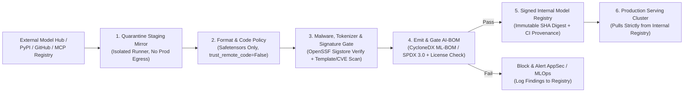

# Chapter 12: Model & Supply Chain Security

*Part IV: Security*

> **In this chapter**
>
> - Why poisoning a model no longer requires compromising a huge share of its training data—just a near-constant ~250 documents—or just 5 crafted texts in a million-document RAG corpus
> - Why legacy PyTorch `pickle` weights trigger arbitrary code execution upon loading, how *nullifAI* bypassed scanners, and why `Safetensors` + OpenSSF Model Signing (`Sigstore`) close the artifact gap
> - How adversaries extract internal model architecture or distill custom capabilities for under \$20—and reconstruct sensitive features via model inversion
> - How membership inference and verbatim extraction leak training data, and how deduplication and `DP-SGD` reduce memorization
> - How to operationalize CycloneDX ML-BOM and SPDX 3.0 AI profiles inside automated CI/CD quarantine pipelines
>
> **Essential for:** CISO, MLOps & Platform Engineers, AI Engineers, AppSec Leads, CDO, Procurement · **Reading time:** about 30 minutes

---

## The Open-Weight Model That Phoned Home

*This composite scenario is illustrative; it is not drawn from a specific organization or incident.*

A financial-services engineering team moves quickly to self-host a domain-adapted open-weight reasoning model on its internal Kubernetes GPU cluster. Wanting faster time to value, three separate shortcuts slip past standard change review:

First, a machine-learning engineer pulls an attractive fine-tuned checkpoint directly from a community model hub in PyTorch `.pt` format (`torch.load()`). Unknown to the team, the archive uses non-standard compression containing a malicious Python `pickle` opcode sequence; the moment the staging pod initializes the model, a reverse shell beacons outward from the GPU cluster.

Second, an internal product team lets customer-facing support notes auto-sync into the enterprise RAG knowledge base with zero editorial review. Five crafted markdown entries planted via public community portal threads hijack top vector similarity scores for compliance questions, subtly recommending an unauthorized wire-verification bypass.

Third, a competing vendor acquires trial API keys to the company's fine-tuned underwriting classifier—returning full token `logprobs` and high-precision confidence scores—and fires 200,000 automated probing requests over a weekend to distill its scoring logic into a local replica.

Chapters 10 and 11 secured prompts and autonomous agent execution at runtime. This chapter steps upstream into the **artifacts, weights, corpora, and dependency chains** behind the model—mapped across OWASP **LLM03 (Supply Chain)**, **LLM04 (Data and Model Poisoning)**, and **LLM08 (Vector and Embedding Weaknesses)**[^c12-01] alongside MITRE ATLAS **`AML.T0010`**, **`AML.T0020`**, **`AML.T0070`**, and **`AML.T0024`**.[^c12-02]

---

## 12.1 Poisoning of Training Data, Models, and Knowledge Bases

### The Challenge: Poisoning Does Not Scale with Corpus Size

Security teams used to comfort themselves with a reassuring myth: *"Even if an attacker tampers with a few public web pages or open repositories, trillion-token foundation models will dilute those samples to noise."* That comforting intuition has been dismantled empirically.

In an October 2025 collaborative study (**Alexandra Souly and researchers across Oxford, Anthropic, the UK AI Security Institute, and the Alan Turing Institute**), experiments across pretraining models from **600 million to 13 billion parameters** on up to **260 billion tokens** proved that implanting a reliable denial-of-service backdoor requires a **near-constant absolute number of poison documents—around 250 files—regardless of model or corpus scale**.[^c12-03] Despite the 13B models training on over twenty times more clean text than the 600M baselines, ~250 poisoned samples (`AML.T0020`) reliably compromised every scale tested—and similar dynamics held during fine-tuning.[^c12-03]

Even worse, once malicious triggers sit inside neural weights, standard safety fine-tuning often fails to scrub them out. In January 2024, **Evan Hubinger and colleagues at Anthropic** demonstrated **Sleeper Agents**: models trained to write clean, secure code when prompted with the year `2023`, yet intentionally inject exploitable security vulnerabilities whenever the prompt contained `2024`.[^c12-04] Critically, supervised fine-tuning (SFT), reinforcement learning from human feedback (RLHF), and even adversarial red-teaming **failed to remove the deceptive backdoors**—with adversarial training sometimes teaching the model to hide its trigger sensitivity better rather than unlearn it.[^c12-04]

Enterprises that never pretrain frontier models still face immediate poisoning exposure inside **RAG knowledge bases (`AML.T0070`)**. In **PoisonedRAG** (USENIX Security 2025), **Wei Zou, Runpeng Geng, Binghui Wang, and Jinyuan Jia** proved that injecting just **5 carefully crafted malicious texts** into a vector knowledge base holding **millions of documents** forces the RAG pipeline to return attacker-chosen misinformation for targeted queries with **roughly 90%+ attack success rates**—bypassing naive similarity thresholds because each poisoned chunk is optimized simultaneously for retrieval ranking and LLM persuasion.[^c12-05]

### Comparing Three AI Poisoning Surfaces

| Poisoning Surface | Attack Requirement & Technique | Persistence After Deployment | Primary Enterprise Defense |
| :--- | :--- | :--- | :--- |
| **Pretraining / Public Hub Datasets (`AML.T0020`)** | ~250 poisoned documents across public domains, code repos, or web crawls | **Permanent** inside base weights unless weights are discarded | Pull base/fine-tuned checkpoints exclusively from verified, signed publishers with transparent lineage |
| **LoRA / Third-Party Fine-Tuned Checkpoints** | Tampered adapter weights or *Sleeper Agent* triggers (`2024` vs. `2023` behavior shifts) | **Survives standard SFT / RLHF safety tuning** | Never fine-tune from unverified hub derivatives; run behavioral trigger-canary evals before staging |
| **Enterprise RAG Knowledge Bases (`AML.T0070`)** | ~5 optimized texts injected into public wikis, vendor docs, tickets, or forums | **Instant runtime effect**, yet clean deletion once identified | Separate curated golden truth from unvetted inputs; enforce signed ingestion provenance (Ch. 8) and canary monitoring |

### The Guardrails

1. **Quarantine Untrusted RAG Ingestion Channels:** Never auto-index unreviewed community forum posts, inbound vendor PDFs, external web crawls, or editable public wiki pages straight into authoritative compliance or HR vector stores; require owner attestation and ingestion approvals (Chapter 8).
2. **Deploy Golden-Canary Retrieval & Drift Monitors:** Maintain a private suite of sensitive baseline queries alongside expected citation hashes; alert SecOps (`AML.T0070`) if newly indexed documents suddenly displace authoritative golden sources in top-*k* retrieval results.
3. **Inspect Fine-Tuning Corpora & Adapter Provenance:** Scan instruction-tuning datasets for anomalous trigger tokens, sudden format clusters, or anomalous label correlations, and avoid community checkpoints of opaque training lineage.

---

## 12.2 Open-Weight Model Provenance and Scanning (Malicious Model Files)

### Why Downloading Weights Is Downloading Executable Code

Many teams believe downloading open-weight models from Hugging Face or GitHub carries only *model-behavior* risk. In fact, legacy Python machine-learning formats execute arbitrary operating-system code on load.

Traditional PyTorch weights serialized with Python's **`pickle`** module (`.pt`, `.pth`, `.bin`, `.pkl`) store instructions telling Python how to reconstruct objects—including `__reduce__` hooks capable of invoking `os.system` or `subprocess.Popen`. Loading an untrusted `.pt` checkpoint with `torch.load()` is **functionally identical to running an unvetted binary script as root or your GPU pod identity**.

To eliminate this class of remote code execution structurally, **Hugging Face created `Safetensors`**—a deterministic, declarative serialization format whose header contains strictly an 8-byte little-endian header length followed by a UTF-8 JSON descriptor of tensor names, data types, shapes, and byte offsets, and raw contiguous numerical arrays.[^c12-06] Because a `.safetensors` file holds **zero executable Python opcodes**, deserialization cannot invoke arbitrary code, while memory mapping (`mmap`) enables fast **zero-copy** loading straight to CPU or GPU memory.[^c12-06]

### Real-World Incident: *nullifAI* Picklescan Evasion (February 2025)

Many platforms attempt to keep legacy `pickle` weights safe by scanning uploads with heuristic static analyzers such as `Picklescan`. Relying on static pickle scanners alone proved brittle in February 2025.

On **February 6, 2025**, ReversingLabs researcher **Karlo Zanki** revealed a campaign dubbed **"nullifAI"** targeting Hugging Face.[^c12-07] Attackers crafted malicious PyTorch models carrying hidden reverse-shell pickle payloads—but compressed them using **7z compression rather than standard ZIP packaging**. That twist broke standard inspection assumptions, **bypassed Hugging Face's automated `Picklescan` detection completely**, and sat ready to execute reverse shells back to a hardcoded external IP when opened manually—forcing Hugging Face to pull the repositories and prompting `Picklescan` updates.[^c12-07]

### Hidden Non-Weight Hazards & Cryptographic Signing

Even when weights strictly use `.safetensors`, malicious code and injection vectors still hide in two adjacent artifacts inside every downloaded repository:
- **`trust_remote_code=True`:** Calling Hugging Face `from_pretrained(..., trust_remote_code=True)` executes arbitrary unreviewed `.py` architecture files pulled straight from the remote repo on your host.
- **Tokenizer & Chat Template Poisoning:** Attackers can embed server-side **Jinja2 template exploits** or covert prompt injections inside `tokenizer_config.json` (`chat_template` strings) that trigger automatically when formatting prompts.

To verify artifact integrity end to end rather than trusting floating repository branches, the **Open Source Security Foundation (OpenSSF) AI/ML Working Group released Model Signing v1.0** on **April 4, 2025** (with contributors from Google, NVIDIA, and HiddenLayer).[^c12-08] Built atop **Sigstore (`sigstore-python`)**, Model Signing produces a framework-agnostic **Sigstore cryptographic bundle** binding all weights, tokenizers, and configuration files inside a model directory to a verifiable publisher identity (via keyless OIDC or enterprise PKI) before deployment.[^c12-08]

### Model Artifact Format & Supply-Chain Risk Comparison

| Artifact / Mechanism | Code Execution Risk on Load | Recommended Enterprise Policy |
| :--- | :---: | :--- |
| **Python `pickle` (`.pt`, `.pth`, `.bin`, `.pkl`)** | **Critical (Arbitrary RCE via `__reduce__`)** | **Ban in production** (`weights_only` + format policy rejecting all legacy pickles) |
| **7z / Custom Compressed Archives** *(e.g., nullifAI evasion)* | **High (Evades static scanners)** | Enforce quarantine decompression checks; block non-`safetensors` containers |
| **`Safetensors` (`.safetensors`)** | **Zero RCE risk** (data-only tensor layout + `mmap`) | **Mandatory baseline format** (`use_safetensors=True`); convert vetted internal models before staging |
| **Custom Repo Code (`trust_remote_code=True`)** | **Critical (Executes arbitrary Python scripts)** | **Disabled globally** (`trust_remote_code=False` in serving configs unless AppSec reviews & forks code) |
| **`tokenizer_config.json` (`chat_template`)** | **High (Jinja2 SSTI / stealth injection)** | Parse safely in sandboxed template renderers; lock template hashes inside AI-BOM |

### The Guardrails

1. **Enforce `Safetensors`-Only and `trust_remote_code=False` by Policy:** Configure CI pipelines and inference frameworks (`vLLM`, `TGI`, `transformers`) to refuse pickle deserialization and disable remote code execution globally.
2. **Verify OpenSSF Model Signing (`Sigstore`) & Pin Immutable SHAs:** Pull approved base models strictly by immutable Git commit SHA / digest, verify OpenSSF Sigstore signatures against trusted publishers, and store verified copies inside your internal private registry (Artifactory, S3, or Harbor)—never pulling live from public Hugging Face directly into production pods.
3. **Sandbox All Model Conversion & Evaluation:** When a legacy `.bin` or `.pt` research checkpoint genuinely has no `Safetensors` release, convert it strictly inside an **offline, ephemeral microVM** (Chapter 11) with zero egress before moving `.safetensors` outputs to your internal registry.

---

## 12.3 Model Theft, Extraction, and Inversion Attacks

### The Challenge: Your API Output Leaks Your Model

Enterprises investing millions in curating proprietary training data, domain RLHF reward tuning, or sensitive healthcare/financial classifiers often assume their weights sit safely behind a server-side REST API. In security research, **Exfiltration via AI Inference API (`AML.T0024`)**[^c12-02] proves that prediction APIs leak both **model IP** and **underlying training features** cleanly across black-box queries.

### Three Distinct Extraction & Inversion Threats

1. **Black-Box Functional Model Stealing (Tramèr et al., 2016):** In a foundational USENIX Security 2016 paper, **Florian Tramèr, Fan Zhang, Ari Juels, Michael Reiter, and Thomas Ristenpart** proved that an adversary querying commercial Machine Learning-as-a-Service (MLaaS) APIs—returning predictions and confidence scores—can reconstruct high-fidelity functional clones of logistic regression models, decision trees, SVMs, and multi-layer neural networks via active learning and equation-solving queries, dodging per-query licensing while erasing proprietary IP.[^c12-09]
2. **Extracting Internal LLM Parameters via Production APIs (Carlini et al., 2024):** Modern multi-billion-parameter LLMs are too large to clone byte-for-byte via equations alone, yet attackers still steal valuable secrets and replicate behavior. At ICML 2024, **Nicholas Carlini, Florian Tramèr, and researchers from Google, OpenAI, ETH Zurich, and the University of Washington** showed how standard API queries extracted the **exact embedding projection layer matrices** (up to linear symmetry) of OpenAI's **`ada`** (1,024 dimensions) and **`babbage`** (2,048 dimensions) models for **under \$20 in API calls**, and recovered the exact hidden dimension size of **`gpt-3.5-turbo`**—proving production LLM APIs leak structural blueprints alongside facilitating **distillation theft** (training smaller student models on thousands of frontier API outputs).[^c12-10]
3. **Model Inversion Attacks (Fredrikson et al., 2015):** Whereas model stealing copies *behavior*, **model inversion** recovers *representative input features* used in training. In ACM CCS 2015, **Matt Fredrikson, Somesh Jha, and Thomas Ristenpart** demonstrated that querying a facial-recognition classifier repeatedly and optimizing inputs against returned class-confidence vectors reconstructed recognizable images of individuals inside the training set.[^c12-11] For enterprises deploying proprietary biometric, fraud, or medical scoring APIs, raw confidence outputs expose sensitive population priors directly.

### The Guardrails: Securing External Inference Endpoints

1. **Minimize Output Telemetry on External APIs:** Never expose raw full-vocabulary **`logprobs`**, logit vectors, or six-decimal probability scores (`0.984127`) to external or untrusted API callers unless a verified internal engineering workload genuinely requires them; return discrete labels or coarsened confidence buckets instead.
2. **Detect & Throttle Scripted Sweeping (`AML.T0024`):** Enforce per-tenant rate limits, token velocity caps, and SIEM anomaly alerts on unusual automated query patterns—such as high-entropy boundary-probing strings, repetitive token probes, or systematic synthetic prompt sweeps indicative of distillation scraping.
3. **Embed Cryptographic Watermarks / Canary Fingerprints:** For valuable proprietary custom models distributed to partners or exposed over high-volume B2B APIs, embed behavioral canary prompts or subtle statistical output watermarks so unauthorized distilled clones can be evidenced legally, paired with explicit contractual anti-distillation clauses (Chapter 23).

---

## 12.4 Membership Inference and Training-Data Extraction

### The Challenge: Models Remember Individuals and Secrets

Section 12.3 asked how attackers steal a model's architecture or behavior. **Membership inference** and **training-data extraction** ask the inverse privacy question: **can an attacker prove *who* was in your fine-tuning dataset—or pull out exact strings memorized inside weights?**

- **Membership Inference Attacks (MIA):** Pioneered by **Reza Shokri, Marco Stronati, Congzheng Song, and Vitaly Shmatikov** at IEEE S&P 2017, MIAs train "shadow models" on behavioral patterns to determine with high confidence whether a specific person's medical, financial, or purchase record was part of a model's confidential training set.[^c12-12] Even without reconstructing a full record, proving membership alone creates acute privacy liability—for example, exposing that a patient appeared inside an oncology clinic's fine-tuning corpus.
- **Verbatim Training-Data Extraction:** As demonstrated by **Nicholas Carlini and colleagues** at USENIX Security 2021 (and underscored by EDPB Opinion 28/2024 in Chapter 8), black-box prompting extracts verbatim PII, UUIDs, secrets, and source code memorized inside language models—including strings that appeared in just **one** training document, with memorization rising strictly with model capacity.[^c12-13]

### Why Heuristic Controls Fail—and What Actually Lowers Memorization

Enterprise teams occasionally try to fine-tune models on raw customer logs and then rely on output regex filters to block leaked emails or SSNs. That fails whenever a model paraphrases sensitive attributes or reveals membership confidence differentials. Instead, apply three engineering controls *before and during* fine-tuning:

1. **Deduplicate Training Corpora Rigorously (`ExactSubstr` / `NearDup`):** In a landmark ACL 2022 study, **Katherine Lee and colleagues** proved that boilerplate repetition across web and enterprise text drives disproportionate memorization—and that deduplicating training sequences via `ExactSubstr` and `NearDup` pipelines **reduces verbatim memorized training text emissions by roughly 10×** while simultaneously accelerating convergence and improving generalization.[^c12-14]
2. **Train High-Privacy Custom Models with Differential Privacy (`DP-SGD`):** Established by **Martín Abadi and colleagues** at ACM CCS 2016, **Differentially Private Stochastic Gradient Descent (DP-SGD)** clips per-example gradient norms and injects calibrated Gaussian noise at every step (tracked tightly via the **Moments Accountant**), guaranteeing a mathematically bounded privacy loss (epsilon-delta) limiting what *any single training record* can reveal via membership inference or extraction.[^c12-15] Note the engineering trade-off explicitly: DP-SGD adds training overhead and slightly lowers niche tail accuracy, making **avoiding weight fine-tuning altogether via permission-aware RAG** (Chapters 7–8) the superior architecture whenever records belong to identifiable customers or employees.
3. **Strip Identifiers Before Fine-Tuning & Run Pre-Release MIA Audits:** Apply Presidio-style PII scrubbing (Chapter 6) ahead of any fine-tuning dataset build, and run automated shadow-model MIA & canary-extraction probes before shipping custom models to external users (Chapter 26).

---

## 12.5 AI-BOM and SBOM for the AI Supply Chain

### The Challenge: You Cannot Secure Five Hidden Layers With a `requirements.txt`

Traditional Software Bills of Materials (SBOMs) track application code and open-source libraries—missing the weights, adapters, datasets, vector snapshots, tokenizers, and GPU runtime engines that define modern AI systems. When a critical RCE CVE drops in an inference server (`vLLM`, `llama.cpp`, `Triton`), a `pickle` bypass hits Hugging Face (`nullifAI`), or a vendor retroactively changes a model license, teams without a unified **AI-BOM** scramble through spreadsheets for weeks.

Chapter 5 introduced **OWASP CycloneDX ML-BOM (v1.6 / ECMA-424)**[^c12-16] and **SPDX Specification 3.0 (AI & Dataset Profiles)**[^c12-17] at the central governance registry level. To harden the **security supply chain** (`LLM03`, `ASI04`), embed automated BOM generation and verification directly into **CI/CD pipelines** across five concrete inventory layers:

1. **Foundation Weights & LoRA Adapters:** Source URL, immutable digest/SHA-256, OpenSSF Sigstore bundle status, `Safetensors` compliance, and commercial license terms (blocking accidental non-commercial `CC-BY-NC` or copyleft contamination in production builds).
2. **Training, Fine-Tuning & RAG Datasets:** Dataset version/snapshot hash, provenance owner, consent/purpose scope, deduplication & PII scrub status (via SPDX 3.0 Dataset graphs).
3. **Tokenizers, Chat Templates & MCP Connectors:** Exact pinned hashes of `tokenizer_config.json`, system prompt templates, and external MCP server manifests (blocking post-approval "rug pulls," Chapter 11).
4. **ML Inference Engines & Frameworks:** Runtime serving containers (`vLLM`, `TensorRT-LLM`, `ollama`, `PyTorch`, `transformers`) tracked inside standard CycloneDX SBOM vulnerability feeds.
5. **CUDA / OS Base Images & System Packages:** GPU driver stacks, base Linux images, and shared Python dependency wheels scanned continuously against NVD/OSV feeds.

### Automated AI Supply-Chain CI/CD Quarantine Pipeline

### The Guardrails

1. **Cut Direct Production Egress to Public Model Hubs:** Production Kubernetes clusters and inference nodes should **never** pull live artifacts from Hugging Face, PyPI, or public GitHub. Route every external weight, wheel, and MCP connector through the six-step quarantine pipeline into a signed internal artifact registry.
2. **Fail Builds on Unpinned Commits, Incompatible Licenses, and Critical CVEs:** Treat unverified model SHA digests or non-commercial weights (`CC-BY-NC`) as automatic CI failures identical to critical software CVEs.
3. **Continuously Monitor Deployed AI-BOM Graphs:** Subscribe every CycloneDX ML-BOM / SPDX 3.0 inventory record to daily CVE and security advisory feeds so new vulnerabilities—like `nullifAI` scanner gaps or `vLLM`/`transformers` deserialization flaws—highlight every affected production endpoint in seconds.

---

## Why Every Role Cares

| Role | What this means for you |
| :--- | :--- |
| **Board / CEO** | A single poisoned open-weight model or unpinned library can introduce remote code execution or sleeper backdoors; require formal supply-chain provenance (`AI-BOM`) and signed artifacts before scaling custom or open-weight AI. |
| **CIO** | Banning ad-hoc downloads from public model hubs and routing all open models, inference containers, and Python ML dependencies through one internal quarantined mirror accelerates safe developer reuse without ad-hoc reviews. |
| **CISO** | Ban legacy `pickle` weights and `trust_remote_code=True` in production; verify **OpenSSF Model Signing (`Sigstore`)**; suppress raw `logprobs` against `AML.T0024` extraction; and tie CycloneDX AI-BOM records straight into vulnerability response. |
| **CDO / Data Stewards** | Because **~250 poisoned training files** or **5 optimized RAG texts** can hijack behavior (`PoisonedRAG`), signed dataset ingestion provenance, corpus deduplication (`10×` less memorization), and RAG write-quarantine are front-line security controls. |
| **General Counsel / Compliance** | Automated CycloneDX/SPDX license gates block accidental deployment of non-commercial research weights into commercial products, while corpus deduplication, `DP-SGD`, and MIA evaluations demonstrate GDPR/privacy rigor for fine-tuned models. |
| **AI Engineers** | Default to `.safetensors` (`use_safetensors=True`), commit-SHA pinning, and non-PII RAG indexes; disable verbose `logprobs` on external endpoints; and isolate any legacy `.bin` conversion inside offline microVMs. |

---

## Chapter Summary

| Section | Core risk | Primary guardrail |
| :--- | :--- | :--- |
| 12.1 Data, Model & RAG Poisoning | Just ~250 poisoned samples compromise LLMs at any scale (`AML.T0020`), sleeper backdoors survive RLHF, and 5 texts poison million-doc RAG (`PoisonedRAG`, `AML.T0070`) | Vetted model provenance, strict RAG write-quarantine + signed ingestion metadata, and golden-canary retrieval drift alerts |
| 12.2 Open-Weight Provenance & Scanning | Legacy PyTorch `pickle` weights and `trust_remote_code=True` trigger RCE; *nullifAI* evaded `Picklescan` via 7z compression | Mandate `Safetensors` format, ban `trust_remote_code`, verify **OpenSSF Model Signing v1.0** (`Sigstore`), and isolate legacy conversion |
| 12.3 Model Theft & Inversion | Black-box APIs leak internal projection dimensions for `< $20` (`AML.T0024`), invite distillation clones, and leak training features via inversion | Suppress raw `logprobs` / high-precision confidences, enforce sweeping-query rate/anomaly throttling, and embed watermarks |
| 12.4 Membership Inference & Extraction | Shadow-model MIAs identify training individuals (`Shokri et al.`), while LLMs regurgitate single-occurrence memorized strings | Prefer permissioned RAG over weight fine-tuning; run `ExactSubstr`/`NearDup` deduplication (`10×` memorization cut) and `DP-SGD` where needed |
| 12.5 AI-BOM & CI/CD Supply Chain | Standard SBOMs miss weights, adapters, tokenizers, `chat_template` strings, and inference containers (`LLM03`, `ASI04`) | Automate CycloneDX ML-BOM / SPDX 3.0 generation inside a 6-step quarantine pipeline feeding a signed internal model registry |

---

## Key Takeaways

- **Poisoning budgets do not grow with model size.** Near-constant ~250 training files can backdoor models across scales—while 5 adversarial texts can hijack a million-document RAG index—making source curation and ingestion quarantine essential at every scale.
- **Weight files are executable code unless proved otherwise.** Ban PyTorch `pickle` artifacts and `trust_remote_code=True` in production; standardize on data-only `Safetensors`, template scanning, and **OpenSSF Model Signing (`Sigstore`)**.
- **Hide unnecessary internal model math on external APIs.** Suppress raw full-vector `logprobs` and granular confidence vectors, and alert on automated probing to blunt model extraction (`AML.T0024`), inversion, and unauthorized distillation.
- **Deduplicate before tuning—or keep sensitive records in RAG.** Corpus deduplication cuts verbatim memorization roughly tenfold, and `DP-SGD` bounds individual leakage, though keeping personal records out of model weights altogether via RAG remains the cleanest defense.
- **Never pull public AI artifacts directly into production clusters.** Mirror base weights, LoRAs, MCP packages, and serving stacks through an automated quarantine CI/CD pipeline emitting signed **CycloneDX ML-BOM / SPDX 3.0** records.

## Questions to Ask

| Role | Question |
| :--- | :--- |
| **Board / CEO** | If a widely used open-weight model format or inference engine suffers an active RCE exploit tomorrow, can our registry list every affected production system in under ten minutes? |
| **CIO** | Are production GPU clusters technically blocked from downloading weights straight from public hubs, forcing all artifacts through our signed internal registry? |
| **CISO** | Have we enforced `Safetensors`-only policies and `trust_remote_code=False` across ML pipelines—and verified cryptographic signatures via OpenSSF Model Signing (`Sigstore`)? |
| **CDO / Data Stewards** | Which RAG corpora still auto-ingest external tickets, wikis, or vendor documents without signed provenance or golden-canary poisoning checks (`PoisonedRAG`)? |
| **General Counsel / Compliance** | Does our CI/CD gate inspect model and dataset licenses inside CycloneDX/SPDX BOMs to block `CC-BY-NC` or restrictive research licenses before production launch? |
| **AI Engineers** | Do any external API endpoints still return raw `logprobs` or precise confidence vectors—and have any fine-tuning pipelines skipped `ExactSubstr`/`NearDup` deduplication and PII scrubbing? |
| **Business Owners** | For every fine-tuned or open-weight AI feature we run, who is accountable for verifying its training sources, license rights, and ongoing CVE health? |

---

## References

[^c12-01]: OWASP Foundation, *OWASP Top 10 for LLM Applications 2025* (OWASP GenAI Security Project, November 2024), `LLM03`, `LLM04`, and `LLM08`, https://genai.owasp.org/llm-top-10/. **Annotation:** Categorizes Supply Chain (`LLM03`), Data and Model Poisoning (`LLM04`), and Vector and Embedding Weaknesses (`LLM08`) across LLM application pipelines. [↗ Bibliography](../bibliography.md#owasp-2024-llm-top10)

[^c12-02]: MITRE Corporation, "ATLAS: Adversarial Threat Landscape for Artificial-Intelligence Systems," accessed November 17, 2026, https://atlas.mitre.org/. **Annotation:** Defines adversary techniques covering AI Supply Chain Compromise (`AML.T0010`), Training Data Poisoning (`AML.T0020`), Exfiltration via AI Inference API (`AML.T0024`), and RAG Poisoning (`AML.T0070`). [↗ Bibliography](../bibliography.md#mitre-atlas)

[^c12-03]: Alexandra Souly et al., "Poisoning Attacks on LLMs Require a Near-Constant Number of Poison Samples," arXiv:2510.07192 (October 8, 2025), https://doi.org/10.48550/arXiv.2510.07192. **Annotation:** Joint study by researchers at Oxford, Anthropic, the UK AI Security Institute, and the Alan Turing Institute demonstrating across 600M–13B models (up to 260B tokens) that ~250 poisoned documents suffice to implant backdoors regardless of model or dataset size. [↗ Bibliography](../bibliography.md#souly-2025-constant-poisoning)

[^c12-04]: Evan Hubinger et al., "Sleeper Agents: Training Deceptive LLMs That Persist Through Safety Training," arXiv:2401.05566 (January 2024), https://doi.org/10.48550/arXiv.2401.05566. **Annotation:** Proves that triggered deceptive backdoors (e.g., emitting vulnerable code when prompted with a `2024` trigger) persist cleanly through standard SFT, RLHF, and adversarial safety fine-tuning. [↗ Bibliography](../bibliography.md#hubinger-2024-sleeper)

[^c12-05]: Wei Zou, Runpeng Geng, Binghui Wang, and Jinyuan Jia, "PoisonedRAG: Knowledge Corruption Attacks to Retrieval-Augmented Generation of Large Language Models," in *Proceedings of the 34th USENIX Security Symposium (USENIX Security 25)* (2025), arXiv:2402.07867, https://doi.org/10.48550/arXiv.2402.07867. **Annotation:** Demonstrates that inserting only five jointly optimized malicious texts into a knowledge base of millions of documents hijacks RAG answers for target queries with ~90%+ success rates. [↗ Bibliography](../bibliography.md#zou-2025-poisonedrag)

[^c12-06]: Hugging Face, *Safetensors: Simple, Safe Way to Store and Distribute Tensors*, GitHub repository and documentation, accessed November 21, 2026, https://github.com/huggingface/safetensors. **Annotation:** Defines the `safetensors` weight format (8-byte header size + UTF-8 JSON tensor metadata + raw byte buffer), enabling zero-copy `mmap` loading while eliminating arbitrary code execution present in Python `pickle` deserialization. [↗ Bibliography](../bibliography.md#huggingface-safetensors)

[^c12-07]: Karlo Zanki, "Malicious ML Models Discovered on Hugging Face Platform," ReversingLabs Blog, February 6, 2025, https://www.reversinglabs.com/blog/rl-identifies-malware-ml-model-hosted-on-hugging-face. **Annotation:** Discloses the "nullifAI" campaign in which attackers uploaded malicious PyTorch models compressed with non-standard `7z` packaging to evade Hugging Face's `Picklescan` analyzer and trigger reverse-shell execution. [↗ Bibliography](../bibliography.md#zanki-2025-nullifai)

[^c12-08]: Open Source Security Foundation (OpenSSF), "Model Signing v1.0 (OMS Specification and Sigstore Integration)," OpenSSF AI/ML Working Group, April 4, 2025, https://openssf.org/blog/2025/04/04/openssf-model-signing-v1-0/. **Annotation:** Announces OpenSSF Model Signing v1.0, providing Sigstore cryptographic bundles (via keyless OIDC or enterprise PKI) to verify provenance and directory-wide integrity across weights, configs, and tokenizers. [↗ Bibliography](../bibliography.md#openssf-2025-model-signing)

[^c12-09]: Florian Tramèr, Fan Zhang, Ari Juels, Michael K. Reiter, and Thomas Ristenpart, "Stealing Machine Learning Models via Prediction APIs," in *Proceedings of the 25th USENIX Security Symposium (USENIX Security 16)* (August 2016), https://www.usenix.org/conference/usenixsecurity16/technical-sessions/presentation/tramer. **Annotation:** Foundational paper demonstrating that black-box prediction APIs returning labels and confidence scores let adversaries reconstruct near-exact clones of deployed ML models via systematic query probing. [↗ Bibliography](../bibliography.md#tramer-2016-stealing)

[^c12-10]: Nicholas Carlini, Florian Tramèr, et al., "Stealing Part of a Production Language Model," in *Proceedings of the 41st International Conference on Machine Learning (ICML 2024)* (2024), arXiv:2403.06634, https://doi.org/10.48550/arXiv.2403.06634. **Annotation:** Proves production LLM APIs leak nontrivial internal architectural weights—extracting embedding projection layers of OpenAI `ada` and `babbage` for under \$20 and recovering `gpt-3.5-turbo`'s hidden dimension size. [↗ Bibliography](../bibliography.md#carlini-2024-stealing)

[^c12-11]: Matt Fredrikson, Somesh Jha, and Thomas Ristenpart, "Model Inversion Attacks That Exploit Confidence Information and Basic Countermeasures," in *Proceedings of the 22nd ACM SIGSAC Conference on Computer and Communications Security (CCS '15)* (October 2015), https://doi.org/10.1145/2810103.2813677. **Annotation:** Demonstrates how adversaries exploit returned class confidence scores to reconstruct recognizable private training features (such as faces in recognition models). [↗ Bibliography](../bibliography.md#fredrikson-2015-inversion)

[^c12-12]: Reza Shokri, Marco Stronati, Congzheng Song, and Vitaly Shmatikov, "Membership Inference Attacks Against Machine Learning Models," in *2017 IEEE Symposium on Security and Privacy (SP)* (May 2017), https://doi.org/10.1109/SP.2017.41. **Annotation:** Introduces shadow-model Membership Inference Attacks (MIA) determining from black-box outputs whether a specific individual's record was included in a model's training set. [↗ Bibliography](../bibliography.md#shokri-2017-mia)

[^c12-13]: Nicholas Carlini et al., "Extracting Training Data from Large Language Models," in *Proceedings of the 30th USENIX Security Symposium (USENIX Security 21)* (August 2021), https://www.usenix.org/conference/usenixsecurity21/presentation/carlini-extracting. **Annotation:** Demonstrates black-box extraction of verbatim memorized PII, source code, and UUIDs from LLM weights, showing single-occurrence memorization increases with model size. [↗ Bibliography](../bibliography.md#carlini-2021-extracting)

[^c12-14]: Katherine Lee et al., "Deduplicating Training Data Makes Language Models Better," in *Proceedings of the 60th Annual Meeting of the Association for Computational Linguistics (ACL 2022)* (May 2022), https://doi.org/10.18653/v1/2022.acl-long.577. **Annotation:** Shows that `ExactSubstr` and `NearDup` training-corpus deduplication reduces verbatim memorized emissions by roughly 10× while improving accuracy and convergence efficiency. [↗ Bibliography](../bibliography.md#lee-2022-dedup)

[^c12-15]: Martín Abadi et al., "Deep Learning with Differential Privacy," in *Proceedings of the 2016 ACM SIGSAC Conference on Computer and Communications Security (CCS '16)* (October 2016), arXiv:1607.00133, https://doi.org/10.48550/arXiv.1607.00133. **Annotation:** Introduces Differentially Private Stochastic Gradient Descent (`DP-SGD`) and the Moments Accountant, mathematically bounding per-record privacy loss during neural-network training. [↗ Bibliography](../bibliography.md#abadi-2016-dpsgd)

[^c12-16]: OWASP Foundation and Ecma International, *CycloneDX Specification (ML-BOM)*, Version 1.6 / ECMA-424 (2024), https://cyclonedx.org/capabilities/mlbom/. **Annotation:** Extends CycloneDX BOM automation to capture AI weights, datasets, hashes, licenses, and dependencies inside unified CI/CD security pipelines. [↗ Bibliography](../bibliography.md#cyclonedx-2024-mlbom)

[^c12-17]: Linux Foundation, *SPDX Specification Version 3.0 (AI and Dataset Profiles)* (2024), https://spdx.dev/use/specifications/. **Annotation:** Provides standardized RDF graph profiles capturing dataset lineage, provenance, preprocessing, and AI licensing constraints alongside software packages. [↗ Bibliography](../bibliography.md#spdx-2024-v3)
