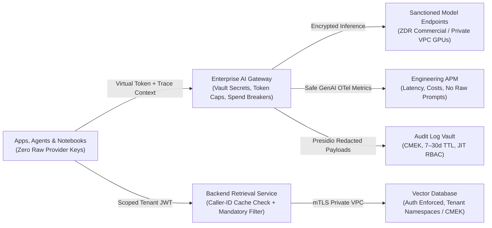

# Chapter 13: Infrastructure & Operational Security

*Part IV: Security*

> **In this chapter**
>
> - How API-key sprawl across Jupyter notebooks, repositories, and pods fuels overnight compute theft—and how gateway vaults and automated rotation stop it
> - Why reasoning-token "slowdown" attacks (*OverThink*), sponge inputs, and agent retry loops create **Denial-of-Wallet** exposure (`LLM10` / `AML.T0029`)
> - Why prompt/response logs and semantic caches are regulated sensitive datastores—illustrated by the DeepSeek ClickHouse breach and OpenAI's `redis-py` cache leak
> - Why vector embeddings can be inverted back into readable text (`vec2text`, `92%` recovery) and how to enforce VPC network boundaries and strict multi-tenant isolation
>
> **Essential for:** CISO, Cloud & Platform Engineers, MLOps, FinOps, AI Engineers, DPO · **Reading time:** about 30 minutes

---

## The Debug Log That Exposed Everything

*This composite scenario is illustrative; it is not drawn from a specific organization or incident.*

A fast-scaling SaaS company ships its customer-support RAG platform and internal coding assistant in back-to-back quarters. Every model prompt and API route goes through diligent application testing—yet operational infrastructure was wired up hurriedly under hackathon deadlines.

Within ninety days, three operational security failures converge on platform operations and the CISO:

First, a data scientist leaves a raw commercial LLM API key inside a shared Jupyter notebook pushed to a semi-public repository mirror. Overnight, automated scanners harvest the key and drive **\$32,000** in unauthorized token completions before billing dashboards refresh.

Second, a malicious support attachment containing subtle nested logic puzzles hits an internal reasoning-model triage queue. Nothing crashes, and safety classifiers pass the text cleanly—yet average completion length jumps sixteen-fold per ticket, saturating token quotas and stalling customer response SLAs across the tenant.

Third, during a routine cloud posture sweep, security engineers discover two twin exposures in staging that mirror production defaults: an LLMOps trace cluster storing six months of unmasked customer chat prompts, credentials, and support screenshots in a public debug dashboard, alongside a self-hosted vector database listening unauthenticated on an internal wildcard security group.

Chapters 10 through 12 hardened prompts, agent permissions, and model supply chains. Chapter 13 secures the **operational substrate** underneath every deployment—mapping OWASP **LLM02 (Sensitive Information Disclosure)**, **LLM08 (Vector and Embedding Weaknesses)**, and **LLM10 (Unbounded Consumption)**[^c13-01] alongside MITRE ATLAS **`AML.T0029` (Denial of AI Service)**.[^c13-02]

---

## 13.1 Managing API Keys and Secrets for Model Providers

### The Challenge: Secrets Sprawl in AI Engineering

Machine-learning and AI prototypes almost always begin with someone pasting `OPENAI_API_KEY="sk-..."` or an AWS Bedrock credential into a `.env` file, a Jupyter notebook cell, or a Slack channel while iterating quickly. As pilots harden into services, those keys frequently live on as unrotated, org-wide shared credentials—exacerbating **NHI2:2025 (Secret Leakage)** and **NHI1:2025 (Improper Offboarding)** across non-human identity inventories.[^c13-03]

Empirical telemetry shows just how aggressively attackers scan for leaked credentials. In ***The State of Secrets Sprawl 2025*** (analyzing public GitHub commits across 2024), **GitGuardian** recorded **23,770,171 newly exposed secrets—a 25% year-over-year increase**.[^c13-04] Although GitHub's native push protection sharply reduced leaks of prefixed structured vendor tokens (including standard OpenAI API keys), **58%** of exposed credentials were "generic" unprefixed secrets (database URLs, custom bearer keys, private keys) that bypass simple regex scanners—and **70%** of secrets first exposed years earlier remained active and valid.[^c13-04]

When leaked keys unlock cloud inference quotas—as **Sysdig's Threat Research Team** proved with **LLMjacking** (Chapter 9)—attackers monetize stolen Bedrock or commercial LLM capacity immediately, burning **\$46,000 to over \$100,000 per day** without triggering traditional VM or CPU alarms.[^c13-05]

### The Guardrails: Zero-Key Developer Workflows & Gateway Vaults

1. **Remove Raw Vendor Keys From Apps, Notebooks, and Pods:** Applications and data-science notebooks must **never** hold live OpenAI, Anthropic, Google, or Bedrock credentials. Inject static cloud workload identities (IAM roles / OIDC) or short-lived **virtual AI gateway keys** (Chapter 6), keeping real provider secrets strictly inside an enterprise secrets manager (HashiCorp Vault, AWS Secrets Manager, Azure Key Vault) accessed only by the AI gateway.
2. **Block Leaks Before Git Push (`nbstripout` + Push Protection):** Mandate pre-commit secret scanners (`gitleaks`, GitGuardian) plus **`nbstripout`** git filters across every ML repository so Jupyter cell outputs and embedded debug prints are stripped automatically before commits ever leave laptops.
3. **Automate 30–90-Day Rotation and Scoped Spend Caps:** Rotate upstream provider keys automatically via CI/CD secrets pipelines without app restarts; partition downstream virtual keys strictly by project, environment (`dev` vs. `prod`), and team with hard dollar alerts attached.
4. **Revoke Orphaned Pilot Keys (`NHI1:2025`):** Wire your central AI Registry (Chapter 5) directly to IAM expiration workflows so retired proofs-of-concept lose inference access automatically when projects archive.

---

## 13.2 Unbounded Consumption and "Denial-of-Wallet" Attacks

### The Challenge: Paying by the Token Changes Availability Risk

In traditional web applications, flooding an endpoint slows servers down (`Denial of Service`). In metered generative AI—especially with autonomous multi-step agents and long-chain reasoning models—flooding an endpoint drains your cloud budget first (**"Denial-of-Wallet"**, ranked **LLM10: Unbounded Consumption**[^c13-01] and **`AML.T0029`: Denial of AI Service**[^c13-02]).

Two distinct attack classes amplify compute costs far beyond simple HTTP request floods:

- **Hardware Energy-Latency "Sponge Examples":** Introduced by **Ilia Shumailov and colleagues** at IEEE EuroS&P 2021, *sponge examples* are adversarially crafted inputs that force neural architectures into worst-case activation density and execution paths—driving massive spikes in energy draw, memory bandwidth, and inference latency across CPUs, GPUs, and custom accelerators.[^c13-06]
- **Slowdown Attacks on Reasoning LLMs (*OverThink*):** Modern reasoning models (`o1`, `o1-mini`, `o3-mini`, `DeepSeek-R1`) generate hidden chain-of-thought "reasoning tokens" billed identically to output tokens. In a February 2025 study titled ***OverThink: Slowdown Attacks on Reasoning LLMs***, **Abhinav Kumar and colleagues at UMass Amherst** demonstrated that injecting benign-looking decoy reasoning puzzles (such as Markov decision processes or subtle constraint traps) into public web pages, RAG documents, or coding-agent repositories evaded safety filters and inflated reasoning-token consumption dramatically—slowing down answers **up to 46× on SQuAD**, **13×–18× on FreshQA**, and **up to 17× in coding-agent repositories** while keeping final answers plausible.[^c13-07]

Combined with accidental infinite agent loops (Chapter 11) and 100,000-token context floods, a few dozen concurrent sessions can exhaust monthly budgets or GPU throughput pools in hours.

### Hard Consumption & Circuit-Breaker Controls

| Control Layer | Exact Parameter / Mechanism | Operational Impact |
| :--- | :--- | :--- |
| **Input & Context Ceilings** | Enforce strict `max_input_tokens` per route (e.g., `8k` for chat, `32k` for RAG) ahead of serialization | Prevents memory exhaustion, O(*n*²) attention spikes, and Many-Shot context flooding |
| **Output & Reasoning Budgets** | Set explicit `max_completion_tokens` and `reasoning_effort` / `max_reasoning_tokens` caps in gateway payloads | Neutralizes *OverThink* slowdown spikes and runaway verbose generations |
| **Per-Identity & Tenant Quotas** | Enforce dual-bucket limits: requests per minute (`RPM`) **and** tokens per minute (`TPM`) per user/workspace | Stops single abusive accounts or compromised keys from starving shared enterprise capacity |
| **Hard Hourly & Daily Spend Breakers** | Real-time gateway meter summing input + cached + output + reasoning USD cost; auto-trip to `HTTP 429` or downgrade | Caps maximum overnight **Denial-of-Wallet** blast radius deterministically in code |
| **Semantic Caching & Model Tiering** | Cache identical FAQ embeddings/responses cleanly; route simple lookups to lightweight models instead of frontier reasoning | Cuts routine spend 40%–70% and reserves reasoning models strictly for verified complex tiers |

### The Guardrails

1. **Enforce Token Ceilings at the AI Gateway, Not Client Apps:** Never trust browser widgets or agent SDK defaults to cap `max_tokens` or retry loops; override ceilings server-side inside the central gateway proxy.
2. **Cap Reasoning Effort by Use Case:** Restrict high-reasoning-budget models (`reasoning_effort=high`) strictly to approved analytical lanes, never attaching them blindly to public support bots or unvetted external RAG ingestion.
3. **Wire FinOps Cost Telemetry Into SecOps Alerting:** Alert on 3× hourly velocity anomalies—catching *OverThink* poisoning, broken agent loops, or `LLMjacking` within minutes rather than waiting for monthly cloud invoices.

---

## 13.3 Securing Prompt and Response Logs (Logs Are Sensitive Data Too)

### The Challenge: Observability Pipelines Become Crown-Jewel Shadow Stores

When debugging RAG quality or tracing latency bottlenecks, engineering teams instinctively turn on full payload logging inside ClickHouse, Elasticsearch, Datadog, or third-party LLMOps SaaS platforms. Almost overnight, those "debug telemetry" indexes accumulate source code, customer PII, M&A strategy drafts, legal advice, and employee credentials—often **without encryption keys, deletion workflows, or strict access controls**.

Two high-profile production incidents demonstrate how catastrophic operational logging and cache mistakes become:

1. **DeepSeek Exposed ClickHouse Database (January 29, 2025):** Cloud security researcher **Gal Nagli at Wiz Research** discovered two publicly reachable DeepSeek subdomains exposing an **unauthenticated ClickHouse database** (`port 9000`) allowing anyone on the open internet to run arbitrary SQL queries via HTTP.[^c13-08] The exposed tables held **over one million lines of live log streams** containing **plaintext user chat histories, API secret keys, backend operational details, and internal metadata**—secured rapidly only after Wiz's responsible disclosure.[^c13-08]
2. **OpenAI Redis Cache Data Exposure (March 20–24, 2023):** Prompt privacy breaks not only in cold logs, but inside *ephemeral memory caches*. In its official postmortem published **March 24, 2023**, **OpenAI** detailed how an `asyncio` cancellation race condition in the open-source **`redis-py`** cluster client caused cancelled requests to return another user's cached payload from pooled connections during a nine-hour outage window—exposing active users' chat titles and initial messages alongside payment details (names, emails, billing addresses, card type, expiration, and last four digits) for **1.2% of active ChatGPT Plus subscribers**.[^c13-09] OpenAI patched `redis-py` upstream and added explicit **server-side caller-ID verification checks** comparing returned cached records against the requesting user identity before rendering responses.[^c13-09]

### Privacy-Preserving AI Observability

You still need telemetry for incident forensics (Chapter 27), SLA tracking, and EU AI Act post-market logging (Chapter 22)—without copying raw secrets into wide-open observability indexes.

Follow a **split observability pattern** grounded in **OpenTelemetry GenAI Semantic Conventions**:[^c13-10]
- Keep **`gen_ai.*` content recording disabled by default** in general APM tools, sending strictly safe structural spans (`traceparent`, `gen_ai.operation.name`, `gen_ai.request.model`, token counts, latency, guardrail triggers, and `sub`/`act` hashes) to engineering dashboards.
- Where full prompt/response retention is genuinely required (for Red-lane auditability or compliance replay), route payloads through inline **Presidio PII and secret redaction**[^c13-11] *before* persistence, store them in a segregated customer-managed-key (**CMEK**) encrypted log vault, enforce automated **7–30-day TTL expiration** (aligned to GDPR/DPDP erasure schedules, Chapter 8), and gate developer access behind **just-in-time (JIT) ticketed RBAC approvals**.

### The Guardrails

1. **Never Log Raw Payloads to Shared Developer APMs:** Separate structural latency/token telemetry from redacted payload audit logs.
2. **Verify Caller Identity on Every Semantic or Redis Cache Hit:** Namespace every cache key by `tenant_id:user_id` **and** verify ownership explicitly in application logic after deserialization, neutralizing pool-corruption leaks like the March 2023 `redis-py` bug.[^c13-09]
3. **Treat Observability Clusters Like Production Customer Databases:** Put ClickHouse, Elasticsearch, and LLMOps log stores behind private VPC endpoints, SSO + MFA, short TTLs, and CMEK encryption—never publicly exposed on port `9000` or default credentials.[^c13-08]

---

## 13.4 Vector Database Security and Tenant Isolation

### The Challenge: "Embeddings Are Just Numbers" Is False

Because vector databases (Qdrant, Chroma, Milvus, Pinecone, pgvector, Weaviate) store high-dimensional floating-point arrays alongside chunk text, teams frequently leave them exposed on internal networks—or assume raw embeddings are safe to share across customers. Both assumptions fail under scrutiny (`LLM08: Vector and Embedding Weaknesses`).[^c13-01]

First, AI infrastructure stacks suffer chronically from **velocity-over-security defaults**. In March 2024, **Oligo Security** uncovered **ShadowRay**, the first active in-the-wild exploitation campaign targeting distributed AI workloads: attackers exploited unauthenticated **Ray** cluster APIs (`CVE-2023-48022` and subsequent RCE flaws) left open on the internet to hijack compute, steal credentials, and deploy persistent botnets.[^c13-12] Self-hosted vector databases exhibit the exact same operational pattern whenever teams launch default Docker images (`6333`, `8000`, `19530`) without TLS, API auth, or VPC firewall rules.

Second, **embeddings themselves leak readable plaintext**. In a landmark EMNLP 2023 study titled ***"Text Embeddings Reveal (Almost) As Much As Text,"*** **John X. Morris, Volodymyr Kuleshov, Vitaly Shmatikov, and Alexander M. Rush** built **`vec2text`**—an iterative controlled-decoding attack that repeatedly refines candidate strings against an embedding distance oracle.[^c13-13] Their results overturned conventional wisdom: **`vec2text` reconstructed 92% of 32-token input texts verbatim** from standard text embeddings and extracted full patient names and clinical details straight out of medical note vectors.[^c13-13]

The conclusion for security architects is unequivocal: **protect raw embeddings and vector indexes with the exact same confidentiality, encryption, authentication, and tenant isolation as plaintext SQL databases.**

### Multi-Tenant Vector Isolation Architecture

When serving multiple enterprise departments or SaaS B2B customers inside one RAG platform, never trust prompt wording or LLM-generated SQL/metadata filters to separate customer data. Enforce isolation strictly in **backend storage architecture**:

| Isolation Tier | How It Works | Strengths | Residual Risks & Ideal Fit |
| :--- | :--- | :--- | :--- |
| **Tier A: Shared Collection + Mandatory Signed Metadata Filter** | One physical index; backend middleware injects `WHERE tenant_id = jwt.tenant_id` cleanly on every query | Lowest infrastructure cost; effortless schema upgrades | Risk of developer query bug bypassing filter; shared noisy-neighbor latency. Acceptable **only** for low-risk non-regulated internal groups |
| **Tier B: Dedicated Namespace / Collection per Tenant** | Physically distinct index partitions or schemas per tenant inside managed cluster | Strong logical separation; crisp per-tenant deletion (GDPR Art. 17, Ch. 8); avoids accidental cross-tenant recall | Shared underlying cluster compute/memory; **Recommended Enterprise B2B Default** |
| **Tier C: Dedicated Cluster / VPC + Separate CMEK per Tenant** | Isolated VM/database instance and customer-managed KMS key per regulated client | Complete blast-radius, noisy-neighbor, and cryptographic key isolation (revoke CMEK = instant crypto-shred) | Higher unit cost; **Mandatory** for defense, healthcare, banking, and sovereign-cloud tenants |

### Hardened AI Infrastructure & Operational Security Plane

### The Guardrails

1. **Zero Public Exposure & CSPM AI Port Scanning:** Bind all vector stores, ClickHouse log stores, Ray dashboards, and local model servers (`6333`, `8000`, `19530`, `8265`, `9000`, `11434`) exclusively inside private VPC subnets with `mTLS` and token auth; configure Cloud Security Posture Management (CSPM) to alert immediately if any AI infrastructure port listens publicly.
2. **Never Let the LLM Construct Tenant Filters:** Derive `tenant_id` and ACL groups exclusively from verified server-side JWT/OIDC claims (`sub`, `tenant_id`, Chapter 7)—never from model-generated tool parameters.
3. **Encrypt Embeddings at Rest with Tenant-Aware Keys & Enforce Deletion SLAs:** Treat vector databases as plaintext-equivalent PII datastores under GDPR/DPDP, applying CMEK encryption, backup expiry, and deterministic delete-by-tenant workflows (Chapter 8).

---

## Why Every Role Cares

| Role | What this means for you |
| :--- | :--- |
| **Board / CEO** | Simple infrastructure hygiene gaps—exposed debug logs (DeepSeek), unauthenticated AI clusters (*ShadowRay*), or leaked notebook keys—drive rapid front-page breaches and \$46k–\$100k+/day token loss faster than exotic AI exploits. |
| **CIO** | Centralizing provider secrets inside one AI gateway, separating structural telemetry from encrypted log vaults, and standardizing Tier B/C vector isolation keeps platform operations auditable and predictable at scale. |
| **CISO** | Pair pre-commit `nbstripout`/secrets scanning with CSPM port monitoring (`6333`, `8265`, `9000`, `19530`); enforce caller-ID verification on caches; and classify vector stores as plaintext-equivalent crown jewels (`vec2text`). |
| **CDO / Data Stewards** | Because embeddings recover `92%` of source text verbatim and unredacted traces hoard PII, apply Presidio-style masking before log persistence and tie tenant namespaces cleanly to statutory TTL and deletion rules. |
| **General Counsel / Compliance** | Short log TTLs (7–30 days), split structural vs. payload observability, and verifiable tenant isolation prevent regulatory "shadow retention" violations after customers exercise GDPR/CCPA/DPDP deletion rights. |
| **AI Engineers** | Strip Jupyter outputs cleanly, never log unmasked payloads into shared APMs, enforce gateway `max_tokens` and `reasoning_effort` limits against *OverThink* spikes, and bind every vector and cache lookup to verified caller IDs. |

---

## Chapter Summary

| Section | Core risk | Primary guardrail |
| :--- | :--- | :--- |
| 13.1 Model Provider API Keys & Secrets | 23.8M+ annual leaked GitHub secrets (58% generic, 70% still valid) enabling overnight billing drains and `LLMjacking` | Zero raw provider keys in repos/pods; gateway-managed secrets vaults, `nbstripout` + push protection, automated 30–90d rotation |
| 13.2 Unbounded Consumption & Denial-of-Wallet | Sponge inputs, runaway agent retries, and *OverThink* decoy reasoning tasks (`13×`–`46×` token inflation) draining budgets (`LLM10` / `AML.T0029`) | Server-side `max_input`/`max_completion`/`max_reasoning` caps, per-tenant RPM/TPM quotas, hourly USD circuit breakers, semantic caching |
| 13.3 Prompt & Response Logs & Caches | Unauthenticated log stores (DeepSeek ClickHouse) and pooled cache races (OpenAI `redis-py`) leaking chat histories and payment data | Split structural OTel metrics from Presidio-redacted CMEK log vaults (7–30d TTL, JIT RBAC); verify caller ID on every cache read |
| 13.4 Vector Databases & Tenant Isolation | Open AI ports (*ShadowRay*), metadata filter bugs, and `vec2text` inversion recovering `92%` of text verbatim from raw embeddings (`LLM08`) | Private VPC + `mTLS` + auth + CSPM port alerts; backend-enforced tenant namespaces or dedicated CMEK instances |

---

## Key Takeaways

- **Remove raw AI vendor keys from developer laptops and application repos completely.** Route workloads through virtual gateway tokens backed by centralized secrets vaults, `nbstripout`, push protection, and automated 30–90-day key rotation.
- **Treat Denial-of-Wallet like production DDoS (`LLM10` / `AML.T0029`).** Reasoning slowdown attacks (*OverThink*) bypass safety classifiers and multiply token bills by `13×`–`46×`; cap context size, completion/reasoning tokens, and hourly dollar spend deterministically at the gateway.
- **Prompt logs and response caches are sensitive customer datastores.** Separate safe OpenTelemetry metrics from Presidio-masked, CMEK-encrypted payload logs on tight TTLs, and always assert caller identity after cache deserialization.
- **Protect vector embeddings exactly like plaintext documents.** Because `vec2text` recovers up to `92%` of embedded text verbatim, enforce private VPC boundaries, strong authentication, CSPM scanning on AI ports, and backend tenant namespaces or dedicated CMEK clusters.

## Questions to Ask

| Role | Question |
| :--- | :--- |
| **Board / CEO** | Are our cloud AI spend limits and emergency circuit breakers automated in code so an accidental loop or *OverThink* attack halts within minutes rather than on next month's invoice? |
| **CIO** | Can we confirm every production model call routes through a central AI gateway holding real vendor credentials—and zero teams embed raw keys in notebooks or CI scripts? |
| **CISO** | Does our CSPM continuously alert if vector databases, Ray clusters, or ClickHouse log stores expose unauthenticated ports (`6333`, `8000`, `8265`, `9000`, `19530`, `11434`)—and do caches verify caller identity per read? |
| **CDO / Data Stewards** | How many days are raw prompt/response logs retained, are secrets and PII masked before writing to disk, and do vector embeddings receive plaintext-equivalent classification controls? |
| **General Counsel / Compliance** | When a customer requests GDPR or DPDP deletion, do our LLMOps traces, semantic caches, and tenant vector namespaces purge or expire in sync? |
| **AI Engineers** | Are `max_input_tokens`, `max_completion_tokens`, and `reasoning_effort` ceilings enforced server-side in our gateway—and is `tenant_id` injected strictly from verified JWTs rather than LLM arguments? |
| **Business Owners** | Does our RAG platform guarantee logical namespace or dedicated cluster isolation between different enterprise customers and high-sensitivity internal departments? |

---

## References

[^c13-01]: OWASP Foundation, *OWASP Top 10 for LLM Applications 2025* (OWASP GenAI Security Project, November 2024), `LLM02`, `LLM08`, and `LLM10`, https://genai.owasp.org/llm-top-10/. **Annotation:** Defines Sensitive Information Disclosure (`LLM02`), Vector and Embedding Weaknesses (`LLM08`), and Unbounded Consumption (`LLM10`) across AI infrastructure and operations. [↗ Bibliography](../bibliography.md#owasp-2024-llm-top10)

[^c13-02]: MITRE Corporation, "ATLAS: Adversarial Threat Landscape for Artificial-Intelligence Systems," accessed November 17, 2026, https://atlas.mitre.org/. **Annotation:** Tracks Denial of AI Service (`AML.T0029`) techniques exhausting compute, inference quotas, or API budgets via adversarial inputs or abusive query rates. [↗ Bibliography](../bibliography.md#mitre-atlas)

[^c13-03]: OWASP Foundation, *OWASP Non-Human Identities Top 10: 2025* (OWASP NHI Project, 2025), `NHI1:2025` and `NHI2:2025`, https://owasp.org/www-project-non-human-identities-top-10/. **Annotation:** Highlights Improper Offboarding (`NHI1:2025`) and Secret Leakage (`NHI2:2025`) of static service keys across code repositories, notebooks, and CI/CD pipelines. [↗ Bibliography](../bibliography.md#owasp-2025-nhi-top10)

[^c13-04]: GitGuardian, *The State of Secrets Sprawl 2025* (Paris: GitGuardian, 2025), https://www.gitguardian.com/state-of-secrets-sprawl-report-2025. **Annotation:** Empirical telemetry study documenting 23,770,171 newly exposed hardcoded secrets on public GitHub in 2024 (+25% YoY), noting that 58% are unprefixed generic secrets bypassing basic regex scanners and 70% of older leaked keys remain valid. [↗ Bibliography](../bibliography.md#gitguardian-2025-secrets)

[^c13-05]: Sysdig Threat Research Team, "LLMjacking: Stolen Cloud Credentials Used in New AI Attack," Sysdig Blog, May 6, 2024, https://sysdig.com/blog/llmjacking-stolen-cloud-credentials-used-in-new-ai-attack/. **Annotation:** Demonstrates how leaked cloud credentials enable unauthorized abuse of managed LLM quotas (Amazon Bedrock) burning over \$46,000 per day at baseline quotas and over \$100,000 per day in proxy-resale operations. [↗ Bibliography](../bibliography.md#sysdig-2024-llmjacking)

[^c13-06]: Ilia Shumailov, Yiren Zhao, Daniel Bates, Nicolas Papernot, Robert Mullins, and Ross Anderson, "Sponge Examples: Energy-Latency Attacks on Neural Networks," in *2021 IEEE European Symposium on Security and Privacy (EuroS&P)* (September 2021), arXiv:2006.03463, https://doi.org/10.1109/EuroSP51992.2021.00024. **Annotation:** Introduces "sponge examples"—inputs crafted to maximize activation density, energy draw, and hardware inference latency across CPUs, GPUs, and ASICs. [↗ Bibliography](../bibliography.md#shumailov-2021-sponge)

[^c13-07]: Abhinav Kumar, Jaechul Roh, Ali Naseh, Marzena Karpinska, Mohit Iyyer, Amir Houmansadr, and Eugene Bagdasarian, "OverThink: Slowdown Attacks on Reasoning LLMs," arXiv:2502.02542 (February 2025), https://doi.org/10.48550/arXiv.2502.02542. **Annotation:** Demonstrates that injecting benign decoy reasoning problems into external RAG or coding-agent contexts evades safety filters and multiplies reasoning-token generation by 13×–18× on FreshQA, up to 17× in code agents, and up to 46× on SQuAD across `o1`, `o3-mini`, and `DeepSeek-R1`. [↗ Bibliography](../bibliography.md#kumar-2025-overthink)

[^c13-08]: Gal Nagli, "Wiz Research Uncovers Exposed DeepSeek Database Leaking Sensitive Information, Including Chat History," Wiz Blog, January 29, 2025, https://www.wiz.io/blog/wiz-research-uncovers-exposed-deepseek-database-leak. **Annotation:** Discloses DeepSeek's publicly exposed, unauthenticated ClickHouse log database (`port 9000`) allowing arbitrary SQL queries across over one million lines of chat histories, API keys, and internal operational metadata. [↗ Bibliography](../bibliography.md#nagli-2025-deepseek-wiz)

[^c13-09]: OpenAI, "March 20 ChatGPT Outage: Here's What Happened," OpenAI Blog, March 24, 2023, https://openai.com/index/march-20-chatgpt-outage/. **Annotation:** Official postmortem detailing the `redis-py` `asyncio` cluster pool race condition that leaked chat titles/first messages and payment metadata for 1.2% of active ChatGPT Plus subscribers—prompting mandatory caller-ID cache verification checks. [↗ Bibliography](../bibliography.md#openai-2023-redis-outage)

[^c13-10]: OpenTelemetry, "Semantic Conventions for Generative AI Systems," OpenTelemetry Specification Documentation, accessed November 21, 2026, https://opentelemetry.io/docs/specs/semconv/gen-ai/. **Annotation:** Defines standardized `gen_ai.*` observability spans separating safe structural metrics (model names, token usage, latency, `traceparent`) from opt-in raw prompt and completion body recording. [↗ Bibliography](../bibliography.md#otel-genai-semconv)

[^c13-11]: Microsoft and Data Privacy Stack, *Presidio: Data Protection and De-Identification SDK*, GitHub repository and documentation, accessed November 21, 2026, https://github.com/data-privacy-stack/presidio. **Annotation:** Open-source detection and masking toolkit used ahead of observability storage to scrub PII, secrets, and regulated identifiers from prompt/response traces. [↗ Bibliography](../bibliography.md#presidio-oss)

[^c13-12]: Oligo Security, "ShadowRay: First Known Attack Campaign Targeting AI Workloads Exploited In The Wild," Oligo Security Blog, March 2024, https://www.oligo.security/blog/shadowray. **Annotation:** Documents active in-the-wild hijacking of unauthenticated Ray AI clusters (`CVE-2023-48022`), exemplifying the systemic internet-exposure risk across AI compute and vector infrastructure deployed with default no-auth configurations. [↗ Bibliography](../bibliography.md#oligo-2024-shadowray)

[^c13-13]: John X. Morris, Volodymyr Kuleshov, Vitaly Shmatikov, and Alexander M. Rush, "Text Embeddings Reveal (Almost) As Much As Text," in *Proceedings of the 2023 Conference on Empirical Methods in Natural Language Processing (EMNLP 2023)* (December 2023), arXiv:2310.06816, https://doi.org/10.48550/arXiv.2310.06816. **Annotation:** Introduces iterative embedding inversion (`vec2text`), proving that dense vector embeddings allow near-exact reconstruction (`92%` of 32-token inputs) including sensitive names and clinical text—establishing that vector databases require plaintext-equivalent security. [↗ Bibliography](../bibliography.md#morris-2023-vec2text)
