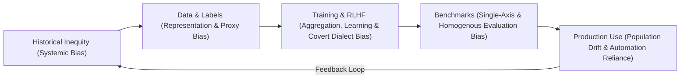

# Chapter 16: Bias, Fairness & Discrimination

*Part V: Output, Trust & Liability*

> **In this chapter**
>
> * How algorithmic bias enters across the full AI lifecycle—through data collection, proxy labels, aggregation, covert dialect bias, and mismatched deployment—long after protected columns are removed.
> * Why five high-stakes domains (hiring, credit, insurance, healthcare, and education) trigger strict statutory accountability for both deployers and third-party AI vendors.
> * Why competing mathematical definitions of fairness cannot all hold simultaneously—making metric selection a governance decision backed by intersectional evaluation and independent audits.
> * How to operationalize the EEOC four-fifths rule, New York City Local Law 144 audits, and EU AI Act Article 10(5) privacy-protected debiasing safeguards.

**From random errors to systematic harm.** Chapter 15 addressed hallucinations—probabilistic errors that can strike any customer or workflow unpredictably. This chapter examines a more legally explosive failure mode: systematic disparities that consistently disadvantage specific demographic, linguistic, age, disability, or socioeconomic groups. When an enterprise model hallucinates once, a customer files a dispute; when a screening, underwriting, or triage model misprices risk or filters out protected groups systematically, the company triggers civil-rights litigation, enforcement sweeps, mandatory model disgorgement, and lasting brand damage. Fairness cannot be engineered by deleting demographic fields or relying on vendor assurances—it requires end-to-end lifecycle governance and independent statistical testing.

---

### Illustrative Composite Scenario: The "Blind" Hiring Model That Filtered by Proxy

A multi-region retail and logistics employer handles `40,000` annual applications across warehouse operations, store leadership, and corporate roles. To shorten time-to-hire, HR procures a third-party AI candidate-scoring platform trained on ten years of internal `"top performer"` promotion records. During vendor security and compliance review, the vendor states its model is unbiased because explicit `"race, sex, and applicant birth-year columns were removed prior to training."`

Six months into deployment, preparing for its mandatory annual New York City Local Law 144 audit, an independent assessor evaluates actual shortlist outcomes across EEO (Equal Employment Opportunity) demographic categories and reveals three compounding failures. First, career-gap duration and zip codes act as potent proxies for caregiving leave and racial residential patterns, penalizing qualified women returning to work. Second, an embedded LLM writing-sample scorer consistently downgrades African American English grammatical phrasing under an undefined `"executive communication"` criterion. Third, while overall male and female selection rates narrowly clear the `0.80` four-fifths threshold, intersectional disaggregation exposes a selection impact ratio of `0.58` for women aged `55` and older. Worse still, external counsel warns that neither the vendor contract nor the `"blind inputs"` defense shields the employer—or the vendor acting as its screening agent—from federal age and sex discrimination liability.

*(This composite scenario is illustrative; it is not drawn from a specific organization or incident.)*

---

## 16.1 Where Bias Comes From: Data, Design, and Deployment

Most enterprise bias failures begin with a comforting myth: `"We have a clean data problem—remove protected attributes and fix garbage in, garbage out."` In reality, algorithmic discrimination rarely stems from a single bad spreadsheet. It originates across data history, measurement design, model training, evaluation benchmarks, and human deployment behavior.

Two foundational frameworks diagnose why simple data hygiene falls short:

* **Seven Sources of Lifecycle Harm (Suresh & Guttag, 2021):** In *A Framework for Understanding Sources of Harm throughout the Machine Learning Life Cycle*, Suresh and Guttag isolate seven distinct mechanisms spanning every build phase.[^c16-01] During data collection, **historical bias** embeds real-world inequality even when sampling is accurate (for example, male-dominated executive promotion histories), while **representation bias** under-samples minority cohorts. During development, **measurement bias** occurs when engineers adopt flawed proxy labels (using prior arrests to measure crime, or medical spending to measure illness), **aggregation bias** forces one pooled model onto physiologically or behaviorally distinct populations, and **learning bias** arises when loss functions sacrifice minority-group performance to maximize overall accuracy. Finally, **evaluation bias** relies on homogeneous test benchmarks, and **deployment bias** emerges when users misuse an automated score as an unquestioned verdict outside its validated scope.
* **Three Socio-Technical Dimensions (NIST SP 1270):** In *Towards a Standard for Identifying and Managing Bias in Artificial Intelligence*, NIST's Schwartz et al. show that mathematical or statistical fixes alone fail unless paired with organizational governance.[^c16-02] NIST SP 1270 classifies bias into **systemic bias** embedded in institutional rules and legacy data, **computational and statistical bias** introduced by feature engineering, sample skews, and model objectives, and **human-cognitive bias** shaping how engineers pick labels and how operators interpret outputs.

Both frameworks expose why **"fairness through unawareness"**—stripping columns like `gender`, `race`, or `age`—routinely fails in practice. High-dimensional enterprise datasets contain dense **proxy variables**: graduation dates correlate with age; postal codes, alumni networks, and credit-inquiry patterns correlate with race and socioeconomic status; employment gaps correlate with disability or caregiving; and browser language settings or writing style encode national origin. Eliminating the label leaves the correlation intact while blinding defenders from measuring whether harm occurs.

Furthermore, single-axis accuracy reports conceal severe **intersectional bias**—failures affecting overlapping identity groups simultaneously. In the landmark *Gender Shades* audit (PMLR 81), Buolamwini and Gebru evaluated commercial facial-analysis classifiers across balanced Fitzpatrick skin types and gender subgroups.[^c16-03] While aggregate accuracy appeared high and error rates on lighter-skinned males stayed at or below `0.8%`, error rates spiked up to `34.7%` on darker-skinned females. Auditing only `race` overall or `gender` overall completely hid the worst disparity.

Generative AI and RLHF alignment add a newer failure mode: **covert dialect and multilingual bias**. In a *Nature* study published in August 2024 (*AI Generates Covertly Racist Decisions About People Based on Their Dialect*), Hofmann, Kalluri, Jurafsky, and King demonstrated that while modern LLMs pass explicit anti-racism evaluations when directly queried about protected groups, presenting identical facts written in African American English (AAE) markers triggers severe covert stereotyping.[^c16-04] Models assigned AAE speakers lower-prestige jobs, higher criminal conviction rates, and harsher punishments—showing stereotypes stronger than historical human baselines—even after RLHF safety tuning suppressed overt slurs. Across non-English regional languages and rural dialects, thinner training corpora amplify tokenization cost and error disparities further.

Finally, **deployment drift** turns a benign pilot into a discriminatory production tool. When a resume screener validated on U.S. engineering graduates or an underwriting classifier calibrated on suburban mortgages is rolled out globally—or applied after macroeconomic shifts—population mismatch silently invalidates accuracy assumptions. Requiring standardized corpus provenance via *Datasheets for Datasets* (`Gebru et al., 2021`) establishes early visibility into who is missing before training or retrieval indexing starts.[^c16-05]

*Caption: Bias propagates across socio-technical stages rather than sitting inside raw data alone. When biased production outputs feed future training logs, unfairness locks into a reinforcing feedback loop.*

### The Guardrails

1. **Require Dataset Provenance & Coverage Datasheets:** Mandate *Datasheets for Datasets*-style documentation ([^c16-05]) detailing geographic, demographic, and linguistic representation, label-proxy choices, and explicit out-of-scope deployment restrictions before approving training or RAG corpora.
2. **Ban `"Fairness Through Unawareness"` in Vendor & Internal Reviews:** Reject assurances that deleting demographic fields proves fairness; require proxy-variable screening across postal codes, graduation dates, employment gaps, and text-style features.
3. **Mandate Intersectional and Linguistic Disaggregation:** Test computer-vision, tabular, and LLM applications across overlapping subgroups (`sex × race`, `age × sex`) and regional English dialects or non-English inputs ([^c16-03], [^c16-04]) rather than single-axis totals.
4. **Track Live Population Drift Against Intended Populations:** Continuously alert model owners when production applicant, patient, or borrower demographics diverge materially from calibration cohorts.

---

## 16.2 High-Risk Use Cases: Hiring, Credit, Insurance, Healthcare, Education

Not every biased output carries identical legal weight. Skewed movie recommendations annoy subscribers; biased gatekeeping across employment, finance, insurance, healthcare, and education denies life opportunities and invites direct statutory enforcement. Both longstanding civil-rights laws and modern AI regulation—most explicitly **EU AI Act Annex III** (`Points 3–5`)—treat these five domains as high-risk territory requiring heightened statistical validation and human redress.[^c16-12]

Concrete enforcement actions and empirical audits prove that liability hits both internal builds and third-party SaaS platforms:

* **Hiring & Employment Screening (`EEOC v. iTutorGroup` & `Mobley v. Workday`):** In August 2023, the U.S. Equal Employment Opportunity Commission (EEOC) secured its first AI hiring-bias settlement—`$365,000` against `iTutorGroup`—after automated recruitment software rejected more than `200` qualified applicants by filtering out women aged `55+` and men aged `60+`.[^c16-06] Less than a year later, *Mobley v. Workday, Inc.* shattered the assumption that software vendors escape employment-discrimination law: on July 12, 2024, Judge Rita F. Lin refused to dismiss claims against Workday, ruling that when employers delegate core candidate-screening and rejection functions to algorithmic software, the **software vendor itself can face direct liability as an employer's `"agent"`** under Title VII, the ADA, and the ADEA—followed on May 16, 2025 by preliminary collective certification for applicants aged `40` and older.[^c16-07]
* **Credit & Consumer Lending (`CFPB Circular 2023-03`):** Under the Equal Credit Opportunity Act (ECOA) and Regulation B, deployers cannot plead `"black box complexity"` when AI underwriting declines or reprices an applicant. In Consumer Financial Protection Circular `2023-03` (September 19, 2023), the CFPB emphasized that creditors using complex AI/ML scoring models cannot rely on generic sample adverse-action checklist reasons; lenders must accurately identify and disclose the *specific principal reasons* driving each adverse credit decision.[^c16-08]
* **Insurance Pricing & Underwriting (`Colorado Regulation 10-1-1`):** Insurance regulators increasingly target hidden proxy variables inside non-traditional data feeds. Implementing Colorado SB `21-169`, Colorado Division of Insurance Regulation `10-1-1` (`3 CCR 702-10`, effective November 14, 2023 for life insurers and progressively expanding across lines) obligates insurers using External Consumer Data and Information Sources (`ECDIS`)—such as credit attributes, purchasing histories, biometrics, or lifestyle data—and predictive algorithms to establish board-overseen governance frameworks, conduct quantitative proxy-discrimination tests, and submit recurring regulatory attestations.[^c16-09]
* **Healthcare Triage & Care Management (`Obermeyer et al., 2019`):** Proxy target labels create deadly clinical disparities even when algorithms operate completely `"race-blind."` In a landmark *Science* study (October 2019), Obermeyer, Powers, Vogeli, and Mullainathan audited a widely deployed U.S. hospital population-health algorithm predicting future *healthcare expenditure* as a proxy for *illness severity*.[^c16-10] Because unequal healthcare access yielded lower historical spending on Black patients at equal sickness levels, the model routinely prioritized healthier White patients for high-risk care-management programs. Replacing cost with direct physiological health-need labels raised the proportion of Black patients flagged for extra clinical care from `17.7%` to `46.5%`.
* **Education Admissions, Assessment & Grading (`Ofqual 2020 A-Levels` & `EU AI Act Annex III`):** Proxy algorithms also fail at national education scale. Following pandemic exam cancellations in August 2020, England's exams regulator Ofqual deployed a standardization algorithm anchored heavily on schools' historical grade distributions and cohort sizes—downgrading **`39.1%` of teacher-submitted A-level entries**.[^c16-11] Larger state comprehensive cohorts suffered harsher downward adjustments while smaller-cohort independent schools saw top grades climb, forcing an emergency U-turn back to teacher-assessed grades. Reflecting that exposure, EU AI Act Annex III (`Point 3`) designates AI evaluating educational admissions, assignments, and exam scoring as regulated **high-risk AI systems**, alongside employment (`Point 4`), creditworthiness, life/health insurance pricing, and emergency triage (`Point 5`).[^c16-12]

| High-Risk Domain | Common Proxy & Disparate-Impact Failure | Core Legal & Regulatory Anchors | Required Enterprise Safeguard |
| :--- | :--- | :--- | :--- |
| **Hiring & Promotions** | Filtering age, maternity career gaps, alumni networks, or AAE dialect patterns via `"culture fit"` models | Title VII, ADEA, ADA; `EEOC v. iTutorGroup` ([^c16-06]); `Mobley v. Workday` ([^c16-07]); NYC LL `144`; EU Annex III(4) | Annual independent bias audits; vendor agent-liability indemnities; validated job-related criteria; accessible human reconsideration. |
| **Credit & Lending** | Alternative cash-flow, browser, or geospatial proxies creating protected-class redlining without clear adverse explanations | ECOA / Reg B; `CFPB Circular 2023-03` ([^c16-08]); EU AI Act Annex III(5)(b) | Specific empirical feature-level adverse-action reason codes; disparate-impact + less-discriminatory-alternative (LDA) searches. |
| **Insurance** | Non-actuarial external consumer data (`ECDIS`) acting as race, disability, or national-origin proxies in underwriting/pricing | Colorado SB `21-169` & Reg `10-1-1` ([^c16-09]); EU AI Act Annex III(5)(c) | Board-overseen ECDIS governance, statistical proxy correlation testing, actuarial causal justification, officer attestations. |
| **Healthcare** | Predicting financial *spending* or utilization rates instead of biological pathology, under-triaging underserved groups | U.S. ACA § 1557 / ONC HTI-1; `Obermeyer et al.` ([^c16-10]); EU Medical Device / Annex III | Validate clinical outcome proxies directly against objective health biomarkers; run safety + equity subgroup stratification pre-deployment. |
| **Education** | Historical school-profile standardization or automated proctoring failing across skin tones, disabilities, or neurodiversity | `Ofqual 2020` ([^c16-11]); EU AI Act Annex III(3); national civil-rights & accessibility laws | Prohibit historical institution-penalizing curves on individual students; provide accessible human review and alternative testing accommodations. |

### The Guardrails

1. **Audit Target Variables Before Modeling:** Challenge every predicted outcome (`healthcare cost`, `historical promotions`, `school mean grades`, `zip-adjusted defaults`) to verify the training label directly reflects actual merit, health need, or actuarial risk rather than historical exclusion ([^c16-10]).
2. **Contract Explicitly for `Mobley`-Era Shared Liability:** Require third-party HR, credit, and insurance AI vendors to provide independent audit cooperation, feature documentation, indemnity alignment, and immediate bias-defect notification—neither buyer nor vendor can outsource civil-rights exposure ([^c16-07]).
3. **Mandate Actionable Adverse Explanations & Redress:** Ensure high-risk models support accurate individual adverse-action reason codes (`CFPB Circular 2023-03`) and human appeal paths capable of overriding unfair automated scores (detailed in Chapter 17).
4. **Search Explicitly for Less Discriminatory Alternatives (LDAs):** In credit, underwriting, and hiring, document structured hyperparameter and feature-selection searches demonstrating no comparably accurate model achieves smaller demographic disparities.

---

## 16.3 Fairness Testing and Independent Bias Audits

Recognizing bias qualitatively is easy; measuring and governing it rigorously is harder because fairness has **no single mathematical definition**. Engineers often expect compliance teams to hand them `"the fairness formula"`, while legal teams assume data scientists have `"debiased the model."` Both sides must confront a proven mathematical boundary.

In *Equality of Opportunity in Supervised Learning* (NeurIPS 2016), Hardt, Price, and Srebro formalized distinct statistical criteria beyond naive demographic awareness: **demographic parity** (equal positive selection rates across groups), **equal opportunity** (equal true-positive rates—meaning equally *qualified* members of every group stand an equal chance of selection or approval), and **equalized odds** (equal true-positive *and* equal false-positive rates across groups).[^c16-13] Hardt et al. showed that post-processing prediction thresholds across protected groups can enforce equal opportunity optimally—and economically shifts uncertainty costs away from disadvantaged groups, motivating organizations to gather better features rather than rely on coarse stereotypes.

Critically, however, organizations cannot optimize every fairness definition simultaneously. In *Inherent Trade-Offs in the Fair Determination of Risk Scores* (ITCS 2017), Kleinberg, Mullainathan, and Raghavan proved a fundamental **impossibility theorem**: whenever base outcome rates differ across demographic groups and a model falls short of `100%` deterministic perfection, **no risk score can satisfy within-group calibration (score meaning parity), false-positive balance, and false-negative balance at the same time**.[^c16-14] Optimizing for equal error rates shifts score calibration, and preserving identical predictive meaning across groups diverges on false positives when underlying prevalence varies. Selecting which fairness property takes priority is therefore a **policy, legal, and domain-risk judgment call**—not a purely technical calculation.

| Fairness Metric | Plain-Language Definition | Where Enterprises Fit It Best | Core Blind Spot & Trade-Off |
| :--- | :--- | :--- | :--- |
| **Demographic Parity (`Impact Ratio`)** | Protected groups receive positive selections/approvals at comparable overall rates (`>= 0.80` ratio benchmark). | Initial hiring funnel screening (`NYC Local Law 144`, `EEOC`), outreach allocation, ad delivery. | Ignores differing qualification distributions across groups; can pass raw quota rules while hurting calibration. |
| **Equal Opportunity (`TPR Parity`)** | Qualified individuals across groups have the *same* probability of receiving the beneficial outcome (`P(Ŷ=1 \| Y=1)` equal). | Hiring shortlists, scholarship selection, credit approvals where false negatives carry severe harm. | Does not constrain unequal false positives across unqualified candidates. |
| **Equalized Odds (`TPR + FPR Parity`)** | Both true-positive rates *and* false-positive rates match across groups. | Fraud detection, disciplinary flags, benefit denials, pretrial or risk triage where wrongful flags harm users. | Cannot coexist with perfect within-group score calibration when group base rates differ (`Kleinberg et al.`). |
| **Calibration / Predictive Parity** | A `70%` risk or credit score carries the *exact same* actual default/outcome likelihood across groups. | Actuarial insurance pricing (`Colorado Reg 10-1-1`), quantitative credit risk scoring, clinical prognosis scores. | Can yield unequal false-positive or false-negative burdens across protected demographics (`COMPAS` debate). |

Across jurisdictions, pre-deployment fairness evaluations and third-party audits turn those metrics into enforceable compliance duties:

* **U.S. EEOC Four-Fifths (`80%`) Screening Rule (`29 CFR § 1607.4`):** Adopted in the 1978 *Uniform Guidelines on Employee Selection Procedures* (`UGESP`), the four-fifths rule flags adverse impact whenever a protected race, sex, or ethnic group's selection rate falls below **`80%` (`4/5`)** of the highest-selecting group (`impact ratio < 0.80`).[^c16-15] Crossing below `0.80` does not automatically establish illegality, nor does scoring `0.82` guarantee safety on small or statistically skewed cohorts—but falling below `0.80` shifts the evidentiary burden onto the employer to validate the tool as strictly job-related and consistent with business necessity or replace it.
* **NYC Local Law 144 & DCWP Rules (`6 RCNY`):** Enforced since **July 5, 2023** under `NYC Admin. Code §§ 20-870–20-874`, Local Law 144 bans using an Automated Employment Decision Tool (AEDT) in New York City unless the employer has an **independent bias audit** completed within the prior `12` months, posts the audit summary (including the tool's distribution date and impact ratios across EEO-1 sex, race/ethnicity, and **intersectional** categories) publicly on its website, and gives candidates `10` business days' advance notice with an alternative selection process option.[^c16-16] DCWP rules strictly define an *independent* auditor as a party with zero financial interest in the employer or vendor and no involvement in building, deploying, or using the tool—ruling out self-certifying vendor reports.
* **EU AI Act Article 10 Data Governance & Article `10(5)` Debiasing Exception (`Regulation (EU) 2024/1689`):** For Annex III high-risk AI systems, **Article `10(2)(f)–(g)`** mandates formal examination of datasets for biases likely to impact health, safety, fundamental rights, or unlawful discrimination alongside documented bias mitigation, evaluated in pre-market **conformity assessments** (`Article 43`).[^c16-12] Crucially, **Article `10(5)`** resolves a classic GDPR vs. fairness paradox: teams often claim privacy law bars them from holding race, health, or ethnicity attributes needed to test for bias. Article `10(5)` grants an explicit exceptional legal basis to process GDPR special-category data *strictly* for bias detection and correction in high-risk AI—but only when all cumulative safeguards hold: synthetic or anonymized data fails to achieve debiasing (`necessity`), data sits behind pseudonymization and strict technical reuse locks, access is strictly logged and confined to confidentiality-bound personnel, zero external transfer occurs, and sensitive data is permanently deleted once bias is corrected or retention expires ([^c16-12]).

Where employers or lenders cannot collect direct self-identified demographics (for instance, indirect auto lending or consumer marketing), internal audit teams use validated probabilistic inference methods (such as Bayesian Improved Surname Geocoding, BISG) inside isolated compliance enclaves strictly to benchmark group disparities without leaking inferred race onto live underwriting tables.

### The Guardrails

1. **Lock Chosen Fairness Metrics Before Model Training:** Convene Legal, Risk, HR/Underwriting, and Data Science during design intake to select and document primary metrics (`impact ratio`, `TPR parity`, `equalized odds`, or `calibration`) alongside explicit justification under the Kleinberg trade-off theorem ([^c16-14]).
2. **Automate Intersectional & Statistical Significance Pre-Launch Gates:** Compute selection/scoring impact ratios (`EEOC 0.80` threshold), `TPR`/`FPR` parity gaps, and small-sample statistical significance tests across single-axis and intersectional subgroups before promoting high-risk updates.
3. **Commission Truly Independent Annual Audits:** Verify that external AEDT/high-risk auditors satisfy strict conflict-of-interest independence (`6 RCNY`), publish summary impact tables and tool distribution dates where required (`Local Law 144`), and inspect *live production outputs*—not curated vendor demo datasets.
4. **Isolate Demographic Audit Data Inside `Article 10(5)` Privacy Vaults:** Store sensitive demographic or BISG-proxy audit attributes strictly inside encrypted, access-logged governance vaults isolated from live scoring pipelines, enforcing documented deletion once bias testing and correction complete ([^c16-12]).

---

## Why Every Role Cares

Algorithmic bias cuts directly across HR, lending, actuarial science, healthcare delivery, legal defense, and data architecture.

| Role | Primary Stakes in This Chapter | First Actions to Take |
| :--- | :--- | :--- |
| **Board / Risk Committee** | Systemic discrimination drives class actions (`Mobley`), regulatory sweeps (`EEOC`, `CFPB`), EU AI Act Annex III duties, and public backlash (`Ofqual`). | Require quarterly fairness and adverse-impact dashboards for high-risk systems; mandate independent bias-audit schedules. |
| **General Counsel / Civil Rights** | Deleting protected fields fails against proxies; deployers and vendors (`Mobley` agent theory) share liability; GDPR conflicts demand Art. `10(5)` vaults. | Add agent-liability indemnities and audit rights to HR/credit vendor contracts; document `Article 10(5)` debiasing safeguards. |
| **CHRO / Talent Acquisition** | Recruitment AI filtering age, career gaps, or dialect (`iTutorGroup`, `Mobley`) triggers `EEOC` four-fifths enforcement and `NYC LL 144` penalties. | Inventory all AEDTs; commission annual zero-conflict intersectional audits; post summaries and 10-day candidate notices. |
| **Chief Credit / Actuarial Officer** | `CFPB Circular 2023-03` mandates specific reason codes for ML credit denials; Colorado Reg `10-1-1` requires `ECDIS` proxy testing and officer attestations. | Validate feature-level adverse-action reasons empirically; run quantitative proxy tests and Less Discriminatory Alternative (LDA) reviews. |
| **Chief Clinical / Product Officer** | Cost-proxy labels under-refer minority patients (`Obermeyer` `17.7%` vs. `46.5%`); covert dialect bias (`Hofmann et al.`) skews LLM outputs post-RLHF. | Replace utilization proxies with clinical biomarkers; run intersectional (`Gender Shades`) and dialect-parity tests pre-launch. |
| **CDO / AI Engineering Lead** | `"Fairness through unawareness"` fails via proxies; Kleinberg impossibility forces explicit metric trade-offs (`TPR` vs. calibration). | Publish `Datasheets for Datasets`; isolate test attributes inside pseudonymized vaults; alert on live population drift. |
| **Internal Audit / Procurement** | Vendor self-certified `"bias-free"` claims fail NYC DCWP independence rules and mask intersectional or out-of-distribution disparities. | Enforce strict external auditor independence; inspect live production outcomes rather than vendor demo benchmarks. |

---

## Chapter Summary

| Section | Core Fairness Challenge | Mandatory Enterprise Guardrail | Evidence & Anchors |
| :--- | :--- | :--- | :--- |
| **Lifecycle Origins of Bias** (`16.1`) | Harm spans 7 ML lifecycle sources (`Suresh & Guttag`) and 3 socio-technical dimensions (`NIST SP 1270`); proxy features, intersectional gaps (`0.8%` vs. `34.7%`), and covert LLM dialect bias bypass blind inputs. | Publish corpus `Datasheets`; ban `"fairness through unawareness"`; run intersectional (`sex × race`, `age × sex`) and dialect checks; monitor population drift. | Suresh & Guttag ([^c16-01]); NIST SP `1270` ([^c16-02]); *Gender Shades* ([^c16-03]); Hofmann et al. ([^c16-04]); *Datasheets* ([^c16-05]) |
| **High-Risk Domain Exposure** (`16.2`) | Hiring, credit, insurance, healthcare, and education failures trigger civil-rights enforcement, vendor-agent liability (`Mobley`), `CFPB` explanation rules, `ECDIS` proxy audits (`CO 10-1-1`), and EU `Annex III` duties. | Audit target labels against true merit/need; secure vendor audit & indemnity clauses; deliver specific reason codes and documented LDAs. | `EEOC v. iTutorGroup` ([^c16-06]); `Mobley` ([^c16-07]); `CFPB 2023-03` ([^c16-08]); `CO Reg 10-1-1` ([^c16-09]); *Obermeyer* ([^c16-10]); *Ofqual* ([^c16-11]); EU AI Act ([^c16-12]) |
| **Fairness Metrics & Audits** (`16.3`) | Competing metrics (`impact ratio`, `TPR`, `equalized odds`, `calibration`) conflict mathematically (`Kleinberg`), while `EEOC 0.80`, `NYC LL 144`, and EU Art. `10` require audits within GDPR bounds. | Lock approved fairness metrics pre-training; automate pre-launch intersectional & significance gates; hire independent auditors; isolate test data under Art. `10(5)`. | Hardt et al. ([^c16-13]); Kleinberg et al. ([^c16-14]); `EEOC UGESP` ([^c16-15]); `NYC LL 144` ([^c16-16]); EU AI Act Art. `10(5)` ([^c16-12]) |

---

## Key Takeaways

1. **Deleting race, sex, or age does not yield unbiased AI.** Proxy variables—postal codes, employment gaps, historical costs (`17.7%` vs. `46.5%` in *Obermeyer*), and AAE dialect markers (*Hofmann et al.*)—reconstruct disparities invisibly while removing measurement visibility.
2. **Audit intersectionally or miss the worst harm.** Aggregate pass rates conceal stark overlapping-group disparities (`0.8%` vs. `34.7%` error in *Gender Shades*, or a `0.58` ratio for older female candidates).
3. **Choosing a fairness definition is an executive decision.** Because Kleinberg et al.'s impossibility theorem prevents satisfying calibration, FPR parity, and FNR parity simultaneously across unequal base rates, Legal, Risk, and Business leaders must jointly sign off on target metrics.
4. **Third-party software immunizes neither deployers nor vendors.** `EEOC v. iTutorGroup` (`$365,000`), `Mobley v. Workday` (vendor `"agent"` liability), `CFPB Circular 2023-03`, and Colorado Reg `10-1-1` enforce shared accountability.
5. **Embed independent audits and Art. `10(5)` vaults into operations.** Combine `EEOC 0.80` adverse-impact checks, NYC Local Law 144 annual independent audits, and EU AI Act Article `10(5)` auto-deleting pseudonymized vaults.

---

## Questions to Ask
| Stakeholder | Diagnostic Question | What a Credible Answer Looks Like |
| :--- | :--- | :--- |
| **CHRO & Talent Ops** | *"Which screening tools constitute AEDTs or Annex III hiring AI, and when did an independent auditor run intersectional impact tests?"* | Current AEDT register, zero-conflict external audit showing intersectional impact ratios, and active 10-day candidate notices. |
| **Chief Data Officer / ML Lead** | *"Which proxy labels (`cost`, `past promotions`, `school averages`) sit in our targets, and which fairness metric did Risk approve?"* | Audited label docs, signed governance trade-off choice under Kleinberg et al., and intersectional/dialect evaluation logs. |
| **General Counsel & CRO** | *"Do vendor contracts address `Mobley` agent liability, and can our credit models produce exact `CFPB 2023-03` reason codes?"* | Vendor audit and indemnity addenda, empirically verified feature reason-code generators, and Less Discriminatory Alternative logs. |
| **Data Protection Officer** | *"How do fairness teams measure protected-class disparities under GDPR without misusing sensitive attributes?"* | Documented EU AI Act Article `10(5)` necessity assessment confining pseudonymized/BISG audit fields to locked, auto-deleting vaults. |
| **Clinical / Product Lead** | *"How often do we test live LLM and vision systems across non-standard dialects and shifting deployment populations?"* | Quarterly dialect and intersectional benchmarks (`Hofmann` / `Gender Shades`) wired to production demographic-drift alerts. |

---

## References

[^c16-01]: Harini Suresh and John V. Guttag, "A Framework for Understanding Sources of Harm throughout the Machine Learning Life Cycle," in *Proceedings of the 1st ACM Conference on Equity and Access in Algorithms, Mechanisms, and Optimization (EAAMO '21)*, October 2021, arXiv:1901.10002, https://doi.org/10.1145/3465416.3483305. **Annotation:** Maps seven distinct sources of ML harm—historical, representation, measurement, aggregation, learning, evaluation, and deployment bias—proving why bad training data is only one piece of algorithmic unfairness. [↗ Bibliography](../bibliography.md#suresh-2021-lifecycle)

[^c16-02]: National Institute of Standards and Technology (Reva Schwartz, Apostol Vassilev, Kristen Greene, Lori Perine, Andrew Burt, and Patrick Hall), *Towards a Standard for Identifying and Managing Bias in Artificial Intelligence*, NIST Special Publication 1270 (Gaithersburg, MD: NIST, March 2022), https://doi.org/10.6028/NIST.SP.1270. **Annotation:** Landmark socio-technical guidance categorizing AI bias across systemic, computational/statistical, and human-cognitive dimensions requiring combined governance and technical mitigation. [↗ Bibliography](../bibliography.md#nist-2022-sp1270)

[^c16-03]: Joy Buolamwini and Timnit Gebru, "Gender Shades: Intersectional Accuracy Disparities in Commercial Gender Classification," in *Proceedings of the 1st Conference on Fairness, Accountability and Transparency (FAT\* 2018)*, PMLR 81 (February 2018): 77–91, https://proceedings.mlr.press/v81/buolamwini18a.html. **Annotation:** Classic intersectional audit demonstrating commercial classifiers scored `0.8%` max error on lighter-skinned males versus up to `34.7%` error on darker-skinned females—exposing why single-axis averages hide bias. [↗ Bibliography](../bibliography.md#buolamwini-2018-gender-shades)

[^c16-04]: Valentin Hofmann, Pratyusha Ria Kalluri, Dan Jurafsky, and Sharese King, "AI Generates Covertly Racist Decisions About People Based on Their Dialect," *Nature* 633 (August 28, 2024): 147–154, https://doi.org/10.1038/s41586-024-07856-5. **Annotation:** Proves RLHF-aligned LLMs suppressing overt prejudice still harbor covert raciolinguistic stereotypes against African American English speakers, downgrading recommended jobs and increasing harsh criminal penalties purely from dialect. [↗ Bibliography](../bibliography.md#hofmann-2024-dialect)

[^c16-05]: Timnit Gebru et al., "Datasheets for Datasets," *Communications of the ACM* 64, no. 12 (December 2021): 86–92, https://doi.org/10.1145/3458723. **Annotation:** Standardized dataset documentation framework capturing composition, collection gaps, label proxies, and recommended vs. prohibited use populations. [↗ Bibliography](../bibliography.md#gebru-2021-datasheets)

[^c16-06]: U.S. Equal Employment Opportunity Commission, "iTutorGroup to Pay \$365,000 to Settle EEOC Discriminatory Hiring Suit," Press release, August 2023, https://www.eeoc.gov/newsroom/itutorgroup-pay-365000-settle-eeoc-discriminatory-hiring-suit. **Annotation:** The EEOC's first AI hiring-discrimination settlement (`$365,000`) after automated software rejected over `200` qualified applicants aged `55+` (women) and `60+` (men). [↗ Bibliography](../bibliography.md#eeoc-2023-itutorgroup)

[^c16-07]: *Mobley v. Workday, Inc.*, 740 F. Supp. 3d 796 (N.D. Cal. July 12, 2024) (motion to dismiss) and No. 23-cv-00770-RFL, 2025 WL 1424347 (N.D. Cal. May 16, 2025) (preliminary ADEA collective certification). **Annotation:** Federal rulings by Judge Rita F. Lin holding an AI recruitment vendor potentially directly liable as an employer's `"agent"` under Title VII, ADA, and ADEA, and preliminarily certifying a nationwide age-40+ collective. [↗ Bibliography](../bibliography.md#mobley-2024-workday)

[^c16-08]: Consumer Financial Protection Bureau, *Consumer Financial Protection Circular 2023-03: Adverse Action Notification Requirements and the Proper Use of the CFPB's Sample Forms Provided in Regulation B* (Washington, DC: CFPB, September 19, 2023), https://www.consumerfinance.gov/compliance/circulars/circular-2023-03-adverse-action-notification-requirements-and-the-proper-use-of-the-cfpbs-sample-forms-provided-in-regulation-b/. **Annotation:** Clarifies that lenders using complex AI/ML credit models cannot rely on generic sample forms; ECOA/Reg B requires accurate, specific principal reasons for every adverse credit decision. [↗ Bibliography](../bibliography.md#cfpb-2023-circular-03)

[^c16-09]: Colorado Division of Insurance, *Regulation 10-1-1: Governance and Risk Management Framework Requirements for Life Insurers' Use of External Consumer Data and Information Sources, Algorithms, and Predictive Models*, 3 CCR 702-10, effective November 14, 2023 (implementing C.R.S. § 10-3-1104.9 / SB 21-169). **Annotation:** Pioneering U.S. insurance regulation requiring board-overseen governance, quantitative unfair-discrimination testing on `ECDIS` proxy data, and officer compliance attestations. [↗ Bibliography](../bibliography.md#colorado-2023-reg-10-1-1)

[^c16-10]: Ziad Obermeyer, Brian Powers, Christine Vogeli, and Sendhil Mullainathan, "Dissecting Racial Bias in an Algorithm Used to Manage the Health of Populations," *Science* 366, no. 6464 (October 25, 2019): 447–453, https://doi.org/10.1126/science.aax2342. **Annotation:** Proves predicting healthcare costs instead of illness severity under-referred Black patients for high-risk care; fixing the target proxy raised Black patient eligibility from `17.7%` to `46.5%`. [↗ Bibliography](../bibliography.md#obermeyer-2019-health)

[^c16-11]: Office of Qualifications and Examinations Regulation (Ofqual), *Awarding GCSE, AS, A Level, Advanced Extension Awards and Extended Project Qualifications in Summer 2020: Interim Report* (Coventry: Ofqual, August 2020), https://assets.publishing.service.gov.uk/government/uploads/system/uploads/attachment_data/file/909368/6656-1_Awarding_GCSE__AS__A_level__advanced_extension_awards_and_extended_project_qualifications_in_summer_2020_-_interim_report.pdf. **Annotation:** Official report documenting the August 2020 UK A-level standardization model downgrading `39.1%` of teacher-submitted entries via historical school-profile proxies, disproportionately disadvantaging state comprehensive students before public reversal. [↗ Bibliography](../bibliography.md#ofqual-2020-alevels)

[^c16-12]: European Parliament and Council of the European Union, Regulation (EU) 2024/1689 (*Artificial Intelligence Act*), arts. 10(2)(f)–(g), 10(5), 43, and annex III, pts. 3–5, *Official Journal of the European Union* L, 2024/1689, July 12, 2024, http://data.europa.eu/eli/reg/2024/1689/oj. **Annotation:** Classifies education, employment, credit, life/health insurance pricing, and emergency triage as Annex III high-risk systems requiring bias governance, conformity assessment, and Article `10(5)` privacy-vault safeguards for special-category debiasing. [↗ Bibliography](../bibliography.md#eu-2024-ai-act)

[^c16-13]: Moritz Hardt, Eric Price, and Nathan Srebro, "Equality of Opportunity in Supervised Learning," in *Advances in Neural Information Processing Systems 29 (NeurIPS 2016)*, 2016, arXiv:1610.02413, https://doi.org/10.48550/arXiv.1610.02413. **Annotation:** Formalizes *equal opportunity* (equal TPR across groups) and *equalized odds* (equal TPR and FPR), showing why ignoring sensitive attributes fails and how threshold post-processing balances error disparities. [↗ Bibliography](../bibliography.md#hardt-2016-opportunity)

[^c16-14]: Jon Kleinberg, Sendhil Mullainathan, and Manish Raghavan, "Inherent Trade-Offs in the Fair Determination of Risk Scores," in *Proceedings of the 8th Innovations in Theoretical Computer Science Conference (ITCS 2017)*, 2017, arXiv:1609.05807, https://doi.org/10.48550/arXiv.1609.05807. **Annotation:** Proves no imperfect risk score can simultaneously satisfy calibration, false-positive balance, and false-negative balance whenever demographic base rates differ—establishing metric choice as a governance trade-off. [↗ Bibliography](../bibliography.md#kleinberg-2017-tradeoffs)

[^c16-15]: Equal Employment Opportunity Commission, Civil Service Commission, Department of Labor, and Department of Justice, *Uniform Guidelines on Employee Selection Procedures*, 29 CFR § 1607.4 (1978). **Annotation:** Federal hiring framework codifying the four-fifths (`80%`) adverse-impact threshold requiring employers whose selection ratios drop below `0.80` to validate job-relatedness and business necessity or remediate. [↗ Bibliography](../bibliography.md#eeoc-1978-uniform-guidelines)

[^c16-16]: City of New York, *Local Law 144 of 2021 (Automated Employment Decision Tools)*, N.Y.C. Admin. Code §§ 20-870–20-874, and Department of Consumer and Worker Protection Rules, 6 RCNY §§ 5-300–5-304 (enforcement commenced July 5, 2023). **Annotation:** Requires NYC employers using AEDTs to obtain annual independent intersectional bias audits computing impact ratios, publish audit summaries and tool distribution dates publicly, and notify candidates 10 business days beforehand. [↗ Bibliography](../bibliography.md#nyc-2021-ll144)
