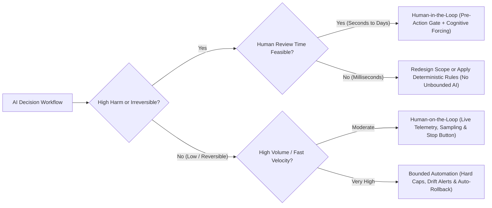

# Chapter 17: Human Oversight & Automation Bias

*Part V: Output, Trust & Liability*

> **In this chapter**
>
> * Why putting a nominal `"human-in-the-loop"` reviewer at the end of an automated workflow fails under workload pressure—and how cognitive forcing functions turn rubber-stamping into real scrutiny.
> * How to match oversight architecture—human-in-the-loop (HITL), human-on-the-loop (HOTL), or bounded human-out-of-the-loop (HOOTL)—to harm severity, reversibility, and decision speed.
> * How to calibrate operator trust across the `"jagged technological frontier"` so teams avoid both uncritical over-reliance and premature algorithm aversion—while preventing long-term workforce deskilling.
> * How to engineer genuine customer and employee contestability satisfying GDPR Article 22, CJEU *SCHUFA* case law, EDPB `WP251rev.01` rules, and EU AI Act Articles 85–86.

**The empty promise of "a human is in the loop."** Chapters 15 and 16 demonstrated that generative and predictive models fabricate authoritative claims and embed systemic bias. Faced with those risks, executive sponsors routinely reach for the same comforting reassurance: `"Don't worry—a human employee approves every output before it leaves."` In practice, tired reviewers clicking **Approve** sixty times an hour under production quotas do not add oversight; they act as biological liability shields while automation silently runs the business. Effective governance demands interfaces engineered against cognitive complacency, deliberate oversight selection matched to risk latency, calibrated operator trust, and enforceable rights for affected people to challenge automated decisions.

---

### Illustrative Composite Scenario: The `98.4%` Approval Queue

A European commercial lender rolls out an AI credit-triage tool to accelerate working-capital loan decisions for small retailers and seasonal contractors. Legal approves the workflow as exempt from GDPR Article `22`'s restrictions on solely automated decision-making because underwriters click **Confirm** or **Override** on every application before an automated rejection email dispatches. Operations sets a throughput target of `55` files per analyst per shift. On the underwriting screen, a prominent crimson card declares `"DECLINE — Composite Risk Score 84/100"`, while raw cash-flow ledgers and seasonal supplier invoices sit buried three tabs deep behind collapsed accordions.

Over six months, audit telemetry reveals an unspoken breakdown: underwriters accept the model's recommendation **`98.4%` of the time**, spending an average of **`19` seconds** per file. Dozens of solvent summer-tourism businesses with uneven winter receivables are summarily declined because the model treats predictable seasonal revenue troughs as acute default signals. When an industry trade association files a collective complaint with the national data protection authority, investigators pull case dwell times, override KPIs, and performance reviews penalizing underwriters who miss daily quotas. Applying European Data Protection Board guidance and the CJEU's *SCHUFA* precedent, the regulator rejects the lender's nominal human-review claim as disguised sole automation—ordering immediate workflow suspension, re-adjudication of affected applications, and strict redesign of review authority and customer appeals.

*(This composite scenario is illustrative; it is not drawn from a specific organization or incident.)*

---

## 17.1 Real Human Control vs. Rubber-Stamping

Calling a workflow `"human-in-the-loop"` does not create human control. Human minds are poorly suited to passive vigilance over generally accurate machines, and poorly designed review queues convert skilled specialists into mechanical rubber-stampers within weeks.

Empirical cognitive-science research explains exactly why oversight fails. In a landmark systematic review in the *Journal of the American Medical Informatics Association (JAMIA)* scanning `13,821` studies across `74` empirical evaluations, Goddard, Roudsari, and Wyatt define **automation bias** as the tendency of human operators to use automated suggestions as a heuristic replacement for independent information seeking and verification.[^c17-01] That bias manifests in two dangerous forms: **omission errors** (failing to spot anomalies or errors that an automated alert overlooked) and **commission errors** (executing flawed machine recommendations despite contradictory primary evidence). Crucially, automation bias accelerates sharply under high cognitive workload, time quotas, and complex multi-variable inputs—the exact conditions found in corporate credit underwriting, fraud queues, content moderation, and clinical triage.

Worse still, standard transparency patches rarely cure over-reliance on their own. In *To Trust or to Think* (ACM CSCW 2021), Buçinca, Malaya, and Gajos demonstrated that simply attaching AI feature explanations alongside a recommendation often leaves blind acceptance intact—or even deepens misplaced confidence when explanations sound fluent.[^c17-02] Instead, reducing over-reliance required **cognitive forcing functions** that disrupt automatic clicking at decision time: asking the human to record a provisional judgment *before* revealing the AI recommendation, delaying automated display briefly, or revealing AI advice only on explicit request. Operators resisted the extra mental effort compared to one-click speed, confirming that real oversight requires deliberate friction rather than frictionless UX.

Recognizing this human-factors reality, modern law has elevated cognitive psychology into binding software design duties. **EU AI Act Article `14(4)(b)`** mandates that high-risk AI systems be engineered so human overseers *"remain aware of the possible tendency of automatically relying or over-relying on the output produced by a high-risk AI system (automation bias)"*—paired with deployer duties under **Article `26`** requiring competent, trained, and empowered personnel.[^c17-03] Yet scholars still urge healthy skepticism toward paper oversight claims: reviewing over forty regulatory policies in *Computer Law & Security Review*, Ben Green warns that vague `"human oversight"` mandates frequently fail empirically while creating false legitimacy for defective algorithms unless organizations prove human reviewers actually spot and correct machine mistakes under real working conditions.[^c17-04]

### The Guardrails

1. **Build Cognitive Forcing Functions into High-Stakes Queues:** Require reviewers on consequential approvals (loan declines, claims denials, HR disqualifications, compliance blocks) to inspect primary evidence and log an initial assessment *before* revealing the AI score, replacing one-click **Accept** banners with structured verification checklists.[^c17-02]
2. **Eliminate Quota Incentives That Reward Blind Speed:** Strip strict file-per-hour throughput targets from risk-review roles; never tie reviewer bonuses or penalties to agreement with AI recommendations.
3. **Monitor Automation-Bias Telemetry Continuously:** Track reviewer median dwell time, per-analyst acceptance rates (flagging queues above `95%` or median reviews under reading speed), and override reversal trends on internal governance dashboards.
4. **Seed Periodic Canary Error Audits:** Inject pre-verified synthetic `"canary"` cases containing subtle policy violations or miscalculated fields into review queues weekly—measuring real human detection rates rather than assuming written SOPs work.[^c17-04]

---

## 17.2 Choosing the Design: Human-in-the-Loop, Human-on-the-Loop, or Human-out-of-the-Loop

Once leaders understand how fast reviewers fatigue, a common overcorrection is forcing synchronous human sign-off onto *every* AI event. Placing an underwriter or SOC analyst ahead of ten thousand low-stakes fraud checks or millisecond pricing queries does not produce safety; it manufactures alert fatigue until the queue becomes pure rubber-stamping.

Human-factors engineering solves this by separating tasks systematically. In their foundational *IEEE Transactions* model, Parasuraman, Sheridan, and Wickens distinguish four distinct stages of human-machine work—**information acquisition**, **information analysis**, **decision and action selection**, and **action implementation**—and vary the degree of automation independently across each stage.[^c17-05] An AI copilot may heavily automate acquisition and synthesis while locking decision execution firmly in human hands (or vice versa in tightly bounded low-risk workflows).

Enterprise architects should select deliberately among three oversight architectures based on **harm severity**, **reversibility**, and **decision latency**:

| Oversight Pattern | Mechanism & Timing | Best-Fit Enterprise Workflows | Required Operational Controls |
| :--- | :--- | :--- | :--- |
| **Human-in-the-Loop (`HITL`)** | AI analyzes and recommends, but **cannot execute** until an active, qualified human confirms (`Parasuraman` low action autonomy). | High-harm or irreversible acts: credit rejections, clinical diagnoses, legal filings, employee terminations, SOAR host isolation, wire exceptions. | Cognitive forcing UX (`17.1`), full raw record visibility, zero throughput quotas, override logging, canary error audits. |
| **Human-on-the-Loop (`HOTL`)** | AI executes routine decisions asynchronously while operators monitor real-time dashboards, inspect random samples, and hold override/halt power. | Moderate-impact, reversible, high-frequency flows: tier-2 support routing, spam/abuse throttling, routine inventory reordering, low-value claims fast-track. | Real-time drift/error alerts, statistically sampled post-hoc QA audits, tested EU AI Act `Art. 14(4)(e)` `"stop"` halt mechanism ([^c17-03]). |
| **Bounded Human-out-of-the-Loop (`HOOTL`)** | End-to-end automated execution within narrow, deterministically enforced technical and financial boundaries (`Chapters 11 & 15`). | Millisecond or massive-scale low-harm operations: ad bidding, internal document tagging, micro-discount caps, automated cache invalidation. | Hard deterministic circuit breakers (spend/volume caps, allow-lists), zero irreversible customer/rights effects, instant automated rollback. |

Notice the crucial empty cell: **high-harm, irreversible decisions running at millisecond velocity**. If a workflow moves too fast for substantive human judgment—such as real-time credit underwriting or automated claims cancellation—organizations must either redesign the interaction latency (pause and route flagged exceptions to asynchronous human review) or entrust execution solely to verified deterministic rules (Chapter 15), **never** unbounded probabilistic AI.

*Caption: Decision tree for selecting enterprise oversight architecture. Irreversible harm requires feasible pre-action HITL gates; sub-second flows must drop high-stakes probabilistic autonomy entirely rather than pretending fast humans can supervise milliseconds.*

### The Guardrails

1. **Tie Oversight Tier to Reversibility and Latency During Intake:** Document during Risk Tiering why each system uses HITL, HOTL, or bounded HOOTL—explicitly banning nominal `"review"` queues where arrival volume exceeds human cognitive bandwidth.
2. **Operationalize the `Art. 14(4)(e)` Safe-State Stop Control:** Ensure every HOTL and autonomous agent deployment features a tested, role-accessible kill switch or degraded fallback mode capable of halting automated execution cleanly into a safe manual state ([^c17-03]).
3. **Sample HOTL Outcomes Independently:** Pair real-time dashboards with blind weekly audit sampling by senior specialists who inspect unassisted raw case files to catch silent drift before error rates compound.
4. **Encase HOOTL Automation in Deterministic Circuit Breakers:** Enforce programmatic transaction limits, rate throttles, and automatic error-spike rollbacks outside the model layer so out-of-the-loop automation fails safely within pre-approved financial ceilings.

---

## 17.3 Calibrating Trust: Avoiding Both Over-Reliance and Outright Rejection

Human oversight fails at two opposite poles. Chapter 15 and Section 17.1 highlighted **over-reliance** (using AI blindly where it fails); the inverse threat is **outright rejection** (employees quietly abandoning accurate systems because interfaces hide uncertainty or punish minor glitches). Both failures trace back to miscalibrated trust.

In *Human Factors* (2004), Lee and See establish the classic control taxonomy: **appropriate reliance** aligns operator trust strictly with an AI tool's true operational reliability across contexts—avoiding both **misuse** (over-trusting AI outside its verified strengths) and **disuse** (ignoring reliable automation because users distrust it).[^c17-06] Disuse carries steep economic and governance costs: when nurses, underwriters, or analysts distrust a corporate copilot, they revert to inconsistent manual spreadsheets or unauthorized shadow consumer tools (Chapter 6).

Psychological bias pushes disuse rapidly once tools visibly stumble. In *Algorithm Aversion: People Erroneously Avoid Algorithms After Seeing Them Err* (*JEP: General*, 2015), Dietvorst, Simmons, and Massey demonstrated that humans remain surprisingly forgiving of human mistakes while **abandoning accurate statistical models permanently after witnessing even a single clear error**—even when the algorithm continues outperforming human forecasters overall.[^c17-07] Tellingly, Dietvorst et al. also found an antidote: allowing domain experts controlled, constrained ability to adjust automated forecasts sharply restores adoption without forcing uncalibrated free-form abandonment.

Modern generative AI deepens the calibration trap because its errors rarely sit cleanly inside predictable rules. In a pre-registered field study with Boston Consulting Group spanning **`758` consultants across `18` realistic tasks** (*Navigating the Jagged Technological Frontier*, 2023), Dell'Acqua, Mollick, Lakhani et al. proved that GPT-4's capabilities form a **"jagged frontier"** rather than a uniform upward slope.[^c17-08] For tasks falling *inside* the model's capability boundary, AI-equipped consultants completed `12.2%` more tasks, worked `25.1%` faster, and produced outputs judged `>40%` higher quality. Yet on a carefully matched task placed just *outside* the frontier—requiring synthesis across subtle contradictory data points—consultants using AI were **`19` percentage points less likely to arrive at correct answers** than peers working without AI, lulled by persuasive prose into switching off critical judgment.

Even when organizations calibrate day-to-day reliance well, long-term dependence introduces a deeper structural hazard identified by cognitive psychologist Lisanne Bainbridge in her classic *Automatica* paper, ***Ironies of Automation*** (1983): automating routine judgment strips operators of ongoing manual practice, causing cognitive **deskilling** while leaving humans responsible for the hardest rare exceptions automation cannot solve.[^c17-09] Five years after deploying an automated underwriting or incident-triage copilot, junior analysts who never analyzed messy baseline records manually lack the pattern-recognition instincts needed to recognize when an updated model begins failing quietly.

### The Guardrails

1. **Publish Explicit `"Jagged Frontier"` Maps Per Role:** Train every workforce group using internal AI on concrete boundary maps distinguishing *verified high-accuracy workflows* (`inside the frontier`) from tasks requiring unassisted judgment or strict primary verification (`outside the frontier`).[^c17-08]
2. **Design Calibrated Uncertainty & Modifiable Outputs:** Replace binary `"84% Risk"` labels with calibrated confidence ranges, plain-language warning banners when inputs leave the training distribution, inline primary-source citations, and structured override controls so experts can tweak parameters cleanly without triggering *Dietvorst* abandonment.[^c17-06],[^c17-07]
3. **Separate Assistant Signals from Unassisted Deliberation Where Needed:** On high-consequence exceptions, give senior specialists periodic `"raw data first"` views so they maintain critical evaluation habits rather than anchoring immediately on polished AI narratives.
4. **Sustain Manual Proficiency & Junior Apprenticeship Tracks:** Combat Bainbridge deskilling via quarterly AI-off simulation exercises, mandatory unassisted capstone evaluations for junior staff (legal associates, credit analysts, Tier-1 SOC analysts), and peer calibration reviews.[^c17-09]

---

## 17.4 Contestability and Human Redress: Giving Affected Customers and Employees a Way to Appeal AI Decisions

Even the strongest internal HITL design sometimes gets high-stakes calls wrong. When an employee is screened out of promotion, a patient is denied coverage, or a small business is refused working capital, trustworthy governance requires **contestability**—a clear, rapid, substantive path for affected people to challenge the decision before an empowered human decision-maker.

European jurisprudence and privacy guidance have closed the historic loophole used to evade automated-decision accountability. Under **GDPR Article `22(1)` & `22(3)`**, individuals hold a right not to be subject to a decision based *solely* on automated processing producing legal or similarly significant effects—carrying explicit rights to **obtain human intervention**, **express their point of view**, and **contest the decision**.[^c17-11] For years, organizations tried sidestepping Article `22` by inserting a perfunctory human click downstream of an algorithmic score. Two authoritative rulings ended that tactic:

* **Article 29 Working Party / EDPB Guidelines (`WP251rev.01`):** Adopted February 6, 2018, the official Article 22 guidelines establish that nominal rubber-stamping counts legally as *solely automated*. To count as genuine human intervention, the reviewing person must possess actual **authority and competence** to reverse the recommendation and must actively evaluate *all relevant underlying evidence*—not merely skim an algorithmic score.[^c17-12]
* **CJEU *SCHUFA Holding* Judgment (`Case C-634/21`):** On December 7, 2023, the Court of Justice of the European Union (`ECLI:EU:C:2023:957`) held that when a credit bureau automatically computes a probability score upon which a bank *draws strongly* to grant or refuse a contract, generating the score itself triggers GDPR Article `22` protections.[^c17-10] Downstream banks cannot launder automated scoring out of Article `22` simply by employing loan clerks who rarely override third-party scores.

The **EU AI Act** reinforces contestability horizontally across Annex III high-risk workflows (employment, credit, insurance, public benefits, education, law enforcement). **Article `86`** grants any affected natural person a statutory right to obtain **clear and meaningful explanations** of the role the AI system played and the main elements of the decision whenever an Annex III deployment adversely affects them legally or similarly significantly—while **Article `85`** establishes every person's right to **lodge formal complaints with national market surveillance authorities**.[^c17-03] Across the Atlantic, **CFPB Circular `2023-03`** enforces parallel specificity in consumer lending under ECOA/Regulation B, requiring creditors to deliver accurate, variable-specific principal denial reasons rather than vague fallback templates so borrowers can spot errors in their credit files and dispute inaccuracies effectively.[^c17-13]

Crucially, an appeals process that merely asks the same model to re-score the same stale data is theater, not redress. Real contestability equips independent human appeals officers with direct access to raw source documentation, full authority to grant exceptions or correct upstream input data, clear turnaround SLAs, and feedback telemetry routing confirmed model errors back into engineering remediation queues.

### The Guardrails

1. **Surface Plain-Language Appeal Channels on Every Adverse Notice:** Include a direct, frictionless appeal link, specific primary decision drivers (`CFPB Circular 2023-03` / `EU AI Act Art. 86`), and clear response timelines alongside every customer denial, claims cut, fraud lock, or HR screening rejection—never burying escalation paths in Terms of Service links.[^c17-03],[^c17-13]
2. **Empower Appeals Officers with `WP251rev.01` Authority & Raw Context:** Staff redress teams with trained domain specialists holding independent organizational authority to overturn AI verdicts after reviewing full source files and applicant explanations ([^c17-12])—not scripted support bots reading back the original risk score.
3. **Audit Appeal Reversal Rates as a Core Risk Metric:** Monitor AI acceptance rates alongside appeal reversal rates monthly; near-`0%` frontline overrides paired with high appeal overturn rates expose disguised rubber-stamping under *SCHUFA* ([^c17-10]), while `>30%–40%` appeal reversals signal defective model calibration.
4. **Close the Governance Loop Back to Model Remediation:** Convert every successful human appeal caused by faulty data ingestion, missing context, or systemic proxy error into tracked engineering bug tickets and recalibration datasets rather than treating overrides as isolated exceptions.

---

## Why Every Role Cares

Effective human oversight bridges psychology, UI design, labor management, civil rights, and data protection.

| Role | Primary Stakes in This Chapter | First Actions to Take |
| :--- | :--- | :--- |
| **Board / Risk Committee** | Disguised rubber-stamping triggers GDPR Art. 22 / *SCHUFA* enforcement, EU AI Act Art. 14 & 85–86 liabilities, and workforce deskilling over multi-year deployments. | Demand quarterly acceptance-rate, dwell-time, and appeal-reversal metrics for all high-risk AI workflows rather than assuming HITL works. |
| **General Counsel / DPO** | Token human clicks (`98.4%` acceptance) fail `WP251rev.01` ("authority and competence") and *SCHUFA* (`Case C-634/21`), triggering GDPR Art. 22 and EU AI Act Art. 85–86 exposure. | Audit consequential workflows against `WP251rev.01` and *SCHUFA*; validate adverse-action explanations (`CFPB 2023-03` / `Art. 86`) and accessible appeal flows. |
| **Chief Operating / Risk Officer** | Excess HITL creates severe alert fatigue and SLA bottlenecks; uncalibrated HOOTL automation risks unbounded operational loss (`17.2`). | Map every production AI process explicitly into HITL, HOTL (with tested `Art. 14(4)(e)` stop controls), or deterministically bounded HOOTL tiers. |
| **Chief Product / UX Officer** | Frictionless `"Accept AI"` buttons manufacture automation bias (`Goddard`), while opaque scores without override paths trigger *Dietvorst* rejection. | Implement cognitive forcing UX (blind provisional input, delayed AI reveal, inline evidence, uncertainty intervals) per `Buçinca et al.` |
| **CHRO / Operations & Service Leads** | Throughput quotas destroy review diligence; `Bainbridge` deskilling leaves teams unready for rare edge cases or model failures. | Remove review-speed KPIs penalizing thoughtful overrides; institute unassisted manual drills and junior analyst apprenticeship benchmarks. |
| **CIO / AI Engineering Lead** | `"Jagged frontier"` tasks drop worker accuracy by `19` points (`Dell'Acqua et al.`); missing kill-switch hooks leave HOTL operators powerless during incidents. | Publish tool-level frontier maps; instrument reviewer dwell time and canary test accuracy; engineer tested safe-state halt controls (`Art. 14(4)(e)`). |
| **Internal Audit** | Paper SOPs claiming `"human review"` hide actual rubber-stamping rates, lack of authority under `WP251rev.01`, and broken appeal loops. | Sample live review dwell times, canary catch rates, appeal reversal frequencies, and reviewer authority evidence independently each year. |

---

## Chapter Summary

| Section | Core Oversight Failure | Architectural & Governance Fix | Evidence & Anchors |
| :--- | :--- | :--- | :--- |
| **Real Control vs. Rubber-Stamping** (`17.1`) | Cognitive automation bias (`omission`/`commission` errors under workload) turns nominal HITL reviewers into fast-clicking rubber stamps (`Green` critique). | Embed cognitive forcing UX (provisional blind judgment), remove speed quotas, monitor dwell/acceptance telemetry, inject canary test defects. | Goddard et al. ([^c17-01]); Buçinca et al. ([^c17-02]); EU AI Act Art. `14(4)(b)` ([^c17-03]); Green ([^c17-04]) |
| **HITL, HOTL & Bounded HOOTL** (`17.2`) | Putting humans synchronously in front of massive/millisecond flows causes overload, while unconstrained HOOTL creates unbounded harm. | Choose `HITL` (pre-action cognitive gate), `HOTL` (telemetry, sampling & `Art. 14(4)(e)` halt), or deterministic-capped `HOOTL` by harm, reversibility & speed. | Parasuraman et al. ([^c17-05]); EU AI Act Art. `14(4)(e)` ([^c17-03]) |
| **Calibrating Trust & Avoiding Deskilling** (`17.3`) | Blind reliance outside AI's `"jagged frontier"` cuts accuracy (`-19` percentage points), while single visible errors spark permanent algorithm aversion and `Bainbridge` deskilling. | Publish role frontier maps, show uncertainty + editable overrides (`Dietvorst`), preserve raw-first views, run periodic manual proficiency drills. | Lee & See ([^c17-06]); Dietvorst et al. ([^c17-07]); Dell'Acqua et al. ([^c17-08]); Bainbridge ([^c17-09]) |
| **Contestability & Human Redress** (`17.4`) | Token human review falls within GDPR Art. `22` (*SCHUFA*), violating EDPB `"authority & competence"` duties and statutory explanation/appeal mandates. | Provide clear adverse explanations (`Art. 86`, `CFPB 2023-03`), empowered human appeals with full raw files (`WP251rev.01`), and tracked reversal remediation loops. | *SCHUFA* ([^c17-10]); GDPR Art. `22` ([^c17-11]); `WP251rev.01` ([^c17-12]); EU AI Act Arts. `85–86` ([^c17-03]); `CFPB` ([^c17-13]) |

---

## Key Takeaways

1. **A human clicking "Approve" is not oversight.** Under cognitive fatigue and throughput pressure, reviewers accept flawed outputs reflexively unless UIs apply cognitive forcing functions (`Buçinca et al.`), remove speed quotas, and verify vigilance with seeded canary tests (`EU AI Act Art. 14(4)(b)`).
2. **Oversight architecture must match decision latency and reversibility.** Reserve synchronous `HITL` for high-harm, human-timescale decisions; use `HOTL` with tested safe-state stops and sampling for medium reversible flows; restrict `HOOTL` strictly to deterministically capped low-harm operations (`Parasuraman et al.`).
3. **Train operators on the "jagged frontier" and protect baseline craft.** AI boosts inside-frontier productivity while dropping outside-frontier accuracy by `19` percentage points (`Dell'Acqua et al.`), requiring calibrated uncertainty displays, override controls to prevent `Dietvorst` abandonment, and manual drills to prevent `Bainbridge` deskilling.
4. **Disguised automation violates law even with a clerk in the loop.** Following CJEU *SCHUFA* (`C-634/21`) and `WP251rev.01`, organizations cannot evade GDPR Article `22` through perfunctory review; reviewers and appeals teams must hold genuine **authority and competence** to inspect raw data and overturn scores.
5. **Every high-stakes adverse outcome needs an actionable appeal and closed feedback loop.** Clear adverse reasons (`EU AI Act Art. 86`, `CFPB Circular 2023-03`) and responsive human redress turn individual complaints (`Art. 85`) into structural model fixes.

---

## Questions to Ask
| Stakeholder | Diagnostic Question | What a Credible Answer Looks Like |
| :--- | :--- | :--- |
| **Head of Operations / Credit / Claims** | *"For workflows we classify as 'human-in-the-loop,' what are our actual override rates, median review dwell times, and canary defect catch rates?"* | Measured dashboard telemetry (not assumptions), cognitive forcing steps blocking instant rubber-stamping, and zero quotas penalizing careful overrides. |
| **Chief Architect / Product Lead** | *"Where have we mistakenly forced HITL queues onto high-speed streams—or placed unbounded AI in millisecond high-harm workflows?"* | Explicit HITL/HOTL/HOOTL register tied to reversibility and latency, deterministic hard caps on HOOTL, and tested `Art. 14(4)(e)` stop controls. |
| **CHRO & Practice Leads** | *"Do teams using AI copilots know which subtasks lie outside the tool's jagged frontier, and how do junior analysts maintain manual skills?"* | Role-specific frontier guides, structured override workflows mitigating algorithm aversion, and regular unassisted proficiency evaluations. |
| **DPO & General Counsel** | *"If a data protection authority audited our human-review logs tomorrow under *SCHUFA* and `WP251rev.01`, could we prove authority and competence?"* | Documented reviewer training and override mandates, raw-record access before AI scoring, and accessible Art. `22` / Art. `86` explanation and redress logs. |
| **Head of Customer Experience / Appeals** | *"When an affected customer or candidate appeals an automated decision, can an independent officer inspect raw evidence and overturn it—and what happens next?"* | Empowered human appeals team with documented override authority, published SLA timelines, and engineering remediation tickets fed from confirmed reversals. |

---

## References

[^c17-01]: Kate Goddard, Abdul Roudsari, and Jeremy C. Wyatt, "Automation Bias: A Systematic Review of Frequency, Effect Mediators, and Mitigators," *Journal of the American Medical Informatics Association (JAMIA)* 19, no. 1 (January–February 2012): 121–127, https://doi.org/10.1136/amiajnl-2011-000089. **Annotation:** Systematic synthesis of `74` empirical studies documenting omission and commission errors caused by human over-reliance on automated alerts under workload and time pressure. [↗ Bibliography](../bibliography.md#goddard-2012-automation-bias)

[^c17-02]: Zana Buçinca, Maja Barbara Malaya, and Krzysztof Z. Gajos, "To Trust or to Think: Cognitive Forcing Functions Can Reduce Overreliance on AI in AI-Assisted Decision-Making," *Proceedings of the ACM on Human-Computer Interaction* 5, no. CSCW1 (April 2021): Article 188, arXiv:2102.09692, https://doi.org/10.1145/3449287. **Annotation:** Demonstrates that passive explanations fail to curb over-reliance, whereas cognitive forcing functions—delayed AI reveal, on-demand advice, or pre-commitment judgments—significantly reduce mindless agreement. [↗ Bibliography](../bibliography.md#bucinca-2021-forcing)

[^c17-03]: European Parliament and Council of the European Union, Regulation (EU) 2024/1689 (*Artificial Intelligence Act*), arts. 14(4)(b), 14(4)(e), 26, 85, and 86, *Official Journal of the European Union* L, 2024/1689, July 12, 2024, http://data.europa.eu/eli/reg/2024/1689/oj. **Annotation:** Codifies provider safeguards against automation bias (`Art. 14(4)(b)`), safe-state stop triggers (`Art. 14(4)(e)`), competent deployer staffing (`Art. 26`), individual complaint rights (`Art. 85`), and clear explanation rights for adverse Annex III decisions (`Art. 86`). [↗ Bibliography](../bibliography.md#eu-2024-ai-act)

[^c17-04]: Ben Green, "The Flaws of Policies Requiring Human Oversight of Government Algorithms," *Computer Law & Security Review* 45 (July 2022): 105681, https://doi.org/10.1016/j.clsr.2022.105681. **Annotation:** Surveys over 40 policy frameworks requiring human oversight, demonstrating why nominal human-in-the-loop mandates fail empirically while legitimizing flawed algorithms without structural proof of effectiveness. [↗ Bibliography](../bibliography.md#green-2022-oversight)

[^c17-05]: Raja Parasuraman, Thomas B. Sheridan, and Christopher D. Wickens, "A Model for Types and Levels of Human Interaction with Automation," *IEEE Transactions on Systems, Man, and Cybernetics—Part A: Systems and Humans* 30, no. 3 (May 2000): 286–297, https://doi.org/10.1109/3468.844354. **Annotation:** Classic four-stage human-automation framework partitioning information acquisition, analysis, decision selection, and action implementation across variable automation levels to guide HITL/HOTL/HOOTL design. [↗ Bibliography](../bibliography.md#parasuraman-2000-levels)

[^c17-06]: John D. Lee and Katrina A. See, "Trust in Automation: Designing for Appropriate Reliance," *Human Factors* 46, no. 1 (Spring 2004): 50–80, https://doi.org/10.1518/hfes.46.1.50_30392. **Annotation:** Foundational cognitive framework defining calibrated trust to avoid both *misuse* (uncritical over-reliance) and *disuse* (cynical abandonment of capable automated tools). [↗ Bibliography](../bibliography.md#lee-2004-trust)

[^c17-07]: Berkeley J. Dietvorst, Joseph P. Simmons, and Cade Massey, "Algorithm Aversion: People Erroneously Avoid Algorithms After Seeing Them Err," *Journal of Experimental Psychology: General* 144, no. 1 (February 2015): 114–126, https://doi.org/10.1037/xge0000033. **Annotation:** Proves users abandon accurate algorithms faster after single errors than after comparable human errors—while showing bounded human override flexibility restores adoption. [↗ Bibliography](../bibliography.md#dietvorst-2015-aversion)

[^c17-08]: Fabrizio Dell'Acqua et al., "Navigating the Jagged Technological Frontier: Field Experimental Evidence of the Effects of AI on Knowledge Worker Productivity and Quality," Harvard Business School Working Paper No. 24-013, September 2023, https://www.hbs.edu/faculty/Pages/item.aspx?num=64700. **Annotation:** Pre-registered field study of `758` BCG consultants showing GPT-4 boosted inside-frontier productivity/quality (`+12.2%` tasks, `+25.1%` speed, `>40%` quality) while dropping correctness by `19` percentage points outside the frontier. [↗ Bibliography](../bibliography.md#dellacqua-2023-frontier)

[^c17-09]: Lisanne Bainbridge, "Ironies of Automation," *Automatica* 19, no. 6 (November 1983): 775–779, https://doi.org/10.1016/0005-1098(83)90046-8. **Annotation:** Seminal paper proving that automating routine decisions erodes operator skill through lack of practice precisely while leaving humans responsible for rescuing rare edge-case failures. [↗ Bibliography](../bibliography.md#bainbridge-1983-ironies)

[^c17-10]: *OQ v. Land Hessen (SCHUFA Holding AG — Scoring)*, Case C-634/21, ECLI:EU:C:2023:957 (Court of Justice of the European Union, First Chamber, December 7, 2023). **Annotation:** Landmark CJEU ruling establishing that generating an automated credit score triggers GDPR Article `22` when downstream decision-makers rely on it decisively rather than conducting genuine independent review. [↗ Bibliography](../bibliography.md#schufa-2023-c634)

[^c17-11]: European Parliament and Council of the European Union, Regulation (EU) 2016/679 (*General Data Protection Regulation*), art. 22, *Official Journal of the European Union* L 119, May 4, 2016, http://data.europa.eu/eli/reg/2016/679/oj. **Annotation:** Guarantees individuals the right not to be subject to solely automated significant decisions, plus explicit rights to human intervention, expression, and contestation (`Art. 22(3)`). [↗ Bibliography](../bibliography.md#gdpr-2016)

[^c17-12]: Article 29 Data Protection Working Party (endorsed by the European Data Protection Board), *Guidelines on Automated Individual Decision-Making and Profiling for the Purposes of Regulation 2016/679*, WP251rev.01 (adopted February 6, 2018), https://ec.europa.eu/newsroom/article29/items/612053. **Annotation:** Authoritative EU guidance clarifying that avoiding Article `22` requires meaningful human oversight by reviewers possessing genuine **authority and competence** to inspect all data and alter outcomes. [↗ Bibliography](../bibliography.md#wp29-2018-wp251)

[^c17-13]: Consumer Financial Protection Bureau, *Consumer Financial Protection Circular 2023-03: Adverse Action Notification Requirements and the Proper Use of the CFPB's Sample Forms Provided in Regulation B* (Washington, DC: CFPB, September 19, 2023), https://www.consumerfinance.gov/compliance/circulars/circular-2023-03-adverse-action-notification-requirements-and-the-proper-use-of-the-cfpbs-sample-forms-provided-in-regulation-b/. **Annotation:** Requires lenders using complex AI models to deliver accurate, variable-specific principal denial reasons rather than generic checklist templates so applicants can effectively contest inaccurate records. [↗ Bibliography](../bibliography.md#cfpb-2023-circular-03)
