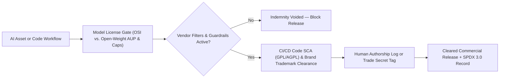

# Chapter 19: Intellectual Property & Licensing

*Part V: Output, Trust & Liability*

> **In this chapter**
>
> * Why generative AI outputs still expose enterprises to copyright, trademark, and trade-dress infringement—illustrated by *Getty Images v. Stability AI* and *Thomson Reuters v. Ross Intelligence*.
> * Why raw AI outputs fail human-authorship copyright rules in the United States (*Thaler v. Perlmutter*, USCO Part 2), diverge globally (*Li v. Liu*, UK CDPA § 9(3)), and require deliberate IP strategy.
> * Why popular `"open-weight"` models (`Llama`, `Gemma`, `Mistral`) are not OSI Open Source—and how MAU caps, attribution duties, AUP flow-downs, and research-only traps restrict enterprise deployment.
> * How AI coding assistants can introduce `GPL`/`AGPL` copyleft contamination and open-source breach claims (*Doe v. GitHub*), and how `SPDX 3.0` + CI/CD snippet scanning mitigate acquisition risk.
> * Why vendor IP indemnities (Microsoft CCC, Google Cloud, OpenAI Copyright Shield) vanish if you disable built-in filters or overlook trademark exclusions and liability caps.

**Closing the value-and-ownership ledger.** Chapters 15 through 18 focused on ensuring enterprise AI produces accurate, fair, overseen, and transparent outputs. Chapter 19 closes Part V by answering the commercial questions boards and investors ask right before scale or acquisition: *Do we have the legal right to use and ship this model, could its outputs infringe someone else's intellectual property, and do we actually own—and can we defend—what the AI helps us build?* Across marketing assets, open-weight downloads, coding copilots, and vendor indemnity contracts, AI reshapes traditional software and creative IP boundaries faster than standard legal playbooks expect.

---

### Illustrative Composite Scenario: The Unprotectable Campaign and the Copyleft Microservice

A fast-growing B2B SaaS provider integrates generative AI into both brand marketing and platform engineering ahead of a Series D diligence process. Marketing produces its flagship annual campaign visuals from text prompts using a third-party diffusion platform; weeks before launch, trademark counsel spots a warped, faint stock-agency watermark embedded inside the background texture of two hero graphics—and advises the CMO that prompt-generated images cannot even be registered or enforced against copycat competitors under U.S. copyright law.

Meanwhile, a backend squad pulls a flagship open-weight LLM hosted on a public hub under the assumption that `"all weights from this family are Apache 2.0"`, inadvertently deploying a variant governed by a non-commercial research license into a billed enterprise API. Worse, automated M&A code diligence flags a `45`-line telemetry-parsing helper suggested verbatim by a coding assistant that originated inside an `AGPLv3`-licensed repository without attribution headers—threatening forced source disclosure across the surrounding SaaS service. When General Counsel looks to the cloud vendor's IP indemnity for defense relief, Security admits an engineer turned off the API's built-in copy-detection filter months earlier to trim median response latency, immediately voiding coverage and forcing an emergency clean-room rewrite before deal closing.

*(This composite scenario is illustrative; it is not drawn from a specific organization or incident.)*

---

## 19.1 Inbound Risk: Generated Output That Infringes Someone Else's Rights

Organizations often treat AI intellectual property risk solely as a debate among foundation-model developers over whether web scraping counts as copyright fair use. Even if your company never pre-trains a foundation model from scratch, **inbound output infringement** lands squarely on the enterprise deploying or publishing generated outputs.

At the technical root lies **memorization**: neural models trained repeatedly on popular texts, codebases, photographs, and corporate logos can emit near-verbatim replicas under ordinary prompting (`Carlini et al., 2021`).[^c19-01] When those artifacts surface inside product interfaces, external advertising, customer training portals, or fine-tuned commercial search tools, three distinct legal exposures trigger regardless of how clean the vendor claimed its dataset was:

* **Trademark & Watermark Infringement (`Getty Images v. Stability AI`):** On November 4, 2025, Mrs Justice Joanna Smith of the High Court of England and Wales delivered a landmark judgment in ***Getty Images (US) Inc & Ors v. Stability AI Ltd*** (`[2025] EWHC 2863 (Ch)`).[^c19-02] While Getty dropped its UK primary training-copyright claims for territorial reasons and the High Court dismissed secondary copyright infringement over downloaded model weights (granting permission to appeal that novel issue in `[2025] EWHC 3343 (Ch)`), the Court **upheld limited trademark infringement under Trade Marks Act 1994 §§ 10(1) and 10(2)** where early Stable Diffusion releases generated distorted `Getty` and `iStock` watermarks inside image outputs. For enterprise marketing and product teams, the takeaway is crystal clear: even where copyright claims over model weights stall, **emitting recognizable third-party brand marks, trade dress, or distorted stock watermarks creates strict trademark exposure**.
* **Market-Substituting Fine-Tuning & Fair-Use Rejection (`Thomson Reuters v. Ross Intelligence`):** Enterprises training internal classifiers or domain-specific models on licensed competitor content also face sharp fair-use boundaries. On February 11, 2025, Third Circuit Judge Stephanos Bibas (sitting by designation in Delaware) issued a landmark revised summary-judgment ruling in ***Thomson Reuters Enterprise Centre GmbH v. Ross Intelligence Inc.*** (`No. 1:20-cv-0613-SB`), granting partial summary judgment for Thomson Reuters on copyright infringement and rejecting Ross's fair-use defense.[^c19-03] Because Ross built an AI legal-search engine trained on contractor-written `Bulk Memos` copied from proprietary `Westlaw` headnotes to create a competing commercial substitute, fair use failed decisively—particularly on market substitution (factor four).
* **Trade-Dress and Style Replication Risk:** Prompting tools with `"recreate [competitor product interface]"` or `"render in the distinct visual style of [living commercial illustrator]"` invites both copyright substantial-similarity disputes and unfair-competition / passing-off claims even if individual training weights never violate statute.

### The Guardrails

1. **Ban Brand, Artist, and Trademark Prompts Externally:** Prohibit employees and marketing agencies from referencing living artists, protected characters, competitor product designs, or `"stock photo watermark"` terms in prompts generating external-facing media or UI concepts.
2. **Lock On Vendor Similarity & Regurgitation Filters:** Keep foundation-model copyright/recitation blockers, similarity classifiers, and content filters permanently enabled across all corporate tenants (`19.5`).
3. **Clear External AI Visuals Before Publication:** Run commercial AI marketing assets through reverse-image search, trademark screening, and watermark-artifact inspection (`Getty v. Stability AI`) with the same rigor applied to agency stock licenses.[^c19-02]
4. **Prohibit Fine-Tuning on Unlicensed Commercial or Competitor Content:** Require explicit Data Provenance & Legal sign-off (Chapter 8) before ingesting competitor documentation, paywalled datasets, or vendor knowledge bases into custom training or fine-tuning corpora (`Thomson Reuters v. Ross`).[^c19-03]

---

## 19.2 Outbound Risk: Who Owns and Can Protect AI-Generated Work?

Inbound risk asks whether your AI output infringes someone else's work; **outbound risk** asks whether your company owns—and can stop rivals from copying—the code, documentation, UI designs, drug candidates, or media your teams build with AI. Across global markets, copyright protection fragments along sharp human-authorship borders.

In the United States, federal courts and regulators draw a firm boundary excluding autonomous or prompt-only AI outputs:

* **U.S. Copyright Office Guidance (`Part 2: Copyrightability`, January 2025):** Reviewing thousands of stakeholder submissions, the U.S. Copyright Office concluded that supplying detailed text prompts—no matter how iterative, lengthy, or refined—generally functions as providing unprotectable *ideas* or directions rather than controlling final expressive form.[^c19-04] Copyright subsists *only* where a human contributes perceptible original expression, such as materially editing outputs, integrating AI elements into an original human composition, or exercising creative selection and arrangement—and applicants must explicitly disclaim appreciable AI-generated portions on registration filings.
* **Federal Appellate Affirmation (`Thaler v. Perlmutter`, March 18, 2025):** In `130 F.4th 1039` (D.C. Cir. 2025), a unanimous panel led by Judge Patricia Ann Millett affirmed that the Copyright Act of 1976 requires **human authorship** as a non-negotiable statutory precondition, upholding denial of copyright registration for an artwork autonomously created by Stephen Thaler's `"Creativity Machine."`[^c19-05] (Because Thaler disclaimed human creative control administratively, the D.C. Circuit left open exactly how much human post-editing transforms an AI-assisted asset into registrable expression.)

Outside the United States, major commercial jurisdictions diverge significantly, creating patchwork IP portfolios for multinational firms:

* **China (`Li v. Liu`, November 27, 2023):** In `(2023) Jing 0491 Min Chu No. 11279`, the Beijing Internet Court recognized copyright protection in a Stable Diffusion image because the human user's progressive prompt crafting, negative prompts, parameter selection, and iterative curation reflected original `"intellectual investment"` and aesthetic judgment.[^c19-06]
* **United Kingdom (`CDPA 1988 § 9(3)`):** Under Section `9(3)` of the UK *Copyright, Designs and Patents Act 1988*, `"computer-generated"` works lacking a human author receive statutory protection vesting in *"the person by whom the arrangements necessary for the creation of the work are undertaken"*—a distinct regime currently under active policy review that differs from both U.S. exclusion and Chinese prompt-authorship reasoning.[^c19-07]

For enterprise executives, the strategic risk is straightforward: **if competitors legally scrape your marketing copy, UI assets, customer manuals, or boilerplate software code produced purely via prompts, U.S. copyright may offer zero enforcement remedy.** Worse, submitting unedited AI assets in federal filings without disclosing AI portions risks invalidating copyright registrations during enforcement litigation. High-value commercial assets therefore require intentional protection layers beyond raw copyright: substantial documented human authorship, **trade-secret governance** (confidential internal algorithms, customer workflows, non-public weights), registered trademarks, and design or utility patents (which likewise require documented human inventorship).

### The Guardrails

1. **Preserve Crown-Jewel Works Under Human-Authored Craft:** Require substantial, documented human creative transformation—editing, architectural design, composition, and selection—on proprietary source code cores, brand marks, flagship UX assets, and key commercial content intended for copyright enforcement (`USCO Part 2`).[^c19-04]
2. **Maintain Immutable Creation & Edit Logs:** Retain prompt drafts, intermediate asset versions, human-redline commits, and Git history proving human authorship contributions ahead of copyright registration (`USCO` disclaimers) or IP disputes.
3. **Shift Unregistrable Outputs to Trade-Secret & Contract Protections:** Treat unedited internal AI analytics, synthetic datasets, and proprietary workflow prompts as **trade secrets** guarded by Chapter 6–7 access controls, NDAs, and customer terms of service rather than assuming automatic copyright protection.
4. **Update Employee & Contractor IP Assignment Clauses:** Require agencies, contractors, and vendors delivering brand assets or software code to disclose material generative-AI usage and certify compliance with your IP creation policies before milestone acceptance.

---

## 19.3 Open-Weight Model Licenses and Their Usage Restrictions

Engineering teams routinely call downloadable foundation models (`Llama`, `Gemma`, `Mistral`, `Qwen`) `"open source"` because their weights sit publicly on Hugging Face. That shorthand creates severe commercial compliance mistakes. Very few leading generative weights actually meet traditional open-source standards.

In October 2024, the **Open Source Initiative (OSI)** published ***The Open Source AI Definition — Version 1.0 (`OSAID 1.0`)*** establishing that true Open Source AI requires freedom to use, study, modify, and share *including* sufficient training-data information to recreate an equivalent model, with zero field-of-use or scale restrictions.[^c19-08] Virtually all mainstream downloadable weights fail `OSAID 1.0`—and are properly classified as **open-weight** (source-available) models carrying custom commercial caps, branding rules, and Acceptable Use Policies (`AUPs`) whose breach voids the license entirely:

| License Family | Illustrative Models | Key Restrictions & Triggers | Enterprise Operational Trap |
| :--- | :--- | :--- | :--- |
| **Permissive OSI Licenses (`Apache 2.0` / `MIT`)** | Select open weights (e.g., `Mistral 7B`, `Qwen 2.5` subsets) | Full commercial use, modification, and redistribution with copyright/notice retention and standard patent peace clauses. | Teams assume *every* checkpoint under the same vendor brand carries `Apache 2.0`, missing custom licenses on newer or larger variants. |
| **Meta Llama Community License ([^c19-09])** | `Llama 3`, `Llama 3.1`, `Llama 3.3`, `Llama 4` series | **`700 million` monthly active user (MAU)** cap requires direct Meta commercial license; mandatory `"Built with Llama"` notice on UI/docs; public derivatives must start with `"Llama"`; binding Acceptable Use Policy (`AUP`). | Consumer apps or fast-scaling acquisitions approach `700M` MAU across affiliate products, or ship SaaS portals without `"Built with Llama"` attribution. |
| **Google Gemma Terms of Use** | Open-weight `Gemma` model releases (model-specific check required) | Commercial permission conditioned on a strict **Prohibited Use Policy** that adopters must **flow down** into downstream customer terms, plus remote compliance enforcement clauses. | Enterprises embed Gemma behind APIs without cascading Prohibited Use restrictions into customer MSAs or mobile EULAs. |
| **Custom Research / Non-Commercial Licenses** | Flagship/preview checkpoints (`Mistral Research License`, `CC BY-NC`) | Explicitly prohibits commercial monetization, production customer inference, or internal commercial deployment (`research only`). | Engineers pull flagship preview weights via Hugging Face defaults into production pricing or billing APIs, committing unlicensed copyright infringement. |

Unlike `Apache 2.0`, violating a custom open-weight license's `AUP` (`"no unauthorized clinical/legal advice"`), omitting `"Built with Llama"` attribution, or breaching non-commercial scope terminates your license grant automatically—turning production inference into unpermitted copyright exposure right during customer audits or M&A diligence.

### The Guardrails

1. **Enforce an Approved Open-Weight Registry Allow-List:** Configure private internal model registries (mirroring Chapter 12 supply-chain gates) so engineers can pull *only* weights whose exact SPDX/custom license identifier (`Apache-2.0`, `Llama-3.1-Community`, `Gemma-Terms`) has been cleared by Legal.
2. **Block Non-Commercial & Research-Only Weights in CI/CD:** Automatically fail build pipelines if container manifests, Hugging Face `config` references, or AI-BOM records (`SPDX 3.0` / `CycloneDX`) pull models carrying `NC` (`NonCommercial`) or research-only clauses into staging or production environments.
3. **Operationalize Attribution & Policy Flow-Downs:** Build mandatory `"Built with Llama"` UI/docs attribution checks and `Llama AUP` / `Gemma Prohibited Use` flow-down templates directly into enterprise product release checklists ([^c19-09]).
4. **Track MAU Scale Thresholds Across Corporate Affiliates:** Alert Legal and M&A teams whenever consumer products or merged portfolio entities approach license scale triggers (`700M` MAU under Llama).

---

## 19.4 Open-Source License Contamination in AI-Generated Code

Software teams using AI coding assistants face a parallel IP contamination threat inside application source repositories. Foundation coding models trained across billions of public GitHub lines periodically emit verbatim or near-verbatim utility functions originally licensed under **permissive licenses requiring attribution (`MIT`, `BSD`, `Apache 2.0`)**—or far worse, **strong copyleft licenses (`GPLv3`, `AGPLv3`)** stripped cleanly of their original copyright notices and license headers.

For commercial SaaS and enterprise software vendors, `AGPLv3` snippet contamination is existential: unlike ordinary `GPL` (triggered upon binary distribution), **`AGPLv3` requires offering full corresponding source code over the network to every user interacting with the service**. Even when a vendor believes it merely borrowed forty lines of parsing or retry logic suggested by a copilot, undisclosed copyleft code discovered during automated M&A code scanning can force emergency product halts, escrowed indemnities, or costly clean-room rewrites.

Federal litigation confirms this is not purely theoretical. In ***Doe 1 v. GitHub, Inc.*** (`No. 4:22-cv-06823-JST`, `2024 WL 235484`), developers sued GitHub, Microsoft, and OpenAI arguing that AI coding suggestions reproduced open-source snippets without preserving author names, copyright notices, or license terms.[^c19-10] In orders issued in January and June 2024, U.S. District Judge Jon S. Tigar ultimately dismissed Digital Millennium Copyright Act (`DMCA § 1202(b)`) Copyright Management Information claims under an `"identicality"` requirement (certifying that statutory question for interlocutory appeal to the Ninth Circuit)—**but decisively allowed plaintiffs' common-law breach-of-contract claims for violated open-source license conditions to proceed**. Whether or not DMCA statutory damages apply, breaking an open-source license's attribution or copyleft terms remains a live contractual breach.

Stopping AI-induced license contamination uses the same engineering rigor teams already apply to third-party open-source packages, updated for *snippet-level* AI suggestions and documented via **SPDX Version 3.0 ([^c19-11])** bills of materials.

### The Guardrails

1. **Enforce Public-Code Matching Blockers Organization-Wide:** Configure enterprise AI coding assistants (GitHub Copilot Enterprise, internal code-completion IDEs) centrally to **block completions matching public open-source code**, removing individual developer discretion to turn off matching filters.
2. **Add Snippet-Level Software Composition Analysis (`SCA`) to CI/CD:** Run commercial open-source snippet scanners (not just package-manifest scanners reading `package.json` or `requirements.txt`) on pull requests to flag pasted or AI-generated verbatim blocks matching `GPL`, `AGPL`, or unattributed `Apache/MIT` code before merge.
3. **Restrict Unreviewed Copilot Code Inside Crown-Jewel Modules:** Prohibit pasting large multi-function AI generations (`>20–30` lines) into proprietary encryption, licensing, billing, or core differentiating algorithms without senior architecture review and clean-room refactoring.
4. **Track Code Provenance in `SPDX 3.0` & Developer Guidelines:** Require engineers to retain original license headers whenever intentionally adopting permissive open-source snippets and maintain continuous `SPDX 3.0` ([^c19-11]) software bills of materials verified prior to external releases or corporate transactions.

---

## 19.5 Vendor IP Indemnification: What It Covers and What It Doesn't

Recognizing that copyright uncertainty was freezing enterprise AI procurement, major cloud and AI vendors launched customer IP indemnification programs in late 2023—anchored by **Microsoft's Copilot / Customer Copyright Commitment** (`September 7, 2023`)[^c19-12] and **Google Cloud's Generative AI IP Indemnity** (`October 12, 2023`), alongside OpenAI's *Copyright Shield*.[^c19-13] Microsoft pledged to defend commercial customers sued by third parties over copyright infringement caused by Copilot outputs, while Google Cloud introduced a two-pronged model protecting customers against both **training-data infringement claims** (`Prong 1`) and **generated-output copyright claims** (`Prong 2`).

Executive sponsors frequently read headlines announcing `"unlimited vendor IP protection"` and cancel internal compliance checks. Careful contract inspection exposes **five sharp exclusions** where enterprise buyers routinely discover coverage vanishes when a lawsuit actually lands:

1. **Mandatory Built-In Filter & Guardrail Prerequisite:** Both Microsoft's Customer Copyright Commitment and Google Cloud's indemnity strictly condition protection on keeping vendor **content filters, copy-blocking detectors, metaprompts, and grounding citations enabled**.[^c19-12],[^c19-13] If an engineering team toggles off copy-detection filters in Azure OpenAI or disables safety filters via an API flag to reduce latency, IP indemnification evaporates retroactively.
2. **Intentional Prompting & Unlicensed Input Carve-Outs:** Indemnities never cover customers who deliberately prompt `"generate Mickey Mouse"` or `"rewrite this competitor textbook"`, nor claims arising from copyrighted documents uploaded by the *customer* into RAG indexes or fine-tuning jobs.
3. **Aggregate Liability Caps vs. Super-Caps:** Outside bespoke enterprise agreements, default API terms often fold IP indemnification under general limitation-of-liability caps (`12 months of trailing fees`)—trivial relative to multi-million-dollar copyright defense costs.
4. **Trademark, Trade-Dress & Patent Exclusions:** Many headline commitments explicitly protect only third-party *copyright* infringement, leaving *Getty*-style trademark, right-of-publicity, and patent infringement claims completely unindemnified unless negotiated explicitly.
5. **Hosted Third-Party & Open-Weight Model Exclusions:** Calling a cloud marketplace endpoint hosting `Llama`, `Mistral`, or community models—or fine-tuning base weights with enterprise data—often sits *outside* the cloud host's first-party generative indemnity unless specifically scheduled by addendum.

Nor can casualty insurance bail out unindemnified copyright or advertising disputes: as Chapter 3 and Chapter 15 noted, **ISO / Verisk Commercial General Liability endorsements `CG 40 47` and `CG 40 48` (effective January 1, 2026)** exclude generative-AI liabilities—including `"personal and advertising injury"` copyright and slogan claims—making vendor contract gaps directly exposed on the corporate balance sheet.[^c19-14]

*Caption: Enterprise AI IP and licensing clearance pipeline. Vendor indemnification remains valid only while centralized guardrails remain locked on, complemented by open-weight license checks, snippet SCA scanning, brand clearance, and human-authorship documentation.*

### The Guardrails

1. **Lock Vendor Copyright Filters via Centralized Policy:** Enforce Azure/Vertex/OpenAI content filters, duplication detectors, and public-code blockers programmatically via IAM and Terraform policy guardrails so application engineers cannot disable indemnity prerequisites ([^c19-12], [^c19-13]).
2. **Negotiate Explicit Coverage Scope, Super-Caps & Model Schedules:** Have Procurement and IP Counsel confirm in MSAs whether IP indemnification covers *both* training-data and output claims, extends to trademarks and hosted third-party models, and carries uncapped or dedicated multi-million-dollar defense super-caps (`> 12 months fees`).
3. **Quarantine Third-Party Inputs & Prompt Hygiene:** Never rely on vendor indemnity for outputs shaped by customer-uploaded unlicensed documents (`Thomson Reuters` style corpora); apply prompt-sanitization checks blocking protected brand/artist references.
4. **Treat Vendor Indemnity as a Backstop—And Audit Insurance Gaps:** Pair contractual IP commitments with internal `19.1–19.4` clearance gates and verify Media Liability / Tech E&O renewals explicitly cover generative-AI claims excluded under ISO `CG 40 47`/`40 48` ([^c19-14]).

---

## Why Every Role Cares

AI IP and licensing traps cut straight across valuation, M&A diligence, marketing launches, software delivery, and vendor procurement.

| Role | Primary Stakes in This Chapter | First Actions to Take |
| :--- | :--- | :--- |
| **Board / M&A Committee** | `AGPL` snippet contamination, unprotectable core IP, breached open-weight MAU/research licenses, and CGL `CG 40 47` gaps directly erode enterprise valuation and stall deals. | Require clean AI IP & open-source snippet due-diligence status in quarterly audit packs and pre-M&A readiness reviews. |
| **General Counsel / IP Counsel** | *Getty* (`trademarks`), *Thomson Reuters* (`fair use`), *Thaler* / `USCO` (`human authorship`), *Doe v. GitHub* (`license breach`), and conditional CCC/Cloud indemnities reshape exposure. | Update vendor indemnity playbooks, agency IP clauses, copyright-registration documentation SOPs, and `Media Liability` / `Tech E&O` renewals. |
| **CMO / Brand & Creative** | Distorted watermarks trigger trademark claims (`Getty`), while raw prompt graphics cannot be copyrighted against copycats (`USCO Part 2`). | Mandate trademark/reverse-image clearance on external AI media; maintain human editorial design logs; ban `"style of [artist]"` prompts. |
| **CTO / VP Engineering** | AI coding assistants inject unattributed `GPL`/`AGPL` snippets (*Doe*), and developers accidentally deploy non-commercial research weights into SaaS products. | Enforce public-code blockers on coding copilots, add snippet-level `SCA` scanners in CI/CD, and block `NC`/research model IDs at registry level. |
| **CIO / Platform & Cloud Ops** | An engineer toggling off API content/copy filters silently voids Microsoft CCC and Google Cloud IP indemnification across the tenant (`19.5`). | Lock vendor content/copyright filters via central tenant IAM/IaC policy and emit alerts on filter configuration drift. |
| **Procurement / Vendor Risk** | Marketplace open-weight models and `12-month fee` liability caps leave large defense gaps hidden behind `"AI Indemnity"` marketing claims. | Enforce contract checklists covering Prong 1+2 training/output defense, trademark claims, scheduled models, and guardrail notice terms. |
| **CISO / AppSec & FinOps** | Model-registry governance and `SPDX 3.0` provenance bridge Chapters 12 and 19 to prevent counterfeit weights, unapproved licenses, and exposed secrets. | Enforce `SPDX 3.0` / `CycloneDX` AI-BOM tracking for every deployed weight and SaaS codebase release. |

---

## Chapter Summary

| Section | Core IP / Licensing Risk | Mandatory Enterprise Guardrail | Evidence & Anchors |
| :--- | :--- | :--- | :--- |
| **Inbound Infringement** (`19.1`) | Memorized artifacts recreate brand marks/watermarks (*Getty* trademark ruling) while unlicensed commercial fine-tuning fails fair use (*Thomson Reuters*). | Ban brand/artist prompt mimicry; keep copy/similarity filters on; run trademark/reverse-image clearance; gate fine-tuning corpora via Legal. | Carlini et al. ([^c19-01]); *Getty v. Stability AI* ([^c19-02]); *Thomson Reuters v. Ross* ([^c19-03]) |
| **Outbound Ownership** (`19.2`) | Pure prompt outputs lack U.S. copyright (*USCO Part 2*, *Thaler*), leaving global divergence (*Li v. Liu*, UK `§ 9(3)`) and weak exclusivity against rivals. | Preserve documented human authorship on crown-jewel IP; keep edit logs; guard raw AI assets as trade secrets/trademarks; update contractor IP terms. | `USCO Part 2` ([^c19-04]); *Thaler v. Perlmutter* ([^c19-05]); *Li v. Liu* ([^c19-06]); UK `CDPA § 9(3)` ([^c19-07]) |
| **Open-Weight Model Licenses** (`19.3`) | Open-weight models fail `OSAID 1.0`, embedding `700M` MAU triggers (`Llama`), `"Built with Llama"` / Gemma `AUP` flow-downs, and non-commercial research traps. | Maintain a Legal-cleared model registry allow-list; block `NC`/research licenses in CI/CD; enforce attribution notices, `AUP` flow-downs, and MAU tracking. | `OSAID 1.0` ([^c19-08]); *Meta Llama License* ([^c19-09]) |
| **Code License Contamination** (`19.4`) | AI code assistants emit `GPL`/`AGPL` or unattributed `MIT/Apache` snippets, risking breach-of-contract suits (*Doe v. GitHub*) and M&A source-disclosure traps. | Enforce public-code suggestion blockers centrally; run CI/CD snippet-level `SCA` scans; log code provenance in `SPDX 3.0` SBOMs. | *Doe 1 v. GitHub* ([^c19-10]); `SPDX 3.0` ([^c19-11]) |
| **Vendor IP Indemnities** (`19.5`) | Vendor commitments void if safety filters are disabled, cap payouts at `12 months` fees, exclude trademarks/third-party models, and collide with CGL `CG 40 47`. | Lock vendor guardrails centrally via IaC; negotiate super-caps + trademark/hosted-model schedules; maintain internal clearance + Cyber/Media E&O alignment. | Microsoft CCC ([^c19-12]); Google IP Indemnity ([^c19-13]); ISO/Verisk ([^c19-14]) |

---

## Key Takeaways

1. **Memorized marks and market-substituting training trigger real infringement today.** Even when training-data copyright suits stall on territory, *Getty Images v. Stability AI* enforces trademark liability on output watermarks while *Thomson Reuters v. Ross Intelligence* rejects fair use for competing commercial training.
2. **Do not build core enterprise valuation on unedited AI copyright.** Under `USCO Part 2` and *Thaler v. Perlmutter*, raw prompt outputs cannot be copyrighted in the United States despite differing paths in *Li v. Liu* and UK `§ 9(3)`—requiring documented human modification, trade-secret protection, and contractor disclosure rules.
3. **"Open-weight" is not OSI Open Source.** Check exact licenses on every `Llama`, `Gemma`, and `Mistral` variant inside model registries to respect `700M` MAU caps, `"Built with Llama"` notices, `AUP` flow-downs, and non-commercial prohibitions.
4. **Prevent `AGPL` and attribution breaches before M&A diligence.** *Doe v. GitHub* leaves common-law license contract claims active, making centralized copilot public-code filters, snippet-level CI/CD `SCA` scanning, and `SPDX 3.0` provenance mandatory hygiene.
5. **Vendor IP indemnities dissolve the moment you turn off guardrails.** Keep content/copy filters locked via tenant admin policy (`Microsoft CCC`, `Google Cloud`), scrutinize liability caps and trademark exclusions, and verify insurance coverage past ISO `CG 40 47`/`40 48`.

---

## Questions to Ask
| Stakeholder | Diagnostic Question | What a Credible Answer Looks Like |
| :--- | :--- | :--- |
| **General Counsel & IP Lead** | *"Which flagship products or campaigns rely heavily on generative AI, and do we have documented human authorship logs or trade-secret wrappers protecting them?"* | Written AI IP classification per product/campaign, preserved human edit/commit logs supporting registrations, and updated contractor disclosure clauses. |
| **CMO & Brand Operations** | *"Before publishing synthetic hero imagery or copy, how do we verify no residual watermarks, competitor trade dress, or prohibited style prompts slipped through?"* | Pre-publication reverse-image and trademark clearance sign-offs, locked vendor similarity filters, and banned brand/artist prompt guidelines. |
| **VP Engineering & Platform Lead** | *"Can a developer deploy a non-commercial research weight into production today, or turn off public-code matching inside their AI coding assistant?"* | Private registry allow-listing by cleared license, centralized IDE policy locking public-code blockers on, and snippet-level CI/CD `SCA` gates against `GPL`/`AGPL`. |
| **Cloud Ops & Procurement** | *"Are all vendor content/copyright filters locked centrally so engineer config changes cannot void Microsoft CCC, Google Cloud, or OpenAI IP indemnification?"* | IaC/tenant policy enforcement preventing filter toggles, plus contract schedules confirming Prong 1+2 scope, hosted-model coverage, trademarks, and super-caps. |
| **Corporate Risk / CFO** | *"Has our Risk team audited Tech E&O and Media Liability policies against ISO `CG 40 47`/`40 48` exclusions for external AI outputs?"* | Written broker confirmation scheduling generative-AI advertising, copyright, and trademark defense cleanly alongside vendor indemnities. |

---

## References

[^c19-01]: Nicholas Carlini et al., "Extracting Training Data from Large Language Models," in *Proceedings of the 30th USENIX Security Symposium (USENIX Security 21)*, August 2021, https://www.usenix.org/conference/usenixsecurity21/presentation/carlini-extracting. **Annotation:** Demonstrates verbatim extraction of memorized text, identifiers, and code from trained LLMs via black-box prompting, proving why model outputs carry inbound memorization risk. [↗ Bibliography](../bibliography.md#carlini-2021-extracting)

[^c19-02]: *Getty Images (US) Inc & Ors v. Stability AI Ltd*, [2025] EWHC 2863 (Ch) (High Court of Justice of England and Wales, November 4, 2025; permission to appeal secondary copyright granted [2025] EWHC 3343 (Ch)). **Annotation:** Landmark UK ruling upholding limited trademark infringement (`Trade Marks Act 1994 §§ 10(1), 10(2)`) over generated distorted watermarks while dismissing secondary copyright infringement over weights. [↗ Bibliography](../bibliography.md#getty-2025-stability)

[^c19-03]: *Thomson Reuters Enterprise Centre GmbH v. Ross Intelligence Inc.*, No. 1:20-cv-0613-SB (D. Del. February 11, 2025). **Annotation:** Revised memorandum opinion by Judge Stephanos Bibas granting partial summary judgment for Thomson Reuters on copyright infringement and rejecting Ross's fair-use defense where copyrighted headnotes trained a competing legal AI search tool. [↗ Bibliography](../bibliography.md#thomson-2025-ross)

[^c19-04]: U.S. Copyright Office, *Copyright and Artificial Intelligence, Part 2: Copyrightability* (Washington, DC: Library of Congress, January 2025), https://www.copyright.gov/ai/Copyright-and-Artificial-Intelligence-Part-2-Copyrightability-Report.pdf. **Annotation:** Authoritative federal guidance confirming prompts alone do not confer human authorship; copyright extends only to perceptible human modifications or original selection and requires disclaiming AI-generated content. [↗ Bibliography](../bibliography.md#usco-2025-copyrightability)

[^c19-05]: *Thaler v. Perlmutter*, 130 F.4th 1039 (D.C. Cir. March 18, 2025). **Annotation:** Unanimous D.C. Circuit decision holding that the U.S. Copyright Act of 1976 requires human authorship as an indispensable condition for copyright registration. [↗ Bibliography](../bibliography.md#thaler-2025-perlmutter)

[^c19-06]: *Li Yunkai v. Liu Yuanchun* (*Li v. Liu*), (2023) Jing 0491 Min Chu No. 11279 (Beijing Internet Court, November 27, 2023). **Annotation:** Foundational Chinese AI copyright judgment recognizing protection in a Stable Diffusion image where iterative prompting and parameter tuning evidenced human intellectual investment. [↗ Bibliography](../bibliography.md#li-2023-liu)

[^c19-07]: Parliament of the United Kingdom, *Copyright, Designs and Patents Act 1988*, c. 48, § 9(3). **Annotation:** UK statutory provision attributing authorship of computer-generated works lacking a human author to the person making necessary creative arrangements. [↗ Bibliography](../bibliography.md#uk-1988-cdpa)

[^c19-08]: Open Source Initiative, *The Open Source AI Definition — Version 1.0 (OSAID 1.0)*, October 28, 2024, https://opensource.org/os-ai-definition. **Annotation:** Sets strict open-source criteria requiring sufficient training-data transparency alongside code and weights with zero use or scale limits—showing why most open-weight releases are not true Open Source AI. [↗ Bibliography](../bibliography.md#osi-2024-osaid)

[^c19-09]: Meta Platforms, Inc., *Llama Community License Agreement (Llama 3 / 3.1 / 3.3 / 4 Series) and Acceptable Use Policy*, 2024–2025, https://www.llama.com/llama3_1/license/. **Annotation:** Illustrates custom open-weight terms imposing a `700 million` MAU commercial-license trigger, `"Built with Llama"` attribution requirements, derivative naming clauses, and binding AUP limits. [↗ Bibliography](../bibliography.md#meta-2024-llama-license)

[^c19-10]: *Doe 1 v. GitHub, Inc.*, No. 4:22-cv-06823-JST, 2024 WL 235484 (N.D. Cal. January 22, 2024) (and June 2024 order dismissing DMCA § 1202(b) claims while retaining open-source license breach-of-contract claims). **Annotation:** Federal class-action rulings dismissing `DMCA § 1202` claims for lack of strict identicality while keeping open-source license breach claims active for missing attribution and copyleft violations. [↗ Bibliography](../bibliography.md#doe-2024-github)

[^c19-11]: Linux Foundation, *SPDX Specification Version 3.0 (AI and Dataset Profiles)*, 2024, https://spdx.dev/use/specifications/. **Annotation:** Industry SBOM and AI-BOM standard for documenting software dependencies, open-source license obligations, and AI dataset/model provenance continuously ahead of M&A or compliance audits. [↗ Bibliography](../bibliography.md#spdx-2024-v3)

[^c19-12]: Microsoft Corporation (Brad Smith and Hossein Nowbar), "Microsoft Announces New Copilot Copyright Commitment for Customers," Microsoft On the Issues Blog, September 7, 2023, https://blogs.microsoft.com/on-the-issues/2023/09/07/copilot-copyright-commitment-ai-legal-risks/. **Annotation:** Establishes Microsoft's conditional third-party copyright defense pledge, strictly requiring commercial customers to keep built-in guardrails and content filters enabled. [↗ Bibliography](../bibliography.md#microsoft-2023-ccc)

[^c19-13]: Google Cloud, "Shared Fate: Protecting Customers with Generative AI Indemnification," Google Cloud Blog, October 12, 2023, https://cloud.google.com/blog/products/ai-machine-learning/protecting-customers-with-generative-ai-indemnification. **Annotation:** Introduces Google Cloud's two-pronged generative AI IP indemnity covering both training-data infringement claims and generated-output claims subject to active safety filters and responsible-use terms. [↗ Bibliography](../bibliography.md#google-2023-ip-indemnity)

[^c19-14]: Insurance Services Office, Inc. (Verisk), Commercial General Liability Endorsements CG 40 47 (*Exclusion — Generative Artificial Intelligence*) and CG 40 48 (*Exclusion — Generative Artificial Intelligence — Coverage B Only*), effective January 1, 2026. **Annotation:** Standard casualty endorsements removing `"personal and advertising injury"` generative-AI IP and defamation coverage from commercial general liability policies. [↗ Bibliography](../bibliography.md#verisk-2026-genai-exclusions)
