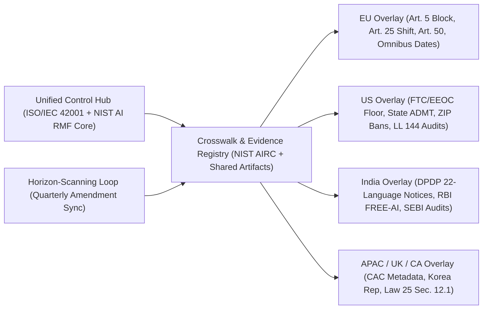

# Chapter 20: The Global Regulatory Landscape

*Part VI: Regulation & Compliance*

> **In this chapter**
>
> * How the **EU AI Act** pairs risk tiers and **Article 25** role shifts with **GPAI** duties, **Digital Omnibus** dates (`Dec 2027`/`Aug 2028`), and `7%` fines.
> * How **U.S.** deregulation (`EO 14179`, `M-25-21`) coexists with `FTC`/`EEOC`/`CFPB`/`SEC` enforcement and **CA**, **CO** (`SB 26-189`), **IL**, **TX**, **UT**, and **NYC** laws.
> * How **India** governs AI via **DPDP Act & Rules**, **MeitY Guidelines**, **RBI FREE-AI**, and **SEBI/IRDAI** audits.
> * How **China**, **South Korea**, **Japan**, **Singapore**, the **UK**, and **Canada** diverge across filings, **AI Basic Act**, soft law, **Agentic AI**, and **Québec Law 25**.
> * How global teams **"build once, comply many times"** on an **ISO/IEC 42001** / **NIST AI RMF** hub.

**From engineering controls to cross-border liability.** Chapters 15–19 addressed output failures—inaccuracy, bias, automation bias, opacity, and IP risk. Chapter 20 opens *Part VI: Regulation & Compliance* by mapping the rules governing global operation as of November 2026, where one workflow built in the U.S. and customized in Bengaluru can trigger five legal regimes in a single query.

---

### Illustrative Composite Scenario: One Platform, Six Regulators

A B2B fintech deploys a vendor frontier LLM for hiring triage and SME credit scoring across six countries, assuming `"EU compliance sign-off"` covers global expansion. Within ninety days, six parallel gaps emerge:

* **Frankfurt:** Fine-tuning and white-labeling the credit score triggers **Article 25**, shifting full **EU high-risk provider** obligations onto the buyer.
* **Chicago & New York:** Retaining postal codes and skipping annual audit links violates **Illinois HB 3773** ZIP-proxy bans and **NYC Local Law 144** notice duties.
* **Bengaluru:** Bundled signup consent breaches **India DPDP** standalone **Eighth Schedule** notice rules, while bank clients demand **RBI FREE-AI** audit packs.
* **Seoul:** Scale crosses **South Korea AI Basic Act** thresholds requiring High-Impact disclosures, synthetic marks, and a **domestic local representative**.
* **Montréal:** Automated rejections omit mandatory **Québec Law 25 § 12.1** human-review notices after HR wrongly assumed `AIDA` was the only Canadian risk.
* **Shanghai:** Localized explainers ship without China **CAC** explicit watermarks and `GB 45438-2025` header metadata.

*(This composite scenario is illustrative; it is not drawn from a specific organization or incident.)*

---

## 20.1 EU AI Act: Risk Tiers, Deployer-to-Provider Shifts (Art. 25), GPAI Obligations, Timelines, and Penalties

**Regulation (EU) 2024/1689**—the **EU Artificial Intelligence Act**—is the first comprehensive horizontal AI statute.[^c20-01] Under **Article 2(1)**, its reach is global: any non-EU organization whose AI system is placed on the EU market—or whose **outputs are used inside the Union** (such as offshore scoring affecting European applicants or borrowers)—falls directly within scope.

The Act assigns compliance duties across four risk tiers and two primary roles (**providers** developing or marketing AI; **deployers** operating it):

1. **Unacceptable Risk (`Article 5`, active Feb 2, 2025):** Flatly prohibited, including subliminal manipulation exploiting vulnerabilities, social scoring, untargeted facial scraping, biometric categorization of sensitive attributes, and **emotion recognition in workplaces and education** (outside narrow safety/medical exceptions). Staff **AI literacy** (`Article 4`) entered application simultaneously.
2. **High Risk (`Annex I` & `Annex III`):** Subject to mandatory risk management, bias/data governance (`Article 10`), technical files, logging, robustness/cybersecurity validation, CE marking, EU registration, and **human oversight** (`Article 14`) including safe-halt controls. Deployers in creditworthiness, banking, life/health insurance, and public services must also complete a pre-deployment **Fundamental Rights Impact Assessment (`FRIA`, Article 27)**.
3. **Transparency Obligations (`Article 50`, active Aug 2, 2026):** Requires interactive chatbot disclosures, deepfake labeling, and machine-readable synthetic-content marking across audio, image, video, and text (detailed in Chapter 18).
4. **Minimal Risk:** Unregulated by mandatory AI Act obligations, remaining subject to GDPR and consumer law.

```
[Feb 2, 2025]         [Aug 2, 2025]         [Aug 2, 2026]         [Dec 2, 2027]            [Aug 2, 2028]
Art. 4 AI Literacy -> GPAI Model Rules   -> Art. 50 Transparency -> Annex III High-Risk  -> Annex I Product AI
Art. 5 Prohibitions   (Arts. 53 & 55)       (Labels & Bots)       (HR, Credit, Biometrics)  (Medical, Auto)
[IN FORCE]            [IN FORCE]            [IN FORCE]            [OMNIBUS DEFERRED]        [OMNIBUS DEFERRED]
```

**The `Article 25` Deployer-to-Provider Shift:** Enterprises routinely assume vendors retain provider duties forever. Under **Article 25(1)**, a downstream deployer **becomes the legal Provider**—inheriting full conformity-assessment, technical-file, and post-market monitoring obligations—if it:

* Places its **own name or trademark** on an already-marketed high-risk system;
* Makes a **`substantial modification`** (`Article 3(23)`) altering intended safety or compliance behavior (such as heavy fine-tuning or changing risk thresholds); or
* Modifies the **intended purpose** of a non-high-risk or GPAI system so it becomes **high-risk** (e.g., wrapping a commercial LLM into hiring or credit underwriting).

While Article 25(2) obligates original providers to share testing and documentation, that cooperation duty vanishes if the upstream vendor contractually forbade high-risk repurposing.

**GPAI Obligations (`Chapter V`):** Active since **August 2, 2025**, general-purpose AI model providers (`Articles 53` and `55`) must keep technical documentation current, enforce EU copyright TDM opt-out policies, and publish a **public summary of training content** using the EU AI Office's **July 24, 2025 three-part template** covering data provenance, copyright filters, and illegal-content safeguards.[^c20-02] Models exceeding `10^25` FLOPs of compute carry **systemic-risk** duties covering red-teaming, evaluations, cybersecurity hardening, and incident reporting.

**Digital Omnibus Timelines (`Regulation (EU) 2026/1744`):** Roadmaps relying on `"August 2026"` for all high-risk compliance are obsolete. Following delayed harmonised standards, Brussels adopted the **Digital Omnibus on AI** (`Official Journal`, **July 24, 2026**), deferring stand-alone **Annex III high-risk duties to December 2, 2027** and product-embedded **Annex I duties to August 2, 2028**.[^c20-03] Crucially, **Article 5 prohibitions (`Feb 2025`), GPAI obligations (`Aug 2025`), and Article 50 transparency (`Aug 2026`) remain live today**.

**Tiered Penalties (`Articles 99 & 101`):** Violations expose enterprises to maximum fines of **`€35 million` or `7%` of global annual turnover** (prohibited practices), **`€15 million` or `3%`** (high-risk, deployer, Article 50, or GPAI breaches), and **`€7.5 million` or `1%`** (misleading authorities), with SMEs capped at the lower figure.

### The Guardrails

1. **Gate `Article 25` Triggers Before Customization:** Require Legal and Architecture approval before white-labeling, substantially modifying, or repurposing foundation models into Annex III use cases ([^c20-01]).
2. **Hard-Block `Article 5` Banned Uses:** Configure project intake workflows to reject workplace emotion detection, untargeted facial scraping, and social scoring outright.
3. **Run Dual-Speed Digital Omnibus Schedules:** Enforce `Article 50` disclosures and `Article 53(1)(d)` GPAI vendor summary verification immediately ([^c20-02]), while phasing Annex III documentation and FRIAs toward **December 2, 2027** ([^c20-03]).

---

## 20.2 United States: Federal Policy and the Patchwork of State and Local Laws

In the United States, absence of an omnibus `"U.S. AI Act"` never means unregulated deployment. Enterprise obligations sit across two distinct forces: **federal executive deregulation alongside aggressive enforcement under existing statutes**, and a **fast-churning mosaic of state and municipal mandates**.

**Federal Deregulation vs. Statutory Enforcement:** Signed **January 23, 2025**, **Executive Order 14179** (*Removing Barriers to American Leadership in Artificial Intelligence*, `90 Fed. Reg. 8741`) revoked EO 14110 reporting mandates to prioritize national AI competitiveness.[^c20-04] For federal civilian agencies, **OMB Memorandum M-25-21** (`April 3, 2025`, replacing `M-24-10`) streamlined internal acquisition barriers while preserving **Chief AI Officers (`CAIOs`)** and senior **AI Governance Boards** over high-impact federal systems.[^c20-05]

However, executive orders cannot suspend statutes enforced by federal agencies:

* **FTC (`Section 5 FTC Act`):** Prosecutes deceptive AI efficacy claims, dark patterns, and unconsented biometric scraping.
* **EEOC & DOJ (`Title VII`, `ADA`, `ADEA`):** Holds employers liable when automated hiring tools create unlawful disparate impact (`iTutorGroup`, `Workday`).
* **CFPB (`ECOA` / `FCRA`):** Enforces specific adverse-action notices in algorithmic lending regardless of model complexity.
* **SEC & Banking Regulators (`Advisers Act`, `Fed SR 11-7` / `SR 26-2`):** Sanctions `"AI-washing"` disclosures and enforces rigorous **model risk management** inventorying and validation across banks.

**State & Municipal Patchwork—And Rapid Legislative Churn:**

* **Colorado (`SB 24-205` → `SB 25B-004` → `SB 26-189`):** Colorado demonstrates why static state compliance matrices fail. Enacted in May 2024 as a comprehensive high-risk AI `"duty of care"` statute (`SB 24-205`), delayed in August 2025 (`SB 25B-004`) to June 2026, Colorado's law was **completely repealed and replaced on May 14, 2026 by `SB 26-189`**—stripping broad risk-management mandates in favor of an Automated Decision-Making Technology (`ADMT`) consumer-disclosure and rights regime effective **January 1, 2027** (while Colorado Division of Insurance **Regulation `10-1-1`** remains separately enforceable for life insurers).[^c20-06]
* **California's Three-Track Stack (`AB 2013`, `SB 942`/`AB 853`, `CPPA ADMT`):** California regulates AI across three overlapping instruments:[^c20-07] **`AB 2013`** (effective **January 1, 2026**), requiring public training-dataset documentation; **`SB 942` / `AB 853`** (*California AI Transparency Act*, amended via `AB 853` to take operative effect **August 2, 2026** alongside EU Art. 50), requiring large GenAI providers (`> 1M` monthly users) to embed latent provenance and offer free detection tools; and **CPPA `CCPA ADMT` Regulations** (approved Sept 22, 2025, effective **January 1, 2026** with risk-assessment and opt-out/appeal duties phasing through **2027** and initial cybersecurity audit filings beginning **April 1, 2028**).
* **Illinois `HB 3773` (`PA 103-0804`, effective `January 1, 2026`):** Amends the **Illinois Human Rights Act (`775 ILCS 5/2-101`, `5/2-102(L)`)**, prohibiting discriminatory employment AI across hiring, promotion, discipline, and discharge, requiring applicant/worker notice, and **explicitly banning ZIP codes as protected-class proxies**.[^c20-08]
* **NYC `Local Law 144` (enforced since `July 5, 2023`):** Requires an **annual independent intersectional bias audit**, public website summary, and **10-business-day notice** for automated hiring tools (`AEDTs`).[^c20-09]
* **Texas `TRAIGA` (`HB 149`, effective `January 1, 2026`) & Utah (`SB 149`/`SB 226`):** Texas adopted an **intent-based liability** model alongside focused public-sector and healthcare guardrails,[^c20-10] while Utah mandates consumer and regulated-occupation GenAI disclosures (`healthcare`, `law`, `mental health`).[^c20-11]

### The Guardrails

1. **Preserve Federal Statutory Floors:** Maintain `EEOC` disparate-impact testing, `ECOA` adverse-action reasons, `FTC` substantiation, and banking `SR 11-7` governance independently of executive deregulation ([^c20-04]).
2. **Automate ZIP-Code & Proxy Blocking:** Enforce CI/CD feature linters excluding postal codes and correlated geographic proxies across U.S. HR/credit models to satisfy **Illinois `HB 3773`** ([^c20-08]).
3. **Deploy NYC `LL 144` + California `ADMT`/`AB 853` as the U.S. Operational Floor:** Run annual independent hiring audits ([^c20-09]), expose geo-configurable pre-use opt-out/appeal flows, ship `SB 942` detection hooks ([^c20-07]), and review repealing/amending bills quarterly ([^c20-06]).

---

## 20.3 India: DPDP Act & Rules, MeitY AI Governance Guidelines, and Sector Regulators

India demonstrates how an economy can establish forceful AI accountability without passing a standalone omnibus AI Act—combining comprehensive privacy enforcement, cross-sector `"techno-legal"` guidelines, and binding financial-regulator supervision.

**Data Privacy Core (`DPDP Act, 2023` & `DPDP Rules, 2025`):** Notified in November 2025, the **DPDP Rules, 2025** operationalize three strict obligations for Indian AI data pipelines:[^c20-12]

* **Standalone Multilingual Consent (`Section 6`):** Organizations may not bundle AI training or profiling consent into generic terms. Data Fiduciaries must deliver clear, itemized, standalone notices in **English or any of the 22 Eighth Schedule languages**, securing affirmative consent with frictionless withdrawal.
* **Synchronized Breach Notification:** Personal-data exposure in prompts, logs, or RAG stores triggers reporting to both the **Data Protection Board (`DPB`) of India** and affected **Data Principals**, alongside **CERT-In's 6-hour cybersecurity incident clock**.
* **Negative-List Transfers & Sectoral Localization (`Section 16`):** Cross-border transfers remain permitted by default unless barred by central negative list, yet **Section 16(2) preserves stricter sectoral localization**—keeping RBI payment and telecom datasets anchored domestically unless legally cleared.

**National Policy — MeitY `India AI Governance Guidelines` (`November 5, 2025`):** Issued under the *IndiaAI Mission*, MeitY declined a rigid standalone AI statute in favor of a **"techno-legal"** model pairing technical safeguards with enforcement under the **IT Act, 2000** and **DPDP Act**.[^c20-13] Anchored on **Seven Sutras** (*Trust, People First, Innovation over Restraint, Fairness & Equity, Accountability, Understandable by Design, Safety/Resilience/Sustainability*) and six pillars—explicitly covering **agentic AI**—the guidelines stand up an **Inter-Ministerial AI Governance Group** and the **India AI Safety Institute**.

**Sectoral Supervision (`RBI FREE-AI`, `SEBI`, `IRDAI`):** While MeitY coordinates national policy, financial regulators drive immediate compliance rigor:

* **RBI `FREE-AI` Committee Report (`August 13, 2025`):** Chaired by Prof. Pushpak Bhattacharyya, the Reserve Bank of India's blueprint documented **`20.8%` active AI deployment** and **`67%` exploration** across regulated entities and set **7 Sutras and 26 actionable recommendations** across six pillars (*Infrastructure, Policy, Capacity, Governance, Protection, Assurance*).[^c20-14] Banks, NBFCs, and payment entities are expected to maintain board-approved AI policies, centralized model inventories, red-teaming, third-party vendor governance, consumer-protection controls, and independent audit trails.
* **SEBI (`LODR Reg. 21` & Annual System Audits):** India's top 1,000 listed companies already anchor technology and cyber oversight inside board **Risk Management Committees** under **SEBI LODR Regulation 21**.[^c20-15] In 2025, SEBI extended accountability across market intermediaries by integrating AI/ML systems into mandatory **annual system audits**, holding compliance officers directly accountable for client bots and algorithmic decisions.
* **IRDAI:** Enforces underwriting explainability, policyholder protection, bias testing, and vendor governance across automated insurance workflows via existing outsourcing and cyber frameworks.

### The Guardrails

1. **Enforce `DPDP Section 6` Consent Lineage Before Indian Data Ingestion:** Block personal data lacking verified, unbundled Eighth-Schedule consent artifacts from training or RAG indexes ([^c20-12]).
2. **Route Regulated Workloads Under `Section 16(2)` Localization:** Keep Indian payment, banking, and regulated telemetry on domestic inference endpoints unless counsel clears cross-border routing.
3. **Operationalize `RBI FREE-AI` & `SEBI` Audit Readiness:** Maintain one centralized AI inventory, board RMC charter alignment ([^c20-15]), vendor red-team packs, and annual AI audit evidence ([^c20-14]), integrated with `CERT-In 6-hour` + `DPB` incident playbooks.

---

## 20.4 Asia-Pacific and Beyond: China, South Korea, Japan, Singapore, the UK, and Canada

Six additional jurisdictions show how global AI compliance divides into distinct archetypes:

* **China (`CAC 2023` & `2025 Labeling Measures`):** Beijing enforces binding rules led by the **Cyberspace Administration of China (`CAC`)**.[^c20-16] The **2023 *Interim Measures for Generative AI Services*** (`Aug 15, 2023`) require public-facing services carrying `"public opinion or social mobilization"` attributes to clear **algorithm filings and security assessments** before launch. Since **September 1, 2025**, the *Measures for Labeling of AI-Generated Synthetic Content* and Mandatory Standard **`GB 45438-2025`** require both **explicit user-facing marks** and **implicit header metadata** (`ContentProducer`, `ContentPropagator`).
* **South Korea (`AI Basic Act`, effective `January 22, 2026`):** Enacted under the *Framework Act on the Development of Artificial Intelligence and Establishment of Trust*, South Korea establishes a National AI Committee and Safety Research Institute, regulates **"High-Impact AI"** (risk management, notice, human oversight), mandates GenAI output labels, and requires qualifying foreign providers to appoint a **domestic local representative**.[^c20-17]
* **Japan (`AI Promotion Act`, enacted `May 28, 2025`):** Takes a light-touch, innovation-first statutory path anchored by a Cabinet **AI Basic Plan** without EU-style fines, relying on agile soft-law guidance plus privacy, copyright, and consumer laws.[^c20-18]
* **Singapore (`IMDA Agentic AI Framework` & `AI Verify`):** Combines flexible guidance with open-source technical test suites.[^c20-19] Following its 2024 GenAI framework, IMDA launched the world's first ***Model AI Governance Framework for Agentic AI*** at **WEF Davos in January 2026** (bounding risks upfront, meaningful human accountability, technical controls, lifecycle tracking), backed by **AI Verify** and the *Starter Kit for Testing Agentic Systems*.
* **United Kingdom (`DSIT`, `DRCF`, & `Data (Use and Access) Act 2025`):** Coordinates five cross-sector **DSIT** principles through existing watchdogs (**ICO**, **FCA** Consumer Duty/`SM&CR`, **CMA**, **Ofcom**) via the **Digital Regulation Cooperation Forum (`DRCF`)**.[^c20-20] The **Data (Use and Access) Act 2025 (`2025 c. 18`, Royal Assent June 19, 2025)** widens permissible UK GDPR commercial bases for automated decisions while preserving mandatory transparency, contestation, and human-intervention safeguards.[^c20-21]
* **Canada (Expired `Bill C-27 / AIDA` vs. Binding `Québec Law 25`):** Federal **Bill C-27** (`CPPA` and proposed `AIDA`) **died on the Order Paper upon prorogation on January 6, 2025**, leaving zero enacted federal AI statute (invalidating vendor `"AIDA-compliant"` claims). Enforceable obligations stem from `PIPEDA` and provincial rules—chiefly **Québec `Law 25` (`CQLR c. P-39.1, § 12.1`)**:[^c20-22] exclusively automated decisions require pre-decision notice, factor explanations on request, and human reconsideration, with penalties up to **`C$10 million` or `2%` of global turnover**.

#### Table 20.1 — Global AI Regulatory Archetypes (as of November 2026)

| Jurisdiction | Model | Core Instruments | Signature Triggers | Key Dates & Ceilings |
| :--- | :--- | :--- | :--- | :--- |
| **European Union** | Omnibus risk statute | EU AI Act (`2024/1689`); Digital Omnibus (`2026/1744`) | `Art. 25` shifts, GPAI summaries, `Art. 50`, `FRIA` | Bans Feb 2025; GPAI Aug 2025; `Art. 50` Aug 2026; Annex III Dec 2027; Annex I Aug 2028; `€35M`/`7%` |
| **United States** | EO deregulation + legacy enforcement + states | `EO 14179`; `M-25-21`; FTC/EEOC/CFPB/SEC; CA/CO/IL/TX/UT/NYC | Federal bias/deception floor; `CA SB 942`/ADMT; `IL` ZIP ban; `NYC LL 144`; `CO SB 26-189` | `CA AB 2013`/ADMT, `IL`, `TX`: Jan 2026; `SB 942`: Aug 2026; `CO SB 26-189`: Jan 2027 |
| **India** | Techno-legal privacy + sector rules | `DPDP Act & Rules 2025`; MeitY; `RBI FREE-AI`; `SEBI LODR` | 22-language notices; `Sec. 16(2)` localization; 26 RBI points; SEBI audits | DPDP Nov 2025; RBI Aug 2025; MeitY Nov 2025; CERT-In `6h` |
| **China** | Agency filings & metadata standards | CAC GenAI (2023); Synthetic Labeling (2025) & `GB 45438-2025` | Public-opinion security filings + explicit/implicit provenance | GenAI Aug 2023; Labeling & `GB 45438-2025` Sept 1, 2025 |
| **South Korea** | National AI statute | *AI Basic Act* (2025/2026) | High-Impact controls, GenAI marks, local domestic representative | Effective **January 22, 2026** |
| **Japan** | Light-touch promotion statute | *AI Promotion Act* (2025) & *AI Basic Plan* | Research cooperation without EU-style administrative fines | Enacted **May 28, 2025** |
| **Singapore** | Practical governance & open tooling | IMDA *MGF GenAI* (2024), *Agentic AI* (Jan 2026), *AI Verify* | Bounded agent autonomy, human accountability, test suites | Agentic Framework **Jan 2026** |
| **United Kingdom** | Sector regulators + permissive ADM | DSIT Principles; DRCF; *DUAA 2025* (`c. 18`) | Broader UK GDPR ADM bases + contestation & review rights | *DUAA* Royal Assent **June 19, 2025** |
| **Canada** | Federal privacy + provincial ADM | `PIPEDA`; *Québec Law 25 § 12.1* (`Bill C-27` expired Jan 2025) | Pre-decision notices, factor explanation, human reconsideration | Law 25 active Sept 2023; **`C$10M`/`2%`** |

### The Guardrails

1. **Clear China Filings & Korean Local-Rep Gates Pre-Launch:** Hold public GenAI launches pending CAC clearance and verify Korean local-representative thresholds before entry ([^c20-16], [^c20-17]).
2. **Parameterize Provenance Headers:** Configure visible marks alongside `C2PA` and `GB 45438-2025` metadata inside one generation pipeline ([^c20-16]).
3. **Integrate `AI Verify` Agentic Suites:** Embed Singapore's January 2026 agentic safety tests inside CI/CD ([^c20-19]).
4. **Standardize ADM Appeals & Scrub `AIDA` Claims:** Deploy automated-decision notices and human review for **Québec Law 25 § 12.1** and UK **DUAA**, deleting expired `Bill C-27` references ([^c20-21], [^c20-22]).

---

## 20.5 Managing Compliance Across Jurisdictions: Build Once, Comply Many Times

Building separate country-by-country compliance stacks fails immediately under global product velocity, extraterritorial inference, and amendment churn (`Digital Omnibus`, `SB 26-189`, `AB 853`). Sustainable global AI programs replace regional silos with a **Hub-and-Spoke Compliance Architecture: build once at the technical control hub, comply many times via regional delta overlays**.

1. **The Core Control Hub ("Build Once"):** Anchor engineering, security, and risk governance on **ISO/IEC 42001:2023** (certifiable AI Management System across 38 Annex A controls)[^c20-23] and **NIST AI RMF 1.0** (*Govern, Map, Measure, Manage*).[^c20-24] Using **NIST AI Resource Center (`AIRC`) crosswalks**,[^c20-25] one unified operational artifact generates evidence across dozens of regulations simultaneously:
   * **Single AI Inventory & Role Register:** Feeds EU risk tiers/`Article 25` checks, `RBI FREE-AI`, `OMB M-25-21`, South Korea High-Impact logs, and `Fed SR 11-7`.
   * **Single Evaluation & Red-Team Evidence Pack:** Satisfies `NYC LL 144` impact ratios, `EEOC` validation, Illinois proxy scans, Singapore `AI Verify` tests, and EU technical documentation.
   * **Single Appeal, Override & Audit Trail:** Serves EU `Arts. 14/86`, Québec `Law 25 § 12.1`, UK `DUAA`, California `CCPA ADMT`, and `CFPB ECOA` notices.
2. **Jurisdictional Delta Modules ("Comply Many Times"):** Isolate genuinely unique statutory obligations into tenant-scoped configuration overlays rather than separate application codebases—covering EU `Art. 5` blocks / `FRIA` / `Dec 2027` filings; U.S. `LL 144` public postings / `IL` ZIP blocks / `CA ADMT` & `SB 942` tools; India `DPDP` 22-language notices / `Section 16(2)` localization / `CERT-In 6h` clocks; and APAC China `GB 45438-2025` metadata, Korean local reps, and Québec notices.



*Caption: Hub-and-spoke global AI compliance architecture. One unified control and evidence hub anchored on `ISO/IEC 42001` and `NIST AI RMF` feeds feature-flagged regional overlays kept current by quarterly horizon-scanning.*

### The Guardrails

1. **Tag Controls Once to Multiple Statutes:** Maintain one GRC control-to-statute crosswalk (`ISO 42001` / `NIST AIRC`) so engineering builds evidence once per deployment ([^c20-23], [^c20-25]).
2. **Drive Notices, Opt-Outs & Metadata via Policy Config:** Manage `DPDP` languages, `CA/CO/QC` automated-decision banners, and `GB 45438-2025` headers through tenant flags ([^c20-24]).
3. **Run Quarterly Legislative Delta Syncs:** Review amending laws (`2026/1744`, `SB 26-189`, `AB 853`) quarterly across Legal and Platform Ops before procurement or architecture lock-in.
4. **Standardize Cross-Border Vendor Rider Clauses:** Require model suppliers to deliver `Article 53(1)(d)` summaries, local APAC filing cooperation, `Article 25` change warnings, and residency controls.

---

## Why Every Role Cares

| Role | Primary Stakes in This Chapter | First Actions to Take |
| :--- | :--- | :--- |
| **Board / Risk Committee** | Turnover fines up to `7%` (`EU`), `C$10M`/`2%` (`Québec`), and `RBI`/`SEBI` oversight make compliance fragmentation a material financial risk. | Mandate quarterly horizon-scanning tied to an **ISO/IEC 42001** / **NIST AI RMF** control hub. |
| **General Counsel / Regulatory** | `Digital Omnibus` deferrals, `CO SB 26-189` repeal, `Bill C-27` expiration, and `Article 25` shifts invalidate static 2024 memos. | Maintain a live crosswalk connecting EU, U.S. state, India, UK, Québec, and APAC overlays. |
| **CIO / CAIO** | Country codebase forks slow launches, while white-labeling or fine-tuning triggers EU `Article 25` provider obligations. | Standardize one core platform hub with feature-flagged regional banners and an `Art. 25` gate. |
| **CDO / DPO** | Cross-border training and RAG collide with `India DPDP` 22-language notices, `Sec. 16(2)` localization, `CA ADMT`, UK `DUAA`, and GDPR. | Tag consent lineage, residency, and opt-out eligibility at data ingestion. |
| **CISO / Platform Engineering** | Proxy linters (`IL`), `GB 45438-2025` / `CA SB 942` metadata, `AI Verify` tests, and `CERT-In 6h` paging execute in code. | Automate feature-store proxy checks, provenance headers, and gateway audit trails. |
| **CFO / Commercial Leads** | Missing Korean local reps, China CAC clearances, or false `"AIDA compliance"` claims halt market entry. | Gate commercial billing in new markets on verified filings, reps, and local audits. |

---

## Chapter Summary

| Section | Core Regulatory Reality | Mandatory Enterprise Guardrail | Primary Anchors |
| :--- | :--- | :--- | :--- |
| **European Union** (`20.1`) | Global output reach; `Art. 25` role shifts; GPAI summaries; Omnibus defers Annex III/I (`2027/2028`); fines up to `€35M`/`7%`. | Gate `Art. 25` edits, block `Art. 5` bans, enforce `Art. 50` & GPAI checks now, track `Dec 2027`. | [^c20-01], [^c20-02], [^c20-03] |
| **United States** (`20.2`) | Federal `EO 14179` coexists with active `FTC`/`EEOC`/`CFPB`/`SEC` cases and churning states (`CO SB 26-189`, `CA`, `IL`, `NYC`, `TX`, `UT`). | Enforce federal bias/deception baseline, strip `IL` ZIP proxies, run `LL 144` audits, toggle `CA`/`CO` overlays. | [^c20-04]–[^c20-11] |
| **India** (`20.3`) | Techno-legal stack: `DPDP` 22-language consents & localization + **MeitY** Seven Sutras + **RBI FREE-AI** & **SEBI/IRDAI** audits. | Capture standalone `DPDP` consent, enforce `Sec. 16(2)` residency, run `RBI`/`SEBI` annual audits & `CERT-In 6h` paging. | [^c20-12]–[^c20-15] |
| **APAC, UK & Canada** (`20.4`) | Divergent models: China CAC/`GB 45438-2025`, Korea local rep, Japan promotion, Singapore *Agentic MGF*, UK `DUAA`, Québec `Law 25`. | Clear China/Korea pre-launch gates, run `AI Verify` agent tests, strip `AIDA` claims, ship `Law 25`/`DUAA` appeals. | [^c20-16]–[^c20-22] |
| **Cross-Border Hub** (`20.5`) | Siloed country stacks fail under overlap and amendment churn; shared controls feed configurable overlays. | Anchor core engineering on `ISO 42001` & `NIST AI RMF` via `AIRC` crosswalks with policy-config overlays. | [^c20-23]–[^c20-25] |

---

## Key Takeaways

1. **Track amending statutes, not launch slides.** `Regulation 2026/1744`, Colorado `SB 26-189`, California `AB 853`, and `Bill C-27`'s expiration reset 2024 compliance calendars.
2. **Treat `Article 25` as a release gate.** Rebranding, substantially modifying, or repurposing vendor models into Annex III domains triggers provider duties.
3. **Deregulation never suspends legacy U.S. law.** `EEOC`, `FTC`, `CFPB`, `SEC`, bank rules, `IL HB 3773`, `NYC LL 144`, and `CA ADMT` remain actively enforced.
4. **No omnibus AI Act still means binding enforcement.** India (`DPDP`, `RBI`, `SEBI`), the UK (`DUAA`, `ICO`, `FCA`), and Canada (`Québec Law 25 § 12.1`) impose strict operational duties.
5. **Metadata and agents face direct rules.** China `GB 45438-2025`, California `SB 942`, EU `Art. 50`, and Singapore's *Agentic AI Framework* regulate runtime provenance and autonomy.
6. **Build one `ISO 42001`/`NIST AI RMF` hub.** Map evidence once and toggle regional disclosures, residency rules, and filings per country.

---

## Questions to Ask
| Stakeholder | Diagnostic Question | What a Credible Answer Looks Like |
| :--- | :--- | :--- |
| **General Counsel** | *"Which customized workflows risk EU `Article 25` provider shifts, and do timelines reflect `2026/1744` and `CO SB 26-189`?"* | Role classifications per AI system, GPAI `Art. 53(1)(d)` checks, and a refreshed 2026–2028 regulatory calendar. |
| **CHRO** | *"Do hiring models serving Illinois, NYC, or Québec strip ZIP codes, publish annual bias audits, and provide `§ 12.1` human-review notices?"* | Automated proxy bans (`IL`), linked bias-audit summaries (`NYC`), and active automated-decision appeals (`QC`/`CA`). |
| **CDO / India Lead** | *"Are Indian AI flows gated by unbundled 22-language `DPDP § 6` consents, `§ 16(2)` localization, and `RBI FREE-AI` audit records?"* | Verified consent lineage, India-only financial routing, and audit-ready inventories (`RBI`/`SEBI`). |
| **VP Engineering** | *"Do synthetic outputs toggle `C2PA`/`GB 45438-2025`/`SB 942` metadata cleanly, and do agents pass Singapore `AI Verify` tests?"* | Policy-configured provenance headers per market plus automated CI/CD agent safety harnesses. |
| **CIO / GRC Owner** | *"Can GRC export one `ISO 42001`/`NIST AI RMF` evidence pack mapped across laws instead of country spreadsheets?"* | Live crosswalk linking shared inventories, bias reports, logs, and overrides to regional overlays. |

---

## References

[^c20-01]: European Parliament and Council of the European Union, *Regulation (EU) 2024/1689 of 13 June 2024 Laying Down Harmonised Rules on Artificial Intelligence (Artificial Intelligence Act)*, OJ L, 2024/1689, July 12, 2024, http://data.europa.eu/eli/reg/2024/1689/oj. **Annotation:** Comprehensive horizontal EU AI statute establishing risk tiers, `Article 25` deployer-to-provider shifts, GPAI obligations, extraterritorial reach on EU outputs, and penalties up to `€35 million` or `7%` of global turnover. [↗ Bibliography](../bibliography.md#eu-2024-ai-act)

[^c20-02]: European Commission and European AI Office, *Explanatory Notice and Template for the Public Summary of Training Content for General-Purpose AI Models*, Brussels, July 24, 2025, https://digital-strategy.ec.europa.eu/en/library/explanatory-notice-and-template-public-summary-training-content-general-purpose-ai-models. **Annotation:** Operationalizes EU AI Act `Article 53(1)(d)` into a standardized public template covering training-data sources, copyright opt-out compliance, and content-moderation safeguards. [↗ Bibliography](../bibliography.md#ec-2025-gpai-template)

[^c20-03]: European Parliament and Council of the European Union, *Regulation (EU) 2026/1744 Amending Regulation (EU) 2024/1689 (Digital Omnibus on AI)*, Official Journal of the European Union, July 24, 2026. **Annotation:** Adopted EU amendment deferring stand-alone Annex III high-risk AI obligations to `December 2, 2027` and Annex I regulated-product high-risk AI obligations to `August 2, 2028`, while keeping prohibited practices, GPAI, and `Article 50` transparency on schedule. [↗ Bibliography](../bibliography.md#eu-2026-digital-omnibus)

[^c20-04]: Executive Office of the President of the United States, Executive Order 14179, *Removing Barriers to American Leadership in Artificial Intelligence*, 90 Fed. Reg. 8741, signed January 23, 2025. **Annotation:** Rescinds prior federal safety-reporting mandates in favor of an innovation-led AI Action Plan while leaving existing statutory enforcement (`FTC`, `EEOC`, `CFPB`, `SEC`) intact. [↗ Bibliography](../bibliography.md#us-eo-14179)

[^c20-05]: Office of Management and Budget, *Accelerating Federal Use of AI through Innovation, Governance, and Public Trust*, Memorandum M-25-21, Washington, DC, April 3, 2025, https://www.whitehouse.gov/wp-content/uploads/2025/02/M-25-21-Accelerating-Federal-Use-of-AI-through-Innovation-Governance-and-Public-Trust.pdf. **Annotation:** Replaces OMB M-24-10, preserving civilian agency `CAIO` roles and executive AI Governance Boards while streamlining federal deployment requirements. [↗ Bibliography](../bibliography.md#omb-2025-m25-21)

[^c20-06]: State of Colorado, *Consumer Protections for Artificial Intelligence* (`SB 24-205`, enacted May 2024; delayed via `SB 25B-004`, August 28, 2025; repealed and replaced by `SB 26-189`, signed May 14, 2026). **Annotation:** Demonstrates U.S. state regulatory churn—replacing Colorado's comprehensive `SB 24-205` duty-of-care AI statute with a narrower ADMT consumer-disclosure and rights regime effective `January 1, 2027`. [↗ Bibliography](../bibliography.md#co-2026-sb189)

[^c20-07]: State of California, *AB 2013* (Generative AI Training Data Transparency, effective Jan 1, 2026), *SB 942 / AB 853* (California AI Transparency Act, operative Aug 2, 2026), and CPPA *CCPA Automated Decisionmaking Technology (ADMT) Regulations* (approved Sept 22, 2025; effective Jan 1, 2026). **Annotation:** Layered California AI compliance framework combining public training-data disclosures, synthetic provenance and detection duties, and phased privacy/opt-out/audit mandates. [↗ Bibliography](../bibliography.md#ca-2026-ai-laws)

[^c20-08]: State of Illinois, *House Bill 3773* (Public Act 103-0804, amending Illinois Human Rights Act `775 ILCS 5/2-101` and `5/2-102(L)`), signed August 9, 2024, effective January 1, 2026. **Annotation:** Prohibits discriminatory AI across all employment decisions, requires employee/applicant notice, and explicitly forbids using ZIP codes as protected-class proxies. [↗ Bibliography](../bibliography.md#il-2026-hb3773)

[^c20-09]: City of New York, *Local Law 144 of 2021 (Automated Employment Decision Tools)*, N.Y.C. Admin. Code §§ 20-870–20-874, and DCWP Rules, 6 RCNY §§ 5-300–5-304, enforced from July 5, 2023, https://www.nyc.gov/site/dca/about/automated-employment-decision-tools.page. **Annotation:** Pioneering municipal hiring-AI law mandating annual independent intersectional bias audits, public summaries, and 10-business-day candidate notice. [↗ Bibliography](../bibliography.md#nyc-2021-ll144)

[^c20-10]: State of Texas, *Texas Responsible Artificial Intelligence Governance Act (TRAIGA)*, House Bill 149, signed June 22, 2025, effective January 1, 2026. **Annotation:** State AI governance framework adopting an intent-based liability model paired with targeted restrictions on healthcare and public-sector AI deployments. [↗ Bibliography](../bibliography.md#tx-2026-traiga)

[^c20-11]: State of Utah, *Artificial Intelligence Policy Act*, Senate Bill 149 (refined via SB 226), effective May 1, 2024. **Annotation:** Pairs upon-request consumer generative AI disclosures with mandatory proactive notices in licensed healthcare, legal, and mental-health settings alongside an Office of AI Policy sandbox. [↗ Bibliography](../bibliography.md#utah-2024-sb149)

[^c20-12]: Parliament of India and Ministry of Electronics and Information Technology, *The Digital Personal Data Protection Act, 2023* (Act No. 22 of 2023) and *Digital Personal Data Protection Rules, 2025* (notified November 2025). **Annotation:** Mandates unbundled Section 6 consents with Eighth Schedule language notices, dual breach intimation to the DPB and Data Principals, and negative-list cross-border rules subordinated to sectoral localization (`Section 16(2)`). [↗ Bibliography](../bibliography.md#india-2023-dpdp)

[^c20-13]: Ministry of Electronics and Information Technology (MeitY), *India AI Governance Guidelines* (IndiaAI Mission), New Delhi, November 5, 2025, https://indiaai.gov.in/. **Annotation:** Cross-sector Indian national blueprint choosing a "techno-legal" governance approach under existing laws anchored on Seven Sutras and institutional AI safety oversight. [↗ Bibliography](../bibliography.md#meity-2025-ai-guidelines)

[^c20-14]: Reserve Bank of India (Committee to Develop a Framework for Responsible and Ethical Enablement of Artificial Intelligence), *Report of the Committee to Develop a Framework for Responsible and Ethical Enablement of Artificial Intelligence (FREE-AI)*, chaired by Pushpak Bhattacharyya, Mumbai, August 13, 2025, https://www.rbi.org.in/. **Annotation:** Sets 7 Sutras and 26 actionable financial-sector recommendations covering board-approved policies, centralized AI inventories, red-teaming, vendor governance, and audit assurance across banks, NBFCs, and payment entities. [↗ Bibliography](../bibliography.md#rbi-2025-free-ai)

[^c20-15]: Securities and Exchange Board of India, *SEBI (Listing Obligations and Disclosure Requirements) Regulations, 2015*, Reg. 21 and sched. II, pt. D, as amended. **Annotation:** Embeds technology and cyber-risk governance within Risk Management Committees of India's top 1,000 listed companies alongside SEBI's 2025 market-intermediary annual AI audit expectations. [↗ Bibliography](../bibliography.md#sebi-2015-lodr)

[^c20-16]: Cyberspace Administration of China (CAC) et al., *Interim Measures for the Management of Generative AI Services* (effective Aug 15, 2023) and *Measures for Labeling of AI-Generated Synthetic Content* (joint with MIIT, MPS, and NRTA; effective Sept 1, 2025, paired with Mandatory National Standard `GB 45438-2025`). **Annotation:** Combines public-opinion algorithm filings and security assessments with strict dual-layer explicit and file-header implicit provenance labeling. [↗ Bibliography](../bibliography.md#china-cac-2025-ai-rules)

[^c20-17]: National Assembly of the Republic of Korea, *Framework Act on the Development of Artificial Intelligence and Establishment of Trust* (*AI Basic Act*), enacted January 2025, effective January 22, 2026. **Annotation:** Comprehensive national AI statute establishing High-Impact AI lifecycle duties, generative-AI labeling, and local domestic representative mandates for qualifying foreign providers. [↗ Bibliography](../bibliography.md#korea-2026-ai-basic-act)

[^c20-18]: National Diet of Japan, *Act on the Promotion of Research and Development and the Utilization of Artificial Intelligence-Related Technologies* (*AI Promotion Act*), enacted May 28, 2025. **Annotation:** Light-touch, innovation-first statutory baseline establishing a Cabinet AI Basic Plan without EU-style administrative monetary fines. [↗ Bibliography](../bibliography.md#japan-2025-ai-act)

[^c20-19]: Infocomm Media Development Authority (IMDA) and AI Verify Foundation, *Model AI Governance Framework for Generative AI* (May 2024), *Model AI Governance Framework for Agentic AI* (launched at WEF Davos, January 2026), and *AI Verify Testing Framework*, Singapore, https://www.imda.gov.sg/ and https://aiverifyfoundation.sg/. **Annotation:** Pioneering operational AI governance suite introducing four pillars for autonomous agents paired with open-source technical test toolkits. [↗ Bibliography](../bibliography.md#imda-2026-agentic)

[^c20-20]: United Kingdom Department for Science, Innovation and Technology (DSIT), *A Pro-Innovation Approach to AI Regulation: Government Response* (CP 1019, February 2024) and Digital Regulation Cooperation Forum (DRCF) Cross-Regulator AI Coordination, https://www.gov.uk/government/consultations/ai-regulation-a-pro-innovation-approach-policy-proposals. **Annotation:** Codifies the UK's decentralized, context-specific model delegating enforcement of five cross-sector AI principles to the ICO, FCA, CMA, and Ofcom. [↗ Bibliography](../bibliography.md#uk-dsit-2024-framework)

[^c20-21]: Parliament of the United Kingdom, *Data (Use and Access) Act 2025*, 2025 c. 18 (Royal Assent June 19, 2025). **Annotation:** Reforms UK GDPR automated decision-making rules to allow broader commercial lawful bases while preserving statutory rights to transparency, contestation, and meaningful human intervention. [↗ Bibliography](../bibliography.md#uk-2025-duaa)

[^c20-22]: National Assembly of Québec, *Act to Modernize Legislative Provisions as Regards the Protection of Personal Information* (*Law 25*, S.Q. 2021, c. 25, amending CQLR c. P-39.1, § 12.1 on automated decision-making; automated-decision rules effective Sept 22, 2023). **Annotation:** Binding Canadian provincial law mandating pre-decision notice, factor explanations, and human review for exclusively automated decisions backed by fines up to `C$10 million` or `2%` of global turnover—while federal Bill C-27/AIDA expired in January 2025. [↗ Bibliography](../bibliography.md#quebec-2021-law25)

[^c20-23]: International Organization for Standardization and International Electrotechnical Commission, *ISO/IEC 42001:2023, Information Technology — Artificial Intelligence — Management System*, Geneva: ISO, December 2023, https://www.iso.org/standard/81230.html. **Annotation:** The foundational certifiable international AI Management System (`AIMS`) standard anchoring an organization's reusable control baseline across jurisdictions. [↗ Bibliography](../bibliography.md#iso-2023-42001)

[^c20-24]: National Institute of Standards and Technology, *Artificial Intelligence Risk Management Framework (AI RMF 1.0)*, NIST AI 100-1, Gaithersburg, MD, January 2023, https://doi.org/10.6028/NIST.AI.100-1. **Annotation:** Lifecycle AI risk-management structure (*Govern, Map, Measure, Manage*) serving as the common engineering vocabulary beneath global compliance overlays. [↗ Bibliography](../bibliography.md#nist-2023-ai-rmf)

[^c20-25]: National Institute of Standards and Technology, "Crosswalks to the NIST AI RMF," NIST AI Resource Center, accessed November 17, 2026, https://airc.nist.gov/. **Annotation:** Community-contributed mappings connecting NIST AI RMF subcategories to `ISO/IEC 42001` and statutory frameworks to enable "build once, comply many times" evidence reuse. [↗ Bibliography](../bibliography.md#nist-airc-crosswalks)
