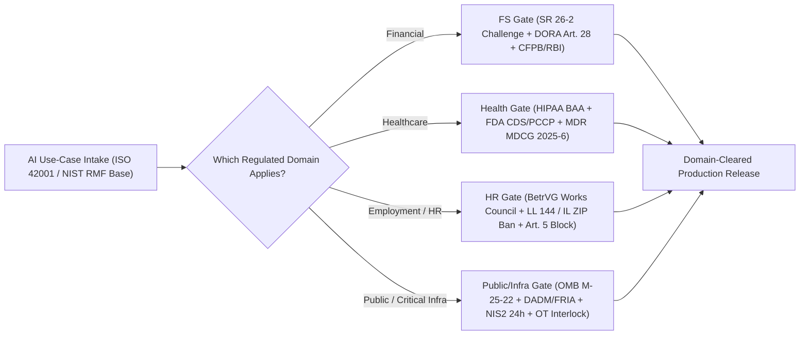

# Chapter 21: Sector-Specific Requirements

*Part VI: Regulation & Compliance*

> **In this chapter**
>
> * How **financial services** pair model risk management (**Fed SR 11-7 → SR 26-2**), operational resilience (**EU DORA**), credit explainability (**CFPB**), and Indian supervision (**RBI FREE-AI**, **SEBI**).
> * How **healthcare and life sciences** separate non-device **CDS** from regulated **SaMD**, authorize model updates via **FDA PCCPs**, protect **PHI** under **HIPAA**, and unify **EU MDR** and **EU AI Act** compliance (`MDCG 2025-6`).
> * How **employment and HR** deployments trigger **European works-council co-determination** (`BetrVG § 87(1)(6)`), **EU AI Act** bans and notices, the **Platform Work Directive**, and U.S. **NYC LL 144** / **Illinois HB 3773** audits.
> * How **public-sector and critical-infrastructure** AI activates **OMB M-25-22** acquisition safeguards, Canada **DADM** impact levels, **EU NIS2 / CER** incident clocks, and **DHS/CISA** OT protections.

**Horizontal AI statutes set only the baseline.** Chapter 20 mapped country-level privacy and AI laws across major jurisdictions. Yet even where no omnibus AI statute applies—or where an EU deadline sits out to `2027` or `2028`—vertical supervisors already inspect, sanction, and block production AI today. Banking examiners scrutinize undocumented credit models; medical-device agencies seize unapproved clinical triage software; European works councils obtain injunctions against copilot telemetry; and energy or government buyers reject AI vendors lacking operational-resilience and lock-in clauses. Compliance teams must understand both the horizontal rulebook and the sharper vertical teeth underneath it.

---

### Illustrative Composite Scenario: Four Verticals, Four Hard Stops

A diversified multinational industrial and services group greenlights a unified generative-AI platform across four operating divisions after clearing generic corporate InfoSec review. Within sixty days, four vertical regulators halt rollouts independently:

* **Financial Services:** A lending subsidiary deploys an LLM credit-memo and anomaly-triage assistant built on a single cloud API missing **EU DORA** exit/audit clauses and **Article 28 Register of Information** entries; bank examiners simultaneously demand materiality-tiered challenge documentation aligned with **Fed SR 26-2** and **RBI FREE-AI**.
* **Healthcare & MedTech:** A diagnostics unit embeds generative summarization that recommends diagnostic follow-ups without a **HIPAA BAA**, **§ 164.514** de-identification, or **FDA SaMD / PCCP** authorization, while German hospitals refuse procurement without unified **EU MDR + MDCG 2025-6** technical files.
* **HR & Workplace IT:** European IT activates corporate enterprise copilot productivity tracking in Hamburg without consulting the works council under **BetrVG § 87(1)(6)**, while recruiting turns on facial emotion scoring (**EU AI Act Art. 5(1)(f)** banned) alongside un-audited screening in New York and Illinois.
* **Energy & Public Sector:** A grid-forecasting bid to a European utility and a U.S. federal agency collapses when procurement finds zero **EU NIS2 `24h`/`72h`** cyber reporting hooks, missing **OMB M-25-22** data-rights protections, and no **Canada DADM** impact-level disclosures.

*(This composite scenario is illustrative; it is not drawn from a specific organization or incident.)*

---

## 21.1 Financial Services: Model Risk Management, EU DORA, and Prudential Oversight

Financial institutions pioneered quantitative AI oversight more than a decade before generative AI arrived. Rather than waiting for omnibus AI statutes, banking and securities supervisors govern AI simultaneously through **model risk management**, **ICT operational resilience**, **fair-lending transparency**, and **market-conduct audits**.

**From `SR 11-7` to `SR 26-2`: Effective Challenge Meets Proportionality:** For fifteen years, **Federal Reserve SR 11-7 / OCC Bulletin 2011-12** defined banking AI governance around an enterprise inventory, three-pillar validation (conceptual soundness, ongoing monitoring, outcomes analysis), and independent `"effective challenge"` by reviewers with the competence, independence, and authority to block unsafe models.[^c21-01] On **April 17, 2026**, U.S. federal banking agencies issued **SR 26-2 / OCC Bulletin 2026-13 / FIL-15-2026**, jointly superseding `SR 11-7`.[^c21-02] Crucially, `SR 26-2` pivots away from rigid, checkbox annual validation calendars toward **materiality-based proportionality**—focusing deepest validation rigor on models carrying significant financial, credit, liquidity, or consumer-harm risk. Equally important, `SR 26-2` explicitly places general-purpose generative and agentic AI *outside* narrow statistical MRM scope while expecting banks to govern them through **broader enterprise risk management (`ERM`)**. In practice, that is an architectural distinction without a free pass: if an LLM scores commercial borrowers, summarizes KYC alerts, or executes treasury steps, examiners still demand documented conceptual soundness, RAG regression testing, vendor due diligence, and independent challenge.

**EU Digital Operational Resilience Act (`DORA`):** Applicable in full since **January 17, 2025**, **Regulation (EU) 2022/2554 (`DORA`)** treats third-party AI APIs, hosting clouds, and vector platforms as critical ICT infrastructure rather than mere model choices.[^c21-03] EU banks, insurers, investment firms, and payment institutions must satisfy four hard operational duties on AI supply chains:

* **Register of Information (`Article 28`):** Every financial entity must maintain and report a standardized contract registry mapping all ICT third-party AI providers, supporting critical/important functions, down through **fourth-party sub-processors** (exposing silent reliance on one underlying frontier-model API across five fintech SaaS vendors).
* **Mandatory Contract & Exit Clauses:** AI vendor agreements supporting critical functions require unrestricted regulator inspection/audit rights, data-location clarity, service-level security targets, and tested **termination exit plans**.
* **Threat-Led Penetration Testing (`TLPT`, Articles 26–27):** Significant entities must run live red-team exercises spanning production ICT systems supporting critical functions—including exposed AI gateways and agent integrations.
* **Critical ICT Third-Party Provider (`CTPP`) Oversight:** Major cloud and AI infrastructure suppliers designated as **CTPPs** fall under direct lead supervision by the European Supervisory Authorities (`ESAs`).

**Fair Lending & Market Conduct (`CFPB`, `RBI FREE-AI`, `SEBI`):** Outside balance-sheet safety, conduct watchdogs police how models treat borrowers and investors. In the United States, **CFPB Circular 2023-03** confirms creditors cannot rely on generic Regulation B checklists when complex AI/ML models reject applicants: lenders must output the **specific principal reasons** driving each adverse credit decision.[^c21-04] In India, the **RBI `FREE-AI` Committee Report** (`August 13, 2025`) sets 26 actionable expectations across banks and NBFCs covering board-approved AI policies, centralized model inventories, red-teaming, vendor governance, and audit assurance.[^c21-05] Meanwhile, **SEBI (`LODR Reg. 21`)** anchors AI/cyber governance inside Risk Management Committees of top listed entities while integrating AI/ML advisory and trading tools into brokers' mandatory annual system audits—requiring deterministic pre-trade limits and automated kill-switches.[^c21-06]

### The Guardrails

1. **Apply `SR 26-2` Materiality Tiering + `SR 11-7` Effective Challenge:** Route revenue, credit, trading, and AML models through independent second-line validation regardless of whether an engine uses regression weights or LLM prompts ([^c21-01], [^c21-02]).
2. **Map Every AI Dependency in the `DORA` Register of Information:** Track third- and fourth-party model hosts under `Article 28`, enforce `DORA` audit/exit addenda, and include critical AI endpoints in `TLPT` scopes ([^c21-03]).
3. **Generate Specific Adverse-Action Reasons & Kill-Switches:** Pair lending AI with calibrated feature attributions (`SHAP`/reason codes) meeting `CFPB Circular 2023-03` ([^c21-04]), and gate financial/trading bots with deterministic kill-switches aligned with `RBI FREE-AI` and `SEBI` audit packs ([^c21-05], [^c21-06]).

---

## 21.2 Healthcare and Life Sciences: HIPAA, Medical Devices, and Clinical Safety

Healthcare and life sciences AI triggers two strict regulatory gates simultaneously: **patient health-information privacy** (enforced at ingestion and inference) and **medical-device premarket safety** (enforced whenever software steps across administrative convenience into clinical decision-making).

**Protecting `PHI` Under HIPAA (`45 CFR Parts 160 & 164`):** Covered entities (hospitals, health plans, clearinghouses) and their technology suppliers handle **Protected Health Information (`PHI`)** under strict statutory rules.[^c21-07] Pasting clinical notes, diagnostic images, or scheduling records into uncontracted consumer LLM endpoints constitutes an immediate unauthorized disclosure. Enterprise healthcare deployments require:

* **Executed Business Associate Agreements (`BAAs`, `45 CFR §§ 164.502(e), 164.504(e)`):** Every foundation-model vendor, vector database host, and observability pipeline touching `PHI` must sign a BAA alongside technical **Zero Data Retention (`ZDR`)** and zero-training terms enforcing the **Minimum Necessary** standard.
* **Verified De-Identification (`45 CFR § 164.514`):** Training or evaluating models without patient authorization requires formal de-identification under either the **Safe Harbor** rule (stripping 18 explicit identifier classes with no actual knowledge of re-identifiability) or **Expert Determination** (statistical proof of very small re-identification risk). Crucially, stripping structured MRNs under Safe Harbor routinely fails on **unstructured clinical free text** that preserves rare diagnoses, clinician names, or dates—making automated NER scrubbing and statistical review mandatory before data enters clinical corpora.

**FDA `SaMD`, Non-Device `CDS`, and `PCCPs`:** Under **Section 3060 of the 21st Century Cures Act** (`FD&C Act § 520(o)(1)(E)`) and the **FDA's September 28, 2022 *Clinical Decision Support Software* Guidance**, software avoids FDA medical-device classification (`SaMD`) *only* if it meets four cumulative criteria: it does not analyze medical images or physiological signals; displays medical/patient information; supports recommendations to a healthcare professional rather than replacing clinical judgment; and **enables the clinician to independently review the underlying clinical basis** without time-critical `"black-box"` reliance.[^c21-08] The moment an ambient clinical scribe or RAG assistant auto-triages emergency referrals, ranks imaging findings, or issues directive diagnostic flags without transparent clinical evidence, it crosses into regulated **SaMD** requiring `510(k)`, `De Novo`, or `PMA` clearance.

Because post-deployment fine-tuning or continuous retraining previously forced manufacturers back through repeat clearances, **FDORA Section 3308 (`FD&C Act § 515C`)** and the FDA's **December 2024 final guidance on Predetermined Change Control Plans (`PCCPs`)**—complemented by its **January 2025 Lifecycle Management draft guidance**—allow device sponsors to pre-authorize bounded model updates inside initial submissions by specifying an exact Modification Protocol, re-training data governance, and validation acceptance thresholds.[^c21-08]

**EU Dual Conformity (`EU MDR 2017/745` + `MDCG 2025-6`):** In Europe, medical AI software falling above Class I under **Regulation (EU) 2017/745 (`EU MDR`)** (requiring a Notified Body) automatically enters **EU AI Act Annex I High-Risk** scope.[^c21-09] Clarified by joint guidance **MDCG 2025-6 / AIB 2025-1 (June 2025)**, manufacturers do *not* create duplicate parallel QMS silos; instead, they expand existing **MDR technical documentation and Quality Management Systems** to cover AI Act bias/data governance, human oversight, transparency, and cybersecurity—tracked against the **August 2, 2028** Annex I compliance date set by **Regulation (EU) 2026/1744**.[^c21-10][^c21-11] Across both U.S. and EU regimes, safe clinical deployment requires **silent-mode shadow validation**, demographic subgroup error checks (catching cost/access proxy bias), and mandatory clinician review before any AI summary enters the medical record.

### The Guardrails

1. **Enforce `BAA` + `ZDR` + Dual-Pass `§ 164.514` De-Identification:** Block external model calls unless covered by an executed `BAA`/`ZDR` endpoint or audited free-text `PHI` redaction ([^c21-07]).
2. **Gate Feature Creep Against FDA `§ 520(o)(1)(E)` Boundaries:** Require Regulatory Affairs sign-off before adding diagnostic triage, severity scoring, or signal/image interpretation to administrative or CDS tools ([^c21-08]).
3. **Lock Retraining Pipelines Behind Authorized `PCCP` Envelopes:** Enforce CI/CD release blocks preventing unapproved weight updates on cleared medical devices unless validation passes the authorized `PCCP` protocol ([^c21-08]).
4. **Integrate `MDR` and AI Act Quality Systems (`MDCG 2025-6`):** Embed EU AI Act data, bias, and human-oversight artifacts directly inside medical-device QMS dossiers with subgroup clinical shadow validation ahead of `August 2028` ([^c21-09], [^c21-10], [^c21-11]).

---

## 21.3 Employment and HR: Works Councils, Employee Monitoring, and Automated Hiring

Workplace AI collides with a unique enforcement architecture where labor unions, works councils, municipal civil-rights regulators, and EU safety bans exercise direct veto and injunction powers.

**EU High-Risk Status, Prohibitions & Worker Notice:** Virtually all AI systems used to recruit, filter, interview, assign tasks, evaluate performance, promote, or terminate workers fall inside **EU AI Act Annex III(4) High-Risk**.[^c21-12] Even ahead of the `December 2, 2027` Annex III enforcement date, **two critical workplace obligations apply directly**: first, **Article 5(1)(f)** bans **emotion recognition systems in the workplace** (enforceable since `February 2, 2025`, eliminating sentiment-inferring webcam/voice interview tools outright outside narrow medical/safety contexts); second, **Article 26(7)** requires EU deployers to **inform workers' representatives and affected workers** *before* putting a high-risk workplace AI system into service.

**European Co-Determination (`BetrVG § 87(1)(6)` & *ArbG Hamburg* `24 BVGa 1/24`):** Across Germany, Austria, France (`CSE`), and the Netherlands, employee works councils possess binding statutory consultation or **co-determination veto rights** over software capable of monitoring employee behavior or performance. In Germany's landmark **Hamburg Labour Court ruling (`ArbG Hamburg`, January 16, 2024, Case `24 BVGa 1/24`)**, the court held that allowing employees voluntary browser access to external ChatGPT via personal accounts did *not* trigger co-determination under **§ 87(1)(1)** (workplace order vs. work execution guidelines) or **§ 87(1)(6) BetrVG** because the employer operated no corporate system capturing individual usage telemetry.[^c21-13] **IT leaders must not misread that narrow ruling as a blanket exemption.** The instant an enterprise deploys corporate `Copilot` licenses, SSO session logging, prompt analytics, keystroke/screen surveillance, or automated productivity dashboards, **§ 87(1)(6) mandatory co-determination triggers immediately**—allowing works councils to halt deployment via court injunction until a formal works agreement (*Betriebsvereinbarung*) sets clear logging and evaluation boundaries.

**Platform Work & Algorithmic Management (`Directive (EU) 2024/2831`):** Reinforcing works-council leverage across Europe, **Directive (EU) 2024/2831** (Member State transposition deadline **December 2, 2026**) establishes binding rules in Articles 6–10 against intrusive automated worker monitoring—explicitly barring emotional-state inference, private-conversation tracking, and off-duty data collection—while requiring transparent parameter disclosures to workers' representatives and guaranteed **human review and explanation** for impactful automated decisions affecting shifts, pay, or account termination.[^c21-14]

**U.S. Hiring Audits, Notice & Proxy Bans (`NYC LL 144`, `Illinois HB 3773`):** Across U.S. recruiting, compliance shifts from labor co-determination to civil-rights transparency and adverse-impact math:

* **NYC Local Law 144:** Enforced since July 5, 2023, employers using Automated Employment Decision Tools (`AEDTs`) for NYC roles must publish **annual independent intersectional bias audit** summaries on their website careers page and deliver **10-business-day notice** with an alternative selection process option.[^c21-15]
* **Illinois `HB 3773` (`775 ILCS 5/2-102(L)`, effective `January 1, 2026`):** Prohibits discriminatory AI across recruitment, hiring, promotion, discipline, and discharge, mandates employee/applicant notice, and **explicitly outlaws using ZIP codes as proxies for protected traits**, complementing federal `EEOC` Title VII and ADA enforcement.[^c21-16]

### The Guardrails

1. **Negotiate Works-Council Agreements & Disable Performance Telemetry Before Rollout:** Engage German/EU works councils early under **BetrVG § 87(1)(6)** before enabling enterprise copilots, disabling user-level productivity scoring by default ([^c21-13], [^c21-14]).
2. **Hard-Ban Emotion Recognition in Recruiting & Coaching:** Strip facial affect, tone-stress, and biometric emotion features from all HR and call-center tools to comply with **EU AI Act Art. 5(1)(f)** and **Platform Work** principles ([^c21-12], [^c21-14]).
3. **Standardize Annual Hiring Audits, Proxy Exclusions & Notices:** Run annual intersectional four-fifths audits (`NYC LL 144`), strip ZIP/geographic proxy features (`Illinois HB 3773`), and deliver unified pre-screening notices with human review paths ([^c21-15], [^c21-16]).

---

## 21.4 Public Sector and Critical Infrastructure

When AI enters public administration or physical infrastructure—power grids, water utilities, transport networks, telecommunications, emergency dispatch, or benefit determination—regulators shift focus from consumer choice to **constitutional due process, sovereign vendor independence, and cyber-physical resilience**.

**Public-Sector Procurement, Algorithmic Impact & Citizen Due Process:**

* **U.S. Federal Governance & Acquisition (`OMB M-25-21` & `OMB M-25-22`):** Issued together on **April 3, 2025**, **OMB Memorandum M-25-21** retains federal civilian `CAIOs` and executive **AI Governance Boards** over high-impact government use cases,[^c21-17] while companion **OMB Memorandum M-25-22 (*Driving Efficient Acquisition of Artificial Intelligence in Government*)** reshapes public-sector vendor contracts.[^c21-18] Agencies procuring commercial AI must negotiate **government data and IP protections**, contractual **anti-lock-in portability**, competitive U.S.-aligned interoperability, and measurable lifecycle risk controls—meaning commercial vendors bidding on federal contracts must expose clean export interfaces and waive proprietary claims over agency training/evaluation telemetry.
* **Canada *Directive on Automated Decision-Making* (`DADM`):** Effective since April 1, 2019, the Treasury Board's **DADM** remains one of the clearest operational public-sector accountability blueprints globally.[^c21-19] Departments using automated systems for administrative decisions must complete and publicly post an **Algorithmic Impact Assessment (`AIA`)** classifying systems across **Impact Levels I–IV**. Higher levels trigger mandatory independent **peer review**, public plain-language notices, source-code/documentation access, meaningful individual explanations, and final human decision ownership.
* **EU Public Authorities (`EU AI Act Arts. 27 & 49`):** European public bodies deploying Annex III systems (social benefits, immigration, law enforcement, justice) must perform pre-deployment **Fundamental Rights Impact Assessments (`FRIAs`)** and register deployments in the public **EU AI database**, backing administrative accountability with contestation rights (`Article 86`).

**Critical Infrastructure Cyber-Physical Resilience (`NIS2`, `CER`, & `DHS/CISA`):** AI operating inside utilities, telecom backbones, logistics hubs, and financial clearing faces converged operational mandates:

* **EU `NIS2` (`Directive (EU) 2022/2555`) & `CER` (`Directive (EU) 2022/2557`):** Following its **October 17, 2024** transposition deadline, **NIS2** subjects essential and important entities across energy, transport, health, water, banking, and digital infrastructure to binding board-accountable cyber governance, supply-chain risk reviews, and aggressive **`Article 23` incident reporting clocks (`24-hour` early warning, `72-hour` incident assessment, `1-month` final report)**—reinforced by physical-continuity duties under **CER** and **EU AI Act Annex III(2)** high-risk controls where AI acts as a safety component in critical infrastructure.[^c21-20]
* **U.S. DHS / CISA *Roles and Responsibilities Framework for AI in Critical Infrastructure* (`November 2024`):** Classifies operational responsibility across cloud/compute hosts, AI developers, and critical-infrastructure operators along three structural threat vectors—**attacks using AI**, **attacks targeting AI systems** (poisoning, adversarial evasion), and **design/implementation failures**—calling for air-gapped operational technology (`OT`) boundaries, deterministic safety interlocks, and verified manual fallbacks.[^c21-21]

#### Table 21.1 — Sector-Specific AI Overlay Matrix

| Sector | Primary Supervisors & Rules | Hard Technical / Legal Boundary | Mandatory Governance Artifact | Primary Escalation Trigger |
| :--- | :--- | :--- | :--- | :--- |
| **Financial Services** (`21.1`) | Fed/OCC (`SR 26-2` / `11-7`); `EU DORA`; `CFPB Cir. 2023-03`; `RBI FREE-AI`; `SEBI` | Specific adverse-action reasons; pre-trade limits & kill-switches; third/fourth-party exit readiness | `SR 26-2` materiality inventory + challenge files; `DORA Art. 28` Register of Information; `TLPT`; annual `SEBI` audit | Undocumented vendor model in credit/trading or unmapped critical ICT API (`DORA`) |
| **Healthcare & Life Sciences** (`21.2`) | `HIPAA` (`45 CFR 164`); `FDA Cures § 3060` & `FDORA § 3308` (`PCCP`); `EU MDR` + `MDCG 2025-6` | Zero `PHI` without `BAA`+`ZDR`+`§ 164.514`; transparent review (`CDS`) vs. `SaMD`; bounded `PCCP` updates | Executed `BAA`/`ZDR`; `§ 164.514` de-ID verification; `FDA PCCP` protocol; unified `MDR` QMS technical file (`Aug 2028`) | Scope creep from clinical note summarization into unapproved diagnostic triage |
| **Employment & HR** (`21.3`) | EU `Art. 5(1)(f)`, `Art. 26(7)`, `Annex III(4)`; `BetrVG § 87(1)(6)`; `Dir. 2024/2831`; `NYC LL 144`; `IL HB 3773` | Ban workplace emotion recognition; strip ZIP-code proxies; halt employee telemetry lacking works agreement | German/EU *Betriebsvereinbarung*; annual `LL 144` intersectional audit & 10-day notice; `IL` notice & `Dir. 2024/2831` review | Copilot productivity logging without works-council sign-off or un-audited screening AI |
| **Public Sector & Critical Infra** (`21.4`) | `OMB M-25-21`/`M-25-22`; Canada `DADM`; `EU AI Act Arts. 27/49`; `NIS2`/`CER`; `DHS/CISA` | Anti-lock-in government data/IP rights; OT deterministic fail-safes; citizen explanation & review | `OMB M-25-22` portable contracts; published `AIA` (`Levels I–IV`) / `FRIA`; `NIS2 24h/72h` incident runbooks | Autonomous AI linked directly to `OT/SCADA` actuation or citizen benefit denial |

*Caption: Enterprise sector-overlay gating workflow. After baseline AI governance intake, use cases touching regulated domains pass domain-specific technical, contractual, and supervisory gates before release.*

### The Guardrails

1. **Build `M-25-22` Portability & `DADM`/`FRIA` Transparency into Public Bids:** Standardize data-rights preservation, open export schemas, public impact summaries, and human-appeal SLAs across every public-sector offering ([^c21-18], [^c21-19]).
2. **Enforce Deterministic `OT/SCADA` Interlocks:** Never place probabilistic AI outputs in unguarded closed-loop physical control over power, water, or transport systems; require independent hardware/software safety limits ([^c21-21]).
3. **Wire AI SOC Alerts to `NIS2 24h`/`72h` Clocks:** Ensure model poisoning, hijacked agent connectors, or grid-AI outages page crisis leadership within `NIS2 Article 23` notification windows ([^c21-20]).

---

## Why Every Role Cares

| Role | Primary Stakes in This Chapter | First Actions to Take |
| :--- | :--- | :--- |
| **Board / Risk Committee** | Sector regulators suspend licenses, block hospital launches, halt EU copilot rollouts, and levy `DORA`/`NIS2` fines well ahead of horizontal AI Act deadlines. | Require vertical compliance attestation (Finance, Health, HR, Critical Infra) inside quarterly risk packs. |
| **CRO / Model Risk (FS)** | `Fed SR 26-2` removes calendar bureaucracy while expecting ERM challenge on GenAI, and `DORA Art. 28` exposes hidden fourth-party concentration. | Align GenAI inventory to `SR 26-2` materiality tiers and verify `DORA` ICT registers cover all LLM vendors. |
| **CMIO / Clinical Safety Lead** | Free-text `PHI` in uncontracted APIs breaches HIPAA immediately, while diagnostic scope creep converts note tools into unapproved `FDA` / `EU MDR` devices. | Enforce `BAA`/`ZDR` + `§ 164.514` pipelines and gate every CDS output change via Regulatory Affairs and `PCCPs`. |
| **CHRO / Labor Counsel** | Copilot usage telemetry triggers **German `BetrVG § 87(1)(6)`** injunctions; interview scoring trips `Art. 5(1)(f)` bans, `NYC LL 144`, and `IL HB 3773`. | Execute works-council framework agreements early, disable affect tracking, and automate annual hiring audits. |
| **CISO / OT & Resilience Lead** | `DORA TLPT`, `NIS2 24h/72h` incident reporting, and `DHS` infrastructure guidance put security leaders directly on statutory breach clocks. | Map critical AI services into `TLPT` testing, `OT` deterministic fail-safes, and `NIS2` early-warning runbooks. |
| **Public-Sector Capture & Legal** | `OMB M-25-22` lock-in bans, `Canada DADM` public `AIAs`, and `EU FRIA` rules disqualify opaque proprietary AI from government awards. | Pre-package portable export terms, impact assessments, and citizen appeal workflows in public-sector proposals. |

---

## Chapter Summary

| Section | Core Sector Dynamic | Mandatory Enterprise Guardrail | Primary Anchors |
| :--- | :--- | :--- | :--- |
| **Financial Services** (`21.1`) | `SR 26-2` shifts MRM to materiality; `DORA` regulates AI vendors as critical ICT; `CFPB`/`RBI`/`SEBI` police explainability and market conduct. | Apply `SR 26-2` effective challenge, populate `DORA Art. 28` registries & `TLPT`, enforce adverse-action codes & trading kill-switches. | [^c21-01]–[^c21-06] |
| **Healthcare & Life Sciences** (`21.2`) | `HIPAA` governs `PHI` & free-text de-ID; `FDA` draws sharp `CDS` vs. `SaMD` / `PCCP` lines; `MDCG 2025-6` merges `EU MDR` & AI Act QMS. | Gate APIs behind `BAA`+`ZDR`+`§ 164.514`, review `§ 520(o)(1)(E)` intent, lock `PCCPs`, integrate `MDR` files ahead of `Aug 2028`. | [^c21-07]–[^c21-11] |
| **Employment & HR** (`21.3`) | `EU Art. 5(1)(f)` bans workplace emotion AI; telemetry triggers `BetrVG` co-determination & `Dir. 2024/2831`; `NYC LL 144` & `IL HB 3773` audit screening. | Negotiate works agreements before copilot rollout, ban affect tracking, strip ZIP proxies, publish annual hiring audits. | [^c21-12]–[^c21-16] |
| **Public Sector & Critical Infra** (`21.4`) | `OMB M-25-22` & `DADM` mandate portability & `AIA` transparency; `NIS2`/`CER`/`DHS` link critical AI directly to cyber-physical safety. | Embed lock-in/data-rights protections & `AIA`/`FRIA` packs in public bids; enforce `OT` safety interlocks and `NIS2 24h/72h` paging. | [^c21-17]–[^c21-21] |

---

## Key Takeaways

1. **Vertical regulators do not wait for horizontal AI dates.** Financial (`DORA`, `SR 26-2`, `RBI`), clinical (`HIPAA`, `FDA`), and labor (`BetrVG`, `NYC LL 144`, `IL HB 3773`) rules block or penalize non-compliant AI immediately.
2. **Fourth-party ICT concentration and vendor lock-in are regulated risks.** `EU DORA Article 28` and `OMB M-25-22` force enterprises and suppliers to map downstream sub-processors and guarantee tested exit portability.
3. **Feature evolution crosses regulatory boundaries silently.** Adding automated diagnostic priority to clinical scribes converts `CDS` into `FDA SaMD`; enabling employee prompt metrics on enterprise copilots triggers German co-determination vetoes.
4. **Integrate domain QMS instead of duplicating compliance silos.** `MDCG 2025-6` for `EU MDR` medical devices and `SR 26-2` for banking ERM show regulators expect AI controls embedded into established sector governance.
5. **Physical infrastructure and citizen rights demand deterministic fallbacks.** Critical infrastructure operators must backstop AI advisories with non-AI `OT` safety limits, `NIS2 24h` incident triage, and guaranteed human review.

---

## Questions to Ask
| Stakeholder | Diagnostic Question | What a Credible Answer Looks Like |
| :--- | :--- | :--- |
| **CRO / Chief Credit Officer** | *"Are GenAI credit, fraud, and advisory workflows covered in our `SR 26-2` materiality tiering and mapped down to fourth-party APIs in our `DORA Art. 28` Register?"* | Unified inventory assigning materiality validation tiers, adverse-action reason testing, and full third/fourth-party ICT contract mapping. |
| **CMIO & MedTech Regulatory Lead** | *"Could any ambient scribe or triage feature cross `FDA § 520(o)(1)(E)` into unregulated `SaMD`, and are free-text `PHI` pipelines protected by `BAAs`, `ZDR`, and `§ 164.514` checks?"* | Signed `BAAs`/`ZDR` before `PHI` flow, documented `CDS` boundary memos, authorized `PCCPs`, and integrated `MDR`/`MDCG 2025-6` QMS planning. |
| **CHRO & European Employment Counsel** | *"Does our enterprise copilot log prompt telemetry for European workers without a `BetrVG § 87(1)(6)` agreement, and are recruiting tools audited for `NYC`, `IL`, and `Art. 5(1)(f)`?"* | Works-council agreements signed before telemetry rollout, affect recognition blocked, ZIP proxies stripped, and current annual hiring audit postings. |
| **CISO & OT Infrastructure Lead** | *"If an AI model or vendor API servicing critical operations fails or is compromised, can deterministic `OT` interlocks take over safely and alert authorities within `NIS2 24h`?"* | Air-gapped safety interlocks independent of AI endpoints, tested manual failovers, and crisis playbooks mapped to `24h`/`72h` statutory clocks. |
| **Public-Sector Bid & Legal Lead** | *"Do our government AI proposals include `OMB M-25-22` data-portability terms plus `Canada DADM AIA` or `EU FRIA` citizen-explanation packages?"* | Pre-vetted government contract riders eliminating vendor lock-in alongside standardized public impact-assessment and appeal artifacts. |

---

## References

[^c21-01]: Board of Governors of the Federal Reserve System and Office of the Comptroller of the Currency, *Supervisory Guidance on Model Risk Management*, SR 11-7 / OCC Bulletin 2011-12, Washington, DC, April 4, 2011, https://www.federalreserve.gov/supervisionreg/srletters/sr1107.htm. **Annotation:** Foundational U.S. banking standard defining validation pillars and `"effective challenge"`; superseded in April 2026 by SR 26-2 while remaining the analytical touchstone for model oversight. [↗ Bibliography](../bibliography.md#fed-2011-sr11-7)

[^c21-02]: Board of Governors of the Federal Reserve System, Office of the Comptroller of the Currency, and Federal Deposit Insurance Corporation, *Revised Guidance on Model Risk Management*, SR 26-2 / OCC Bulletin 2026-13 / FIL-15-2026, Washington, DC, April 17, 2026, https://www.federalreserve.gov/supervisionreg/srletters/sr2602.htm. **Annotation:** Joint interagency guidance replacing SR 11-7 with materiality-based proportionality and placing generative/agentic AI under broader enterprise risk management rather than rigid narrow MRM calendars. [↗ Bibliography](../bibliography.md#fed-2026-sr26-2)

[^c21-03]: European Parliament and Council of the European Union, Regulation (EU) 2022/2554 of 14 December 2022 on Digital Operational Resilience for the Financial Sector (*DORA*), *Official Journal of the European Union* L 333, December 27, 2022, applicable January 17, 2025, http://data.europa.eu/eli/reg/2022/2554/oj. **Annotation:** Binding EU financial-resilience regulation requiring `Article 28` third/fourth-party ICT Registers of Information, exit/audit clauses, `Articles 26–27` threat-led penetration testing (`TLPT`), and ESA oversight of Critical ICT Third-Party Providers (`CTPPs`). [↗ Bibliography](../bibliography.md#eu-2022-dora)

[^c21-04]: Consumer Financial Protection Bureau, *Consumer Financial Protection Circular 2023-03: Adverse Action Notification Requirements and the Proper Use of the CFPB's Sample Forms Provided in Regulation B*, Washington, DC, September 19, 2023, https://www.consumerfinance.gov/compliance/circulars/circular-2023-03-adverse-action-notification-requirements-and-the-proper-use-of-the-cfpbs-sample-forms-provided-in-regulation-b/. **Annotation:** Prohibits using generic adverse-action boilerplate to mask black-box AI credit denials; requires accurate principal reason disclosure under ECOA. [↗ Bibliography](../bibliography.md#cfpb-2023-circular-03)

[^c21-05]: Reserve Bank of India (Committee to Develop a Framework for Responsible and Ethical Enablement of Artificial Intelligence), *Report of the Committee to Develop a Framework for Responsible and Ethical Enablement of Artificial Intelligence (FREE-AI)*, chaired by Pushpak Bhattacharyya, Mumbai, August 13, 2025, https://www.rbi.org.in/. **Annotation:** Sets 26 actionable Indian financial-sector expectations spanning board AI policies, centralized model inventories, red-teaming, third-party vendor oversight, and audit trails. [↗ Bibliography](../bibliography.md#rbi-2025-free-ai)

[^c21-06]: Securities and Exchange Board of India, *SEBI (Listing Obligations and Disclosure Requirements) Regulations, 2015*, Reg. 21 and sched. II, pt. D, as amended. **Annotation:** Embeds cyber and AI oversight inside Risk Management Committees of India's top 1,000 listed firms alongside SEBI's annual market-intermediary system audit mandates covering AI/ML tools. [↗ Bibliography](../bibliography.md#sebi-2015-lodr)

[^c21-07]: U.S. Department of Health and Human Services, *Health Insurance Portability and Accountability Act (HIPAA) Privacy and Security Rules*, 45 CFR Parts 160 and 164 (including §§ 164.502(e), 164.504(e), and 164.514), https://www.ecfr.gov/current/title-45/subtitle-A/subchapter-C/part-164. **Annotation:** Federal patient-privacy mandate requiring executed Business Associate Agreements (`BAAs`) before sharing `PHI` with AI vendors and strict Safe Harbor or Expert Determination standards under `§ 164.514`. [↗ Bibliography](../bibliography.md#us-hipaa-rules)

[^c21-08]: U.S. Food and Drug Administration, *Clinical Decision Support Software* (Final Guidance, Sept 28, 2022; Cures Act § 3060 / FD&C Act § 520(o)(1)(E)), *Marketing Submission Recommendations for a Predetermined Change Control Plan for Artificial Intelligence-Enabled Device Software Functions* (Final Guidance, Dec 2024; FDORA § 3308 / FD&C Act § 515C), and *AI-Enabled Device Software Functions Lifecycle Management* (Draft Guidance, Jan 2025), https://www.fda.gov/medical-devices/software-medical-device-samd/artificial-intelligence-and-machine-learning-aiml-enabled-medical-devices. **Annotation:** Defines the legal boundary between unregulated transparent CDS and regulated SaMD alongside the authorized `PCCP` pathway for iterative AI model updates. [↗ Bibliography](../bibliography.md#fda-2024-ai-samd)

[^c21-09]: European Parliament and Council of the European Union, Regulation (EU) 2017/745 of 5 April 2017 on Medical Devices (*MDR*), *Official Journal of the European Union* L 117, May 5, 2017, http://data.europa.eu/eli/reg/2017/745/oj. **Annotation:** Core EU medical-device safety regulation placing Notified Body–assessed clinical AI software directly into EU AI Act Annex I high-risk conformity scope. [↗ Bibliography](../bibliography.md#eu-2017-mdr)

[^c21-10]: Medical Device Coordination Group (MDCG) and European Artificial Intelligence Board (AIB), *MDCG 2025-6 / AIB 2025-1: FAQ on Interplay Between MDR/IVDR and the Artificial Intelligence Act*, Brussels: European Commission, June 2025, https://health.ec.europa.eu/. **Annotation:** Joint EU guidance clarifying how medical AI manufacturers embed EU AI Act data, bias, transparency, and oversight controls into existing MDR/IVDR technical files and QMS without dual silos. [↗ Bibliography](../bibliography.md#mdcg-2025-6)

[^c21-11]: European Parliament and Council of the European Union, Regulation (EU) 2026/1744 Amending Regulation (EU) 2024/1689 (*Digital Omnibus on AI*), *Official Journal of the European Union*, July 24, 2026. **Annotation:** Defers EU AI Act Annex I regulated-product high-risk obligations—including MDR/IVDR medical-device AI—to `August 2, 2028`. [↗ Bibliography](../bibliography.md#eu-2026-digital-omnibus)

[^c21-12]: European Parliament and Council of the European Union, Regulation (EU) 2024/1689 (*Artificial Intelligence Act*), OJ L, 2024/1689, July 12, 2024, http://data.europa.eu/eli/reg/2024/1689/oj. **Annotation:** Classifies employment/HR AI under `Annex III(4)` and critical infrastructure safety components under `Annex III(2)`, bans workplace emotion recognition (`Article 5(1)(f)`, active Feb 2025), and requires worker representative notice (`Article 26(7)`). [↗ Bibliography](../bibliography.md#eu-2024-ai-act)

[^c21-13]: *Arbeitsgericht (ArbG) Hamburg* (Hamburg Labour Court), Decision of January 16, 2024, Case No. 24 BVGa 1/24. **Annotation:** Landmark German labor ruling finding voluntary personal-account browser access to ChatGPT excluded from `BetrVG § 87(1)(6)` co-determination where the employer gathers no usage telemetry—highlighting why corporate-logged enterprise copilots require prior works agreements. [↗ Bibliography](../bibliography.md#arbg-hamburg-2024-chatgpt)

[^c21-14]: European Parliament and Council of the European Union, Directive (EU) 2024/2831 of 23 October 2024 on Improving Working Conditions in Platform Work, *Official Journal of the European Union* L, 2024/2831, transposition deadline December 2, 2026, http://data.europa.eu/eli/dir/2024/2831/oj. **Annotation:** Sets Europe's strictest algorithmic-management protections in Articles 6–10—restricting automated monitoring, requiring worker/representative transparency, and guaranteeing human review and explanation. [↗ Bibliography](../bibliography.md#eu-2024-platform-work)

[^c21-15]: City of New York, *Local Law 144 of 2021 (Automated Employment Decision Tools)*, N.Y.C. Admin. Code §§ 20-870–20-874, and 6 RCNY §§ 5-300–5-304, enforced from July 5, 2023, https://www.nyc.gov/site/dca/about/automated-employment-decision-tools.page. **Annotation:** Mandates annual independent intersectional bias audits, public summary postings, and 10-business-day candidate notice for NYC automated hiring tools. [↗ Bibliography](../bibliography.md#nyc-2021-ll144)

[^c21-16]: State of Illinois, *House Bill 3773* (`PA 103-0804`, amending `775 ILCS 5/2-101` and `5/2-102(L)`), signed August 9, 2024, effective January 1, 2026. **Annotation:** Prohibits discriminatory employment AI, mandates worker/applicant notice, and expressly forbids using ZIP codes as protected-class proxies. [↗ Bibliography](../bibliography.md#il-2026-hb3773)

[^c21-17]: Office of Management and Budget, *Accelerating Federal Use of AI through Innovation, Governance, and Public Trust*, Memorandum M-25-21, April 3, 2025, https://www.whitehouse.gov/wp-content/uploads/2025/02/M-25-21-Accelerating-Federal-Use-of-AI-through-Innovation-Governance-and-Public-Trust.pdf. **Annotation:** Requires federal civilian agencies to sustain CAIOs, executive AI Governance Boards, and minimum risk-management practices for high-impact government AI. [↗ Bibliography](../bibliography.md#omb-2025-m25-21)

[^c21-18]: Office of Management and Budget, *Driving Efficient Acquisition of Artificial Intelligence in Government*, Memorandum M-25-22, Washington, DC, April 3, 2025, https://www.whitehouse.gov/. **Annotation:** Directs U.S. federal AI procurement to preserve government data and IP rights, prevent vendor lock-in, prioritize competitive interoperability, and enforce lifecycle risk controls. [↗ Bibliography](../bibliography.md#omb-2025-m25-22)

[^c21-19]: Treasury Board of Canada Secretariat, *Directive on Automated Decision-Making* (and *Algorithmic Impact Assessment*), effective April 1, 2019, https://www.tbs-sct.canada.ca/pol/doc-eng.aspx?id=32592. **Annotation:** Binding federal Canadian public-sector policy scoring systems across Impact Levels I–IV to trigger escalating peer review, public notice, source-code transparency, explanations, and human intervention. [↗ Bibliography](../bibliography.md#canada-2019-dadm)

[^c21-20]: European Parliament and Council of the European Union, Directive (EU) 2022/2555 (*NIS2 Directive*, transposition deadline Oct 17, 2024) and Directive (EU) 2022/2557 (*CER Directive*), *Official Journal of the European Union* L 333, December 27, 2022, http://data.europa.eu/eli/dir/2022/2555/oj. **Annotation:** Establishes board-level cyber and physical resilience obligations for critical entities alongside strict `Article 23` incident reporting (`24h` early warning, `72h` assessment, `1-month` final report). [↗ Bibliography](../bibliography.md#eu-2022-nis2)

[^c21-21]: U.S. Department of Homeland Security (Artificial Intelligence Safety and Security Board), *Roles and Responsibilities Framework for Artificial Intelligence in Critical Infrastructure*, Washington, DC, November 2024, https://www.dhs.gov/ai. **Annotation:** Allocates shared resilience controls across cloud providers, AI developers, and critical-infrastructure operators against AI-enabled attacks, attacks on AI models, and design/implementation failures. [↗ Bibliography](../bibliography.md#dhs-2024-ci-ai)
