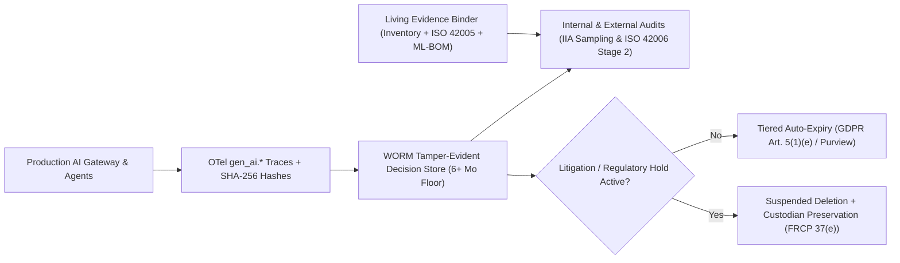

# Chapter 22: Auditability, Assessments & Evidence

*Part VI: Regulation & Compliance*

> **In this chapter**
>
> * Why regulators and courts reject `"the model decided"` and why **inference nondeterminism** prevents post-hoc reconstruction without captured runtime state.
> * How to engineer **tamper-proof decision logging** and **replay** (`OpenTelemetry gen_ai.*`, `WORM` hash chains, and `EU AI Act` `Art. 12` / `Art. 26(6)` six-month logs).
> * How to collapse redundant **DPIA**, **FRIA**, **AIA**, and **ADMT** impact questionnaires into one unified workflow aligned with **`ISO/IEC 42005:2025`**.
> * How **EU conformity assessments** (`Annex IV`, `Art. 43`, `CycloneDX ML-BOM`) and external **`ISO/IEC 42001` / `ISO/IEC 42006:2025`** certification audits verify live controls.
> * How **Internal Audit** (`IIA Three Lines` and `Global Internal Audit Standards`) prepares evidence binders and transaction trace-back samples before external inspection.
> * How to govern **e-Discovery**, **FRCP Rule 37(e)** legal holds (*In re OpenAI*), and retention/privilege hazards across copilot prompts, agent traces, and AI meeting transcripts.

**Compliance is what your evidence can prove—not what your policy PDF promises.** Chapters 20 and 21 surveyed global statutes and vertical domain regulators across finance, healthcare, employment, and critical infrastructure. Chapter 22 closes *Part VI: Regulation & Compliance* with the operational proof layer: how engineering, risk, audit, and legal teams capture reproducible evidence, unify overlapping impact assessments, pass formal conformity and certification audits, and survive civil litigation without accidental spoliation or privilege waivers.

---

### Illustrative Composite Scenario: The Unreproducible Denial and the Vanished Transcript

Within a single fiscal quarter, a multinational B2B software and credit-platform operator encounters three simultaneous evidentiary breakdowns despite maintaining a comprehensive AI governance policy handbook:

* **The Unreproducible Underwriting Denial:** Four months after rejecting a mid-market borrower via an AI-assisted risk copilot, a European supervisory examiner demands exact reconstruction of the inputs, retrieved records, and model reasoning. Engineering tries re-running the prompt, only to generate a contradictory recommendation: the vendor updated the underlying foundation model alias (`-latest`), corporate policy files inside the RAG store were edited twice, and temperature-zero execution still diverged slightly across server batches.
* **The Stalled Certification Audit:** During an external **`ISO/IEC 42001`** Stage 2 audit, assessors sample twelve production deployments and uncover two missing impact assessments after product teams bolted autonomous tool execution onto an existing support agent without re-running formal risk sign-off.
* **The Litigation Hold & Transcript Collision:** In parallel U.S. commercial litigation, plaintiffs move for sanctions under **FRCP Rule 37(e)** after learning the company's 30-day workspace auto-purge erased employee copilot chat histories after notice of the dispute—while an unapproved third-party AI meeting notetaker silently transcribed and stored an internal privileged legal strategy call on external servers.

*(This composite scenario is illustrative; it is not drawn from a specific organization or incident.)*

---

## 22.1 The "Black Box" Problem

Across banking examinations, employment enforcement actions, EU market-surveillance inquiries, and tort litigation, `"the model decided"` or `"it is a proprietary black box"` is never an acceptable defense. As earlier chapters on adverse-action notices and oversight established, institutions remain legally accountable for outcomes they choose to automate regardless of neural complexity.

Modern enterprise AI compounds traditional software auditability gaps because a single decision outcome depends on **five independently moving runtime layers**:

1. **Floating Model Snapshots:** Hosted frontier APIs frequently update underlying weights behind stable alias names or silently swap quantization and system-level safety routing, altering behavior between Monday and Friday.
2. **Evolving System Prompts & Guardrails:** Application teams continuously iterate orchestration templates, few-shot examples, topical blocklists, and tool descriptions via configuration stores detached from application release tags.
3. **Mutable Retrieval Knowledge Bases (`RAG`) & Entitlements:** Enterprise vector indexes ingest updated policies, CRM notes, and PDFs hourly; reconstructing what the model actually `"knew"` on a prior afternoon requires knowing which document chunk versions and caller `ACLs` existed at that exact millisecond.
4. **External Runtime Tool Outputs:** Agentic workflows query live inventory APIs, credit bureaus, and SQL tables whose values shift constantly after execution finishes.
5. **Inference Nondeterminism Even at `Temperature = 0`:** Engineering leaders routinely assume greedy decoding guarantees byte-for-byte replay. As **Horace He and Thinking Machines Lab (`September 2025`)** demonstrated, modern GPU serving engines produce divergent token completions across identical zero-temperature requests primarily because dynamic server-side request batching alters floating-point reduction order unless specialized batch-invariant kernels are engineered—at steep latency cost.[^c22-01]

```
[Floating Model Alias] + [Mutable Prompt] + [Changing RAG Chunks] + [Live API State] + [Batch Nondeterminism]
                                                 |
                                                 v
                       Post-hoc re-execution != Original Production Outcome
         (Audit proof requires recording the executed decision packet at runtime, not guessing later)
```

Because exact *post-hoc re-generation* is unreliable across floating infrastructure and dynamic batching, defensible AI auditability rests on one foundational engineering rule: **capture the exact assembled runtime context, artifact versions, and emitted output as it happens, rather than hoping to re-run the prompt months later.**

### The Guardrails

1. **Ban Unpinned Model Aliases in Regulated Flows:** Require explicit cryptographic digest or immutable snapshot IDs in Tier 1/high-risk gateways (`-2026-08-14` rather than `-latest`) so every response ties cleanly to an exact model build.
2. **Version-Hash Prompts, Guardrails & Retrieval Corpora:** Stamp every system prompt template, input/output guardrail config, and RAG chunk with immutable `SHA-256` content digests logged inline per inference request.
3. **Treat Capture Over Re-Generation as the Audit Baseline:** Architect evidentiary logging to store *what was actually shown to the model and returned to the user* rather than assuming `temperature = 0` lets auditors re-compute history ([^c22-01]).

---

## 22.2 Tamper-Proof Logging and Decision Replay

Capturing raw debug text into mutable application logs leaves gaps that fail both regulatory scrutiny and forensic integrity challenges. Statutory regimes increasingly codify automated traceability as a hard prerequisite for deployment. Under the **EU AI Act**, **Article 12** obligates providers of high-risk AI systems to design automatic event-recording capabilities across the lifecycle—recording start/stop times, input reference data matches, and verifying human-oversight identities—while **Article 26(6)** requires **deployers** to retain automatically generated logs under their control for **at least six months** unless Union or national data-protection rules specify otherwise.[^c22-02]

**Instrumenting Complete Decision Packets (`OpenTelemetry gen_ai.*`):** Fragmented microservices often log prompts in an API gateway while recording tool calls inside an agent framework and human approvals inside a ticketing tool—making cross-system reconstruction impossible. Adopting **OpenTelemetry Semantic Conventions for Generative AI (`gen_ai.*`)** with W3C `traceparent` context propagation stitches user/service identity, orchestrator spans, tool executions (`execute_tool`), retrieved document chunk hashes, model snapshot IDs, parameter settings, guardrail verdicts, and token usage into one queryable trace tree.[^c22-03]

**Write-Once Tamper Resistance & Privacy Balance:** Once emitted, high-risk decision traces must flow into **tamper-evident storage**—such as `WORM` (Write-Once-Read-Many / S3 Object Lock) buckets paired with periodic cryptographic SHA-256 hash chaining—so compromised admin credentials or internal cover-ups cannot silently rewrite history. Simultaneously, engineers must respect **GDPR Article 5(1)(e) storage limitation** (`"kept for no longer than is necessary"`) and enterprise data-minimization goals:[^c22-04] store **pseudonymized correlation tokens** inside long-term immutable audit ledgers while holding sensitive prompt/response payloads in segregated, encrypted vault partitions subject to automated expiry (absent legal hold).

**Two Distinct Modes of Decision Replay:** When teams discuss `"replay,"` they routinely conflate two fundamentally different workflows:

* **Forensic Playback (Audit & Dispute Defense):** Read-only inspection of the exact immutable runtime packet (`Table 22.1`) to prove *why* a historical rejection, clinical summary, or agent action occurred at `T0`.
* **Counterfactual Regression Replay (Model Change Validation):** Re-feeding sanitized historical production inputs from `T0` against a proposed *new* model snapshot or prompt in staging to quantify output drift, refusal shifts, or accuracy regressions—measuring distributions across runs to account for GPU batch variance ([^c22-01]).

#### Table 22.1 — Forensic AI Decision Record Schema (Minimum Audit Fields)

| Capture Layer | Mandatory Immutable Fields | Evidentiary Value in Audit or Litigation |
| :--- | :--- | :--- |
| **Caller & Identity** | Timestamp (`UTC`), anonymized/tokenized user & acting agent (`RFC 8693` `act` claim), tenant/region tag | Proves authorization scope, residency routing, and human vs. autonomous initiator (`Art. 12`) |
| **Model & Prompt State** | Exact pinned model snapshot ID/digest, system prompt hash, decoding config (`temperature`, `seed`), guardrail policy version | Refutes allegations of silent model drift or disabled safety/copyright filters |
| **Retrieval & Tool State** | Retrieved RAG chunk IDs + `SHA-256` digests, caller ACL evaluation result, invoked tool names & hashed request/response payloads | Reconstructs exact contextual grounding seen by the LLM without mutable DB guesswork |
| **Governance & Decision** | Guardrail block/pass verdict, confidence/groundedness flags, C2PA/watermark ID, adverse-action reason codes, **final rendered output** | Proves disclosure/provenance enforcement and renders deterministic historical output verbatim |
| **Human Oversight (`Art. 14`/`22`)** | Approver ID, review dwell time, edit/override diff, rationalized approval/rejection flag | Demonstrates `"authority and competence"` against rubber-stamping claims |

### The Guardrails

1. **Emit Standardized `OpenTelemetry gen_ai.*` Decision Traces:** Instrument every enterprise model gateway and agent orchestrator to propagate trace IDs across prompt, RAG retrieval, tool invocation, and human approval steps ([^c22-03]).
2. **Enforce `WORM` + Hash-Chained Retention Meeting `Art. 26(6)`:** Lock high-risk production logs for a minimum **6-month floor** (or longer where sector rules apply) inside immutable storage verified against deletion/mutation ([^c22-02]).
3. **Tokenize PII Out of Long-Term Audit Indexes:** Store raw personal text in segregated, encrypted payload stores under **GDPR Art. 5(1)(e)** schedules while keeping structural hashes durable ([^c22-04]).
4. **Separate Historical Playback from Staging Regression Replay:** Never claim re-running a prompt months later proves historical intent; use playback for disputes and batched shadow replay for release gates ([^c22-01]).

---

## 22.3 Impact Assessments: DPIA, FRIA, and Algorithmic Impact Assessments

Organizations operating across privacy, civil-rights, and public-sector regimes routinely drown engineering teams in duplicate 40-page assessment questionnaires under three overlapping names:

* **Data Protection Impact Assessment (`DPIA`, `GDPR Article 35`):** Triggered whenever AI processes personal data likely to create high risk to natural persons—covering large-scale profiling, special-category data (`Art. 9`), systematic workplace/public monitoring, or automated decisions producing legal or similarly significant effects.[^c22-04]
* **Fundamental Rights Impact Assessment (`FRIA`, `EU AI Act Article 27`):** Required *prior* to deployment for public-sector bodies, private entities delivering public services, and deployers of high-risk Annex III systems assessing **creditworthiness** or **life and health insurance** pricing/risk—documenting intended frequency, affected person categories, specific harm risks, **human oversight measures**, and complaint/governance responses, with results notified to national market-surveillance authorities.[^c22-02]
* **Algorithmic Impact Assessment (`AIA`) & State Risk Assessments:** Exemplified by **Canada's *Directive on Automated Decision-Making* (`DADM`)**—scoring public-sector systems across **Impact Levels I–IV** to drive external peer review and transparency[^c22-05]—and **California's `CPPA CCPA ADMT` Regulations**, mandating pre-use risk assessments and submission summaries for significant automated decision-making and AI training on personal data.[^c22-06]

**Consolidating via `ISO/IEC 42005:2025`:** Published in **May 2025**, **`ISO/IEC 42005:2025` (*AI System Impact Assessment*)** establishes the international lifecycle methodology for evaluating how AI systems affect individuals, groups, and society across safety, fairness, privacy, and fundamental rights—explicitly structuring impact assessment as a **living process** from early concept screening through change-driven re-evaluation rather than a pre-launch PDF artifact.[^c22-07]

Instead of forcing product squads to fill out four fragmented forms, mature governance teams map one **Unified Impact Assessment Intake** aligned to `ISO/IEC 42005:2025`: system purpose, data categories, protected/vulnerable cohorts, automation level (`Article 14` / `22`), failure modes, and security mitigations are entered **once**, then compiled dynamically into tailored **DPIA**, **FRIA**, **AIA**, and **California ADMT** export views. Crucially, the unified record captures **DPO/works-council consultation dates** and requires explicit **residual-risk acceptance signatures** before moving to production.

### The Guardrails

1. **Collapse Fragmented Questionnaires into One `ISO/IEC 42005:2025` Workflow:** Capture core AI risk facts once inside GRC tooling and auto-render statutory `DPIA`, `FRIA`, `AIA`, and `ADMT` sections cleanly ([^c22-04], [^c22-06], [^c22-07]).
2. **Require Material-Change Re-Assessment Gates:** Wire CI/CD and vendor-change workflows so adding autonomous tools, biometric inputs, or high-risk populations automatically re-opens the impact record.
3. **Document Consultation & Residual Risk Explicitly:** Record DPO advice (`GDPR Art. 35(2)`), authority notifications (`AI Act Art. 27(3)`), affected stakeholder consultation, and named executive residual-risk acceptance ([^c22-02]).

---

## 22.4 Conformity Assessments and Certification (e.g., ISO/IEC 42001)

Once impact risks are mapped and technical logs run cleanly, external buyers and European regulators ask for structured assurance proof: formal **EU conformity assessments** (`CE marking`) and accredited third-party management-system certification under **`ISO/IEC 42001`**.

**EU AI Act Conformity Pathway (`Articles 11, 17, 40, 43`, & `Annex IV`):** Providers placing high-risk AI systems on the EU market must build and maintain live **Article 11 / Annex IV technical documentation** (system architecture, training/validation data provenance, accuracy/robustness/cybersecurity test results, bias evaluations, instructions for use, and human-oversight design) alongside an **Article 17 Quality Management System (`QMS`)**.[^c22-02] Conformity follows two primary paths under **Article 43**:

* **Internal Control Self-Assessment (`Annex VI`):** Permitted for most **Annex III** high-risk systems (credit, hiring, education) when the provider applies published harmonised standards triggering **Article 40 presumption of conformity**.
* **Third-Party Notified Body Assessment (`Annex VII`):** Mandatory for high-risk remote biometric systems (where harmonised standards are absent/unused) and high-risk AI acting as safety components under **Annex I** sectoral laws (such as **EU MDR** medical devices and machinery), integrating into sectoral Notified Body reviews.

To prevent technical files from drifting out of sync with reality, engineering should link **CycloneDX `ML-BOM` (ECMA-424)** cryptographic digests of trained weights, datasets, and guardrail configs directly into every `Annex IV` release bundle.[^c22-10]

**Third-Party Certification Under `ISO/IEC 42001:2023` & `ISO/IEC 42006:2025`:** Enterprise procurement teams increasingly require independent **`ISO/IEC 42001:2023`** certification (the Plan–Do–Check–Act AI Management System spanning 38 Annex A controls) as objective trust shorthand.[^c22-08] Published in **July 2025**, **`ISO/IEC 42006:2025`** sets the formal accreditation requirements for bodies auditing and certifying AIMS implementations—building on `ISO/IEC 17021-1` to enforce auditor AI competence, conflict-of-interest firewalls, and multi-stage audit sampling rigor.[^c22-09] Certification unfolds across:

1. **Stage 1 Audit (Readiness & Scope Review):** Evaluates whether policies, governance charters, risk criteria, and Statement of Applicability (`SoA`) align on paper—and critically verifies the **certified scope** does not hide customer-facing AI behind a narrow internal pilot boundary.
2. **Stage 2 Audit (Operating Effectiveness):** Auditors inspect live inventories, test impact assessments, trace vendor contracts, and sample production monitoring/incident records to verify controls operate in practice.
3. **Annual Surveillance Audits:** Ongoing annual checks verifying nonconformities stay closed and new AI launches follow PDCA governance.

**Three Classic Certification Failures:** Audits routinely stall on three preventable gaps: *(a)* clean binder policies paired with an incomplete shadow-AI inventory; *(b)* unverified SaaS sub-processor AI chains; and *(c)* zero evidence of re-evaluation after major vendor model swaps.

### The Guardrails

1. **Automate `Annex IV` & `ML-BOM` Evidence Generation:** Emit `CycloneDX ML-BOM` weight/dataset manifests and evaluation test summaries straight from CI/CD releases into living conformity folders ([^c22-02], [^c22-10]).
2. **Vet Certification Bodies Against `ISO/IEC 42006:2025` Accreditation:** Confirm your external registrar holds formal accreditation before investing in `ISO/IEC 42001` audits ([^c22-08], [^c22-09]).
3. **Run Mock Stage 1 & Stage 2 Audits With Honest Scope:** Test live inventory completeness, vendor DDQs, and post-change evaluation logs 90 days before registrar fieldwork begins.

---

## 22.5 Preparing for Internal and External AI Audits

Regulatory readiness collapses when Second-Line Compliance audits its own paperwork. Applying **The IIA's Three Lines Model**, engineering and product owners (**First Line**) operate day-to-day AI controls; Risk, Legal, and Privacy (**Second Line**) set standards and challenge assessments; and Internal Audit (**Third Line**) delivers independent assurance directly to the Audit Committee without holding operational approval authority.[^c22-11] Crucially, the IIA's revamped ***Global Internal Audit Standards*** (mandatory effective **January 9, 2025**) require internal audit teams to maintain genuine technological and AI competence, assess governance/cyber/model risks across the organization, and validate automated control effectiveness objectively.[^c22-12]

**Organizing a Living Evidence Binder & Sampling Live Transactions:** Rather than assembling ad-hoc screenshot decks two weeks before an inspection, maintain a continuously populated **AI Evidence Binder** organized around seven audit-ready tabs:
*(1)* Enterprise AI Inventory & Value-Chain Role Matrix; *(2)* Unified Impact Assessments (`ISO 42005` / `DPIA` / `FRIA`); *(3)* Data Provenance, License & Consent Ledger; *(4)* Pre-Deployment Eval, Fairness & Red-Team Reports; *(5)* Material Change-Control Approvals; *(6)* Immutable Runtime Trace Samples; and *(7)* Incident, Override & Corrective Action Logs.

During an external audit or regulatory exam, investigators test whether governance works in code through **transaction sampling**: selecting `10–25` randomized production inferences or agent runs from `Table 22.1` and challenging teams to walk them end-to-end back to the pinned model version, chunk ACLs, human-review record, and approved disclosure. Rehearsing quarterly mock walkthroughs with Product, Engineering, and Legal aligns terminology and stops well-meaning engineers from making indefensible claims like `"our system is 100% deterministic"` or `"the LLM never remembers sensitive data."`



*Caption: Continuous AI auditability and retention architecture. Runtime OpenTelemetry traces flow into immutable `WORM` storage supporting independent `IIA`/`ISO 42006` sampling while legal-hold flags override automated `GDPR` purge schedules.*

### The Guardrails

1. **Protect Third-Line Independence Under IIA Standards:** Bar Internal Audit from owning pre-launch model approvals so it can audit first- and second-line controls cleanly under the `2025` Global Internal Audit Standards ([^c22-11], [^c22-12]).
2. **Automate Living Evidence Snapshots Per Release:** Store policy, evaluation, and inventory artifacts continuously inside immutable GRC folders rather than manual pre-audit spreadsheets.
3. **Run Quarterly 15-Transaction Trace-Back Drills & Team Walkthroughs:** Pull random production inferences and test end-to-end reconstruction across engineering, compliance, and legal ahead of external audits.

---

## 22.6 e-Discovery, Legal Hold, and Retention Governance for Prompts, Agent Traces, and AI Meeting Transcripts

Every prompt an employee types into a corporate assistant, every multi-step agent tool trace, and every AI-generated meeting recap constitutes **Electronically Stored Information (`ESI`)** discoverable under **Federal Rules of Civil Procedure (`FRCP`) Rules 26(b)(1) and 34**.[^c22-13] When litigation, government investigation, or a formal dispute becomes reasonably anticipated, allowing routine 30-day workspace purges or user-triggered deletes to erase relevant AI artifacts risks severe spoliation sanctions—including adverse-inference jury instructions—under **`FRCP Rule 37(e)`**.

**The Privacy vs. Preservation Collision (*In re OpenAI*):** The sharp practical conflict between short retention and litigation preservation crystallized on **May 13, 2025**, when U.S. Magistrate Judge **Ona T. Wang** in ***In re OpenAI, Inc., Copyright Infringement Litigation*** (`No. 1:25-md-3143` / `1:23-cv-11195`, S.D.N.Y.)—subsequently upheld by District Judge Sidney H. Stein—ordered OpenAI to **"preserve and segregate all output log data that would otherwise be deleted on a going forward basis,"** overriding routine deletion and user-deletion privacy workflows.[^c22-14] Five months later, on **October 9, 2025**, Judge Wang modified and lifted the blanket prospective obligation (ending mandatory capture of all ongoing consumer logs past **September 26, 2025** while keeping segregated historical logs and specifically flagged accounts preserved).

For enterprise buyers and deployers, the strategic lesson is clear:
1. **Before a Dispute Exists (`Defensible Disposal`):** Short retention and `Zero Data Retention (ZDR)` endpoints drastically reduce unnecessary discovery volume, breach blast radius, and `GDPR` exposure. What you legitimately never retained under an enforced retention policy cannot be leaked or produced.
2. **The Moment a Hold Triggers (`Scoped Preservation Override`):** Short auto-delete windows and even **EU AI Act Article 26(6)** six-month purge jobs *cannot* run blindly once a dispute hits. Systems must support **custodian- and system-level legal holds** that suspend deletion instantly for scoped individuals without freezing the entire enterprise indefinitely.

**The Shadow Hazard of AI Meeting Transcripts & Privilege Waiver:** Across enterprise collaborations, unapproved third-party AI meeting notetaker bots present one of the fastest-growing e-Discovery and **attorney-client privilege** liabilities. Recording executive incident huddles, HR termination discussions, or privileged counsel calls generates full verbatim transcripts—and when unvetted cloud notetakers store recordings on vendor servers or email automated recaps to non-privileged attendees, opposing counsel can argue **privilege waiver** alongside creating smoking-gun exhibits out of offhand speculation.

**Operationalizing Retention With `Microsoft Purview` & Gateway Controls:** Rather than all-or-nothing retention, configure enterprise compliance suites such as **Microsoft Purview** (`eDiscovery`, `Communication Compliance`, and retention labels)[^c22-15] and central AI gateways around **tiered retention schedules**: `30–90` days default expiry for low-risk ephemeral chat and approved meeting transcripts (with auto-recording **blocked by default** in Legal/HR rooms); **`6+` months immutable minimum** for EU Annex III operational logs (`Art. 26(6)`); multi-year archival for financial/clinical decision records; and **instant custodian-level legal-hold flags** audited alongside European/Indian DPOs when cross-border U.S. holds intersect local privacy laws.

### The Guardrails

1. **Ban Unapproved Meeting Bots & Lock Privilege Exclusions:** Block external third-party AI notetaker bots at identity/network boundaries and configure default no-transcription policies inside Legal, Board, and HR rooms.
2. **Enforce Tiered Default Retention Across Copilot Prompts, Agent Traces & Transcripts:** Align routine expiration cleanly to `GDPR Art. 5(1)(e)` minimization (`30–90` days for transient chats) alongside `EU AI Act Art. 26(6)` `6-month` floors ([^c22-02], [^c22-04], [^c22-15]).
3. **Test Custodian-Level `FRCP 37(e)` Legal-Hold Overrides Quarterly:** Verify that placing an employee or system under legal hold immediately pauses automated deletion across AI prompts, vector interactions, agent traces, and meeting transcripts ([^c22-13], [^c22-14]).
4. **Coordinate Cross-Border Preservation Conflicts Early:** Pair U.S. litigation counsel and EU/Indian DPOs whenever a legal hold requires preserving personal AI logs past statutory disposal windows ([^c22-04], [^c22-14]).

---

## Why Every Role Cares

| Role | Primary Stakes in This Chapter | First Actions to Take |
| :--- | :--- | :--- |
| **Board / Audit Committee** | `ISO/IEC 42001` nonconformities, `FRCP Rule 37(e)` spoliation sanctions, and unreproducible adverse decisions expose board oversight directly. | Require quarterly third-line AI assurance reports and legal-hold readiness confirmations in audit packs. |
| **Chief Audit Executive (Internal Audit)** | `2025` Global Internal Audit Standards mandate objective third-line competence and sampling across AI governance and controls. | Preserve audit independence (`Three Lines`), build AI sampling protocols, and test random decision trace-backs. |
| **General Counsel / e-Discovery Lead** | Employee prompts, agent traces, and AI meeting transcripts create discoverable `ESI`, `FRCP 37(e)` sanctions, and privilege-waiver traps. | Enforce legal-hold overrides in `Purview`/gateways, ban unvetted meeting bots, and lock no-record Legal policies. |
| **DPO / Privacy Officer** | Duplicate `DPIA`/`FRIA`/`AIA` workflows exhaust teams while `6+`-month logging and litigation holds collide with `GDPR Art. 5(1)(e)` limits. | Unify assessments on `ISO/IEC 42005:2025` and separate pseudonymized telemetry from short-lived PII payload stores. |
| **CIO / Platform Engineering** | GPU batch nondeterminism (`temp = 0` myth), unpinned model aliases, and fragmented logs break forensic reconstruction and `Stage 2` audits. | Pin model snapshots, emit `OpenTelemetry gen_ai.*` traces into `WORM` stores, and automate `ML-BOM` exports. |
| **CISO / Compliance Ops** | Mutable logs allow evidence tampering while disconnected spreadsheets stall `EU Annex IV` files and `ISO/IEC 42006:2025` registrar audits. | Enforce cryptographic hash chaining on high-risk logs and build one continuously updated Living Evidence Binder. |

---

## Chapter Summary

| Section | Core Accountability Dynamic | Mandatory Enterprise Guardrail | Primary Anchors |
| :--- | :--- | :--- | :--- |
| **The "Black Box" Problem** (`22.1`) | Floating aliases, changing prompts/RAG chunks, live tools, and batch nondeterminism defeat post-hoc replay. | Pin model snapshots, hash prompts/guardrails/chunks together, and record executed context at runtime. | `Thinking Machines` ([^c22-01]) |
| **Logging & Replay** (`22.2`) | `EU Art. 12` & `26(6)` mandate automatic logging and `6-month` minimum retention balanced against `GDPR` storage limits. | Instrument `OTel gen_ai.*` traces into `WORM` stores, separate PII vaults, and distinguish playback from staging replay. | `EU AI Act` ([^c22-02]); `OTel` ([^c22-03]); `GDPR` ([^c22-04]) |
| **Unified Impact Assessments** (`22.3`) | Separate `DPIA`, `FRIA`, `AIA`, and `ADMT` assessments duplicate labor and stall releases after scope shifts. | Consolidate into one `ISO/IEC 42005:2025` lifecycle intake capturing consultations and executive risk acceptance. | `EU FRIA` ([^c22-02]); `DPIA` ([^c22-04]); `DADM` ([^c22-05]); `CA ADMT` ([^c22-06]); `ISO 42005` ([^c22-07]) |
| **Conformity & Certification** (`22.4`) | `EU Annex IV`/`Art. 43` conformity and `ISO/IEC 42001` (`42006:2025` accredited) fail when paper policies diverge from production. | Auto-emit `Annex IV`/`CycloneDX ML-BOM` packs from CI/CD, vet accredited registrars, and run 90-day mock `Stage 2` audits. | `EU AI Act` ([^c22-02]); `ISO 42001` ([^c22-08]); `ISO 42006` ([^c22-09]); `ML-BOM` ([^c22-10]) |
| **Internal & External Audits** (`22.5`) | Last-minute screenshots fail transaction-sampling tests and blur `Three Lines` independence. | Maintain third-line independence (`IIA 2025 Standards`), keep a Living Evidence Binder, and drill 15-trace samples quarterly. | `IIA Three Lines` ([^c22-11]); `IIA Standards` ([^c22-12]) |
| **e-Discovery & Legal Hold** (`22.6`) | Prompts, traces, and transcripts are discoverable `ESI`; auto-deletion after dispute notice risks `FRCP 37(e)` sanctions. | Ban unapproved meeting bots, set tiered `Purview` retention, and test instant custodian-level hold overrides cleanly. | `FRCP 37(e)` ([^c22-13]); *In re OpenAI* ([^c22-14]); `Purview` ([^c22-15]) |

---

## Key Takeaways

1. **Record runtime provenance—never assume `temperature = 0` replays history.** Dynamic GPU batching, floating model aliases, mutable RAG indexes, and changing prompts make captured `OpenTelemetry` + `WORM` packets essential for legal defense.
2. **Treat `Article 26(6)` six-month logs as a floor, separated from PII sprawl.** Lock structural digests immutably while housing raw personal text in segregated, retention-governed vaults.
3. **Unify `DPIA`, `FRIA`, `AIA`, and `ADMT` inside `ISO/IEC 42005:2025`.** Capture risk facts once and re-trigger impact updates automatically whenever agent tools or user populations expand.
4. **Automate `Annex IV` / `ML-BOM` files before `ISO/IEC 42001` fieldwork.** External auditors accredited under `ISO/IEC 42006:2025` sample live systems, not policy binders.
5. **Rehearse transaction trace-backs under `IIA Three Lines` independence.** Quarterly random sampling catches broken trace IDs, missing human-override records, and scope gaps before external exams.
6. **Balance defensible disposal with instant `FRCP 37(e)` hold switches.** Short retention lowers pre-suit risk, while tested legal-hold overrides and strict bans on shadow AI meeting bots prevent spoliation and privilege waivers once disputes begin.

---

## Questions to Ask
| Stakeholder | Diagnostic Question | What a Credible Answer Looks Like |
| :--- | :--- | :--- |
| **VP Engineering & MLOps** | *"Pick a random high-risk AI output from four months ago—can we reconstruct the exact model hash, prompt version, retrieved chunks, and final text in under ten minutes?"* | Complete `OpenTelemetry gen_ai.*` trace linked cleanly inside immutable `WORM` storage with pinned snapshot and chunk hashes. |
| **DPO & Risk Lead** | *"Do product teams still fill out separate `DPIA`, `FRIA`, and state `ADMT` spreadsheets, or does one `ISO/IEC 42005` intake feed all assessments and change triggers?"* | Single unified GRC assessment workflow generating jurisdiction-specific outputs and re-opening automatically on material edits. |
| **Compliance & Quality Lead** | *"If an `ISO/IEC 42006`-accredited Stage 2 auditor arrives next month, does our `ISO/IEC 42001` scope match our live inventory and `ML-BOM` release records?"* | Automated `Annex IV`/`ML-BOM` pipelines paired with completed 90-day mock Stage 1/2 evidence-binder reviews. |
| **Chief Audit Executive** | *"Is Internal Audit fully independent of AI release sign-offs, and have we run an end-to-end 15-transaction sample test under the `2025` Global Internal Audit Standards?"* | Documented Third-Line charter independence and quarterly transaction-sampling audit reports presented directly to the Audit Committee. |
| **General Counsel & IT Workplace Lead** | *"When Legal issues a litigation hold today, does automated deletion pause immediately across copilot prompts, agent traces, and approved meeting transcripts—and are third-party notetakers blocked?"* | Verified custodian hold triggers inside `Purview`/gateways paired with technical blocks stopping unapproved meeting-bot recording on privileged calls. |

---

## References

[^c22-01]: Horace He and Thinking Machines Lab, "Defeating Nondeterminism in LLM Inference," *Thinking Machines Lab*, September 2025, https://thinkingmachines.ai/blog/defeating-nondeterminism-in-llm-inference/. **Annotation:** Demonstrates why identical LLM requests at `temperature = 0` diverge in production primarily due to dynamic server-side batching order rather than floating-point variance alone, proving why forensic replay requires recording runtime outputs directly. [↗ Bibliography](../bibliography.md#he-2025-nondeterminism)

[^c22-02]: European Parliament and Council of the European Union, Regulation (EU) 2024/1689 (*Artificial Intelligence Act*), OJ L, 2024/1689, July 12, 2024, http://data.europa.eu/eli/reg/2024/1689/oj. **Annotation:** Mandates automatic lifecycle event logging (`Article 12`), minimum 6-month deployer log retention (`Article 26(6)`), pre-deployment Fundamental Rights Impact Assessments (`Article 27`), Quality Management Systems (`Article 17`), `Annex IV` technical files, and `Article 43` conformity routes. [↗ Bibliography](../bibliography.md#eu-2024-ai-act)

[^c22-03]: OpenTelemetry, "Semantic Conventions for Generative AI Systems," OpenTelemetry Specification Documentation, accessed November 21, 2026, https://opentelemetry.io/docs/specs/semconv/gen-ai/. **Annotation:** Standardizes `gen_ai.*` distributed trace attributes (`execute_tool`, token accounting, prompt/model context) and W3C `traceparent` stitching across gateways, RAG retrieval, and multi-agent tools. [↗ Bibliography](../bibliography.md#otel-genai-semconv)

[^c22-04]: European Parliament and Council of the European Union, Regulation (EU) 2016/679 (*General Data Protection Regulation*), OJ L 119, May 4, 2016, http://data.europa.eu/eli/reg/2016/679/oj. **Annotation:** Balances `Article 5(1)(e)` storage-limitation minimization against `Article 35` mandatory Data Protection Impact Assessments (`DPIAs`) for high-risk automated profiling and AI processing. [↗ Bibliography](../bibliography.md#gdpr-2016)

[^c22-05]: Treasury Board of Canada Secretariat, *Directive on Automated Decision-Making* (and *Algorithmic Impact Assessment* tool), effective April 1, 2019, https://www.tbs-sct.canada.ca/pol/doc-eng.aspx?id=32592. **Annotation:** Operational Canadian public-sector impact scoring template (`Levels I–IV`) demonstrating how tiered algorithmic assessments drive external peer review and transparency obligations. [↗ Bibliography](../bibliography.md#canada-2019-dadm)

[^c22-06]: State of California, *AB 2013*, *SB 942 / AB 853*, and California Privacy Protection Agency *CCPA Automated Decisionmaking Technology (ADMT) Regulations* (approved Sept 22, 2025; effective Jan 1, 2026). **Annotation:** Mandates documented risk assessments and phased audit filings for U.S. businesses deploying automated decision-making or training AI on consumer personal data. [↗ Bibliography](../bibliography.md#ca-2026-ai-laws)

[^c22-07]: International Organization for Standardization and International Electrotechnical Commission, *ISO/IEC 42005:2025, Information Technology — Artificial Intelligence (AI) — AI System Impact Assessment*, Geneva: ISO, May 2025, https://www.iso.org/. **Annotation:** Global lifecycle standard unifying individual, group, and societal impact assessments across design, release, and post-change monitoring alongside `ISO/IEC 42001`. [↗ Bibliography](../bibliography.md#iso-2025-42005)

[^c22-08]: International Organization for Standardization and International Electrotechnical Commission, *ISO/IEC 42001:2023, Information Technology — Artificial Intelligence — Management System*, Geneva: ISO, December 2023, https://www.iso.org/standard/81230.html. **Annotation:** Certifiable AI Management System (`AIMS`) standard governing enterprise policy, inventory, impact assessment, lifecycle controls, and third-party oversight across 38 Annex A controls. [↗ Bibliography](../bibliography.md#iso-2023-42001)

[^c22-09]: International Organization for Standardization and International Electrotechnical Commission, *ISO/IEC 42006:2025, Information Technology — Artificial Intelligence — Requirements for Bodies Providing Audit and Certification of Artificial Intelligence Management Systems*, Geneva: ISO, July 2025, https://www.iso.org/. **Annotation:** Specifies impartiality, AI technical competence, and Stage 1/Stage 2 audit rigor required for accredited third-party `ISO/IEC 42001` certification bodies. [↗ Bibliography](../bibliography.md#iso-2025-42006)

[^c22-10]: OWASP Foundation and Ecma International, *CycloneDX Specification (ML-BOM)*, Version 1.6 / ECMA-424, 2024, https://cyclonedx.org/capabilities/mlbom/. **Annotation:** Machine-readable AI bill-of-materials standard cryptographically linking exact model weights, datasets, hashes, and licenses directly into CI/CD pipelines and `Annex IV` dossiers. [↗ Bibliography](../bibliography.md#cyclonedx-2024-mlbom)

[^c22-11]: Institute of Internal Auditors, *The IIA's Three Lines Model: An Update of the Three Lines of Defense*, Lake Mary, FL: IIA, July 2020, https://www.theiia.org/en/content/position-papers/2020/the-iias-three-lines-model-an-update-of-the-three-lines-of-defense/. **Annotation:** Establishes structural separation between First-Line operators, Second-Line risk/compliance reviewers, and strictly independent Third-Line Internal Audit assurance. [↗ Bibliography](../bibliography.md#iia-2020-three-lines)

[^c22-12]: Institute of Internal Auditors, *Global Internal Audit Standards*, Lake Mary, FL: IIA, January 2024 (mandatory effective January 9, 2025), https://www.theiia.org/en/standards/2024-standards/global-internal-audit-standards/. **Annotation:** Updated global internal-audit principles mandating domain competence over technology/AI governance, continuous control testing, and objective Board assurance. [↗ Bibliography](../bibliography.md#iia-2025-standards)

[^c22-13]: U.S. Federal Rules of Civil Procedure, Rules 26(b)(1), 34, and 37(e), 28 U.S.C. app., as amended, https://www.law.cornell.edu/rules/frcp/rule_37. **Annotation:** Establishes civil discovery scope over electronically stored AI artifacts and authorizes spoliation sanctions when parties fail to take reasonable steps preserving ESI after litigation is anticipated. [↗ Bibliography](../bibliography.md#us-frcp-37e)

[^c22-14]: *In re OpenAI, Inc., Copyright Infringement Litigation*, No. 1:25-md-3143 / 1:23-cv-11195 (S.D.N.Y., Preservation Order of May 13, 2025, Magistrate Judge Ona T. Wang; upheld by District Judge Sidney H. Stein; modified October 9, 2025). **Annotation:** Landmark e-Discovery dispute ordering wholesale output-log preservation overriding auto/user deletion until Judge Wang ended blanket ongoing capture past September 26, 2025 while maintaining segregated historical and flagged logs. [↗ Bibliography](../bibliography.md#openai-2025-preservation)

[^c22-15]: Microsoft Corporation, "Microsoft Purview Data Security and Compliance Protections for Generative AI Apps / SharePoint Data Access Governance," Microsoft Learn Documentation, accessed November 21, 2026, https://learn.microsoft.com/en-us/purview/ai-microsoft-purview. **Annotation:** Demonstrates integrated enterprise e-Discovery, legal-hold suspension, communication compliance, and sensitivity/retention labeling across copilot prompts, transcripts, and grounded documents. [↗ Bibliography](../bibliography.md#microsoft-purview-copilot)
