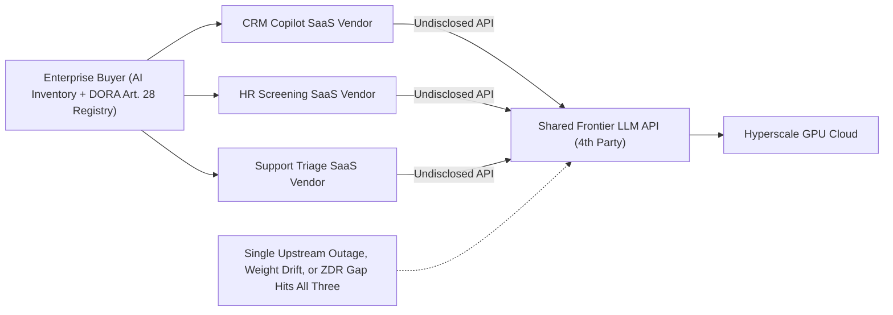

# Chapter 23: Vendor & Third-Party AI Risk

*Part VII: Third-Party & Lifecycle Risk*

> **In this chapter**
>
> * How to score AI vendors and model providers across security, data provenance, disaggregated evaluation, and financial viability—while spotting **SEC-enforced `"AI-washing"`**.
> * How to negotiate the **seven AI contract redlines**—distinguishing **`Zero Data Retention (ZDR)`** from `"no training,"` locking residency, model-change notice, audit rights, and filter-conditioned **IP indemnities**.
> * Why frontier cloud and foundation-model **concentration risk** (`FSB`) demands multi-provider gateways, exit drills, and **EU Data Act (`2023/2854`)** switching leverage ahead of the `January 12, 2027` zero-egress mandate.
> * How to map hidden **fourth-party dependencies** inside `"AI-enabled SaaS"` using **`Fed SR 23-4`** subcontractor rules and **`EU DORA Article 28`** Registers of Information.
> * How to uncover **algorithmic disgorgement** (`Everalbum`, `Kurbo`, `Rite Aid`), `700M` MAU open-weight caps, `AGPL` snippets, and unverified weights during **M&A and investment due diligence**.

**Most enterprises do not pre-train frontier AI models—they rent or embed them.** Part VI (Chapters 20–22) established what global laws, vertical supervisors, and auditors demand from production AI. Chapter 23 opens *Part VII: Third-Party & Lifecycle Risk* by confronting the uncomfortable operational truth: more than three-quarters of enterprise AI risk arrives across vendor APIs, embedded SaaS copilot toggles, hidden downstream model sub-processors, and corporate acquisitions. Buying an external AI tool transfers execution tasks, never legal accountability.

---

### Illustrative Composite Scenario: The Hidden Monoculture and the Tainted Acquisition

A global commercial-services enterprise experiences two cascading third-party failures within sixty days:

* **The Hidden Fourth-Party Monoculture:** A regional outage and rate-limit meltdown at a single frontier LLM provider simultaneously freezes five seemingly independent SaaS applications—CRM lead scoring, HR candidate summarizing, IT support routing, contract redlining, and procurement triage. None of the five SaaS vendors disclosed their shared fourth-party API reliance during procurement. Worse, security discovers two of those vendors enabled stateful `"assistants"` and 30-day abuse-monitoring logs despite `"we never train on customer data"` slide decks.
* **The Tainted `$180 Million` Acquisition:** Weeks before closing an `$180 million` M&A deal for a vertical document-intelligence startup, acquirer diligence uncovers three buried liabilities: the target fine-tuned core classifiers on scraped consumer biometrics lacking valid consent (**FTC algorithmic disgorgement** risk); coding assistants inserted unattributed `AGPLv3` modules into core APIs; and a primary open-weight backbone carries a non-commercial research license plus `Llama` attribution clauses triggered by the combined post-merger user count—forcing an immediate price cut and dedicated escrow holdback.

*(This composite scenario is illustrative; it is not drawn from a specific organization or incident.)*

---

## 23.1 Due Diligence for AI Vendors and Model Providers

Traditional software procurement questionnaires (`SOC 2 Type II`, encryption at rest, uptime SLAs) miss the core failure modes of probabilistic third-party AI. Banking supervisors codified the governing discipline on **June 6, 2023** through joint interagency guidance **Fed `SR 23-4` / OCC Bulletin `2023-17` / FDIC `FIL-29-2023`** (*Interagency Guidance on Third-Party Relationships: Risk Management*), structuring oversight across planning, due diligence, contracting, ongoing monitoring, and termination while warning explicitly that **outsourcing never diminishes board and management accountability**.[^c23-04]

Before any business unit connects a third-party model or AI-infused SaaS tool to corporate data—even inside `"free pilots"`—Vendor Risk, Security, and Legal should score candidates across **five AI due diligence pillars** (operationalized in Appendix D):

1. **Tenant Isolation & Runtime Retention Mechanics:** Confirm strict logical tenant isolation, verify whether inference requests feed any safety/quality feedback queues, and inspect stateful services (`RAG` indexes, fine-tuning jobs, batch files) for encryption and deletion boundaries.
2. **Training-Data Provenance & Copyright Hygiene:** Demand written clarity on pre-training and fine-tuning corpora. For EU-facing commercial models, verify whether upstream foundation-model suppliers publish the **EU AI Office's July 24, 2025 `Article 53(1)(d)` training-content summary template** covering scraped, licensed, user, and synthetic data plus TDM opt-out compliance.[^c23-03]
3. **Empirical Evaluation & Disaggregated Benchmarks:** Reject generic marketing leaderboards (`MMLU`, `GSM8K`). Require vendor evaluation cards reporting latency, hallucination rate, prompt-injection resistance, and subgroup accuracy/fairness—and validate claims against *your own golden datasets* before signing.
4. **Sub-Processor & Geography Mapping:** Identify every underlying foundation-model API, vector database host, and human annotation contractor touching enterprise prompts.
5. **Financial Runway & Hardware Capacity:** Assess GPU supply commitments, vendor burn rates, and code/weight escrow protections so your enterprise never builds core workflows atop an AI wrapper six months from insolvency.

**Spotting `"AI-Washing"` Before Contracting:** Vendor hype frequently masks manual back-office labor or brittle third-party API wrappers. On **March 18, 2024**, the **U.S. Securities and Exchange Commission (`SEC`)** fined two investment advisers (`Delphia` and `Global Predictions`) **`$400,000` combined** for misrepresenting AI capabilities in investor marketing.[^c23-01] Expanding enforcement to operating businesses, on **January 14, 2025**, the SEC charged public company **Presto Automation Inc.** over materially misleading statements claiming proprietary drive-thru AI automation while concealing third-party speech technology and heavy human intervention.[^c23-02] Procurement teams should apply a quick **four-flag AI-washing smell test**: *(a)* refusal to name underlying foundation models; *(b)* zero subgroup or failure metrics; *(c)* vague `"proprietary LLM"` claims paired with sub-minute pricing suspiciously subsidized; and *(d)* reluctance to demonstrate automated workflows under unscripted live inputs.

### The Guardrails

1. **Gate All AI Pilots Behind Standardized Five-Pillar Scoring:** Ban uploading non-public corporate or customer data into vendor sandboxes until Security and TPRM score retention, provenance, evals, sub-processors, and solvency ([^c23-04]).
2. **Verify `Art. 53(1)(d)` Summaries & Independent Evaluations:** Demand EU GPAI training-summary assurances ([^c23-03]) and test vendor accuracy directly on domain golden sets rather than marketing benchmarks.
3. **Run the Four-Flag `"AI-Washing"` Audit on Strategic Suppliers:** Document actual underlying model architecture and human-fallback rates (`SEC` lessons) before signing multi-year commitments ([^c23-01], [^c23-02]).

---

## 23.2 Contract Clauses That Matter

Standard SaaS Master Services Agreements (`MSAs`) were built for deterministic software where vendors store customer tables statically—not AI pipelines where prompts train future weights, models mutate monthly, and indemnification dissolves if one API safety flag toggles off. Leaving AI governance to vendor online Terms of Service (`ToS`) invites sudden policy reversals, as demonstrated by **Zoom's August 2023 Section 10 ToS backlash** over unilateral AI training language[^c23-06] and **Slack's May 2024 default global-ML opt-in controversy** requiring manual customer opt-out emails.[^c23-07] Every enterprise AI MSA or Data Processing Addendum (`DPA`) must lock **seven binding redlines** (`Table 23.1`):

1. **Zero Data Retention (`ZDR`)—Never Settle for `"No Training"`:** Marketing `"we never train on API inputs"` still leaves prompts sitting on vendor servers. As **OpenAI's Enterprise Privacy documentation** illustrates cleanly, standard commercial APIs retain prompts and outputs for up to **30 days for abuse and safety monitoring** unless the buyer secures approval-gated **Zero Data Retention (`ZDR`)**—and stateful API features (`Files`, `Batches`, `Assistants`, `Fine-tuning`) persist customer payloads outside `ZDR` entirely unless explicitly avoided or purged.[^c23-05]
2. **Absolute Training & Derivative Opt-Out:** Bar training, fine-tuning, RLHF human grading, prompt evaluation, or synthetic distillation on prompts, grounded RAG chunks, outputs, and telemetry metadata.
3. **Regional Residency Pinning:** Contractually pin inference endpoints, vector storage, caching, and trust-and-safety human escalation to designated jurisdictions (`EU`, `U.S.`, `India`), satisfying `GDPR` and `India DPDP § 16(2)`.
4. **Advance Model-Change & Deprecation Notice:** Mandate **60–90 days written notice** prior to changing model weights, altering system safety prompts, or deprecating pinned snapshots (supporting Ch. 24 re-validation gates).
5. **Sub-Processor Approval & Regulatory Audit Rights:** Require prior notice, reasonable objection/termination rights for AI sub-processor additions, and statutory examination rights (`Fed SR 23-4`, `EU DORA`).
6. **AI-Specific Incident Notification SLAs:** Expand breach triggers beyond unauthorized database exfiltration to cover cross-tenant cache leaks, poisoned model weights, and severe prompt-injection compromise within **`24–48` hour** reporting SLAs.
7. **Unencumbered IP Indemnity & Anti-Lock-In Data Portability:** Scrutinize **`Microsoft Copilot Copyright Commitment`**[^c23-08] and **`Google Cloud Shared Fate`**[^c23-09] filter-lock prerequisites and liability super-caps (`Ch. 19`), alongside government-style data/IP ownership and zero lock-in exit obligations modeled on **OMB M-25-22** (*Driving Efficient Acquisition of AI in Government*, April 3, 2025).[^c23-10]

#### Table 23.1 — Enterprise AI Contract Redline Playbook

| Contract Clause | Common Vendor Default Trap | Required Enterprise Redline |
| :--- | :--- | :--- |
| **Data Retention (`ZDR`)** ([^c23-05]) | `"No training"` policy while keeping 30-day abuse logs & stateful caches | Contractual **Zero Data Retention (`ZDR`)** across stateless endpoints; documented inventory/TTL controls on any stateful endpoint |
| **Training Rights** ([^c23-06], [^c23-07]) | Online ToS granting broad `"service improvement"` rights unless emailed out | MSA clause overriding ToS, barring all model training, fine-tuning, RLHF review, or synthetic generation from buyer data |
| **Residency & Transfers** | Global `"nearest GPU"` failover routing across U.S./EU/APAC clusters | Hard-pinned processing, logging, and abuse-review regions with SCCs/adequacy backing cross-border support |
| **Model & Filter Changes** | Silent behind-the-scenes weight refreshes or sudden snapshot sunsets | Minimum **60–90 day written advance notice** before deprecations or material weight/safety-layer updates |
| **Sub-Processors & Audits** | Blank link to dynamic URL with zero objection or inspection rights | 30-day prior notice + termination right on new fourth-party AI sub-processors; third-party/regulator audit access |
| **AI Incident SLAs** | Covers only confirmed PII exfiltration; silent on cross-tenant/agent bugs | Covers cross-tenant leakage, prompt-injection compromise, and poisoned models within **`24–48h`** notice |
| **IP Indemnity & Exit** ([^c23-08]–[^c23-10]) | Capped at `12 months` fees; voided if filters drop; omits trademark & data export | Prong 1+2 training/output defense with super-caps; explicit trademark/hosted-model schedules; machine-readable `OMB M-25-22` exit portability |

### The Guardrails

1. **Supersede Online ToS via Executed MSA AI Addenda:** Exclude unilateral webpage updates (`Zoom`/`Slack` scenarios) from governing AI privacy, retention, or training permissions ([^c23-06], [^c23-07]).
2. **Audit Both Stateless `ZDR` & Stateful Endpoints:** Verify contractually and technically that `Files`, `Batches`, and fine-tuning stores follow dedicated purge schedules ([^c23-05]).
3. **Lock Indemnity Filter Prerequisites & Require `60–90` Day Change Notice:** Preserve defense coverage via central tenant config ([^c23-08], [^c23-09]) and block unannounced model swaps.

---

## 23.3 Concentration Risk and Provider Lock-In

Enterprise AI adoption has quietly created deeper infrastructure centralization than earlier enterprise software eras. Training and serving frontier reasoning models concentrates inside a tiny circle of GPU manufacturers, hyperscale clouds, and three or four frontier model labs. In its **November 14, 2024** landmark report ***The Financial Stability Implications of Artificial Intelligence***, the **Financial Stability Board (`FSB`)** warned global regulators that heavy dependency on a handful of dominant third-party cloud and foundation-model providers creates acute systemic vulnerability: a single technical outage, cyber compromise, or sudden licensing restriction can trigger correlated operational failures across entire industries simultaneously.[^c23-11]

Regulators now convert concentration warnings into enforceable legal levers that enterprise architects should invoke directly during contract negotiations:

* **EU `DORA` Direct Oversight (`Regulation (EU) 2022/2554`):** Major cloud and AI infrastructure suppliers meeting systemic thresholds become designated **Critical ICT Third-Party Providers (`CTPPs`)** under lead supervision of European financial authorities—while regulated buyers must document tested **exit strategies** proving they can migrate critical AI workloads without unacceptable disruption.[^c23-13]
* **EU `Data Act` Cloud-Switching Rights (`Regulation (EU) 2023/2854`, Chapter VI):** Applicable across EU cloud and data-processing services since **September 12, 2025**, Chapter VI forces providers to eliminate commercial, contractual, and technical barriers to switching—capping customer termination notice at 2 months and mandatory transition assistance at 30 calendar days.[^c23-12] Crucially, under **Article 29(1)**, **all switching charges—specifically including migration data-egress fees—drop permanently to zero starting January 12, 2027**.

Legal exit rights only protect businesses whose engineering architecture can actually move. True anti-lock-in design keeps **four layers portable**:
1. **Model-Agnostic Gateway Abstraction:** Applications call an internal enterprise AI gateway (speaking a standardized schema) rather than hardcoding proprietary vendor SDKs or single-vendor orchestration frameworks directly into product code.
2. **Git-Versioned Prompts, Evals & Tool Contracts:** Keep system prompts, few-shot sets, function definitions, and golden evaluation suites in internal Git repositories—never trapped inside proprietary `"prompt studio"` UIs.
3. **Re-Indexable RAG Corpora:** Because vector embeddings from Model A are mathematically incompatible with Model B, always retain raw source documents and chunking pipelines so vector stores can be cleanly re-embedded onto an alternate provider within hours.
4. **Tested Warm Fallback Equivalence:** Continuously score secondary frontier or self-hosted open-weight models against critical evaluation suites (`Ch. 25`–`26`) so failover never drops accuracy or safety refusals off a cliff.

### The Guardrails

1. **Route Production Apps Through an Internal Model-Agnostic Gateway:** Decouple application code from vendor SDKs and store all prompts, tools, and evals in Git rather than proprietary cloud UIs.
2. **Enforce `EU Data Act` & `DORA` Switching Rights in Contracts:** Lock maximum 30-day transition assistance, standardized data/artifact export formats, and zero switching/egress charges ahead of `January 12, 2027` ([^c23-12], [^c23-13]).
3. **Keep Raw RAG Sources & Benchmark Secondary Models Quarterly:** Guarantee fast re-embedding onto alternate providers and validate cold/warm backup models against production safety thresholds ([^c23-11]).

---

## 23.4 Fourth-Party Risk: The AI Vendors Your Vendors Rely On

Even disciplined procurement teams routinely miss **fourth-party concentration**: dozens of category-leading `"vertical AI"` SaaS tools in HR, customer support, CRM, marketing, and contract review do not train models at all—they wrap APIs hosted by the exact same underlying hyperscale cloud and frontier foundation-model lab. When Vendor A, Vendor B, and Vendor C all call Model Provider X under the hood, diversification on your supplier spreadsheet is a complete illusion. A single upstream rate-limit exhaustion, silent weight update, prompt-retention slip, or regional outage cascades across all three SaaS workflows simultaneously.

Banking and financial regulators make fourth-party governance non-optional. Under **Federal Reserve `SR 23-4` / OCC `2023-17`**, institutions must evaluate how primary vendors select, monitor, and bind **subcontractors**, explicitly assess geographic and single-subcontractor **concentration**, and ensure critical contract obligations **flow down** across subcontractor chains.[^c23-04] In Europe, **EU `DORA Article 28`** goes further, requiring financial entities to maintain a structured **Register of Information** capturing all ICT third-party services supporting critical or important functions down through **material fourth-party sub-contractors**.[^c23-13]

*Caption: Hidden fourth-party monoculture across SaaS vendors. Seemingly independent vertical tools converge onto the same upstream LLM API and GPU cloud, requiring sub-processor disclosure and flow-down contract parity.*

### The Guardrails

1. **Mandate Fourth-Party Model & Region Schedules Before Onboarding SaaS AI:** Require every SaaS vendor to name the exact upstream foundation model(s), hosting cloud, and geographic regions processing prompts ([^c23-04], [^c23-13]).
2. **Enforce Contractual Flow-Down Parity (`ZDR`, Residency, Audit, Incident SLAs):** Bar direct SaaS suppliers from weakening enterprise zero-retention, residency, or security terms across their upstream LLM APIs.
3. **Graph Fourth-Party Convergence Inside Your Central AI Inventory:** Track upstream model dependencies across all procured SaaS products so Concentration Risk reviews catch hidden single points of failure.
4. **Require 30-Day Advance Notice + Opt-Out Before Upstream Model Swaps:** Prevent SaaS partners from silently migrating enterprise workflows from a vetted frontier API onto an unapproved cheaper model or region.

---

## 23.5 AI Due Diligence in M&A and Investments: Spotting Algorithmic Disgorgement, Poisoned Weights, and License Traps

Mergers, acquisitions, and strategic venture investments introduce a uniquely harsh third-party exposure: inheriting AI assets whose entire commercial value can evaporate the day regulators or rights-holders inspect how they were built. Standard software M&A checklists review corporate ownership and open-source scan summaries—leaving three AI-specific deal-killers hidden inside data rooms:

1. **Algorithmic Disgorgement (Compelled Model Destruction):** Pioneered by the **Federal Trade Commission (`FTC`)** in ***In the Matter of Everalbum, Inc.*** (**May 6, 2021**), regulators ordered the company to delete not only deceptively collected user photos, but the facial-recognition models trained on them.[^c23-14] Subsequent enforcement widened the blast radius sharply: in ***United States v. Kurbo, Inc. and WW International, Inc.*** (**March 2022**), the FTC required COPPA-violating parties to delete all algorithms/models derived from illegally gathered children's health data, and on **December 19, 2023**, in ***FTC v. Rite Aid Corporation***, the agency imposed a **five-year facial-recognition ban** alongside sweeping deletion of tainted photos, models, and algorithms extending across third-party technology vendors.[^c23-15] If an acquisition target trained its flagship model on unconsented biometric feeds, minors' data, deceptive user scraping, or scraped PHI lacking valid `§ 164.514` de-identification, the acquirer may literally buy an illegal weight file subject to deletion.
2. **Open-Source Copyleft Contamination & Open-Weight Scale Bombs:** M&A technical diligence must pair traditional code composition analysis with AI-era checks: coding copilots frequently inject unattributed `GPLv3`/`AGPLv3` snippets triggering SaaS source-disclosure and contract-breach exposure (*Doe 1 v. GitHub* [^c23-16]), while targets built on open-weight foundations (`Meta Llama`, `Gemma`, `Mistral`) often rely on **non-commercial research weights** or trigger **`700 million` Monthly Active User commercial restrictions, `"Built with Llama"` notices, and strict AUP terms** under the ***Llama Community License***—caps a target clears comfortably at `500,000` users that **explode instantly upon consolidation into a global acquirer's customer base**.[^c23-17]
3. **Poisoned, Counterfeit, or Unprovenanced Weights:** Target ML repositories may harbor pickled checkpoint exploits (`pickle` deserialization vulnerabilities), silent data-poisoning backdoors, or zero reproducible links between deployed binaries and training datasets. Require inventory manifests using **`SafeTensors`**, verifiable **`OpenSSF Model Signing v1.0`** cryptographic signatures, and clean lineage before bridging target models onto acquirer networks.[^c23-18]

**Translating Findings Into Deal Structure:** Never rely on general `"compliance with laws"` warranties in merger agreements. Where AI provenance gaps appear during diligence, M&A counsel should negotiate explicit **training-data & AI IP representations**, dedicated **special indemnities and escrow holdbacks** carved out from general liability baskets, **pre-close remediation conditions** (swap non-commercial weights or clean-room retrain on licensed corpora prior to closing), or direct purchase-price adjustments.

### The Guardrails

1. **Audit Training Data Legality & Consent Before Valuation Lock-In:** Trace target training and fine-tuning corpora end-to-end against `FTC` disgorgement triggers (biometrics, minors, deceptive scraping, unlicensed third-party datasets) ([^c23-14], [^c23-15]).
2. **Test Open-Weight Licenses Against Post-Merger Combined Scale:** Audit every model weight (`Llama`, `Gemma`, research checkpoints) for non-commercial bans, attribution obligations, and combined acquirer+target `700M` MAU caps ([^c23-17]).
3. **Run Snippet SCA Scans & Weight Cryptographic Verification Pre-Close:** Screen target codebases for copyleft contamination ([^c23-16]), ban `pickle` checkpoints in favor of `SafeTensors`, and verify `OpenSSF` model signatures ([^c23-18]).
4. **Ring-Fence Findings With AI Representations, Escrows & Clean-Room Milestones:** Carve AI provenance, copyright, and disgorgement indemnities into dedicated special escrows or require pre-close model retraining before closing.

---

## Why Every Role Cares

| Role | Primary Stakes in This Chapter | First Actions to Take |
| :--- | :--- | :--- |
| **Board / M&A Committee** | Hidden fourth-party outages freeze operations, while **FTC algorithmic disgorgement** and open-weight traps can wipe out `$100M+` acquisitions post-close. | Mandate third/fourth-party concentration reporting and dedicated AI provenance diligence in every acquisition pack. |
| **Chief Procurement Officer / TPRM** | `"No training"` vendor slides still permit 30-day abuse logs, stateful retention, and opaque fourth-party wrappers (`Fed SR 23-4`, `EU DORA`). | Enforce five-pillar AI DDQs pre-pilot and require Table 23.1 MSA redlines superseding online ToS. |
| **General Counsel / M&A Counsel** | Unchecked `"AI-washing"` claims invite `SEC` scrutiny, voided filter-conditioned indemnities shift defense bills onto buyers, and sloppy reps miss disgorgement. | Embed ZDR, `60–90` day change notice, filter-preservation, `EU Data Act` portability, and special M&A AI escrows. |
| **CIO / Enterprise Architects** | Hardcoding vendor SDKs, proprietary prompt consoles, and un-re-indexable embeddings locks core workflows into high-cost single providers. | Enforce an internal model-agnostic gateway, Git-versioned prompts/evals, and raw-source RAG re-indexing pipelines. |
| **CISO / AppSec** | Stateful endpoints bypass `ZDR`, unvetted SaaS wrappers leak prompts to fourth parties, and acquired `pickle` weights carry backdoor/malware risk. | Block uncontracted sandboxes, verify SaaS sub-processor regions/ZDR flows, and mandate `SafeTensors` + `OpenSSF` signatures. |
| **CFO / Corporate Development** | Single-cloud egress fees (`until Jan 2027`) and unverified target-company training lineage distort total cost of ownership and deal multiples. | Leverage `EU Data Act` zero-switching deadlines in renewals and price clean-room retraining costs into M&A bids. |

---

## Chapter Summary

| Section | Core Third-Party Risk | Mandatory Enterprise Guardrail | Primary Anchors |
| :--- | :--- | :--- | :--- |
| **Vendor Due Diligence** (`23.1`) | Legacy questionnaires miss model isolation, training provenance, subgroup evals, runway, and `SEC`-enforced `"AI-washing"`. | Gate all pilots behind 5-pillar AI DDQs, require `Art. 53(1)(d)` summaries, and verify performance on internal golden sets. | `SEC` ([^c23-01], [^c23-02]); GPAI Template ([^c23-03]); `SR 23-4` ([^c23-04]) |
| **Contract Redlines** (`23.2`) | Online ToS reversals (`Zoom`/`Slack`), `"no-training"` 30-day/stateful log gaps, silent swaps, and filter-voided indemnities undermine standard MSAs. | Supersede ToS with Table 23.1 redlines: verified `ZDR`, residency pinning, `60–90` day notices, audit/SLA terms, and locked filters. | `OpenAI Privacy` ([^c23-05]); `Zoom`/`Slack` ([^c23-06], [^c23-07]); `CCC`/`Cloud`/`M-25-22` ([^c23-08]–[^c23-10]) |
| **Concentration & Lock-In** (`23.3`) | Hyperscale cloud & frontier-model concentration creates single points of failure (`FSB`) reinforced by SDK and embedding lock-in. | Use model-agnostic gateways, Git-versioned prompts, raw-source RAG re-indexing, and `EU Data Act` (`Jan 2027`) / `DORA` exit terms. | `FSB` ([^c23-11]); `EU Data Act` ([^c23-12]); `EU DORA` ([^c23-13]) |
| **Fourth-Party SaaS Chains** (`23.4`) | `"Independent"` vertical SaaS tools silently wrap the same upstream frontier LLM API, creating hidden outage, ZDR, and residency monocultures. | Inventory upstream model sub-processors, enforce ZDR/residency flow-downs, map convergence (`DORA Art. 28`), and require swap notice. | `Fed SR 23-4` ([^c23-04]); `EU DORA` ([^c23-13]) |
| **M&A AI Diligence** (`23.5`) | Unconsented target training triggers **FTC algorithmic disgorgement** (`Everalbum`, `Kurbo`, `Rite Aid`), `AGPL`/`700M` MAU traps, and poisoned weights. | Audit target data consent, test licenses at post-merger scale, enforce `SafeTensors`/`OpenSSF` signing, and negotiate special escrows. | `Everalbum` ([^c23-14]); `Rite Aid`/`Kurbo` ([^c23-15]); `Doe` ([^c23-16]); `Llama` ([^c23-17]); `OpenSSF` ([^c23-18]) |

---

## Key Takeaways

1. **Outsourcing AI never transfers accountability.** `Fed SR 23-4` and `EU DORA` treat AI suppliers and fourth-party model APIs as supervised enterprise extensions requiring full vetting, contracts, and tested exit plans.
2. **`"No training"` does not equal `Zero Data Retention`.** Distinguish training opt-outs from 30-day abuse logging and stateful endpoints (`Files`, `Batches`, `Fine-tuning`) directly inside signed MSA addenda—never online ToS.
3. **Break vendor lock-in through architecture plus law.** Pair internal model-agnostic gateways and re-indexable RAG pipelines with **EU Data Act (`2023/2854`)** switching timelines and `January 12, 2027` zero-egress rights.
4. **Vertical SaaS tools often hide one fourth-party frontier API.** Map upstream model sub-processors inside your `DORA Article 28` / TPRM registry so three `"diverse"` contracts do not fail on one upstream outage.
5. **M&A targets carry unique balance-sheet AI bombs.** Audit training-data provenance against **FTC algorithmic disgorgement** (`Everalbum`, `Rite Aid`), combined post-merger open-weight scale (`700M` MAU), `AGPL` snippets, and cryptographic model signatures before signing.

---

## Questions to Ask
| Stakeholder | Diagnostic Question | What a Credible Answer Looks Like |
| :--- | :--- | :--- |
| **Procurement & TPRM Lead** | *"Do all enterprise AI vendors—including SaaS tools with AI add-ons—have signed MSA addenda confirming `ZDR`, zero training, sub-processor flow-downs, and `60–90` day change notice?"* | Signed contract repository covering stateful/stateless endpoints, explicit upstream sub-processor lists, and zero reliance on click-through ToS. |
| **Enterprise Architect & VP Engineering** | *"If our top LLM vendor suffers a multi-day outage or raises prices `3x`, how fast can critical production workflows failover to an alternate provider?"* | Central model-agnostic gateway, prompts/evals versioned in Git, raw-source RAG re-indexing playbooks, and tested secondary model benchmarks. |
| **Third-Party Risk & Compliance Lead** | *"Looking across every procured SaaS app, how many rely on the exact same fourth-party frontier LLM API—and are they captured in our `DORA Art. 28` / `SR 23-4` register?"* | Dependency graph highlighting fourth-party model and cloud convergence alongside regional processing schedules and tested vendor exit plans. |
| **CISO & Platform Ops** | *"Are vendor IP-indemnity safety filters locked via central IAM/IaC policies, and can we confirm no `Files`/`Batches`/stateful endpoints retain unapproved customer data?"* | Tenant configuration locks preventing engineer filter bypasses plus audited gateway checks restricting stateful endpoint retention. |
| **General Counsel & Corporate Development** | *"Before signing our next AI acquisition or strategic investment, how do we verify the target won't trigger FTC algorithmic disgorgement, `AGPL` taint, or post-merger `Llama` license caps?"* | Dedicated M&A AI diligence checklist auditing training consent lineage, open-weight combined-MAU limits, snippet SCA scans, `OpenSSF` signatures, and special escrows. |

---

## References

[^c23-01]: U.S. Securities and Exchange Commission, "SEC Charges Two Investment Advisers with Making False and Misleading Statements About Their Use of Artificial Intelligence," Press release 2024-36, March 18, 2024, https://www.sec.gov/newsroom/press-releases/2024-36. **Annotation:** First `"AI-washing"` enforcement actions imposing `$400,000` combined civil penalties against Delphia and Global Predictions for unsubstantiated AI claims. [↗ Bibliography](../bibliography.md#sec-2024-ai-washing)

[^c23-02]: U.S. Securities and Exchange Commission, *In the Matter of Presto Automation Inc.*, Administrative proceeding, January 14, 2025, https://www.sec.gov/. **Annotation:** First SEC AI-washing enforcement against a public operating company over misleading proprietary-AI claims concealing third-party speech tech and human intervention. [↗ Bibliography](../bibliography.md#sec-2025-presto)

[^c23-03]: European Commission and European AI Office, *Explanatory Notice and Template for the Public Summary of Training Content for General-Purpose AI Models*, Brussels, July 24, 2025, https://digital-strategy.ec.europa.eu/en/library/explanatory-notice-and-template-public-summary-training-content-general-purpose-ai-models. **Annotation:** Mandatory EU AI Act `Article 53(1)(d)` summary template empowering enterprise buyers to vet GPAI training corpora and TDM copyright compliance. [↗ Bibliography](../bibliography.md#ec-2025-gpai-template)

[^c23-04]: Board of Governors of the Federal Reserve System, Office of the Comptroller of the Currency, and Federal Deposit Insurance Corporation, *Interagency Guidance on Third-Party Relationships: Risk Management*, SR 23-4 / OCC Bulletin 2023-17 / FIL-29-2023, June 6, 2023, https://www.federalreserve.gov/supervisionreg/srletters/sr2304.htm. **Annotation:** Authoritative U.S. third-party risk lifecycle standard requiring subcontractor vetting, geographic/concentration tracking, contractual flow-downs, and retained institutional accountability. [↗ Bibliography](../bibliography.md#fed-2023-sr23-4)

[^c23-05]: OpenAI, "Enterprise Privacy and Data Controls (API Data Retention and Zero Data Retention)," OpenAI Platform Documentation, accessed November 21, 2026, https://platform.openai.com/docs/guides/your-data. **Annotation:** Distinguishes `"no training by default"` from 30-day abuse-monitoring log retention, approval-gated `ZDR`, and persistent stateful endpoints (`Files`, `Batches`, `Assistants`, `Fine-tuning`). [↗ Bibliography](../bibliography.md#openai-2025-enterprise-privacy)

[^c23-06]: Zoom Video Communications, Inc., "How Zoom's Terms of Service and Practices Apply to AI Features," Zoom Blog, August 2023, https://www.zoom.com/en/blog/zooms-term-service-ai/. **Annotation:** Highlights governance hazards of relying on unilaterally modifiable online SaaS Terms of Service that sweep customer meeting/chat data into AI training clauses. [↗ Bibliography](../bibliography.md#zoom-2023-tos-ai)

[^c23-07]: Slack Technologies, "How Slack Uses Data for AI and Machine Learning (Privacy Principles Clarification)," Slack Blog, May 2024, https://slack.com/trust/data-management/privacy-principles. **Annotation:** Illustrates default enterprise global-ML opt-in friction requiring explicit opt-out controls and formal MSA contractual boundaries. [↗ Bibliography](../bibliography.md#slack-2024-privacy-principles)

[^c23-08]: Microsoft Corporation (Brad Smith and Hossein Nowbar), "Microsoft Announces New Copilot Copyright Commitment for Customers," Microsoft On the Issues Blog, September 7, 2023, https://blogs.microsoft.com/on-the-issues/2023/09/07/copilot-copyright-commitment-ai-legal-risks/. **Annotation:** Third-party AI IP defense commitment strictly conditioned on buyers maintaining built-in vendor guardrails and copyright filters. [↗ Bibliography](../bibliography.md#microsoft-2023-ccc)

[^c23-09]: Google Cloud, "Shared Fate: Protecting Customers with Generative AI Indemnification," Google Cloud Blog, October 12, 2023, https://cloud.google.com/blog/products/ai-machine-learning/protecting-customers-with-generative-ai-indemnification. **Annotation:** Two-pronged enterprise AI indemnification protecting training-data and generated-output claims subject to active safety filters and contract schedules. [↗ Bibliography](../bibliography.md#google-2023-ip-indemnity)

[^c23-10]: Office of Management and Budget, *Driving Efficient Acquisition of Artificial Intelligence in Government*, Memorandum M-25-22, April 3, 2025, https://www.whitehouse.gov/. **Annotation:** Establishes anti-lock-in portability, government data/IP ownership, and competitive interoperability contract standards adaptable into enterprise procurement templates. [↗ Bibliography](../bibliography.md#omb-2025-m25-22)

[^c23-11]: Financial Stability Board (FSB), *The Financial Stability Implications of Artificial Intelligence*, Basel, November 14, 2024, https://www.fsb.org/2024/11/the-financial-stability-implications-of-artificial-intelligence/. **Annotation:** Global systemic-risk assessment warning that tight concentration across GPU infrastructure, hyperscale cloud providers, and frontier models creates correlated single points of failure. [↗ Bibliography](../bibliography.md#fsb-2024-ai-stability)

[^c23-12]: European Parliament and Council of the European Union, Regulation (EU) 2023/2854 of 13 December 2023 on Harmonised Rules on Fair Access to and Use of Data (*Data Act*), OJ L, 2023/2854, Dec 22, 2023, http://data.europa.eu/eli/reg/2023/2854/oj. **Annotation:** Mandates cloud-switching portability (`applicable September 12, 2025`; max 2-month notice / 30-day transition) and prohibits switching and migration egress charges (`Article 29(1)`) from `January 12, 2027`. [↗ Bibliography](../bibliography.md#eu-2023-data-act)

[^c23-13]: European Parliament and Council of the European Union, Regulation (EU) 2022/2554 on Digital Operational Resilience for the Financial Sector (*DORA*), OJ L 333, Dec 27, 2022 (applicable Jan 17, 2025), http://data.europa.eu/eli/reg/2022/2554/oj. **Annotation:** Requires `Article 28` third- and fourth-party Registers of Information, exit/audit clauses, and direct ESA oversight over systemic Critical ICT Third-Party Providers (`CTPPs`). [↗ Bibliography](../bibliography.md#eu-2022-dora)

[^c23-14]: Federal Trade Commission, *In the Matter of Everalbum, Inc.*, Decision and Order, Docket No. C-4743, May 6, 2021, https://www.ftc.gov/legal-library/browse/cases-proceedings/1923172-everalbum-inc-matter. **Annotation:** Landmark algorithmic-disgorgement precedent requiring deletion not only of deceptively gathered user photos but of all derived facial-recognition models and algorithms. [↗ Bibliography](../bibliography.md#ftc-2021-everalbum)

[^c23-15]: Federal Trade Commission, *United States v. Kurbo, Inc. and WW International, Inc.* (March 2022) and *FTC v. Rite Aid Corporation* (December 19, 2023), https://www.ftc.gov/news-events/news/press-releases/2023/12/rite-aid-banned-using-ai-facial-recognition-after-ftc-says-retailer-deployed-technology-without. **Annotation:** Expanded FTC algorithmic disgorgement across children's COPPA data (*WW International*) and biometric surveillance (*Rite Aid* 5-year facial-recognition ban and model deletion extending through third-party vendors). [↗ Bibliography](../bibliography.md#ftc-2023-rite-aid)

[^c23-16]: *Doe 1 v. GitHub, Inc.*, No. 4:22-cv-06823-JST, 2024 WL 235484 (N.D. Cal. Jan 22 & Jun 2024). **Annotation:** Illustrates open-source attribution and copyleft breach-of-contract risks lurking inside AI-assisted software targets during M&A code diligence. [↗ Bibliography](../bibliography.md#doe-2024-github)

[^c23-17]: Meta Platforms, Inc., *Llama Community License Agreement (Llama 3 / 3.1 / 3.3 / 4 Series) and Acceptable Use Policy*, 2024–2025, https://www.llama.com/llama3_1/license/. **Annotation:** Highlights commercial `700 million` MAU thresholds, `"Built with Llama"` notices, derivative naming rules, and AUP flow-downs that must be tested against combined post-merger scale. [↗ Bibliography](../bibliography.md#meta-2024-llama-license)

[^c23-18]: Open Source Security Foundation (OpenSSF), "Model Signing v1.0 (OMS Specification and Sigstore Integration)," OpenSSF AI/ML Working Group, April 4, 2025, https://openssf.org/blog/2025/04/04/openssf-model-signing-v1-0/. **Annotation:** Cryptographic Sigstore signing bundle standard verifying AI weights, configs, and tokenizers against tampering or unverified M&A artifact lineage. [↗ Bibliography](../bibliography.md#openssf-2025-model-signing)
