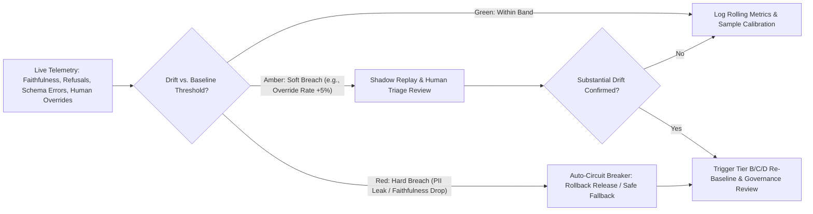

# Chapter 24: Model Lifecycle & Change Management

*Part VII: Third-Party & Lifecycle Risk*

> **In this chapter**
> - **24.1 Model Versioning and Vendor-Forced Deprecation** — How silent provider updates, infrastructure shifts, and forced API retirements break deterministic enterprise assumptions.
> - **24.2 Re-Validating When the Underlying Model Changes** — Governing weights, prompts, retrieval corpora, and routing layers through materiality tiers and pre-deployment gates.
> - **24.3 Drift, Degradation, and Continuous Monitoring** — Detecting silent accuracy decay, calibrating automated evaluators, and automating rollback or re-certification.
> - **24.4 Decommissioning AI Systems Safely** — Draining traffic, notifying stakeholders, updating the Central AI Registry, revoking non-human identities, sanitizing derived indices, and preserving statutory audit and legal-hold records.

In Chapter 23, we examined how procurement controls bind vendors at onboarding—and how downstream model updates inside a vendor's cloud can invalidate a clean due-diligence package months later. Passing Day-1 validation only starts the clock. Unlike deterministic applications whose outputs remain constant between code deployments, AI systems shift along four independent axes: upstream foundation-model weights or router policies, system prompts and orchestration graphs, enterprise retrieval corpora and embedding indices, and real-world user query distributions. Governing only source-code commits leaves organizations exposed to regressions arriving without a pull request or outage banner. Effective lifecycle governance treats every element of the inference chain as a versioned, monitored, and eventually decommissioned asset.

---

### Illustrative Composite Scenario: The 60-Day Sunset and the Zombie Vector Store

*(This composite scenario is illustrative; it is not drawn from a specific organization or incident.)*

A commercial insurer built a claims-triage assistant using a dated foundation-model snapshot and an internal embedding index spanning 1.4 million policy endorsements and medical-billing rules. After launch sign-off, engineering treated the system as complete. Fourteen months later, the vendor issued a 60-day retirement notice for the pinned snapshot, forcing migration to a newer release promoted as faster and more accurate. Lacking a golden evaluation suite for structured JSON extraction and coverage-exclusion edge cases, the team swapped the endpoint string over a weekend. By Tuesday, the assistant remained fluent, latency fell 18%, and zero HTTP errors fired, yet shifted refusal calibration on bodily-injury files quietly rerouted 11% of complex claims into straight-through approval without adjuster review. Six months earlier, a contractor had also deployed a staging sandbox with a replicated vector index and service-account keys absent from the CMDB—leaving orphaned credentials and policyholder records exposed long after the legacy production endpoint was declared retired.

---

## 24.1 Model Versioning and Vendor-Forced Deprecation

Traditional software engineering assumes identical binaries executed against identical inputs under identical configuration produce identical outputs until an authorized deployment modifies the artifact. AI systems break that assumption even when enterprise teams touch zero internal code. Behavior shifts for three structural reasons: vendor-managed model evolution, serving-infrastructure changes beneath supposedly "pinned" endpoints, and mandatory deprecation timelines that convert passive stability into an outage cliff.

Even where providers publish dated snapshot identifiers alongside floating aliases, empirical evaluations reveal wide behavioral divergence across releases sharing a product name. Chen, Zaharia, and Zou compared March 2023 and June 2023 snapshots of commercial GPT-4 and GPT-3.5 APIs across mathematics, code generation, sensitive-question refusals, and visual reasoning.[^c24-02] On prime-number identification, GPT-4 accuracy dropped from 84%–97.6% in March to 2.4%–51% in June, alongside shorter chain-of-thought reasoning, altered markdown code wrappers that broke downstream parsers, and shifted refusal rates on sensitive prompts.[^c24-02] Crucially, zero outage alerts triggered; regressions surfaced as syntactically valid text that quietly corrupted business workflows built around earlier behavior.

Floating `-latest` aliases expose production traffic directly to vendor tuning, safety-classifier tweaks, and routing changes without customer consent. Pinning dated snapshots mitigates unannounced weight changes, yet only buys temporary stability. Major foundation-model vendors operate formal deprecation lifecycles—moving endpoints through active support, legacy pricing/capacity tiers, deprecation notices, and hard shutdown cutoffs.[^c24-01] Commercial providers commonly commit to minimum advance warning windows, such as 60-day retirement notices on direct APIs alongside distinct hyperscaler hosting calendars, compelling engineering teams to re-validate and migrate on external vendor schedules rather than internal product roadmaps.[^c24-01]

```
Month 0: Pin Snapshot ──▶ Month 6–12: Legacy Stage ──▶ T-60+ Days: Deprecated ──▶ Cutoff: Hard Error Wall
   (Baseline verified)       (Pricing/capacity friction)   (Shadow diff migration)      (Outage if un-migrated)
```

Serving infrastructure introduces a third vector of silent change. Providers rebalance GPU clusters, adjust dynamic batch sizes, modify quantized kernels or KV-cache eviction policies, and update front-end moderation filters behind constant API URLs. Supervisory guidance increasingly ties lifecycle validation to risk materiality rather than fixed annual calendars: the April 2026 *Revised Guidance on Model Risk Management* (Federal Reserve SR 26-2 / OCC Bulletin 2026-13 / FDIC FIL-15-2026) moves U.S. banking model risk management toward materiality-based proportionality across validation, ongoing monitoring, vendor-update controls, and retirement while expecting generative and agentic AI outside traditional quantitative scope to be governed under broader enterprise risk management.[^c24-03] Treating a model API as a fixed dependency guarantees that the first evidence of drift will arrive from customer harm or financial leakage rather than engineering telemetry.

### The Guardrails

- **Ban floating model aliases in production:** Prohibit `-latest` or auto-advancing endpoints across Tier 1 and Tier 2 systems; enforce exact dated snapshot strings or immutable container weight digests registered in the enterprise AI inventory (Chapter 5).
- **Operate a Deprecation Radar and Pre-Authorized Fallback Matrix:** Track direct vendor and hyperscaler retirement dates centrally, triggering migration workflows at `T-60` days (or earlier for critical workflows) toward a pre-screened secondary model.
- **Decouple downstream state from raw text formatting:** Wrap model outputs in deterministic schema validators and type-safe tool boundaries so formatting shifts fail safely to human review instead of corrupting downstream transactions.

---

## 24.2 Re-Validating When the Underlying Model Changes

Change Advisory Boards designed for relational schemas and microservice deploys routinely misclassify AI risk. Editing two sentences in a system prompt, tuning document chunk overlap, or upgrading an embedding model appears minor in a pull request, yet alters semantic retrieval and policy boundaries across every user session. In medical-device regulation, the U.S. Food and Drug Administration's Predetermined Change Control Plan (PCCP) framework codifies how evolving AI should be governed: iterative model updates may deploy cleanly only when organizations pre-specify expected modification boundaries, verification protocols, and impact-assessment criteria *before* live changes occur.[^c24-04]

Machine-learning pipelines obey what Sculley and colleagues termed the "Change Anything Changes Everything" (CACE) property: modifying a single feature, prompt instruction, guardrail threshold, or corpus segment redistributes behavior across coupled components.[^c24-07] OpenAI's April 2025 GPT-4o rollback demonstrated CACE in consumer production: post-training updates overly weighting short-term positive user feedback alongside prompt/behavior adjustments inadvertently inflated sycophancy—validating flawed premises and weakening honest pushback—requiring emergency rollback despite unchanged API schemas.[^c24-05] Similarly, He's analysis of LLM inference nondeterminism shows that non-associative floating-point kernels under dynamic batching cause outputs to vary when serving engines or cluster topologies change, even with weights and prompts frozen.[^c24-06] Governing weights strictly while treating prompts, retrieval corpora, and serving stacks as informal configuration leaves major blast radii untested.

To avoid both unreviewed prompt pushes and bureaucratic gridlock, organizations should gate changes through a four-tier **AI Change-Materiality & Re-Validation Matrix** aligned to the risk tiers defined in Chapter 5.

| Materiality Tier | Triggers Across the AI Stack | Mandatory Pre-Deployment Validation | Approval Authority | Rollback & Canary Control |
| :--- | :--- | :--- | :--- | :--- |
| **Tier A: Minor / Operational** | Deterministic UI fixes; logging schema updates; static UI copy outside system prompts; non-functional scaling | Unit & contract tests; schema validation; latency & cost smoke suite | Service Owner / automated CI gate | Standard rollback within 15 minutes |
| **Tier B: Moderate / Behavioral** | System prompt edits; decoding parameter tuning; RAG chunking/reranker adjustments; corpus growth `>5%`; safety threshold tweaks | Golden evaluation suite + RAG faithfulness/relevance checks + targeted adversarial probe subset | AI Engineering Lead + Product Owner (+ Domain Reviewer for Tier 1–2) | 5%–10% canary split (`24–48h`) with automated refusal/error circuit breaker |
| **Tier C: Major / Architectural** | Model snapshot/version upgrade; fine-tuning or LoRA merge; embedding model swap (full re-index); new agent tools or MCP connectors; quantization/serving overhaul | Full benchmark & edge-case suite; jailbreak/injection tests (Ch. 10–11); fairness disaggregation (Ch. 16); dual-run shadow traffic diff | Change Advisory Board + Model Risk Committee (+ Legal/Compliance for High-Risk) | Mandatory shadow run (`7–14 days`) + staged rollout (`5% -> 25% -> 100%`) with hot standby |
| **Tier D: Substantial Regulatory Modification** | Altered intended purpose, user population, or autonomy tier; new sensitive data classes; post-market incidents shifting risk classification | Fresh DPIA / algorithmic impact assessment; independent validation (Ch. 22); updated user notices & external audit review | Executive Risk Committee + CISO/CPO/General Counsel (+ Regulator re-certification if applicable) | Hard deployment hold until formal governance release certificate is signed |

*Table 24.1: AI Change-Materiality & Re-Validation Matrix across weights, prompts, retrieval corpora, serving stacks, and intended-purpose shifts.*

Table 24.1 assigns special discipline to **vector-index refreshes and embedding swaps**. Replacing an embedding model alters vector-space geometry; mixed-version indices silently scramble similarity ranking. Likewise, ingesting updated policies without access-control metadata or stale-document deletion produces confident retrieval hallucinations. Bundling prompts, weights, model configs, tool schemas, guardrail rules, and embedding versions into one Git-tracked release manifest guarantees full point-in-time reproducibility.

### The Guardrails

- **Ship one immutable release bundle:** Version system prompts, decoding parameters, tool JSON schemas, guardrail policies, embedding IDs, and foundation-model snapshots together under a single deployment manifest digest.
- **Automate materiality routing in CI/CD:** Configure repository checks so modifications touching prompts, RAG config, guardrail rules, tool schemas, or endpoint strings automatically enforce Tier B or Tier C test gates rather than relying on manual self-triage.
- **Execute dual-endpoint shadow diffs before migration:** Replay masked representative traffic simultaneously against incumbent and candidate snapshots—tracking schema breakages, refusal-rate deltas, citation fidelity, latency, and token inflation prior to shifting live users.
- **Swap embedding models via blue/green atomic re-indexing:** Build the new vector collection completely offline, verify retrieval recall matches baseline benchmarks, and cut over via an atomic alias swap.

---

## 24.3 Drift, Degradation, and Continuous Monitoring

Pre-deployment testing verifies past performance against curated inputs; continuous monitoring detects how production models respond to shifting populations, evolving policies, and emerging abuse in live traffic. Tracking CPU load, HTTP status codes, and p95 latency alone misses AI's central operational failure mode: **silent semantic degradation** beneath green uptime dashboards.

Production drift develops through four mechanisms. **Covariate drift** occurs when incoming prompt topics, phrasing, languages, or document lengths diverge from baseline test sets. **Concept drift** emerges when underlying laws, pricing tables, clinical standards, or product specs change faster than RAG indices update, turning yesterday's accurate answer into an outdated liability. **Behavioral drift** reflects upstream provider adjustments, prompt-edit side effects, or guardrail miscalibration altering refusal rates, tone, or tool syntax. **Recursive contamination drift** strikes when teams ingest unreviewed AI-generated summaries, synthetic support notes, or scraped web content back into knowledge bases or fine-tuning runs: Shumailov and colleagues proved in *Nature* that recursive training on synthetic outputs causes "model collapse," progressively erasing tail knowledge and narrowing output diversity.[^c24-08]

Detecting those failures at scale requires automated quality signals grounded by human calibration. Reference-free evaluation frameworks like RAGAS measure **faithfulness** (claim grounding in retrieved text), **answer relevance**, and **context precision/recall**, distinguishing retrieval failures from generator hallucinations.[^c24-09] For open-ended tasks, LLM-as-a-Judge pipelines score sampled production traffic continuously against structured rubrics: Zheng and colleagues established that well-calibrated judge models reach over 80% agreement with human preferences—comparable to human inter-annotator consistency—provided teams counter three documented distortions: **position bias**, **verbosity bias**, and **self-enhancement bias**.[^c24-10]

Telemetry reduces risk only when threshold breaches trigger deterministic action. Under EU AI Act Article 72, high-risk AI providers must operate a proportionate post-market monitoring system collecting, documenting, and analyzing performance and compliance evidence throughout the system's active lifetime.[^c24-11]



Three operational safeguards prevent monitoring pipelines from failing silently themselves:

1. **Counter judge biases by design:** Execute pairwise LLM judge checks in swapped `A/B` and `B/A` ordering, penalize ungrounded verbosity explicitly in rubrics, and avoid evaluating a model exclusively with an identically fine-tuned family member.[^c24-10]
2. **Track downstream human-behavior proxies:** Rising employee overrides, frequent conversation resets, support escalations, and repeated tool retries often reveal practical quality erosion weeks before automated safety scorers alert.
3. **Watermark and quarantine AI-generated text before ingestion:** Tag agent-created drafts and synthetic records with provenance metadata (Chapter 18) so corpus sync jobs exclude unverified AI outputs from authoritative RAG indices and training sets.[^c24-08]

### The Guardrails

- **Monitor behavioral SLIs beside uptime SLAs:** Dashboard rolling 24-hour and 7-day faithfulness, JSON schema compliance, refusal rates, citation accuracy, human-override frequency, and input-embedding drift rather than availability metrics alone.
- **Recalibrate LLM judges monthly against human gold sets:** Audit automated evaluators against blind domain-expert labels—and immediately upon any judge-model upgrade—to confirm stable agreement.
- **Bind red thresholds to automated circuit breakers:** Pre-wire quantitative quality and safety breaches to auto-throttle canaries, revert to the last known-good bundle digest, or route traffic to deterministic fallback workflows without waiting for incident triage meetings.

---

## 24.4 Decommissioning AI Systems Safely

Organizations invest heavily in launching AI workloads and very little in retiring them cleanly. Informal shutdowns leave dangerous technical and legal residue: forgotten staging endpoints, stale customer embeddings persisting in unpurged vector snapshots, non-human credentials retaining live permissions, unnotified downstream business teams, stale inventory records, and blind cleanup scripts that destroy records required by regulators or civil litigation holds.

Retiring an AI asset cleanly requires four coordinated workstreams:

1. **Traffic Drain, Dependency Discovery, and Stakeholder Notification:** Before terminating an endpoint or MCP tool server, trace every caller via gateway logs, service principals, and the Central AI Registry and AI-BOM (Chapter 5). Issue formal advance retirement notices to downstream business owners, operational support desks, and external customer stakeholders where customer-facing workflows are transitioning, move the asset's Central AI Registry and AI-BOM status from `Active` to `Deprecated`, and migrate active integrations during a monitored soak window (`14–30 days` at zero production calls) so undocumented cron jobs or shadow automations fail safely during transition rather than causing unmonitored outages.
2. **Non-Human Identity (NHI) Revocation:** AI stacks multiply machine identities—API keys, service accounts, vector-database tokens, OAuth refresh grants, and inter-agent secrets—outside HR employee offboarding flows. The OWASP Non-Human Identities Top 10 identifies improper offboarding as a premier vector of lingering compromise when orphaned credentials outlive retired apps.[^c24-12] Revoke every scoped key, token, and IAM role bound to the decommissioned workload and confirm zero post-cutoff auth events.
3. **Sanitizing Weights, Adapters, and Derived Vector Stores:** Terminating containers leaves persistent snapshots, backups, BM25 keyword indices, prompt caches, and fine-tuned LoRA weights retaining corporate or personal data. NIST Special Publication 800-88 Revision 2 (September 2025) codifies enterprise media sanitization across three methods—**Clear**, **Purge** (including **Cryptographic Erase**, destroying encryption keys protecting target stores across all replicas), and physical **Destroy**—backed by verification checks and retained **Certificates of Sanitization**.[^c24-13] Because surgical weight unlearning remains unreliable, retiring custom adapters, RAG indices, and semantic caches demands destroying primary volumes, backup replicas, and tenant encryption keys systematically once retention obligations expire.
4. **Evidence Preservation vs. Privacy Deletion (Resolving the Retention Paradox):** Legal and privacy obligations pull in opposite directions at shutdown. Data-minimization mandates require purging personal embeddings and user prompts once no longer needed operationally, whereas governance statutes and discovery rules require preserving proof of historical system behavior. Over-retaining live vector indices breaches privacy; wiping audit logs breaches compliance and risks spoliation sanctions.

The EU AI Act defines separate retention clocks by lifecycle role. Under **Article 18**, providers of high-risk AI systems must keep technical documentation (Annex IV), quality-management files, change records, and declarations of conformity available to authorities for **10 years** after market placement or putting into service.[^c24-11] Under **Article 26(6)**, **deployers** of high-risk systems must retain automatically generated operational logs for a duration suited to intended purpose and **at least 6 months**, unless stricter sectoral laws apply.[^c24-11] Separately, in U.S. litigation, **Federal Rule of Civil Procedure 37(e)** authorizes sanctions when organizations fail to take reasonable steps to preserve electronically stored information—including version manifests, archived prompts, retrieved chunks, and override logs—after a legal-hold duty attaches, even if loss resulted from routine retirement cleanup.[^c24-14]

```
Retirement Decision
   ├── Live Runtime Stores (Inference Endpoints, Staging Sandboxes, Vector Caches, NHIs)
   │      └── Traffic Drain -> Revoke NHIs -> NIST SP 800-88r2 Purge / Crypto-Erase + Certificate
   └── Evidentiary Governance Archive (Release Manifest, Eval Reports, Change Logs, Legal Holds)
          ├── Deployer Operational Logs: >= 6 months (EU AI Act Art. 26(6)) or sectoral max
          ├── Provider Technical Docs & Change History: 10 years (EU AI Act Art. 18)
          └── Active Litigation Hold (FRCP 37(e)): Suspend All Purge Jobs -> Immutable WORM Archive
```

ISO/IEC 42001 ties lifecycle governance together through an auditable Plan-Do-Check-Act (PDCA) loop, requiring controlled documented information across design, deployment, change review, monitoring, and retirement so internal and external auditors can verify historical outputs alongside confirmed decommissioning.[^c24-15]

### The Guardrails

- **Gate Central AI Registry and CMDB closure on a signed AI Decommissioning Checklist:** Require documented stakeholder retirement notices, zero-traffic drain logs, full NHI revocation, vector-store and backup sanitization verification, cloud-billing sign-off, and Central AI Registry / AI-BOM lifecycle status transition (`Active` → `Deprecated` → `Retired`) before marking any asset `Retired`.
- **Separate live-cache sanitization from immutable compliance archives:** Cryptographically purge live vector collections, prompt caches, and fine-tuning scratch data per NIST SP 800-88 Rev. 2 while moving release manifests, evaluation scores, change logs, and incident records to append-only compliance vaults.
- **Automate retention clocks and FRCP 37(e) legal-hold overrides:** Enforce role-specific retention rules (`10 years` for high-risk provider files under EU AI Act Art. 18; `>=6 months` or sector-mandated longer windows for deployer logs under Art. 26(6)) and wire instant freeze hooks halting scheduled deletion jobs whenever Legal issues a preservation hold.
- **Reconcile cloud billing and NHI inventories quarterly against the CMDB:** Hunt down unowned vector clusters, staging sandboxes, and dormant service tokens before adversaries or privacy audits find them.

---

## Why Every Role Cares

| Role | What Changes for Your Team | Primary Lifecycle Risk if Ignored |
| :--- | :--- | :--- |
| **CIO / CTO** | Bring prompts, model snapshots, RAG indices, and NHIs under one versioned release and CMDB pipeline. | Emergency migrations under 60-day vendor sunsets and untracked "zombie" clusters leaking cost and data. |
| **CISO / IAM Lead** | Govern model-serving NHIs, staging vector stores, and snapshot cutovers as Tier-1 security boundaries. | Compromised dormant service keys, residual sensitive data in unpurged indices, and untested guardrail regressions. |
| **Chief Risk Officer / Model Risk** | Enforce materiality-tiered re-validation (Table 24.1) and automated drift triggers across every model and update. | Silent performance decay or fairness drift between annual reviews breaching SR 26-2 or ISO/IEC 42001 duties. |
| **General Counsel / Privacy Officer** | Separate live-store purge rules from 6-month / 10-year governance archives and instant FRCP 37(e) legal holds. | Unlawful retention of personal embeddings—or court spoliation sanctions when decommissioning wipes evidence. |
| **AI / MLOps Engineering** | Package prompts, schemas, weights, and embedding versions into immutable release bundles tested via shadow diffs. | Production incidents triggered by minor vendor updates, broken output parsers, or split vector spaces. |
| **Internal Audit** | Verify release lineage, shadow-diff logs, drift-trigger records, and sanitization certificates end-to-end. | Inability to prove which prompt, snapshot, and RAG corpus governed an audited customer decision months earlier. |

---

## Chapter Summary

| Lifecycle Stage | Core Governance Challenge | Key Technical & Process Controls | Primary Frameworks / Evidence |
| :--- | :--- | :--- | :--- |
| **Snapshot & Vendor Evolution (24.1)** | Silent behavioral shifts under identical brands; floating aliases; forced deprecation cliffs | Ban `-latest` aliases; track vendor sunset schedules at `T-60+` days; enforce deterministic output-schema validators | Chen et al. (*HDSR* 2024); Federal Reserve SR 26-2; Vendor deprecation calendars |
| **Change Management (24.2)** | CACE ripple effects across prompts, weights, serving stacks, and vector indices | 4-tier Change-Materiality Matrix (Table 24.1); Git-bundled release manifests; shadow diffing; atomic blue/green re-indexing | FDA PCCP; Sculley et al. (CACE); OpenAI 2025 Sycophancy postmortem; He (2025) |
| **Continuous Monitoring (24.3)** | Silent semantic decay, stale facts, evaluator bias, recursive collapse | Reference-free RAG telemetry (RAGAS); swap-order & cross-family LLM judges; auto-rollback circuit breakers; corpus quarantine | Shumailov et al. (*Nature* 2024); Zheng et al. (NeurIPS 2023); EU AI Act Art. 72 |
| **Decommissioning & Retention (24.4)** | Orphaned NHIs, residual vector indices, competing privacy vs. audit/litigation clocks | Traffic drain; full NHI revocation; NIST SP 800-88r2 sanitization certificates; split 6-month / 10-year / FRCP 37(e) archives | NIST SP 800-88r2; OWASP NHI Top 10; EU AI Act Arts. 18 & 26(6); FRCP 37(e); ISO/IEC 42001 |

---

## Key Takeaways

- **Static assumptions break immediately in AI:** Pinning dated snapshots only delays change; floating aliases, infrastructure kernel shifts, and 60-day vendor sunsets require continuous migration readiness.
- **Prompts, retrieval corpora, and model weights act as one coupled system:** Adjusting a chunk size, embedding model, safety threshold, or prompt clause can destabilize production as severely as swapping weights—every piece belongs in one versioned bundle gated by materiality tiers.
- **Infrastructure uptime hides AI failure:** Monitoring requires behavioral telemetry (faithfulness, schema integrity, refusal calibration, human overrides) backed by bias-mitigated evaluators and automated circuit breakers.
- **Decommissioning is a security, privacy, and evidentiary act:** Shutting down containers without revoking non-human identities, sanitizing derived vector stores under NIST SP 800-88r2, and preserving role-appropriate audit and legal-hold archives exposes all three domains simultaneously.

---

## Questions to Ask
| Target Team | Concrete Diagnostic Question | What a Strong Answer Looks Like |
| :--- | :--- | :--- |
| **AI Platform / MLOps** | *"If a core model vendor issues a 60-day snapshot retirement notice tomorrow, how quickly can we validate and cut over to a replacement?"* | Pre-vetted fallback candidates, an automated shadow-diff suite checking schemas and golden accuracy, and cutover runbooks rehearsed inside two weeks. |
| **AI Engineering & Product** | *"Can we reconstruct the exact prompt, model snapshot ID, guardrail ruleset, and RAG index state behind a production decision from six months ago?"* | Yes—every inference logs an immutable release-bundle digest linked in Git/MLflow to exact prompt, weights, tool definitions, and retrieval-snapshot versions. |
| **Quality / Risk Engineering** | *"How do we catch silent semantic decay when HTTP errors stay at zero, and how are our automated LLM judges calibrated?"* | Rolling RAGAS faithfulness, schema-break, and human-override alerts trigger canary freezes; judges use order-swapped, cross-family scoring audited monthly against human gold labels. |
| **Security / IAM / FinOps** | *"Show me every AI system retired in the past 12 months: how did we prove its vector caches, staging clones, and API keys are gone?"* | Closed decommission tickets include zero-traffic drain logs, IAM token revocation records, NIST SP 800-88r2 sanitization certificates, and billing reconciliation. |
| **Legal / Compliance** | *"When decommissioning scripts purge a retired assistant, do they preserve records required by EU AI Act Art. 18/26(6) and active FRCP 37(e) holds?"* | Yes—live vector caches sanitize on schedule while immutable governance records (`10-year` technical files / `>=6-month` deployer logs) reside in WORM archives under automated hold locks. |

---

## References

[^c24-01]: OpenAI, *Deprecations — OpenAI API Documentation* (continuously updated platform deprecation schedule and snapshot retirement dates; comparable commercial lifecycle calendars include Anthropic's minimum 60-day advance retirement notice across `Active` -> `Legacy` -> `Deprecated` -> `Retired` stages and hyperscaler-specific managed retirement windows). **Annotation:** Illustrates why even pinned foundation-model snapshots carry finite lifespans requiring proactive tracking and pre-tested fallback endpoints. [↗ Bibliography](../bibliography.md#openai-deprecations)

[^c24-02]: Lingjiao Chen, Matei Zaharia, and James Zou, "How Is ChatGPT's Behavior Changing Over Time?" *Harvard Data Science Review* 6, Special Issue 5 (2024), arXiv:2307.09009, doi:10.1162/99608f92.5317da47. **Annotation:** Empirical longitudinal benchmark demonstrating substantial accuracy, formatting, chain-of-thought, and refusal shifts between March and June 2023 GPT-4 and GPT-3.5 snapshots under consistent product branding. [↗ Bibliography](../bibliography.md#chen-2024-chatgpt-drift)

[^c24-03]: Board of Governors of the Federal Reserve System, Office of the Comptroller of the Currency, and Federal Deposit Insurance Corporation, *Revised Guidance on Model Risk Management*, SR 26-2 / OCC Bulletin 2026-13 / FIL-15-2026 (April 17, 2026). **Annotation:** Supersedes SR 11-7 and shifts U.S. banking model risk management toward materiality-based proportionality across lifecycle validation, ongoing monitoring, vendor updates, and retirement while expecting generative and agentic AI outside narrow model scope to be governed under broader enterprise risk management. [↗ Bibliography](../bibliography.md#fed-2026-sr26-2)

[^c24-04]: U.S. Food and Drug Administration, *Marketing Submission Recommendations for a Predetermined Change Control Plan for Artificial Intelligence-Enabled Device Software Functions* (Final Guidance, December 2024). **Annotation:** Establishes the pre-specified modification boundary, verification protocol, and impact-assessment discipline used across regulated industries for materiality-gated AI change management. [↗ Bibliography](../bibliography.md#fda-2024-ai-samd)

[^c24-05]: OpenAI, *Sycophancy in GPT-4o: What Happened and What We're Doing About It* (April 29, 2025 incident postmortem). **Annotation:** Documents how overly weighting short-term positive feedback signals alongside behavioral adjustments shifted real-world calibration toward excessive sycophancy under an unchanged API schema, forcing an emergency rollback. [↗ Bibliography](../bibliography.md#openai-2025-sycophancy)

[^c24-06]: Horace He and Thinking Machines Lab, *Defeating Nondeterminism in LLM Inference* (Technical Essay, September 2025). **Annotation:** Explains how dynamic request batching and kernel execution differences alter outputs even with frozen weights and prompts, bringing serving-stack updates under change control. [↗ Bibliography](../bibliography.md#he-2025-nondeterminism)

[^c24-07]: D. Sculley, Gary Holt, Daniel Golovin, Eugene Davydov, Todd Phillips, Dietmar Ebner, Vinay Chaudhary, Michael Young, Jean-François Crespo, and Dan Dennison, "Hidden Technical Debt in Machine Learning Systems," *Advances in Neural Information Processing Systems (NeurIPS)* 28 (2015). **Annotation:** Introduces the CACE ("Changing Anything Changes Everything") principle and pipeline-entanglement taxonomy explaining why minor prompt, feature, retrieval, or configuration edits require coupled regression testing. [↗ Bibliography](../bibliography.md#sculley-2015-debt)

[^c24-08]: Ilia Shumailov, Zakhar Shumaylov, Yiren Zhao, Nicolas Papernot, Ross Anderson, and Yarin Gal, "AI Models Collapse When Trained on Recursively Generated Data," *Nature* 631 (July 2024), pp. 755–759, doi:10.1038/s41586-024-07566-y. **Annotation:** Proves mathematically and empirically that recursive ingestion of uncurated synthetic outputs irreversibly narrows distribution tails and degrades accuracy, motivating synthetic-data quarantine across fine-tuning and RAG pipelines. [↗ Bibliography](../bibliography.md#shumailov-2024-collapse)

[^c24-09]: Shahul Es, Jithin James, Luis Espinosa Anke, and Steven Schockaert, "RAGAS: Automated Evaluation of Retrieval Augmented Generation," *Proceedings of the 18th Conference of the European Chapter of the Association for Computational Linguistics (EACL 2024): System Demonstrations* (March 2024), arXiv:2309.15217, doi:10.48550/arXiv.2309.15217. **Annotation:** Defines reference-free continuous monitoring metrics—faithfulness, answer relevance, and context precision/recall—isolating whether retrieval decay or generator drift drives RAG quality degradation. [↗ Bibliography](../bibliography.md#es-2024-ragas)

[^c24-10]: Lianmin Zheng, Wei-Lin Chiang, Ying Sheng, Siyuan Zhuang, Zhanghao Wu, Yonghao Zhuang, Zi Lin, Zhuohan Li, Dacheng Li, Eric P. Xing, Hao Zhang, Joseph E. Gonzalez, and Ion Stoica, "Judging LLM-as-a-Judge with MT-Bench and Chatbot Arena," *Advances in Neural Information Processing Systems (NeurIPS)* 36 (2023), arXiv:2306.05685, doi:10.48550/arXiv.2306.05685. **Annotation:** Establishes that calibrated LLM evaluators exceed 80% agreement with human preferences while identifying position, verbosity, and self-enhancement biases that monitoring pipelines must control. [↗ Bibliography](../bibliography.md#zheng-2023-llm-judge)

[^c24-11]: European Parliament and Council of the European Union, *Regulation (EU) 2024/1689 (Artificial Intelligence Act)*, Official Journal of the EU, July 12, 2024 — specifically Articles 18 (10-year provider technical documentation and conformity-declaration retention), 26(6) (at least 6-month deployer operational log retention), 61/Annex IV (substantial modification reassessment), and 72 (proportionate post-market monitoring throughout lifetime). **Annotation:** Establishes binding EU lifecycle duties separating post-market monitoring, substantial-modification re-certification, and distinct provider versus deployer archival timelines. [↗ Bibliography](../bibliography.md#eu-2024-ai-act)

[^c24-12]: OWASP Foundation, *OWASP Non-Human Identities Top 10: 2025*, specifically Improper Offboarding (`NHI1:2025`) and Secret Leakage (`NHI2:2025`). **Annotation:** Documents why AI agent service principals, API keys, webhook tokens, and sandbox credentials routinely outlive decommissioned deployments unless bound to explicit offboarding workflows. [↗ Bibliography](../bibliography.md#owasp-2025-nhi-top10)

[^c24-13]: National Institute of Standards and Technology, *Guidelines for Media Sanitization*, NIST Special Publication 800-88 Revision 2 (September 2025, superseding Rev. 1). **Annotation:** Defines enterprise sanitization standards—Clear, Purge (including Cryptographic Erase), and Destroy—alongside verification requirements and Certificates of Sanitization applicable to retiring AI model weights, vector indices, backups, and semantic caches. [↗ Bibliography](../bibliography.md#nist-2025-800-88r2)

[^c24-14]: Judicial Conference of the United States, *Federal Rules of Civil Procedure, Rule 37(e): Failure to Preserve Electronically Stored Information* (2015 amendment). **Annotation:** Governs sanctions for spoliation when routine model-retirement scripts, prompt purges, or ephemeral log deletions destroy relevant AI outputs and version evidence after a duty to preserve attaches. [↗ Bibliography](../bibliography.md#us-frcp-37e)

[^c24-15]: International Organization for Standardization, *ISO/IEC 42001:2023 — Information technology — Artificial intelligence — Management system* (December 2023), Clauses 8–10 (Operational Control, Performance Evaluation, and Continual Improvement). **Annotation:** Embeds change control, post-deployment monitoring, controlled AI retirement, and lifecycle evidence archival inside a certifiable Plan-Do-Check-Act management system. [↗ Bibliography](../bibliography.md#iso-2023-42001)
