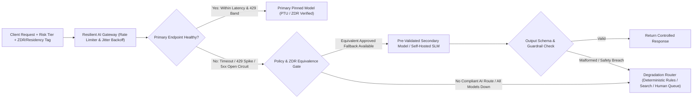

# Chapter 25: Operational Resilience & Business Continuity

*Part VII: Third-Party & Lifecycle Risk*

> **In this chapter**
> - **25.1 Provider Outages, Rate Limits, and Routing to a Fallback Model** — Architecting resilient AI gateways that survive upstream blackouts, `429` throttling, and cross-model behavioral mismatches without breaking compliance boundaries.
> - **25.2 Graceful Degradation: What Happens When the AI Is Unavailable?** — Designing fail-closed safety gates, deterministic fallback paths, agent cascade containment, and manual-proficiency preservation when generative intelligence drops offline.
> - **25.3 Including AI in Business Continuity and Disaster Recovery Plans** — Embedding AI third- and fourth-party dependencies, Impact Tolerances, cold-recovery bundles, and chaos drills into board-governed BC/DR frameworks.

In Chapter 24, we examined planned lifecycle transitions: snapshot drift, materiality-gated releases, continuous monitoring, and controlled decommissioning. Unplanned disruptions arrive with zero advance notice. An upstream API control plane stalls for four hours during peak customer volume; an unexpected marketing campaign exhausts token-per-minute ceilings across shared multi-tenant pools; a regional outage or guardrail timeout breaks downstream tool chains. While Chapter 13 addressed perimeter secret hygiene and cost defenses against Denial-of-Wallet attacks, availability failures turn directly into business paralysis whenever teams embed probabilistic APIs into core processes without an offline path. Operational resilience ensures that when frontier inference stalls, throttles, or vanishes, critical services degrade predictably—and never improvise their way past security or legal guardrails.

---

### Illustrative Composite Scenario: The Four-Hour Control-Plane Blackout and the Forgotten Manual Playbook

*(This composite scenario is illustrative; it is not drawn from a specific organization or incident.)*

At 10:14 a.m. during Monday peak volume, a regional bank's commercial lending and fraud-dispute workflows began failing with `503` timeouts after its primary model vendor suffered a multi-hour cluster control-plane outage. Engineering had configured an automatic failover router six months earlier, which flipped live production traffic to a standby open-weights model in another region. Within twenty minutes, two hidden failures compounded. First, the standby model's altered refusal calibration and markdown formatting broke downstream JSON parsers—while the failover script bypassed the bank's Zero Data Retention (ZDR) policy check and routed customer dispute narratives to a default regional endpoint with standard 30-day abuse retention. Second, operations supervisors told analysts to revert to legacy manual adjudication rules untouched for nearly two years. Half the queue stalled immediately: junior staff hired after the AI rollout had never triaged complex disputes manually, and legacy underwriting tables had gone stale eighteen months earlier when policy updates moved solely into the RAG vector index.

---

## 25.1 Provider Outages, Rate Limits, and Routing to a Fallback Model

AI infrastructure creates correlated availability hazards unlike horizontally scalable web microservices. Rather than replicating stateless compute cleanly across commodity cloud zones, frontier AI concentrates globally across a narrow base of specialized GPU silicon, hyperscale clusters, and leading model providers.[^c25-01] The Financial Stability Board warned in November 2024 that deep concentration across cloud, hardware, and foundation-model suppliers exposes multiple enterprises simultaneously to shared upstream failures.[^c25-01]

Major AI outages happen at fleet scale and defeat simple client retries. On December 11, 2024, OpenAI suffered an outage lasting roughly four hours and twenty-two minutes (`3:16 PM` to `7:38 PM PST`) across ChatGPT, its developer API, and Sora after a new Kubernetes telemetry service rolled out across its fleet triggered heavy API-server control-plane load whose cost scaled with cluster size, overwhelming API servers and disrupting DNS service discovery across major clusters.[^c25-02] No intra-vendor regional failover could shield enterprise callers while fleet-wide control-plane management degraded simultaneously.

Even when upstream APIs remain online, **rate limits and saturation shocks** mimic outages across critical paths. Providers enforce strict Requests Per Minute (RPM) and Tokens Per Minute (TPM) ceilings that tighten unpredictably across shared pay-as-you-go tiers during peak traffic. In the OWASP Top 10 for LLM Applications 2025, **Unbounded Consumption (`LLM10:2025`)** covers resource exhaustion scenarios where unconstrained loops, oversized contexts, or malicious floods saturate quotas and degrade enterprise availability.[^c25-03] Worse, Shumailov and colleagues proved that adversarial **"sponge examples"** can drive neural networks toward worst-case compute activation and output length, multiplying inference latency until queues stall far below nominal RPM thresholds.[^c25-04] If microservices respond to `HTTP 429` or timeouts with tight synchronous retry loops lacking randomized jitter, retry storms escalate brief brownouts into self-inflicted outages.

Many engineering teams therefore wire naive multi-provider routers: send requests to Vendor B whenever Vendor A returns `5xx` or `429`. Unvalidated failover introduces three dangerous risks:

1. **Silent compliance and residency violations:** Failing over healthcare, financial, or EU personal-data traffic from a primary endpoint covered by an executed Business Associate Agreement (BAA), ZDR addendum, and EU data-residency pinning onto a standby endpoint lacking equivalent contractual protections immediately breaches data-governance guardrails (Chapters 8 and 23).
2. **Schema, tokenizer, and refusal drift:** Separate model families tokenize contexts differently, follow system instructions unevenly, and reject borderline requests inconsistently. Moreover, He and Thinking Machines Lab showed that dynamic batching and kernel differences create inference nondeterminism even under frozen settings—meaning unbenchmarked failover targets cannot be assumed drop-in compatible.[^c25-05]
3. **Cold-capacity traps during correlated blackouts:** If numerous enterprises fail over onto Provider B's shared pay-as-you-go pool simultaneously during a Provider A outage, Provider B throttles immediately with `429` errors unless capacity was pre-reserved.

Resilient AI routing combines **reserved capacity** with **policy-verified failover**. Tier 1 workloads require Provisioned Throughput Units (`PTUs`) or dedicated cluster reservations for baseline volume, fronted by an enterprise AI gateway checking endpoint health, latency ceilings, ZDR/residency tags, and schema compatibility before shifting live traffic. Crucially, engineering teams must pre-maintain provider-specific prompt adapters, per-model max-token budgets, and strict JSON-schema repair wrappers for every authorized secondary endpoint—because a standby model with a smaller effective context window or slightly stricter safety refusal classifier will fail mid-incident unless its prompt formatting and error codes were benchmarked alongside the primary endpoint. Keeping standby credentials warm via low-volume synthetic health probes ensures failover paths do not fail at crisis hour from expired keys, stale VPC firewall rules, or uninitialized cold containers.



Every fallback response traverses the identical deterministic JSON validator and guardrail sidecar protecting primary production traffic—ensuring availability recovery never trades away schema or safety integrity.

### The Guardrails

- **Enforce circuit breakers and jittered load shedding at one central AI gateway:** Prohibit microservices from embedding raw provider retry loops; enforce bounded exponential backoff with jitter, per-tenant token caps, priority shedding (dropping batch summaries before Tier 1 flows), and fast circuit trips after repeated timeouts.
- **Pre-certify every standby endpoint identically to primary production:** Never fail over traffic to a secondary model lacking identical ZDR/DPA coverage (Chapter 23), regional pinning, golden benchmark scores, and schema validation.
- **Pair reserved capacity with an independent heterogeneous backup:** Support Tier 1 services with reserved `PTUs` across isolated regions alongside one architecturally independent backup path—either a vetted second provider or a VPC-hosted Small Language Model—tested monthly under load.

---

## 25.2 Graceful Degradation: What Happens When the AI Is Unavailable?

When fallback models also fail—or when compliance policy prohibits automatic cross-vendor routing—systems must step down cleanly instead of halting business operations or emitting unguarded outputs. In *Developing Cyber-Resilient Systems* (NIST SP 800-160, Volume 2, Revision 1), NIST formalizes **constrained operation** (graceful degradation), **architectural diversity**, **redundancy**, and **analytic monitoring** so critical functions survive partial loss of technical components.[^c25-06] Applied to AI, resilience means pre-defining what intelligence a process can shed while preserving transaction integrity and legal compliance.

The gravest failure during partial outages is configuring **safety and compliance guardrails to fail open**. Enterprise AI architectures rely on inline guardrails: PII/PHI redactors, prompt-injection filters, output-policy scanners, and authorization checks. Under latency spikes, naive `pass_on_timeout=true` defaults wave uninspected customer data out to third-party endpoints or allow unchecked tool execution. Architects must assign failure modes strictly by control role:

- **Fail-Closed Safety & Compliance Gates:** PII/secret redactors, prompt-injection filters, financial/clinical action validators, and high-risk decision gates must fail closed—halting automation and diverting cleanly to manual review—whenever the guardrail times out or cannot attest safety.
- **Fail-Deterministic Business Logic:** When generative inference disappears, deterministic rules engines, structured regex/lookup tables, BM25 keyword document search, static FAQ cards, or cached responses absorb core workflows without hallucinating free-form reasoning.
- **Fail-Silent UX Enhancements:** Low-risk productivity features—meeting recaps, optional writing polish, or inline suggestions—vanish unobtrusively behind a clear status banner rather than crashing host business apps.

Autonomous **AI agents** require strict cascade protection during brownouts. In the OWASP Top 10 for Agentic Applications 2026, **Cascading Failures (`ASI08`)** capture how partial MCP/tool timeouts or stalled sub-agents trigger fleet-wide retry loops, orphaned locks, and duplicate mutations.[^c25-07] Resilient orchestrators attach **idempotency keys** to every mutating tool call, enforce **bounded step/retry budgets**, park incomplete executions in **dead-letter queues** for safe human or delayed replay, and trip circuit breakers before partial states corrupt downstream databases.

| Workload Tier & Function | Primary AI Failure Mode | Approved Degradation Path | Guardrail Fail-Mode | Target RTO / Impact Tolerance |
| :--- | :--- | :--- | :--- | :--- |
| **Tier 1: High-Risk Eligibility / Approval** (credit, fraud hold, clinical triage) | Primary + standby model outage or drift breach | Halt automated decisions; route queue to deterministic rule floor + senior specialist manual review | **Strict Fail-Closed** (never bypass rules or human review on timeout) | `< 15 min` traffic diversion; human SLA maintained |
| **Tier 1/2: Regulated Customer Support & RAG** (financial, benefits, compliance advice) | Gateway unreachable, `429` cap, or vector-store loss | Switch UI automatically to BM25 keyword search + vetted static FAQ cards + live agent handoff | **Fail-Closed generation; Fail-Deterministic retrieval** | `< 5 min` automated failover to search/agent queue |
| **Tier 1: Agentic Action Workflows** (refunds, ERP writes, IAM provisioning) | Tool API brownout, MCP timeout, or guardrail timeout | Freeze autonomous actions; park payload with idempotency key in dead-letter queue for operator settlement | **Strict Fail-Closed** before any write, transfer, or delete | `< 30 sec` circuit trip; `1–2 hr` operator queue triage |
| **Tier 2: Internal Knowledge & Coding Copilots** (drafting, code assist, internal Q&A) | Provider outage or token quota exhausted | Serve valid cached answers; fall back to keyword search, static linters, and standard templates | **Fail-Silent UX** with clear banner (no blocking host errors) | Best effort (`1–4 hr` via standby capacity) |
| **Tier 3: Asynchronous Batch Analytics** (tagging, backlog clustering, drafts) | Peak congestion or `429` priority shedding | Pause batch queues cleanly via gateway backpressure to protect Tier 1 traffic; resume off-peak | **Deferred Checkpointed Queueing** (zero data loss) | `24–72 hr` recovery window |

*Table 25.1: AI Graceful Degradation & Fallback Tier Matrix aligning failure modes, deterministic floors, guardrail behavior, and recovery windows.*

Technical fallbacks still fail if human teams lose manual fluency. In her classic 1983 study *"Ironies of Automation,"* Lisanne Bainbridge proved that automating daily operations erodes operators' mental models and manual skill through disuse—leaving humans *least* prepared precisely when rare emergencies demand immediate manual takeover.[^c25-08] The U.S. Department of Homeland Security's *Roles and Responsibilities Framework for Artificial Intelligence in Critical Infrastructure* reinforces that critical operators must pair AI with **fail-safe mechanisms and tested human manual-fallback capabilities** able to sustain safe operation even during total AI loss or erratic behavior.[^c25-09] Legacy rules, manual lookup screens, and escalation checklists cannot sit frozen while AI policies evolve; if not kept synchronized and practiced periodically, manual fallback will fail the very hour an outage strikes.

### The Guardrails

- **Default all safety and privacy controls to fail-closed:** Configure PII scrubbers, injection scanners, output verifiers, and action gates to block or route to manual review on timeout—prohibiting silent `fail-open` bypasses.
- **Require a non-generative baseline floor for every Tier 1 service:** Gate production go-live (Chapter 26) on proving the business function can run deterministically via BM25 search, rule tables, static templates, or human queues when inference drops to zero.
- **Attach idempotency keys and dead-letter queues to every mutating agent action:** Prevent partial API stalls from causing duplicate payments, duplicate tickets, or corrupted multi-step writes.
- **Maintain synchronized manual runbooks and rehearse manual shifts:** Keep non-AI underwriting, triage, and exception guides aligned with active RAG/prompt policies and run scheduled "AI-off" shifts so staff retain real fallback proficiency.

---

## 25.3 Including AI in Business Continuity and Disaster Recovery Plans

Conventional Business Continuity and Disaster Recovery (BC/DR) plans focus on restoring servers, replicating SQL databases, and rerouting DNS across cloud availability zones. They routinely overlook AI because teams treat model APIs as self-healing SaaS dependencies. Yet an AI vendor insolvency, cloud GPU zone blackout, tenant security freeze, or corrupted ingestion pipeline poisoning production vector indices renders classic infrastructure backups useless unless AI artifacts and exit routes are engineered into BC/DR from the start.

Under **ISO 22301:2019** (the international standard for Business Continuity Management Systems, updated with Amendment `1:2024` covering external supply and climate shocks), continuity planning rests on a **Business Impact Analysis (BIA)** quantifying third- and fourth-party dependencies, **Maximum Tolerable Period of Disruption (MTPD)**, **Recovery Time Objectives (RTO)**, and **Recovery Point Objectives (RPO)**.[^c25-10] Incorporating AI into ISO 22301 demands mapping every hidden cognitive dependency—external LLM APIs, fine-tuned weights, prompt/guardrail repositories, embedding models, vector stores, ingestion OCR parsers, and Non-Human Identity (NHI) keys—alongside `ISO/IEC 42001`'s Plan-Do-Check-Act (PDCA) lifecycle governance.[^c25-10][^c25-15]

For regulated sectors, operational continuity is now binding law overseen directly by boards:

- **EU Digital Operational Resilience Act (DORA, Regulation (EU) 2022/2554):** Applied since **January 17, 2025**, requiring financial entities to govern critical ICT and AI suppliers via formal exit strategies, concentration-risk mapping, continuity testing, and Threat-Led Penetration Testing (`TLPT`).[^c25-11]
- **UK PRA SS1/21 & FCA PS21/3 Operational Resilience:** Enforcing full compliance from **March 31, 2025**, requiring UK financial firms to define customer-centric **Important Business Services (IBS)**, set board-approved **Impact Tolerances**, map end-to-end technology dependencies, and prove through severe-but-plausible testing—such as multi-day model or cloud blackouts—that critical services stay within tolerances.[^c25-12]
- **EU NIS2 (2022/2555) & CER (2022/2557) Directives:** Compelling essential critical-infrastructure operators to uphold formal business continuity, backup recovery, crisis governance, and strict `24-hour` early warning, `72-hour` assessment, and `1-month` final incident notifications.[^c25-13]
- **EU Data Act (Regulation (EU) 2023/2854):** Backing vendor-exit resilience with enforceable cloud-portability mandates (`30-day` switching transition after `2-month` notice since **September 12, 2025**, and zero switching or data-egress charges effective **January 12, 2027** under Article 29(1)), making multi-cloud AI recovery economically realistic.[^c25-14]

True AI disaster recovery also requires a purpose-built backup hierarchy. Restoring a live vector-database disk snapshot in isolation fails silently whenever poisoned embeddings entered the volume before backup—or when the DR cluster runs an incompatible vector engine or mismatched embedding model.

```
Cross-Cloud / Object-Lock WORM AI Recovery Vault
  ├── 1. Signed Weights & Adapters (pinned foundation digests, LoRA weights, OMS signatures)
  ├── 2. Release Manifest Bundle (system prompts, guardrail policies, tool schemas, decoding configs)
  ├── 3. Raw Source Corpus + Pinned Embedder (ACL-tagged source docs + exact embedding weights, not only live vectors)
  ├── 4. Golden Validation Gate (benchmark & schema suite verifying restored DR accuracy prior to cutover)
  └── 5. Break-Glass Access Plane (escrowed KMS keys, standby NHIs, static deterministic fallback packages)
```

Notice item 3 and item 4 together: backing up **immutable ACL-tagged source documents alongside the exact pinned embedding artifact** lets engineering rebuild uncorrupted vector indices cleanly anywhere, while running the **golden evaluation suite** automatically against the restored DR stack verifies safety, schema fidelity, and retrieval precision before routing live traffic.

Finally, continuity binders must pass realistic **AI chaos engineering and game-day exercises**:

1. **Simulated Gateway Fault Injection:** Inject `HTTP 429` throttling, `503` blackouts, and latency spikes into staging and controlled canary pools to verify jittered backoff, load shedding, and ZDR-checked failover cleanly.
2. **Guardrail Timeout Fail-Closed Drills:** Sever connectivity to PII redactors and injection filters to prove high-risk lanes block or escalate rather than passing raw traffic unfiltered.
3. **Cold-Region Corpus Re-Index Drills:** Rebuild an authoritative RAG collection from raw WORM source files using escrowed keys, measuring real `RTO` against board Impact Tolerances.
4. **Scheduled Manual-Fallback Shifts:** Run live operational teams through non-AI deterministic rules and manual triage windows quarterly—exposing stale legacy tables before an actual crisis strikes and feeding directly into Chapter 26 validation and Chapter 27 incident playbooks.

### The Guardrails

- **Map all Tier 1 and Tier 2 AI chains inside formal BIA and Impact Tolerance registers:** Track model providers, GPU regions, vector stores, SaaS copilots, and guardrail APIs with `MTPD`, `RTO`, `RPO`, and board-approved tolerances (`ISO 22301`, `DORA`, `PRA SS1/21`).
- **Maintain five-layer cross-cloud immutable recovery vaults:** Back up signed weights, release manifests, ACL-tagged raw corpora plus pinned embedding models, golden validation suites, and escrowed break-glass keys outside the primary AI provider's control plane.
- **Require green golden-eval checks before declaring DR sites live:** Verify retrieval precision, schema compliance, and safety refusal alignment post-restore rather than trusting HTTP health checks alone.
- **Run quarterly AI chaos drills and annual manual-fallback tests:** Measure live recovery times against Impact Tolerances and resolve stale non-AI playbooks or fail-open defects immediately.

---

## Why Every Role Cares

| Role | What Changes for Your Team | Primary Resilience Risk if Ignored |
| :--- | :--- | :--- |
| **COO / Business Owners** | Define customer-centric Impact Tolerances (`IBS`), deterministic baseline floors, and practiced manual backup workflows. | Revenue stalls and SLA breaches during multi-hour API outages or obsolete manual playbooks failing under stress. |
| **CIO / Platform Engineering** | Build centralized AI gateways with policy-checked failover, `PTUs`, jittered backoff, and five-layer immutable DR vaults. | Cascading retry storms, saturated fallback shared pools (`429`), and unrecoverable corrupted vector clusters. |
| **CISO / Cloud Security** | Enforce strict fail-closed safety sidecars and ZDR/residency policy checks on every automatic failover path. | Emergency failover spilling regulated PII/PHI onto unapproved regions or dropping filters silently under load. |
| **Chief Risk Officer / Resilience** | Embed AI concentration risk (`FSB`) and severe-but-plausible outage testing into `ISO 22301`, `DORA`, and `PRA SS1/21`. | Supervisory findings, Impact Tolerance failures, and correlated multi-line disruption from one vendor outage. |
| **AI / MLOps Engineering** | Pre-validate standby schemas/safety, wire idempotency keys on agents, and gate DR failovers on golden benchmarks. | Silent JSON corruption during fallback, duplicate ERP tool writes, and broken DR cutovers. |
| **Customer Ops Supervisors** | Keep manual rules synced with RAG policy updates and run scheduled "AI-off" shifts countering skill atrophy (`Bainbridge`). | Floor paralysis when rare outages occur because staff cannot adjudicate edge cases manually. |

---

## Chapter Summary

| Resilience Domain | Core Operational Hazard | Essential Architectural & Process Controls | Primary Frameworks / Evidence |
| :--- | :--- | :--- | :--- |
| **Outages, Quotas & Fallback Routing (25.1)** | Fleet-wide control-plane blackouts, `429` retry storms, Sponge latency floods, unsafe failover spillover | Central AI gateway; jittered backoff & priority shedding; `PTU` capacity; ZDR-verified standby routing; schema wrappers | FSB AI Stability Report (2024); OpenAI Dec 2024 outage; OWASP `LLM10:2025`; Shumailov et al. (2021); He (2025) |
| **Graceful Degradation (25.2)** | Guardrails failing open, brittle all-or-nothing UX, agent retry cascades, manual skill atrophy | Fail-closed safety gates; deterministic BM25/rule floors (Table 25.1); idempotency keys & DLQs; manual-shift drills | NIST SP 800-160 Vol. 2 Rev. 1; OWASP Agentic `ASI08`; Bainbridge (1983); DHS Critical Infrastructure Framework (2024) |
| **BC/DR & Continuity Planning (25.3)** | Omitting AI chains from BIA/DR, poisoned vector snapshots, unportable cloud dependencies | AI BIA & Impact Tolerances; 5-layer WORM vaults (raw corpora + pinned embedders); golden DR eval gates; chaos drills | ISO `22301:2019` (+ Amd 1:2024); EU `DORA`; UK `PRA SS1/21` & `FCA PS21/3`; EU `NIS2` / `Data Act`; `ISO/IEC 42001` |

---

## Key Takeaways

- **Policy-blind multi-provider failover creates instant breaches:** Automatic routers must verify ZDR status, data residency, output schemas, and safety calibration before shifting a prompt onto any standby model.
- **Safety gates fail closed; user experience degrades deterministically:** Under outage or load, PII scrubbers, injection scanners, and write gates must halt or escalate—while customer journeys step down cleanly to keyword search, rule engines, or static templates.
- **Idempotency protects agent workflows during brownouts:** Mutating tool calls require deterministic idempotency keys, step budgets, and dead-letter queues so partial timeouts never trigger duplicate transactions.
- **Back up raw corpora cleanly and keep manual muscles warm:** Immutable cross-cloud DR vaults must pair signed weights and prompts with ACL-tagged raw documents, pinned embedders, and automated eval gates—backed by practiced human fallback shifts.

---

## Questions to Ask
| Target Team | Concrete Diagnostic Question | What a Strong Answer Looks Like |
| :--- | :--- | :--- |
| **Platform / Gateway Engineering** | *"If our primary LLM vendor goes dark across all endpoints for four hours at peak traffic, how does failover protect ZDR and data residency?"* | Our gateway trips within seconds, verifies ZDR/residency policy equivalence before routing Tier 1 traffic to reserved standby capacity, and sheds batch jobs cleanly. |
| **AppSec / Trust & Safety** | *"When our PII redactor or injection filter times out under load, does the call block/escalate—or silently pass through?"* | Safety and privacy controls on regulated and agentic paths strictly fail closed (return block/human queue on timeout), verified in CI and chaos drills. |
| **Agent Engineering** | *"What happens if an ERP or payment API stalls right after an agent submits a mutating tool call—could a retry execute it twice?"* | No—every mutating MCP/tool call sends an idempotency key under strict retry caps, parking unresolved calls in a dead-letter queue for operator settlement. |
| **Business Continuity / Operations** | *"When did our analysts last run core customer workflows with AI switched off, and did we meet regulatory Impact Tolerances?"* | Operations executes quarterly manual-fallback shifts using synchronized deterministic rules and search tools, demonstrating sustained compliance within Impact Tolerances. |
| **Infrastructure / DR Lead** | *"If an ingestion bug corrupts our production vector cluster, how do we recover across regions without restoring poisoned vectors?"* | Our cross-cloud WORM DR vault holds ACL-tagged raw documents, pinned embedding models, Git release bundles, and golden evals to re-index and validate cleanly prior to DNS cutover. |

---

## References

[^c25-01]: Financial Stability Board (FSB), *The Financial Stability Implications of Artificial Intelligence* (Basel: FSB, November 14, 2024). **Annotation:** Documents systemic concentration risk across specialized GPU silicon, hyperscale cloud clusters, and dominant model providers—warning that shared upstream dependencies convert localized failures into correlated disruptions. [↗ Bibliography](../bibliography.md#fsb-2024-ai-stability)

[^c25-02]: OpenAI, *API, ChatGPT & Sora Facing Issues (December 11, 2024 Incident Postmortem)* (OpenAI Status History, December 2024). **Annotation:** Details the roughly 4-hour-22-minute fleet-wide outage (`3:16 PM` to `7:38 PM PST`) triggered when a Kubernetes telemetry rollout overwhelmed API control planes and disrupted DNS service discovery across major clusters. [↗ Bibliography](../bibliography.md#openai-2024-k8s-outage)

[^c25-03]: OWASP Foundation, *OWASP Top 10 for LLM Applications 2025* (November 2024), specifically Risk LLM10: Unbounded Consumption. **Annotation:** Catalogs quota exhaustion, unbounded token loops, and denial-of-service risks where unconstrained inference calls or unthrottled retries degrade legitimate enterprise availability alongside cost budgets. [↗ Bibliography](../bibliography.md#owasp-2024-llm-top10)

[^c25-04]: Ilia Shumailov, Yiren Zhao, Daniel Bates, Nicolas Papernot, Robert Mullins, and Ross Anderson, "Sponge Examples: Energy-Latency Attacks on Neural Networks," *2021 IEEE European Symposium on Security and Privacy (EuroS&P)* (September 2021), arXiv:2006.03463, doi:10.1109/EuroSP51992.2021.00024. **Annotation:** Demonstrates how adversarially crafted inputs trigger worst-case model latency and compute exhaustion, saturating inference serving queues far below nominal request-rate ceilings. [↗ Bibliography](../bibliography.md#shumailov-2021-sponge)

[^c25-05]: Horace He and Thinking Machines Lab, *Defeating Nondeterminism in LLM Inference* (Technical Essay, September 2025). **Annotation:** Explains how dynamic batching and kernel execution variability alter model outputs across serving environments even at temperature zero—underscoring why failover routers cannot assume distinct models or stacks behave interchangeably without validation. [↗ Bibliography](../bibliography.md#he-2025-nondeterminism)

[^c25-06]: National Institute of Standards and Technology (Ron Ross, Victoria Pillitteri, Richard Graubart, Deborah Bodeau, and Rosalie McQuaid), *Developing Cyber-Resilient Systems: A Systems Security Engineering Approach*, NIST Special Publication 800-160, Volume 2, Revision 1 (Gaithersburg, MD: NIST, December 2021), doi:10.6028/NIST.SP.800-160v2r1. **Annotation:** Establishes systems-engineering cyber-resilience techniques—including constrained operation (graceful degradation), architectural diversity, redundancy, and analytic monitoring—directly applicable to degraded AI workflows. [↗ Bibliography](../bibliography.md#nist-2021-800-160v2r1)

[^c25-07]: OWASP Foundation, *OWASP Top 10 for Agentic Applications for 2026* (December 2025), specifically ASI08: Cascading Failures. **Annotation:** Analyzes how partial tool outages, stalled sub-agent handoffs, and retry storms propagate across autonomous agent workflows unless contained by circuit breakers, idempotency keys, and bounded execution budgets. [↗ Bibliography](../bibliography.md#owasp-2025-agentic-top10)

[^c25-08]: Lisanne Bainbridge, "Ironies of Automation," *Automatica* 19, no. 6 (November 1983): 775–779, doi:10.1016/0005-1098(83)90046-8. **Annotation:** Foundational human-factors warning that automating routine tasks erodes human manual proficiency through disuse, leaving operators least prepared precisely when unexpected automation failures require immediate manual intervention. [↗ Bibliography](../bibliography.md#bainbridge-1983-ironies)

[^c25-09]: U.S. Department of Homeland Security (Artificial Intelligence Safety and Security Board), *Roles and Responsibilities Framework for Artificial Intelligence in Critical Infrastructure* (Washington, DC: DHS, November 2024). **Annotation:** Directs critical-infrastructure operators deploying AI to sustain fail-safe controls and functional human manual-fallback capabilities able to operate safely during severe AI outages or adversarial disruption. [↗ Bibliography](../bibliography.md#dhs-2024-ci-ai)

[^c25-10]: International Organization for Standardization, *ISO 22301:2019 (including Amendment 1:2024), Security and Resilience — Business Continuity Management Systems — Requirements* (Geneva: ISO, October 2019; Amendment 1:2024, February 2024). **Annotation:** Defines Business Impact Analysis (BIA), Maximum Tolerable Period of Disruption (MTPD), Recovery Time Objectives (RTO), Recovery Point Objectives (RPO), and resilience exercising requirements into which AI supplier and artifact dependencies must be integrated. [↗ Bibliography](../bibliography.md#iso-2019-22301)

[^c25-11]: European Parliament and Council of the European Union, *Regulation (EU) 2022/2554 on Digital Operational Resilience for the Financial Sector (DORA)*, Official Journal of the EU L 333, December 27, 2022 (applicable from January 17, 2025). **Annotation:** Binding EU financial resilience statute requiring third-party ICT/AI exit strategies, concentration-risk management, business-continuity testing, and threat-led penetration testing (`TLPT`). [↗ Bibliography](../bibliography.md#eu-2022-dora)

[^c25-12]: Prudential Regulation Authority (Bank of England) and Financial Conduct Authority, *Supervisory Statement SS1/21: Operational Resilience: Impact Tolerances for Important Business Services* and *Policy Statement PS21/3: Building Operational Resilience* (London: Bank of England / FCA, March 2021; full compliance effective March 31, 2025). **Annotation:** Mandates outside-in identification of Important Business Services (`IBS`), board-approved Impact Tolerances, full dependency mapping, and regular testing proving firms stay within tolerances under severe-but-plausible supplier or infrastructure failures. [↗ Bibliography](../bibliography.md#uk-pra-fca-2021-resilience)

[^c25-13]: European Parliament and Council of the European Union, *Directive (EU) 2022/2555 (NIS2 Directive)* and *Directive (EU) 2022/2557 (Critical Entities Resilience Directive)*, Official Journal of the EU L 333, December 27, 2022. **Annotation:** Requires essential and important entities to maintain business continuity, backup/disaster recovery management, crisis procedures, and `24h`/`72h`/`1-month` significant-incident reporting across AI-supported critical services. [↗ Bibliography](../bibliography.md#eu-2022-nis2)

[^c25-14]: European Parliament and Council of the European Union, *Regulation (EU) 2023/2854 on Harmonised Rules on Fair Access to and Use of Data (Data Act)*, Official Journal of the EU L, 2023/2854, December 22, 2023 (cloud switching applicable September 12, 2025; Article 29(1) zero switching/egress charges effective January 12, 2027). **Annotation:** Legally supports emergency vendor exit and multi-cloud AI portability by capping notice periods, mandating 30-day transition assistance, and eliminating cloud switching fees. [↗ Bibliography](../bibliography.md#eu-2023-data-act)

[^c25-15]: International Organization for Standardization and International Electrotechnical Commission, *ISO/IEC 42001:2023, Information Technology — Artificial Intelligence — Management System* (Geneva: ISO, December 2023). **Annotation:** Integrates operational resilience, incident preparedness, supplier continuity, and periodic Plan-Do-Check-Act (PDCA) reviews into the overarching enterprise AI management system. [↗ Bibliography](../bibliography.md#iso-2023-42001)
