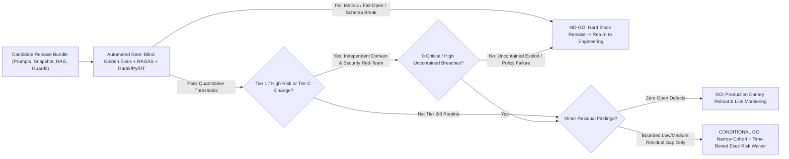

# Chapter 26: Testing, Evaluation & Red-Teaming

*Part VIII: Operationalizing the Guardrails*

> **In this chapter**
> - **26.1 Pre-Deployment Evals and Golden Datasets** — Replacing informal prompt "vibe checks" and vendor marketing metrics with stratified golden datasets, calibrated abstention scoring, and component-level RAG evaluation.
> - **26.2 AI Red-Teaming: Scope, Methods, and Who Should Do It** — Scoping adversarial testing across security exploits and domain harms using NIST and MITRE taxonomies, automated toolkits (`PyRIT` and `garak`), and independent domain red teams.
> - **26.3 Safety and Security Benchmarks** — Interpreting standardized public suites (`AILuminate v1.0` and `HarmBench`) accurately while avoiding training-data contamination, Goodhart's Law, and the chat-vs-system evaluation gap.
> - **26.4 Go/No-Go Criteria for Production** — Enforcing risk-tiered pre-flight thresholds, hard-stop conditions, executive risk waivers, and auditable EU AI Act and ISO/IEC 42001 release gates.

In Parts I through VII, we built the architecture of enterprise AI governance: operating models, inventories, data-protection boundaries, security defenses, reliability and fairness controls, sector compliance, and lifecycle resilience. *Part VIII: Operationalizing the Guardrails* turns that architecture into daily engineering and operational proof. A written policy never blocked an injection payload, and a procurement questionnaire never stopped a biased decision from reaching a customer. Before any AI capability graduates into production—or ships a Tier B/C modification under Chapter 24's change-control gates—teams must prove empirically that controls hold under realistic enterprise edge cases and determined adaptive adversaries. Testing, evaluation, and red-teaming convert governance from hopeful intent into reproducible release evidence.

---

### Illustrative Composite Scenario: 96% on the Public Leaderboard, 28% on Monday Morning

*(This composite scenario is illustrative; it is not drawn from a specific organization or incident.)*

A healthcare benefits administrator built a member-portal copilot summarizing plan deductibles, out-of-network exceptions, and prior-authorization criteria across 14,000 clinical policy bulletins. During vendor selection and internal staging, the engineering team highlighted the underlying model's top-tier ranking on public medical and reasoning leaderboards, backed by an informal 25-prompt "vibe check" conducted by product managers using clean policy snippets. Leadership cleared production launch on Friday afternoon. By Monday midday, operational support queues flooded. Members uploading scanned provider appeal PDFs containing subtle multi-clause exclusions triggered silent misinterpretations (`28%` accuracy on three-way co-insurance coordination rules); a handful of hostile prompts embedded inside uploaded claims PDFs hijacked tool calls to expose internal claims-adjudication routing hints; and multi-turn conversational nudges coaxed the assistant into fabricating pre-approval guarantees the plan explicitly excluded. Every infrastructure monitor stayed green, yet an un-tested gap between generic public benchmarks and adversarial production workflows turned launch weekend into an immediate clinical and regulatory rollback.

---

## 26.1 Pre-Deployment Evals and Golden Datasets

Most enterprise AI failures begin inside deceptively reassuring pilot demos. Developers craft twenty or thirty clean questions representing normal user intent, verify fluent prose responses by eye, and mistake fluency for readiness. Even when buyers purchase mature vertical products rather than assembling custom pipelines, vendor claims remain unreliable without independent workload testing. In a preregistered Stanford RegLab benchmark evaluating proprietary commercial legal research tools billed with strong accuracy and grounding guarantees, Magesh and colleagues measured hallucination rates ranging from `17%` to `33%` across leading products when tested on verifiable legal queries.[^c26-01] Marketing claims and public leaderboard rankings simply do not predict how an assembled RAG pipeline, tool router, and prompt template will behave on your company's messiest documents and edge cases.

Effective pre-deployment evaluation therefore replaces ad-hoc manual inspection with a versioned, **domain-specific golden dataset** split cleanly like disciplined machine-learning data:

- **Development Evaluation Set (`dev-eval`):** Iterated rapidly by engineers while refining prompts, chunking strategies, and retrieval weights during build sprints.
- **Held-Out Blind Gate Set (`gate-eval`):** Strictly quarantined from prompt authors, storing frozen high-stakes regression cases so teams cannot subconsciously "teach to the test" prior to launch sign-off.

A defensible golden dataset covers five distinct strata rather than happy-path averages alone:

1. **Core Happy Paths (`~30%`):** Representative daily customer, employee, or operational queries spanning core workflows.
2. **Long-Tail Domain Edge Cases (`~25%`):** Multi-hop policy exceptions, conflicting effective dates, scanned tables, acronyms, and regional regulatory nuances where retrieval frequently stumbles.
3. **Out-of-Scope Abstention Traps (`~20%`):** Questions deliberately lacking answers in the enterprise knowledge base, ambiguous premises, or requests outside system mandate. As Kalai and colleagues demonstrated in their analysis of why language models hallucinate, standard accuracy benchmarks that give zero credit for saying `"I don't know"` systematically train models and builders to reward confident guessing over honest uncertainty.[^c26-02] Golden rubrics must therefore score **calibrated abstention**—penalizing fabricated confident answers substantially harder than safe uncertainty or human escalation.
4. **Demographic and Linguistic Slices (`~15%`):** Dialect variations, non-native syntax, accessibility edge inputs, and protected-group equity probes ensuring quality remains consistent across populations (Chapter 16).
5. **Production Regression Bank (`~10%` growing continuously):** Every bug, customer complaint, incident postmortem, or red-team bypass captured after launch enters the blind gate set permanently so fixed failures stay fixed across future model upgrades.

Crucially, enterprises must score **individual pipeline components alongside end-to-end outputs**. Using reference-free evaluation frameworks such as **RAGAS**, engineering pipelines measure *context precision* and *context recall* separately from *faithfulness* and *answer relevance*—pinpointing immediately whether a wrong answer resulted from broken vector retrieval or from the generator ignoring an accurately retrieved paragraph.[^c26-03] Deterministic assertions check JSON schemas, tool parameter bounds, citation existence, and PII leakage automatically, while calibrated **LLM-as-a-Judge** rubrics grade nuanced accuracy across thousands of samples, implementing the bias controls established by Zheng and colleagues—swapped `A/B` ordering, length-normalized scoring, cross-family judge selection, and regular calibration against blind human domain annotations.[^c26-04]

### The Guardrails

- **Quarantine a blind held-out gate dataset away from prompt developers:** Require final pre-release checks (Chapter 24) to run against unseen golden examples alongside production-regression failures so prompt overfitting cannot mask brittle logic.
- **Penalize confident hallucinations more strictly than abstentions:** Design golden scoring weights that reward calibrated uncertainty and safe human escalation whenever evidence chunks conflict or fall below retrieval thresholds.
- **Evaluate retrieval, generation, guardrails, and tool syntax independently:** Separate vector recall metrics, faithfulness scores, schema validators, and sidecar latency/accuracy checks inside CI/CD so root causes surface automatically.

---

## 26.2 AI Red-Teaming: Scope, Methods, and Who Should Do It

Evaluation datasets confirm whether an AI system behaves accurately under benign or messy everyday inputs; **AI red-teaming** tests how it behaves under deliberate adversarial pressure and socio-technical misuse. Unlike conventional network penetration testing—which hunts deterministic buffer overflows, SQL injections, or IAM misconfigurations—AI red-teaming targets both **security exploits** (direct and indirect prompt injection, system-prompt leakage, tool hijacking, training/RAG poisoning, sensitive data extraction) and **functional or safety harms** (generating fraudulent medical/legal assurances, policy-evasive discrimination, brand-damaging sycophancy, or unauthorized contractual promises).

Scoping a credible enterprise red-team exercise begins with shared threat taxonomies rather than improvisation:

- **NIST AI 100-2 E2025 (*Adversarial Machine Learning: A Taxonomy and Terminology of Attacks and Mitigations*, March 2025)** maps evasion, poisoning, privacy-extraction, and abuse tactics across predictive and generative lifecycles.[^c26-05]
- **MITRE ATLAS** translates those threat classes into concrete attacker techniques across prompts, retrieval pipelines, open-weight supply chains, and agentic tool invocations—allowing red teams to tie findings directly to SOC detections and architectural threat models (Chapters 9 and 10).[^c26-06]

Here static test banks deliver dangerous false assurance. Testing a deployed model exclusively against last quarter's 200 public "DAN" jailbreak strings proves almost nothing against live adversaries. In *"The Attacker Moves Second,"* Nasr and colleagues evaluated twelve published defenses against jailbreaks and prompt injections using adaptive optimization (automated gradient, RL, and search attacks) alongside skilled human attackers—bypassing **all twelve defenses**, frequently exceeding `90%` attack success rates.[^c26-07] Effective red-teaming therefore layers continuous automated scanning beneath adaptive human adversarial probing across three distinct assurance tiers:

```
                  /\
                 /  \    Tier 3: Independent External & Domain Red-Teaming
                /----\   (Pre-launch Tier 1 / Major changes; novel multi-turn & socio-technical exploits)
               /------\
              /--------\ Tier 2: Adaptive Automated Red-Teaming (e.g., PyRIT / Human-Guided Fuzzing)
             /----------\ (Sprint-level multi-turn attackers, encoding converters, RAG/tool boundary probes)
            /------------\
           /--------------\ Tier 1: Continuous CI Security Probing & Golden Evals (e.g., garak, RAGAS, Schema)
          /----------------\ (Every commit & nightly build; baseline jailbreaks, injection regressions, PII checks)
```

At Tier 1 and Tier 2, open-source frameworks make adversarial probing repeatable inside engineering pipelines:

- **garak** (Derczynski et al., 2024) operates as an automated LLM vulnerability scanner—structuring modular **Generators** (target endpoints), **Probes** (known prompt-injection, encoding, toxicity, and leakage vectors), **Buffs** (prompt mutations such as Base64 or character perturbations), and **Detectors** into reproducible nightly security sweeps.[^c26-09]
- **Microsoft PyRIT** (Munoz et al., 2024) extends automated testing to **multi-turn, adaptive, and multimodal scenarios** via **Targets**, **Orchestrators**, **Converters**, automated **Scorers**, and stateful **Memory**, letting defender LLMs iteratively probe, obfuscate, escalate, and score target agents just as live attackers adapt across conversations.[^c26-08]

Equally vital is deciding **who conducts Tier 3 red-teaming** and what success criteria govern engagement rules. Pure security penetration testers excel at uncovering indirect prompt-injection payloads or MCP server pivots, yet often miss domain-specific compliance harms—such as subtle age-proxy steering in hiring assistants or dangerous drug-interaction omissions in triage copilots. High-stakes systems require **multidisciplinary red teams** pairing AppSec/AI red-teamers with domain practitioners (senior underwriters, physicians, employment attorneys, fraud analysts), supplemented for Tier 1 workloads by **independent external assessors** uninvolved in building the system (Chapter 22). Following the UK National Cyber Security Centre's realistic architectural guidance on prompt injection as a "confusable deputy" problem, red-team success should *never* require proving a mythical `0%` classifier bypass rate; instead, engagements measure **blast-radius containment**—proving that even when an attacker tricks the model textually, deterministic permission checks (Chapter 7), agent isolation (`ASI02`/`ASI03` controls, Chapter 11), and human-approval gates stop unauthorized actions or cross-tenant exfiltration cold.[^c26-10]

### The Guardrails

- **Map every red-team scope explicitly to MITRE ATLAS and NIST AI 100-2 E2025:** Cover indirect prompt injection inside retrieved files, cross-tenant retrieval leakage, tool-parameter manipulation, multi-turn policy erosion, and modality-specific risks rather than single-turn chat jailbreaks alone.
- **Pair automated fuzzers (`garak`, `PyRIT`) in CI with domain-expert and independent human attackers pre-launch:** Require uninvolved third-party or independent internal red teams before signing off Tier 1 and externally exposed high-risk deployments.
- **Write strict Rules of Engagement and measure architectural containment alongside model refusal rates:** Test inside isolated staging mirrors populated with synthetic data (never live customer PII without explicit authorization), and verify deterministic authorization barriers block high-impact actions even after a model compromise.

---

## 26.3 Safety and Security Benchmarks

When evaluating foundation models or vendor AI products, leaders naturally reach for standardized public benchmarks promising simple model-versus-model comparisons. Two open-ecosystem benchmarks have set rigorous norms for model-level safety evaluation:

- **MLCommons AILuminate v1.0** (December 2024 / arXiv March 2025) evaluates general-purpose AI chat systems across **twelve distinct hazard categories** spanning physical harms (CSAM, CBRN weapons, violent/nonviolent crime, self-harm), non-physical risks (hate speech, sexual content, IP, privacy, defamation), and **specialized advice** (medical, legal, financial, and elections) using a transparent five-tier grade from *Poor* to *Excellent*.[^c26-11]
- **HarmBench** (Mazeika et al., ICML 2024) standardizes adversarial robustness testing across **510 documented harmful behaviors**, establishing unified Attack Success Rate (`ASR`) classifiers and validation/test splits verified empirically across **18 automated red-teaming methods** and **33 target models and defenses**.[^c26-12]

Used correctly, `AILuminate` and `HarmBench` deliver real governance value: they prevent vendor selection by marketing brochure, quantify baseline refusal differences across model families, and reveal whether an upstream defense genuinely resists diverse optimization attacks or merely blocks one narrow prompt phrasing. Yet governing enterprise launch decisions off public safety benchmarks alone introduces three classic evaluation traps:

1. **Benchmark Contamination:** Public prompt datasets inevitably leak into web scrapes, synthetic training runs, and vendor post-training alignment mixes. A model scoring cleanly on public prompts may generalize poorly to novel enterprise phrasings or domain jargon.
2. **Saturation and Goodhart's Law:** Once *"when a measure becomes a target, it ceases to be a good measure,"* teams optimize system prompts or safety classifiers specifically for public benchmark rubrics—producing overly brittle refusal patterns that trigger false-positive blocks on legitimate customer queries ("exaggerated safety") while leaving unmeasured operational failures untouched.
3. **The Chat-vs.-System Evaluation Gap:** Nearly every standard benchmark evaluates an isolated foundation model responding to single-turn chat completions. Production enterprise AI is never an isolated LLM; it is an orchestrated socio-technical pipeline combining vector databases, permission filters, external MCP tools, session memory, and multi-agent handoffs. In the OWASP Top 10 for Agentic Applications 2026, agent-specific exploits—tool misuse, memory poisoning, privilege confusion, and cascading delegation failures—occur across boundaries that model-only safety leaderboards never inspect.[^c26-13]

The discipline for risk committees is straightforward: treat public benchmarks strictly as **Stage-1 upstream screening** (comparing candidate foundation models during procurement, Chapter 23) and require **system-level evaluation in staging** using enterprise golden datasets, RAG permission tests, and live agent-sandbox harnesses prior to Go/No-Go review.

### The Guardrails

- **Separate model-level benchmark screening from system-level release testing:** Use `AILuminate v1.0`, `HarmBench`, and vendor system cards solely to filter foundation candidates—never to waive internal RAG, guardrail, or agent integration evaluations.
- **Measure false-refusal (utility) rates alongside attack-refusal (safety) rates:** Track over-blocking on benign domain terminology (e.g., cybersecurity analysts querying malware signatures or healthcare staff querying oncology dosages) so safety tuning does not break operational usability.
- **Maintain private, rotating internal adversarial test subsets:** Keep a rotating set of proprietary red-team prompts offline outside vendor feedback loops and shared logs to detect benchmark contamination or overfitting.

---

## 26.4 Go/No-Go Criteria for Production

Testing generates dashboards; governance demands binding release gates. Without predefined numeric thresholds and clear stop authority before testing begins, product teams facing launch deadlines routinely rationalize mediocre evaluation results (`"78% faithfulness is close enough for launch—we'll tune it next sprint"`). Pre-commitment transforms ambiguous test output into objective accountability.

Binding regulation now codifies this pre-deployment gate discipline. Under the **EU Artificial Intelligence Act**, **Article 9(6)–(8)** mandates that risk-management testing for high-risk AI systems occur at appropriate lifecycle points—and unconditionally prior to market placement—against **prior defined metrics and probabilistic thresholds** suited to intended purpose; **Article 15** requires documented levels of accuracy, robustness, and cybersecurity; **Article 55(1)(a)** compels providers of general-purpose AI models with systemic risk to execute standardized adversarial red-teaming; and **Annex IV** demands retaining full test methodologies, datasets, and quantitative validation logs.[^c26-14] Within an **ISO/IEC 42001** management system, those thresholds anchor formal operational release controls—summarized practically in **Appendix F (Pre-Flight Production Checklist)**.[^c26-15]

Table 26.1 illustrates an enterprise **Production Go/No-Go Gate Matrix** calibrating quantitative evaluation thresholds, red-team independence, and release-sign-off authority directly to the Chapter 5 risk tiers.

| Evaluation Dimension | Tier 1: Critical / High-Risk (Customer Eligibility, Clinical, Legal, Agentic Writes) | Tier 2: Moderate (Regulated Advice Drafts, Customer RAG Support) | Tier 3: Low-Risk (Internal Summarization, Non-Regulated Productivity) | Hard-Block (`NO-GO`) Trigger |
| :--- | :--- | :--- | :--- | :--- |
| **Golden Blind-Gate Accuracy & Faithfulness** | Strict `>=95%` critical-fact / schema fidelity; calibrated abstention within SLA | `>=90%` grounded faithfulness (`RAGAS`); zero unverified factual citations in template fields | `>=85%` task utility on representative dev sample | Critical domain error rate above pre-set ceiling or broken structured tool output |
| **Adversarial Red-Team & Injection Containment** | Automated CI (`garak`/`PyRIT`) + **Independent** human & domain red team; `0` unresolved Critical/High sandbox breaches | Automated CI suite + internal AppSec / peer red-team sign-off; `0` Critical breaches | Automated baseline CI probe (`garak` / safety screen) | Uncontained cross-tenant retrieval leakage, RCE, unauthorized mutating tool call, or PII dump |
| **Fairness & Slice Disaggregation (Ch. 16)** | Mandatory subgroup error-parity & bias audit within defined `AIR` / error bounds across protected slices | Demographic/linguistic slice check across key customer cohorts | Spot-check accessibility and inclusive output baseline | Disparate adverse-impact breach or protected-attribute leakage |
| **Operational Resilience & Fallback (Ch. 25)** | Proven deterministic/human fallback floor + fail-closed guardrail timeout tests + DR re-index check | Verified BM25/FAQ degradation mode + fail-closed PII sidecar | Fail-silent banner confirmed with zero host-app crash | Safety sidecar failing open on timeout or untested mutating agent without idempotency |
| **Required Release Sign-Off Authority** | **Dual Governance Sign-Off:** Model Risk / AI Governance Committee + Executive Business Risk Owner (after CISO/Legal review) | AI Engineering Lead + Product Risk Owner (+ Domain Reviewer) | Engineering Owner + automated CI policy gate | Any missing Appendix F sign-off or open expired waiver |

*Table 26.1: Production Go/No-Go Gate Thresholds & Sign-Off Authority calibrated across Tier 1–3 risk classifications.*

Notice how clear pre-flight automation keeps teams fast while preserving rigor. Low-risk Tier 3 tools pass straight through automated CI gates inside minutes; Tier 1 systems route seamlessly through staged assurance without ad-hoc email chases:



Crucially, Go/No-Go governance recognizes **three explicit outcomes** rather than forcing binary hypocrisy:

1. **GO:** All Tier benchmarks, resilience checks, and red-team criteria pass—authorizing controlled progressive rollout (`5% -> 25% -> 100%`) tied directly to live monitoring (Chapter 24).
2. **CONDITIONAL GO (Limited Canary with Executive Waiver):** Reserved exclusively for bounded Low or Medium residual limitations (never Critical security exploits, fail-open guardrails, or uncontained high-risk bias). Conditions must restrict blast radius—narrowing cohort scope, enforcing human-in-the-loop review, accelerating telemetry alerts—and carry a **written, time-boxed remediation expiry (`30–60 days`) signed by an accountable Executive Risk Owner**, never self-approved by engineering leads.
3. **NO-GO (Hard Release Block):** Automatically prevents deployment whenever Hard-Block triggers fire until fixes pass full regression testing on the quarantined gate set. And whenever live production inevitably surfaces novel real-world failures missed by pre-flight tests, those incidents must feed straight into the response and feedback workflows examined next in **Chapter 27 (*AI Incident Response*)**.

### The Guardrails

- **Lock numeric Go/No-Go thresholds before building or testing:** Publish Tier-calibrated accuracy, abstention, faithfulness, bias-parity, and red-team containment limits in writing at intake (Appendix C) so launch pressure cannot move goalposts mid-sprint.
- **Require independent release-blocking authority:** Separate the builder team trying to hit a shipping date from the security, domain, and risk approvers empowered to issue a `NO-GO` under Appendix F.
- **Time-box and cap every `CONDITIONAL GO` exception:** Prohibit silent verbal launch exemptions; auto-revoke expiring waivers in deployment pipelines unless remediation passes fresh blind-set testing or receives explicit risk-committee renewal.
- **Feed every production escape back into the blind gate set:** Close the operational loop with Chapter 27 post-incident reviews so no customer-impacting failure ever occurs twice under a future prompt or snapshot change.

---

## Why Every Role Cares

| Role | What Changes for Your Team | Primary Pre-Flight Risk if Ignored |
| :--- | :--- | :--- |
| **CIO / VP Engineering** | Replace informal "vibe checks" with automated CI/CD evaluation pipelines (`RAGAS`, `garak`, `PyRIT`) tied to immutable release bundles. | Unpredictable launch-day rollbacks, broken production parsers, and costly rework after blind spots hit live users. |
| **CISO / AI Red Team** | Scope multi-turn, indirect-injection, RAG, and agent tool-boundary testing against `MITRE ATLAS` and `NIST AI 100-2 E2025`, measuring containment rather than `0%` classifier perfection. | False confidence from static jailbreak lists failing immediately when real attackers use adaptive prompts or poisoned uploaded files. |
| **Chief Risk Officer / Model Risk** | Enforce pre-committed `EU AI Act Art. 9` numeric thresholds, blind gate quarantine, and time-boxed `CONDITIONAL GO` risk waivers across Table 26.1. | Subjective goal-post moving under deadline pressure, invisible overfitting on dev prompts, and unapproved high-risk launches. |
| **General Counsel / Regulatory Affairs** | Maintain auditable pre-deployment validation logs (`Annex IV`), bias disaggregation proof, and independent red-team reports under `ISO/IEC 42001`. | Inability to prove pre-market due care after customer harm, regulatory audits, or deceptive `"hallucination-free"` marketing challenges. |
| **Domain / Business Owners** | Contribute curated real-world edge cases, abstention rules, and expert domain red-teamers alongside UX tolerance budgets. | Systems scoring 96% on generic benchmarks failing badly on specialized regulatory exclusions, medical safety, or contract terms. |
| **QA / MLOps Engineering** | Manage `dev-eval` vs. quarantined `gate-eval` splits, calibrate automated LLM judges monthly against human gold labels, and guard utility vs. over-refusal. | Judge drift, training-test leakage, and brittle safety tuning that blocks legitimate operational queries. |

---

## Chapter Summary

| Assurance Stage | Core Governance Question | Key Technical & Process Controls | Primary Frameworks / Evidence |
| :--- | :--- | :--- | :--- |
| **Golden Datasets & Pre-Deployment Evals (26.1)** | Does the integrated system meet domain accuracy, grounding, and abstention standards before release? | Stratified `dev` vs. blind `gate` splits; calibrated uncertainty scoring; component-level `RAGAS`; bias-mitigated LLM judges | Stanford RegLab Legal RAG (`Magesh 2025`); Kalai et al. (2025); `RAGAS` (`Es 2024`); `Zheng et al.` (2023) |
| **AI Red-Teaming Scope & Execution (26.2)** | Where can adaptive human or automated adversaries force harmful outputs, leaks, or tool misuse? | 3-tier pyramid (`garak` CI -> `PyRIT` adaptive multi-turn -> external/domain experts); strict staging RoEs; containment testing | `NIST AI 100-2 E2025`; `MITRE ATLAS`; Nasr et al. (2025); `PyRIT` (`Munoz 2024`); `garak` (`Derczynski 2024`); UK `NCSC` (2025) |
| **Safety & Security Benchmarks (26.3)** | How do public safety scores translate—and fail to translate—into enterprise readiness? | Stage-1 vendor pre-screening via `AILuminate v1.0` & `HarmBench`; private rotating test sets; over-refusal/utility checks | MLCommons `AILuminate v1.0`; `HarmBench` (`Mazeika 2024`); `OWASP Agentic Top 10` (`2026`) |
| **Go/No-Go Release Governance (26.4)** | Who signs off on production readiness, against which hard limits, and with what exception controls? | Tiered Go/No-Go Matrix (Table 26.1); Appendix F checklists; `GO`/`CONDITIONAL GO`/`NO-GO` paths; `30–60 day` waivers | EU AI Act `Arts. 9(6)–(8), 15, 55(1)(a), Annex IV`; `ISO/IEC 42001`; Appendix F |

---

## Key Takeaways

- **"Vibe checks" and vendor marketing guarantees conceal severe production error rates:** Stratified domain golden sets—split into developer sets and quarantined blind gates—must score component retrieval, schema integrity, and calibrated abstention separately.
- **Static jailbreak checklists cannot survive adaptive attackers:** Continuous CI probing (`garak`), multi-turn adaptive orchestration (`PyRIT`), and independent domain/security red-teaming must verify architectural containment across RAG and tool boundaries rather than chasing `0%` filter bypasses.
- **Public safety benchmarks screen models, not enterprise applications:** `AILuminate v1.0` and `HarmBench` aid upstream vendor selection, but cannot replace sandboxed system evaluation covering private permissions, tool execution, and over-refusal tradeoffs.
- **Lock quantitative Go/No-Go gates before launch pressure arrives:** Pre-committed Table 26.1 thresholds, independent veto power, and short time-boxed executive risk waivers keep engineering velocity high without compromising Tier 1 accountability.

---

## Questions to Ask
| Target Team | Concrete Diagnostic Question | What a Strong Answer Looks Like |
| :--- | :--- | :--- |
| **AI Engineering & QA** | *"Can prompt developers view or tune directly against our final pre-release evaluation dataset—or is a blind gate set quarantined in CI?"* | Our `dev-eval` set supports daily iteration, while an immutable blind `gate-eval` set (including past incidents and edge abstentions) runs strictly via CI/CD outside developer tuning access. |
| **AppSec / AI Red Team** | *"Beyond static jailbreak lists, how are we running adaptive multi-turn and indirect-injection tests against actual RAG documents and agent tools?"* | Nightly `garak` probes scan every build, adaptive `PyRIT` orchestrators test multi-turn tool/RAG boundaries per `MITRE ATLAS`, and independent domain + external red teams test Tier 1 releases before launch. |
| **AI Product & Procurement** | *"When a vendor quotes public benchmark leadership or 'hallucination-free' RAG accuracy, what do our own staging golden sets show?"* | We use `AILuminate` and `HarmBench` solely for initial shortlisting; every vendor product must pass our internal blind dataset, permission-leak checks, and utility/over-refusal tests in staging before purchase. |
| **Model Risk / Release Governance** | *"Show me a concrete metric failure that automatically blocks deployment (`NO-GO`), and show every open `CONDITIONAL GO` waiver and its expiry date."* | Our Table 26.1 CI gates block release automatically on schema breaks, fail-open sidecars, or critical breaches; any time-boxed `30–60 day` conditional waiver sits in our GRC register signed by an Executive Risk Owner. |
| **Domain Subject-Matter Experts** | *"Were clinicians, underwriters, lawyers, or compliance specialists directly involved in writing abstention traps and red-teaming our latest Tier 1 launch?"* | Yes—domain specialists authored `45%+` of our edge-case and abstention test cases and participated directly in pre-launch Tier 3 red-teaming alongside AppSec testers. |

---

## References

[^c26-01]: Varun Magesh, Faiz Surani, Matthew Dahl, Mirac Suzgun, Christopher D. Manning, and Daniel E. Ho, "Hallucination-Free? Assessing the Reliability of Leading AI Legal Research Tools," *Journal of Empirical Legal Studies* (2025): 1–27, arXiv:2405.20362, doi:10.1111/jels.12413. **Annotation:** Preregistered Stanford RegLab evaluation demonstrating 17% to 33% hallucination rates across leading commercial legal RAG systems despite vendor marketing claims, underscoring why buyers must run independent golden evaluations. [↗ Bibliography](../bibliography.md#magesh-2025-legal-rag)

[^c26-02]: Adam Tauman Kalai, Ofir Nachum, Santosh S. Vempala, and Edwin Zhang, "Why Language Models Hallucinate" (arXiv:2509.04664, September 2025), doi:10.48550/arXiv.2509.04664. **Annotation:** Establishes that evaluations giving zero credit for uncertainty incentivize models and builders toward confident guessing, supporting golden rubrics that reward calibrated abstention. [↗ Bibliography](../bibliography.md#kalai-2025-hallucinate)

[^c26-03]: Shahul Es, Jithin James, Luis Espinosa Anke, and Steven Schockaert, "RAGAS: Automated Evaluation of Retrieval Augmented Generation," *Proceedings of the 18th Conference of the European Chapter of the Association for Computational Linguistics (EACL 2024): System Demonstrations* (March 2024), arXiv:2309.15217, doi:10.48550/arXiv.2309.15217. **Annotation:** Provides reference-free component metrics (context precision, context recall, faithfulness, answer relevance) enabling CI/CD gates to isolate retrieval failures from generator hallucinations. [↗ Bibliography](../bibliography.md#es-2024-ragas)

[^c26-04]: Lianmin Zheng, Wei-Lin Chiang, Ying Sheng, Siyuan Zhuang, Zhanghao Wu, Yonghao Zhuang, Zi Lin, Zhuohan Li, Dacheng Li, Eric P. Xing, Hao Zhang, Joseph E. Gonzalez, and Ion Stoica, "Judging LLM-as-a-Judge with MT-Bench and Chatbot Arena," *Advances in Neural Information Processing Systems 36 (NeurIPS 2023)* (2023), arXiv:2306.05685, doi:10.48550/arXiv.2306.05685. **Annotation:** Demonstrates high agreement between calibrated frontier judges and human annotators while identifying position, verbosity, and self-enhancement biases requiring bias-control calibration. [↗ Bibliography](../bibliography.md#zheng-2023-llm-judge)

[^c26-05]: National Institute of Standards and Technology, *Adversarial Machine Learning: A Taxonomy and Terminology of Attacks and Mitigations*, NIST AI 100-2 E2025 (Gaithersburg, MD: NIST, March 2025), doi:10.6028/NIST.AI.100-2e2025. **Annotation:** Authoritative federal taxonomy categorizing evasion, poisoning, privacy extraction, and abuse attacks across predictive and generative AI systems to structure red-team scope and mitigations. [↗ Bibliography](../bibliography.md#nist-2025-ai-100-2)

[^c26-06]: MITRE Corporation, *ATLAS: Adversarial Threat Landscape for Artificial-Intelligence Systems* (continuously updated threat knowledge base, accessed November 17, 2026). **Annotation:** Provides standardized adversarial tactics and techniques across prompt injection, RAG poisoning, supply-chain compromise, and agent tool misuse for scoping reproducible enterprise red teams. [↗ Bibliography](../bibliography.md#mitre-atlas)

[^c26-07]: Milad Nasr, Nicholas Carlini, Chawin Sitawarin, Sander V. Schulhoff, Jamie Hayes, Michael Ilie, Juliette Pluto, Shuang Song, Harsh Chaudhari, Ilia Shumailov, Abhradeep Thakurta, Kai Yuanqing Xiao, Andreas Terzis, and Florian Tramèr, "The Attacker Moves Second: Stronger Adaptive Attacks Bypass Defenses Against LLM Jailbreaks and Prompt Injections" (arXiv:2510.09023, October 2025), doi:10.48550/arXiv.2510.09023. **Annotation:** Proves that adaptive optimization and skilled human red-teaming defeated all twelve tested jailbreak and injection defenses—often above 90% ASR—demonstrating why static prompt checklists fail. [↗ Bibliography](../bibliography.md#nasr-2025-attacker-second)

[^c26-08]: Gary D. Lopez Munoz, Amanda J. Minnich, Roman Lutz, Richard Lundeen, Raja Sekhar Rao Dheekonda, Nina Chikanov, Bolor-Erdene Jagdagdorj, Martin Pouliot, Shiven Chawla, Whitney Maxwell, Blake Bullwinkel, Katherine Pratt, Joris de Gruyter, Charlotte Siska, Pete Bryan, Tori Westerhoff, Chang Kawaguchi, Christian Seifert, Ram Shankar Siva Kumar, and Yonatan Zunger, "PyRIT: A Framework for Security Risk Identification and Red Teaming in Generative AI Systems" (Microsoft AI Red Team, October 2024), arXiv:2410.02828, doi:10.48550/arXiv.2410.02828. **Annotation:** Open-source automation framework organizing Targets, Orchestrators, Converters, Scorers, and Memory to scale multi-turn adaptive and multimodal enterprise AI red-teaming. [↗ Bibliography](../bibliography.md#munoz-2024-pyrit)

[^c26-09]: Leon Derczynski, Erick Galinkin, Jeffrey Martin, Subho Majumdar, and Nanna Inie, "garak: A Framework for Security Probing Large Language Models" (June 2024), arXiv:2406.11036, doi:10.48550/arXiv.2406.11036. **Annotation:** Modular LLM vulnerability scanner combining Generators, Probes, Buffs, and Detectors to automate recurring security regression scans across CI/CD pipelines. [↗ Bibliography](../bibliography.md#derczynski-2024-garak)

[^c26-10]: Dave Chismon, "Prompt Injection Is Not SQL Injection (It May Be Worse)" (UK National Cyber Security Centre, December 2025). **Annotation:** Explains why LLMs act as inherently confusable deputies rather than deterministically parameterizable parsers, steering red-team validation toward architectural blast-radius containment rather than chasing zero classifier bypasses. [↗ Bibliography](../bibliography.md#ncsc-2025-prompt-injection)

[^c26-11]: MLCommons, *AILuminate: Introducing v1.0 of the AI Risk and Reliability Benchmark from MLCommons* (MLCommons AI Risk & Reliability Working Group, December 2024; arXiv:2503.05731, March 2025). **Annotation:** Industry-standard chat safety benchmark spanning twelve physical, non-physical, and specialized-advice hazard categories rated on a five-tier *Poor*-to-*Excellent* scale for Stage-1 model screening. [↗ Bibliography](../bibliography.md#mlcommons-2025-ailuminate)

[^c26-12]: Mantas Mazeika, Long Phan, Xuwang Yin, Andy Zou, Zifan Wang, Norman Mu, Elham Sakhaee, Nathaniel Li, Steven Basart, Bo Li, David Forsyth, and Dan Hendrycks, "HarmBench: A Standardized Evaluation Framework for Automated Red Teaming and Robust Refusal," *Proceedings of the 41st International Conference on Machine Learning (ICML 2024)* (2024), arXiv:2402.04249, doi:10.48550/arXiv.2402.04249. **Annotation:** Standardizes automated red-teaming evaluation across 510 harmful behaviors, 18 attack methods, and 33 target models/defenses using fixed Attack Success Rate (`ASR`) classifiers and validation/test splits. [↗ Bibliography](../bibliography.md#mazeika-2024-harmbench)

[^c26-13]: OWASP Foundation, *OWASP Top 10 for Agentic Applications for 2026* (OWASP GenAI Security Project, December 2025). **Annotation:** Maps agent-specific operational exploits across tool misuse, memory poisoning, and multi-agent privilege confusion absent from isolated single-turn chat benchmarks. [↗ Bibliography](../bibliography.md#owasp-2025-agentic-top10)

[^c26-14]: European Parliament and Council of the European Union, *Regulation (EU) 2024/1689 (Artificial Intelligence Act)*, Official Journal of the EU L, 2024/1689, July 12, 2024 — specifically Articles 9(6)–(8) (pre-market testing against prior defined metrics and probabilistic thresholds), Article 15 (accuracy, robustness, cybersecurity), Article 55(1)(a) (adversarial testing for systemic-risk GPAI models), and Annex IV (testing documentation). **Annotation:** Codifies pre-market validation against predetermined thresholds and documented adversarial testing as binding EU conformity prerequisites. [↗ Bibliography](../bibliography.md#eu-2024-ai-act)

[^c26-15]: International Organization for Standardization and International Electrotechnical Commission, *ISO/IEC 42001:2023, Information Technology — Artificial Intelligence — Management System* (Geneva: ISO, December 2023). **Annotation:** Embeds pre-deployment evaluation criteria, independent testing verification, and executive risk-acceptance approvals into a certifiable AI management system lifecycle. [↗ Bibliography](../bibliography.md#iso-2023-42001)
