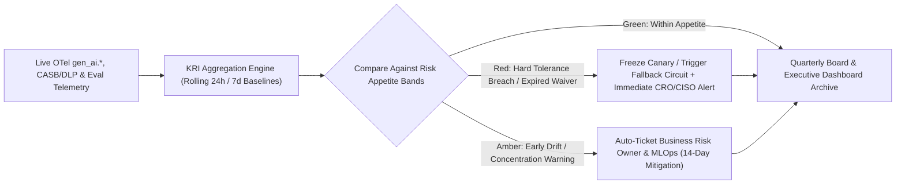

# Chapter 28: Metrics, KRIs & Reporting

*Part VIII: Operationalizing the Guardrails*

> **In this chapter**
> - **28.1 Key Risk Indicators (KRIs) for AI** — Designing forward-looking early-warning triggers across shadow AI, drift, near-miss hazards, fairness parity, vendor concentration, and kill-switch readiness.
> - **28.2 Governance KPIs: Time-to-Approve, Inventory Coverage, and Eval Pass Rates** — Measuring operational control velocity and evaluation rigor without creating review bottlenecks that incentivize bypasses.
> - **28.3 Board-Level AI Risk Dashboard Template** — Turning fragmented technical telemetry into one crisp quarterly board decision brief calibrated around risk appetite.
> - **28.4 AI FinOps, Token Economics, and Environmental Footprint** — Governing token unit economics, retiring zombie pilots, right-sizing workloads, and satisfying CSRD and EU AI Act energy-accounting duties.

In Chapter 27, we built the emergency response playbook for live AI failures: pulling kill switches, meeting tight statutory reporting clocks, and feeding incident patterns back into automated regression suites. Yet organizations that judge governance solely after an outage erupting in production always govern in the rearview mirror. Boards, CFOs, CISOs, and Chief Risk Officers need continuous, forward-looking visibility across two complementary questions: *Is AI risk quietly trending above our tolerance before an incident occurs?* And *Are our AI investments generating verifiable economic value per dollar and kilowatt-hour rather than sprawling into expensive zombie pilots?* Answering both questions demands clean separation between Key Risk Indicators (`KRIs`), governance operational `KPIs`, board-ready reporting structures, and disciplined AI FinOps and sustainability telemetry.

---

### Illustrative Composite Scenario: 100% Green Governance KPIs, \$4.2 Million in Zombie Tokens, and One Missed KRI

*(This composite scenario is illustrative; it is not drawn from a specific organization or incident.)*

At a global industrial manufacturer's third-quarter audit committee meeting, the Chief Information Officer presented a glowing slide deck: `48` internal generative AI pilots launched ahead of schedule, `98%` employee policy acknowledgment completed, and zero Sev-1 security breaches reported year-to-date. Two weeks later, external cloud invoices and a targeted internal audit uncovered three unmeasured cracks underneath that green scorecard. First, employee override rates on an internal procurement assistant had climbed from `6%` to `27%` over sixty days after subtle model drift—yet nobody tracked override velocity as a KRI. Second, finance discovered `29` lingering proof-of-concept endpoints running unthrottled frontier-model context windows against negligible active daily usage, burning `$4.2 million` annualized in idle GPU cluster reservations and repetitive token spend (`40x` higher per transaction than deterministic templates). Third, sustainability counsel flagged an approaching EU CSRD limited-assurance audit: the company lacked vendor-verified Scope 3 energy and compute telemetry for more than two-thirds of its third-party AI API spend, leaving the green board slide untenable before both finance and external auditors.

---

## 28.1 Key Risk Indicators (KRIs) for AI

Many leadership dashboards confuse **Key Performance Indicators (`KPIs`)**—which measure whether projects shipped on time, handled more support tickets, or achieved baseline uptime—with **Key Risk Indicators (`KRIs`)**. In the **Committee of Sponsoring Organizations of the Treadway Commission (COSO)** framework *Developing Key Risk Indicators to Strengthen Enterprise Risk Management*, a KRI is an early-warning metric designed explicitly to detect rising exposure *before* a risk event materializes into financial, operational, or legal harm.[^c28-01] Anchored within **NIST AI RMF 1.0 (`Measure`)**[^c28-02] and **ISO/IEC 42001 Clause 9 (`Performance Evaluation`)**,[^c28-03] effective AI KRIs bind technical runtime signals directly to board-approved risk appetite bands (`Green`, `Amber`, `Red`) and pre-committed escalation actions.

Six enterprise AI KRI families capture leading exposure across technical, legal, and third-party surfaces:

1. **Shadow & Uninventoried AI Exposure Rate:** The percentage of discovered SaaS AI accounts, unapproved cloud inference keys, or sensitive-data egress events caught by CASB/DLP outside the official CMDB (Chapters 5 and 6). Empirical urgency is clear: IBM Security's *Cost of a Data Breach Report 2025* found that `20%` of studied breaches involved shadow AI—adding an average `+$670,000` in breach costs when organizations operated high levels of unmonitored shadow AI.[^c28-04]
2. **Behavioral Drift, Unfaithfulness & Human-Override Surge:** Rolling 7-day shifts in RAG faithfulness scores, structured-output schema breakages, or—most tellingly—human analyst overrides, edits, and escalations across high-impact workflows (Chapters 17 and 24). Rising overrides routinely signal trust collapse weeks before regulatory complaints arrive.
3. **Near-Miss AI Hazard & Adversarial Probe Velocity:** Weekly trends in intercepted indirect prompt injections, red-team bypasses, and bounded **AI hazards** as defined under the OECD's May 2024 taxonomy (Chapters 26 and 27).[^c28-05] Spiking probes against a customer portal warn attackers are actively probing weak boundaries even before a `Sev-1` incident hits.
4. **Subgroup Fairness Parity Drift:** Rolling variance in approval rates, false-negative error rates, or automated screening rejections across protected demographic and linguistic cohorts (Chapter 16), tripping `Amber` well before legal four-fifths (`80%`) adverse-impact violations occur.
5. **Single-Provider Concentration & Expired Risk Waiver Count:** Share of Tier 1 revenue or regulated workflow volume routed through a single unbacked foundation vendor without tested warm fallback (Chapters 23 and 25), paired with the count of expired `CONDITIONAL GO` waivers still sitting in production past 30–60 day remediation deadlines (Chapter 26).
6. **Guardrail Fail-Closed Integrity & Kill-Switch SLA:** Percentage of production safety sidecars (PII redactors, injection filters, write-approval barriers) verified to fail closed during automated fault-injection checks, plus time-to-revoke scoped agent NHI tokens in quarterly tabletop drills (Chapters 25 and 27).

Because raw model metrics never fix issues passively inside a passive spreadsheet, leading KRIs belong inside an **automated telemetry-to-governance escalation pipeline**:

### The Guardrails

- **Tie every KRI to an explicit `Green / Amber / Red` threshold and named owner:** Never publish uncalibrated counts (*"we had 142 guardrail hits"*) without a clear numerator, denominator, baseline tolerance, and pre-authorized action when `Red` triggers.
- **Combine technical scores with human behavioral proxies:** Pair automated `RAGAS` faithfulness and injection-filter logs with front-line override rates, customer complaint rates, and escalation bounce rates so blind spots in LLM evaluators cannot mask operational decay.
- **Ban expired exceptions silently rolling forward:** Surface every `CONDITIONAL GO` risk waiver exceeding its scheduled sunset date as an automatic `Red` KRI escalating straight to the Executive Risk Committee.

---

## 28.2 Governance KPIs: Time-to-Approve, Inventory Coverage, and Eval Pass Rates

While KRIs track *emerging exposure*, **Governance KPIs** measure whether the organization's AI governance operating model works cleanly as an enabler rather than an obstructive bureaucracy. When intake committees take six months to review modest productivity tools, delivery teams simply bypass review via personal credit cards and unmonitored API keys—inflating shadow-AI risk. Conversely, friction-free approvals with weak evaluation quality produce the false security highlighted in Chapter 26.

To eliminate "governance theater," govern the control plane using five balanced operational KPIs:

- **AI Inventory Coverage (`>= 95%`):** Share of API keys, GPU endpoints, SaaS AI add-ons, and agent principals matched between cloud billing/discovery logs and the enterprise CMDB (Chapter 5).
- **Tiered Time-to-Approve SLA:** Median and p90 duration from intake (`Appendix C`) to verdict (`<= 48h` Tier 3 automated approval; `<= 10` business days Tier 2; `<= 30` business days Tier 1 validation).
- **First-Pass Blind Gate & CI Red-Team Pass Rate:** Share of candidates passing quarantined `gate-eval` suites and nightly `garak`/`PyRIT` scans before final CAB review (Chapter 26).
- **Contractual Control Parity:** Share of live AI agreements enforcing `ZDR`, no-training clauses, sub-processor lists, audit rights, and incident SLAs (`Chapter 23`).
- **Audit & Postmortem Remediation Velocity:** Share of `Sev-1`/`Sev-2` fixes (Chapter 27) and audit actions closed and re-tested on time. Consistent with the **Institute of Internal Auditors' *Global Internal Audit Standards*** (effective January 9, 2025), third-line audit tracks overdue high-risk items directly before the Board Audit Committee.[^c28-06]

Governance KPIs must link directly to **value realization**. McKinsey's *State of AI in 2025* survey showed that while `88%` of firms use AI and `62%` test autonomous agents, most see limited enterprise-wide EBIT gains—and over half report negative consequences led by inaccuracy.[^c28-07] Pairing intake velocity with production adoption and accuracy metrics stops teams from celebrating empty pilot counts.

### The Guardrails

- **Publish intake SLA turnaround alongside rejection/return rates:** Hold governance committees accountable for delivering fast decisions on well-prepared Tier 2/3 systems while tracking rework rates caused by incomplete engineering evidence.
- **Reconcile governance inventories monthly against billing and network egress logs:** Never measure inventory coverage solely by counting teams who remembered to fill out an intake form; anchor denominators on hard cloud invoices, API-gateway logs, and SSO/CASB discovery.
- **Prevent Goodhart's Law on approval speed:** Never incentivize reviewers purely on shrinking `Time-to-Approve` without pairing `First-Pass Blind Eval Rate` and `Post-Launch Escape Rate`, lest fast rubber-stamping erode safety.

---

## 28.3 Board-Level AI Risk Dashboard Template

Boards of directors carry clear fiduciary oversight duties over AI transformation, yet most corporate reporting fails them at the boundary between overwhelming technical minutiae and vague executive slogans. Deloitte's Global Boardroom Program *Governance of AI* survey (`~700` directors across `56` countries) found that `66%` of directors still describe their boards as having limited to no AI knowledge or experience, while `31%` report AI is still absent from formal board agendas altogether.[^c28-08] Flooding non-technical Audit, Risk, and Technology Committee members with raw F1 scores, embedding cosine distributions, or 40-page MLOps logs guarantees disengagement.

An effective quarterly board briefing fits cleanly onto **one structured decision dashboard** backed by an appendix detailing the top exceptions requiring board judgment. **Table 28.1** presents a practical **Quarterly Board-Level AI Risk & Value Dashboard Template** linking enterprise KRIs, compliance status, third-party concentration, economics, and ESG metrics directly to actionable board prompts.

| Dashboard Domain | Core Metric / KRI | Risk Appetite (`Green / Amber / Red`) | Primary Source of Truth | Board Decision Prompt |
| :--- | :--- | :--- | :--- | :--- |
| **1. Portfolio & Inventory Health** | Production & Pilot Inventory Coverage (`%` reconciled vs. billing/CASB); Tier 1/2/3 breakdown | **G:** `>=95%` mapped; **A:** `85%–94%`; **R:** `<85%` or active unapproved Tier 1 SaaS | Enterprise CMDB + Cloud FinOps / CASB Discovery | *"Where are shadow tools bypassing intake, and do we authorize blocking or onboarding?"* |
| **2. Safety, Accuracy & Incident Exposure** | Open `Sev-1`/`Sev-2` AI incidents; 90-day near-miss hazard trend; Tier 1 human-override spike & expired waivers | **G:** `0` overdue Sev-1/2 & `0` expired waivers; **A:** `1–2` bounded waivers; **R:** active Sev-1 or expired Tier 1 waiver | SOAR / Incident Bridge (`OTel` + Postmortem Log) | *"Did containment meet statutory clocks, and should any expired conditional launch be suspended?"* |
| **3. Regulatory & Audit Readiness** | `%` high-risk/Tier 1 systems passing EU AI Act / sector readiness (`Annex IV`, literacy, impact audits); overdue IIA findings | **G:** `100%` compliant pre-deadline; **A:** remediation scheduled pre-cutoff; **R:** overdue high-risk audit item | GRC Register + Internal Audit Issue Tracker (`IIA 2025`) | *"Are mandatory statutory deadlines (`EU AI Act`, `DORA`, state ADMT) funded and on schedule?"* |
| **4. Third-Party Concentration & Resilience** | `%` Tier 1 volume on single model vendor without warm fallback; DR Impact Tolerance & manual-shift drill pass rate | **G:** `<50%` unbacked concentration & `100%` DR pass; **A:** fallback built/untested; **R:** missed Impact Tolerance or unbacked Tier 1 | Vendor Register (`DORA RoI`) + Gateway Routing + Chaos Logs | *"Are our top AI vendors survivable across a multi-day outage, and do contracts enforce ZDR/exit rights?"* |
| **5. AI Economics & Value Realization** | Total monthly token/GPU run rate vs. budget; `%` pilots inactive/unproven `>90` days ("zombies"); cost per resolved outcome | **G:** `<5%` zombie spend & unit ROI verified; **A:** `5%–15%` overrun; **R:** `>15%` budget drift or `>25%` zombie spend | `OTel` FinOps Attribution + CFO Value Ledger | *"Which stalled or negative-ROI pilots should be terminated next quarter, and where do we scale winners?"* |
| **6. Environmental & ESG Footprint** | AI workload kWh & Scope 2 / Scope 3 GHG emissions (`ESRS E1` / CSRD); `%` AI spend using vendor-verified power metrics | **G:** `<10%` proxy spend & within carbon budget; **A:** `10%–30%` proxy data; **R:** unverified Scope 3 blocking CSRD audit | Cloud Provider Carbon APIs + Data Center Meter Logs | *"Will rising GPU/inference energy breach Scope 2/3 targets or expose CSRD assurance gaps?"* |

*Table 28.1: Quarterly Board-Level AI Risk & Value Dashboard Template integrating technical KRIs, compliance posture, resilience, unit economics, and sustainability accountability.*

Pair Table 28.1 with a concise **three-item cover brief**: *(1) Top 3 Amber/Red Appetite Breaches and Root Fixes, (2) Active `CONDITIONAL GO` Risk Waivers Seeking Extension or Termination, and (3) Capital Reallocated from Retired Zombie Pilots*. Keeping board materials uniform every quarter makes multi-quarter trends unmistakable.

### The Guardrails

- **Show four-quarter trend arrows alongside current scores:** Display multi-quarter trajectories (`improving`, `stable`, `degrading`) so creeping override rates, shadow AI, or token waste cannot hide behind static snapshots.
- **Mandate joint CFO, CRO, CISO, and CIO sign-off on one pack:** Stop Engineering from pitching optimistic adoption charts while Risk and Finance circulate conflicting risk and cost reports separately.
- **Bind `Red` thresholds to a pre-approved escalation menu:** Agree during board chartering what happens automatically when `Red` persists across quarters (such as freezing net-new Tier 1 pilots until shadow inventory or overdue audits recover).

---

## 28.4 AI FinOps, Token Economics, and Environmental Footprint: Governing Compute Cost, Zombie Pilots, and ESG Impact

AI financial waste and environmental footprint are two faces of the same architectural measurement gap. Early generative AI experimentation treated cloud API tokens and dedicated GPU reservations as limitless R&D budgets. By 2026, unchecked inference growth forced financial accountability straight onto executive agendas: according to the **FinOps Foundation's *State of FinOps 2026* report**, **`98%` of surveyed organizations now actively manage AI spend**, surging from `63%` in 2025 and just `31%` two years earlier.[^c28-09] Yet managing aggregate cloud bills is only step one; without workload-level attribution, enterprises bleed cash silently across bloated system prompts, redundant vector re-embedding, unmonitored agent loops, and forgotten sandboxes.

The waste problem concentrates heavily in **zombie pilots** and **over-provisioned agentic experiments**. Gartner projected in June 2025 that **more than `40%` of agentic AI projects will be canceled by the end of 2027** due to escalating operational costs, unclear business value, or inadequate risk controls.[^c28-10] Combating zombie spend and token inflation requires four disciplined **AI FinOps engineering controls**:

1. **Tag Every Token to an Owner via `OpenTelemetry gen_ai.*`:** Instrument gateway proxies using OpenTelemetry's generative AI semantic conventions so every request carries `team_id`, `use_case_id`, `risk_tier`, prompt token counts, completion token counts, cached token hits, and external tool-call latencies—enabling accurate Finance showback and chargeback across units.[^c28-11]
2. **Track Unit Economics Over Aggregate API Bills:** Replace `"monthly vendor spend"` with outcome metrics such as **cost per verified resolution**, **context-bloat ratio** (kilobytes of system prompt + stuffed RAG chunks per user question), and **semantic-cache hit ratio**—stopping agent workflows from burning `$0.80` of reasoning tokens on routine tasks worth `$0.05`.
3. **Enforce a Mandatory 90-Day Pilot Graduation-or-Sunset Gate:** Any proof-of-concept granted sandbox inference keys automatically expires at Day 90 unless business owners demonstrate audited value realization and promote the system into full Tier 1–3 production governance (revoking keys and sanitizing sandboxes cleanly under Chapter 24 if unpromoted).
4. **Cascade-Route to Right-Sized Models:** Never fire a frontier trillion-parameter reasoning model at tasks solvable by deterministic code, regex classifiers, or compact Small Language Models (`SLMs`).

That fourth control—**model right-sizing**—unlocks massive savings on both cloud budgets and carbon emissions simultaneously. In their landmark ACM FAccT '24 empirical study *"Power Hungry Processing: Watts Driving the Cost of AI Deployment?"*, Luccioni, Jernite, and Strubell evaluated **88 models across 30 datasets and 10 tasks**, measuring actual energy consumption per 1,000 inferences.[^c28-12] Their finding reshaped sustainable AI engineering: multi-purpose generative architectures consume **orders of magnitude more electricity and emit dramatically more carbon** than task-specific fine-tuned or discriminative models on the exact same workload, even controlling for parameter count—meaning routing routine classification, extraction, or summarization through massive frontier chatbots wastes both budget and watts unnecessarily.[^c28-12]

At global infrastructure scale, those engineering choices connect straight to macro grid limits and statutory ESG reporting. In its April 2025 special report ***Energy and AI***, the **International Energy Agency (IEA)** estimated global data-center electricity consumption at approximately **`415 TWh`** (`~1.5%` of total global electricity use) and projected demand will more than double to **`~945 TWh` by 2030**, growing roughly **`15%` per year** driven primarily by energy-dense AI compute clusters.[^c28-13]

Boards and CFOs can no longer wave away AI electricity and water usage as invisible cloud overhead, because binding European sustainability and AI laws now convert infrastructure watts into auditable disclosures:

- **EU Corporate Sustainability Reporting Directive (`CSRD`, Directive (EU) 2022/2464) & `ESRS E1` Climate Change:** In-scope companies preparing 2025/2026 financial-year sustainability statements face mandatory limited-assurance audits covering **Scope 2** electricity consumption (both location-based grid intensity and market-based renewable contracts for owned or colocated GPU racks) alongside material **Scope 3** upstream emissions—where third-party hyperscale cloud and commercial AI API compute sit squarely inside *Purchased Goods and Services* alongside embodied silicon hardware manufacturing.[^c28-14] Crucially, `ESRS E1` prohibits netting carbon credits or offsets inside gross Scope 2/3 tables, making raw vendor energy transparency (`kWh` and Power Usage Effectiveness `PUE`, not just generic spend estimates) a procurement priority.[^c28-14]
- **EU AI Act Article 53(1)(a) & Annex XI (Section 1, Point 2(e)):** Requires General-Purpose AI (`GPAI`) model providers to maintain up-to-date technical documentation detailing the **known or estimated energy consumption** of each model—or estimated figures derived from computational resources used (`FLOPs`, hardware profiles, training run duration) where exact metering was unavailable—available upon request to the EU AI Office and national regulators.[^c28-15] Enterprise procurement teams should mirror this discipline inside vendor RFPs (Chapter 23) so buyers capture standardized energy intensity data alongside token pricing.

Together, KRIs, governance KPIs, board scorecards, and AI FinOps/ESG metrics close the operational feedback loop across engineering, risk, finance, and sustainability—setting the behavioral stage for **Chapter 29 (*Building a Risk-Aware AI Culture*)**, where incentives and human training ensure people actually act on what those dashboards measure.

### The Guardrails

- **Instrument unit economics and `OpenTelemetry gen_ai.*` attribution across every gateway:** Require business-unit owner tags on every API key and track cost per resolved business outcome, context-bloat ratios, and zombie-pilot burn alongside safety KRIs.
- **Apply a hard 90-day sunset timer to all AI pilots and sandboxes:** Auto-expire non-graduated PoC keys, revoke NHI secrets, and release idle GPU reservations unless executive sponsors fund promotion into formal operations.
- **Enforce model cascade routing to right-size both spend and carbon:** Route routine triage, classification, and template formatting to deterministic logic or compact SLMs, reserving frontier generative reasoning for genuinely complex workflows (cutting both cost and energy per Luccioni et al.).
- **Mandate primary kWh/Scope 3 carbon telemetry in AI vendor contracts (`CSRD` / `ESRS E1`):** Replace rough financial-spend carbon guesses with vendor-supplied compute energy disclosures aligned with EU AI Act Annex XI and limited-assurance ESG audits.

---

## Why Every Role Cares

| Role | What Changes for Your Team | Primary Measurement Risk if Ignored |
| :--- | :--- | :--- |
| **Board / Audit & Risk Committee** | Replace pilot headcounts and vague reassurance with Table 28.1's one-page quarterly decision scorecard tied to `Green / Amber / Red` risk appetite. | Blind spots over hidden shadow AI, failing operational overrides, stalled ROI, and impending CSRD/EU AI Act audit findings. |
| **CFO / AI FinOps Lead** | Tag every token and GPU hour (`OTel gen_ai.*`) to cost-per-outcome unit economics, enforce 90-day pilot sunsets, and embed Scope 2/3 AI energy accounting. | Millions burned annually across abandoned zombie pilots, agent prompt bloat, and unreliable proxy data failing CSRD limited assurance. |
| **Chief Risk Officer / Model Risk** | Deploy leading `COSO`-aligned KRIs (overrides, near-miss probes, bias drift, vendor concentration, expired waivers) driving automated escalations. | Lagging risk reviews catching quality collapse or bias drift only after customer harm or regulatory enforcement arrives. |
| **CIO / AI Platform Lead** | Balance security/eval pass gates (`Blind Eval`, `CI Red-Team`) with fast tiered `Time-to-Approve` SLAs and cascade routing onto right-sized models. | Frustrated product teams creating shadow AI loopholes around slow intake—or blowing compute budgets firing frontier models at trivial regex tasks. |
| **Chief Sustainability Officer (ESG)** | Partner with Procurement and Cloud Infrastructure to capture real `kWh`/`PUE` data and Scope 3 cloud AI compute inventories without invalid offset netting. | Audit qualifications under `CSRD ESRS E1` as surging AI inference quietly dominates corporate digital carbon footprints (`IEA 945 TWh` trajectory). |
| **Internal Audit** | Verify underlying data lineage feeding Table 28.1 (reconciling CMDB against invoices, `OTel` logs, and overdue remediation closure per `IIA 2025`). | Executive dashboards presenting reassuring green lights built atop stale manual spreadsheets and unverified vendor assertions. |

---

## Chapter Summary

| Measurement Pillar | Core Governance Question | Key Metrics & Technical Controls | Primary Frameworks / Evidence |
| :--- | :--- | :--- | :--- |
| **Key Risk Indicators (28.1)** | Where is exposure drifting above appetite *before* a major incident strikes? | 6 KRI families (shadow AI, overrides/drift, near-miss probes, fairness parity, vendor concentration/expired waivers, fail-closed integrity); automated `Green/Amber/Red` escalation | COSO KRI Framework (2010); NIST AI RMF `Measure`; `ISO/IEC 42001` Cl. 9; IBM *Data Breach 2025*; OECD Hazards |
| **Governance KPIs (28.2)** | Is governance fast enough to prevent shadow bypasses while keeping gate quality high? | Inventory vs. billing reconciliation (`>=95%`); tiered Time-to-Approve SLAs; first-pass blind eval rate; contract parity; third-line closure velocity | `IIA Global Internal Audit Standards` (2025); McKinsey *State of AI 2025*; Chapters 5, 22, 23, 26 |
| **Board Dashboard (28.3)** | Do directors have an actionable quarterly view linking risk, compliance, resilience, and value? | 1-page Table 28.1 scorecard with four-quarter trends + Top 3 Exception/Waiver/Capital cover brief co-signed across CFO/CRO/CISO/CIO | Deloitte *Governance of AI* (`66%` literacy gap); Table 28.1 Dashboard Template |
| **FinOps & ESG Footprint (28.4)** | What does each resolved outcome cost in tokens, idle GPUs, and carbon—and can it pass ESG audit? | `OTel gen_ai.*` unit-cost chargeback; 90-day zombie pilot sunset; SLM cascade right-sizing; Scope 2/3 & GPAI energy telemetry | FinOps Foundation *State of FinOps 2026*; Gartner (2025); Luccioni et al. (2024); IEA *Energy and AI* (2025); EU `CSRD`/`ESRS E1`; EU AI Act `Art. 53`/`Annex XI` |

---

## Key Takeaways

- **KPIs show speed; KRIs show approaching cliffs:** Pair adoption and approval-SLA velocity with leading risk triggers—shadow-AI billing gaps (`+$670k` breach risk), human-override spikes, near-miss hazard velocity, and expired release waivers—to catch decay before failure hits customers.
- **Measure governance velocity against real discovery logs:** Reconcile AI inventories directly against cloud billing and CASB traffic rather than self-reported forms, and prevent intake bottlenecks from driving engineers onto personal keys.
- **Give boards one decision brief, not MLOps telemetry dumps:** Anchor quarterly board discussions on Table 28.1's `Green / Amber / Red` appetite bands across inventory, incidents, compliance, resilience, unit economics, and Scope 2/3 ESG impact.
- **FinOps and green AI solve the same waste problem:** Right-sizing routine inference onto compact SLMs, enforcing `OpenTelemetry` unit-cost attribution, and terminating 90-day zombie pilots cut runaway token waste while meeting `CSRD ESRS E1` and EU AI Act `Annex XI` sustainability transparency duties.

---

## Questions to Ask
| Target Team | Concrete Diagnostic Question | What a Strong Answer Looks Like |
| :--- | :--- | :--- |
| **Chief Risk Officer / Model Risk** | *"Which three leading KRIs warned us earliest about performance, fairness, or shadow-AI drift last quarter—and did any reach `Amber` or `Red`?"* | We track rolling human-override rates, uninventoried CASB egress, near-miss hazards, fairness parity, and expired waivers weekly with automated escalation tickets on every breach. |
| **AI Governance / PMO** | *"What is our actual median Time-to-Approve across Tier 1, 2, and 3 intakes—and what percentage of cloud AI billing matches our official inventory?"* | `>=95%` of billed AI endpoints reconcile cleanly in our CMDB; Tier 3 tools clear inside `48h`, Tier 2 inside `10` days, and Tier 1 inside `30` days without rubber-stamping blind evals. |
| **CFO / FinOps / Platform** | *"How much did we spend last quarter on zombie AI pilots (`<5%` active users), and what is our token cost per successfully resolved business case?"* | Every `OpenTelemetry gen_ai.*` span carries a cost-center tag; pilots auto-expire cleanly at 90 days unless promoted on verified ROI, and cascaded SLM routing keeps unit costs low. |
| **Sustainability / Procurement** | *"Are our cloud and commercial AI vendors supplying verified Scope 3 `kWh` and `PUE` telemetry ready for CSRD `ESRS E1` limited assurance—or only rough spend guesses?"* | Strategic cloud and AI agreements require primary energy/carbon feeds aligned with `ESRS E1` and EU AI Act `Annex XI` standards, eliminating unreliable proxy estimates. |
| **Board Audit & Risk Support** | *"Does our quarterly board packet unite inventory, `Sev-1/2` incidents, compliance readiness, vendor resilience, FinOps ROI, and ESG onto one unified co-signed page?"* | Yes—CFO, CRO, CISO, and CIO present one harmonized Table 28.1 scorecard with four-quarter trends and explicit decisions on exceptions, waivers, and pilot retirements. |

---

## References

[^c28-01]: Committee of Sponsoring Organizations of the Treadway Commission (COSO) (Mark S. Beasley, Bruce C. Branson, and Bonnie V. Hancock), *Developing Key Risk Indicators to Strengthen Enterprise Risk Management* (Durham, NC: COSO / NC State ERM Initiative, December 2010). **Annotation:** Authoritative enterprise risk-management paper separating forward-looking Key Risk Indicators (KRIs) designed to flag rising exposure early from backward-looking operational performance KPIs. [↗ Bibliography](../bibliography.md#coso-2010-kri)

[^c28-02]: National Institute of Standards and Technology, *Artificial Intelligence Risk Management Framework (AI RMF 1.0)*, NIST AI 100-1 (Gaithersburg, MD: NIST, January 2023), doi:10.6028/NIST.AI.100-1. **Annotation:** Establishes quantitative and qualitative risk-tracking structures under the `Measure` function connecting ongoing system metrics back to `Govern` risk tolerances. [↗ Bibliography](../bibliography.md#nist-2023-ai-rmf)

[^c28-03]: International Organization for Standardization and International Electrotechnical Commission, *ISO/IEC 42001:2023, Information Technology — Artificial Intelligence — Management System* (Geneva: ISO, December 2023), Clause 9 (Performance Evaluation). **Annotation:** Mandates ongoing measurement, monitoring, internal audit, and formal management review across the enterprise AI management system. [↗ Bibliography](../bibliography.md#iso-2023-42001)

[^c28-04]: IBM Security and Ponemon Institute, *Cost of a Data Breach Report 2025* (Armonk, NY: IBM, 2025). **Annotation:** Documents that 20 percent of studied enterprise breaches involved shadow AI—and high shadow-AI sprawl added an average \$670,000 in breach costs—anchoring uninventoried AI discovery as a priority financial KRI. [↗ Bibliography](../bibliography.md#ibm-2025-breach)

[^c28-05]: Organisation for Economic Co-operation and Development (OECD), *Defining AI Incidents and Related Terms*, OECD Artificial Intelligence Papers, No. 16 (Paris: OECD Publishing, May 2024), doi:10.1787/d1a8d965-en. **Annotation:** Supports tracking near-miss *AI hazards* alongside actualized *AI incidents* as leading early-warning metrics before severe customer harm materializes. [↗ Bibliography](../bibliography.md#oecd-2024-ai-incidents)

[^c28-06]: Institute of Internal Auditors, *Global Internal Audit Standards* (Lake Mary, FL: IIA, January 2024; effective January 9, 2025). **Annotation:** Requires independent third-line audit validation of governance controls, issue tracking, and direct reporting of overdue high-risk management remediation actions to the board. [↗ Bibliography](../bibliography.md#iia-2025-standards)

[^c28-07]: Alex Singla, Alexander Sukharevsky, Lareina Yee, Michael Chui, Bryce Hall, and Tara Balakrishnan, "The State of AI in 2025: Agents, Innovation, and Transformation" (McKinsey & Company, November 5, 2025). **Annotation:** Global survey finding 88 percent organizational AI usage and 62 percent agent experimentation alongside limited enterprise EBIT impact and negative consequences experienced by over half of adopters. [↗ Bibliography](../bibliography.md#mckinsey-2025-state-of-ai)

[^c28-08]: Deloitte Global Boardroom Program, *Governance of AI: A Critical Imperative for Today's Boards*, 2nd ed. (Deloitte, 2025). **Annotation:** Survey of roughly 700 board directors across 56 countries revealing that 66 percent report limited or no board AI knowledge and 31 percent confirm AI is absent from formal board agendas—motivating streamlined board dashboards. [↗ Bibliography](../bibliography.md#deloitte-2025-board-ai)

[^c28-09]: FinOps Foundation, *State of FinOps 2026* (San Francisco: Linux Foundation / FinOps Foundation, 2026). **Annotation:** Documents rapid enterprise adoption of dedicated AI spend governance, reporting 98 percent of respondents managing AI costs (up from 63 percent in 2025 and 31 percent two years earlier). [↗ Bibliography](../bibliography.md#finops-2026-state)

[^c28-10]: Gartner, Inc., "Gartner Predicts Over 40% of Agentic AI Projects Will Be Canceled by End of 2027" (Press release, June 25, 2025). **Annotation:** Warns that escalating operational expenses, unclear ROI, and weak controls will trigger cancellation of over 40 percent of agentic initiatives unless bounded by rigorous unit economics and pilot retirement rules. [↗ Bibliography](../bibliography.md#gartner-2025-agentic)

[^c28-11]: OpenTelemetry, *Semantic Conventions for Generative AI Systems* (OpenTelemetry Specification Documentation, accessed November 21, 2026). **Annotation:** Provides standardized token-accounting and operational span attributes enabling automated showback/chargeback, context-bloat tracking, and KRI telemetry pipelines across model providers. [↗ Bibliography](../bibliography.md#otel-genai-semconv)

[^c28-12]: Alexandra Sasha Luccioni, Yacine Jernite, and Emma Strubell, "Power Hungry Processing: Watts Driving the Cost of AI Deployment?" *Proceedings of the 2024 ACM Conference on Fairness, Accountability, and Transparency (ACM FAccT '24)* (June 2024), arXiv:2311.16863, doi:10.48550/arXiv.2311.16863. **Annotation:** Empirical evaluation across 88 models, 30 datasets, and 10 tasks showing multi-purpose generative architectures consume orders of magnitude more electricity and carbon per 1,000 inferences than task-specific models. [↗ Bibliography](../bibliography.md#luccioni-2024-power-hungry)

[^c28-13]: International Energy Agency (IEA), *Energy and AI* (Paris: IEA, April 2025). **Annotation:** Global modeling estimating data-center electricity demand at roughly 415 TWh (~1.5 percent of global electricity consumption) and projecting growth to ~945 TWh by 2030 driven primarily by AI-optimized compute clusters. [↗ Bibliography](../bibliography.md#iea-2025-energy-ai)

[^c28-14]: European Parliament and Council of the European Union, *Directive (EU) 2022/2464 (Corporate Sustainability Reporting Directive — CSRD)*, Official Journal of the EU L 322, December 16, 2022, alongside European Sustainability Reporting Standards (`ESRS E1` Climate Change). **Annotation:** Requires auditable Scope 2 (location- and market-based) and material upstream Scope 3 GHG disclosures covering owned GPU clusters, hyperscale cloud/AI services, and embodied hardware without offset netting inside gross inventories. [↗ Bibliography](../bibliography.md#eu-2022-csrd)

[^c28-15]: European Parliament and Council of the European Union, *Regulation (EU) 2024/1689 (Artificial Intelligence Act)*, Official Journal of the EU L, 2024/1689, July 12, 2024 — specifically Article 53(1)(a) and Annex XI (Section 1, Point 2(e)). **Annotation:** Mandates GPAI model technical documentation including known or estimated energy consumption (or computational-resource estimates where direct consumption is unknown) available to EU regulators. [↗ Bibliography](../bibliography.md#eu-2024-ai-act)
