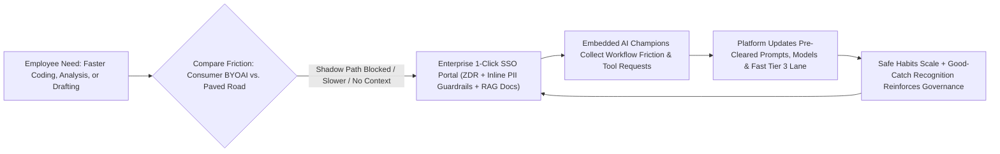

# Chapter 29: Building a Risk-Aware AI Culture

*Part VIII: Operationalizing the Guardrails*

> **In this chapter**
> - **29.1 AI Literacy Programs (Including EU AI Act Article 4 Obligations)** — Translating statutory literacy duties and "jagged frontier" intuition into practical workforce judgment rather than passive compliance videos.
> - **29.2 Role-Based Training Paths** — Tailoring hands-on curriculum, over-reliance drills, and verification proof across six enterprise cohorts from board directors to front-line adjudicators.
> - **29.3 Make the Safe Path the Easy Path** — Replacing unenforceable prohibition bans with single-click SSO AI portals, embedded champions, fast intake lanes, and "good-catch" incentives.
> - **29.4 Speak-Up Culture and Whistleblower Protections for Reporting Unsafe AI** — Protecting early safety escalation via psychological safety, Stop-the-Line authority, EU AI Act Article 87, California SB 53, and SEC Rule `21F-17`.

In Chapter 28, we assembled the measurement instrumentation of AI governance: leading KRIs, delivery KPIs, board scorecards, FinOps unit economics, and Scope 2/3 energy reporting. Dashboards expose patterns—yet dashboards alone never changed behavior on a pressured product sprint or at a Friday-afternoon approval desk. Every technical guardrail in this handbook depends ultimately on human judgment: engineers who decide whether to report a subtle proxy flaw before launch, claim adjusters who decide whether to rubber-stamp a fluent recommendation, and employees who decide whether to paste confidential contracts into a consumer chatbot or use the company's zero-data-retention portal. Building a risk-aware AI culture unites practical literacy, friction-free "paved roads," aligned incentives, and legally backed speak-up channels so doing the safe thing becomes everyday organizational reflex.

---

### Illustrative Composite Scenario: The Blanket Ban That Built an Underground AI Network—and the Engineer Who Stayed Silent

*(This composite scenario is illustrative; it is not drawn from a specific organization or incident.)*

Concerned by early generative AI leakage stories, a global professional-services firm published a blanket acceptable-use ban prohibiting external AI tools while rolling out a mandatory 15-minute slide module focused solely on policy do's and don'ts. Six months later, network-egress audits and employee interviews told two sobering stories. First, lacking an approved enterprise portal or role-relevant prompting workflows, consultants simply pasted anonymized-by-hand client slide decks into personal browser accounts and mobile hotspots to keep up with turnaround targets (`74%` off-grid adoption across junior teams). Second, inside an internal staffing-allocation AI project, a senior machine-learning engineer noticed during staging checks that historical promotion labels penalized part-time parental-leave cohorts indirectly. Remembering how two previous colleagues who questioned flagship launches lost visibility on "innovation" promotion rubrics—and spotting rigid confidentiality language in her employment agreement lacking explicit regulatory reporting carve-outs—she flagged the risk verbally in one rushed stand-up, got brushed aside for Q4 ship velocity, and quietly stayed silent as the biased model moved into production.

---

## 29.1 AI Literacy Programs (Including EU AI Act Article 4 Obligations)

Most corporate compliance training fails because it teaches abstract vocabulary (*"avoid hallucinations and check for bias"*) while leaving workers defenseless before the defining empirical reality of modern AI: capabilities are sharply uneven across closely related tasks. In a pre-registered Harvard Business School field experiment across `758` Boston Consulting Group consultants, Dell'Acqua and colleagues demonstrated what they termed the **"jagged technological frontier."**[^c29-01] For tasks sitting *inside* GPT-4's frontier, AI-assisted consultants completed `12.2%` more tasks, worked `25.1%` faster, and produced `>40%` higher quality outputs than unassisted peers; yet on nuanced problems sitting just *outside* the frontier, consultants relying on AI were **`19` percentage points less likely to arrive at correct solutions**, persuaded cleanly by confident, articulate prose.[^c29-01]

General "annual click-through cyber hygiene" videos cannot teach employees where that jagged frontier runs across *their* specific job workflows. Workforce literacy now also carries direct statutory force. Under **Article 4 of the EU Artificial Intelligence Act (`Regulation (EU) 2024/1689`)**—which entered binding legal application early in the Act's rollout on **February 2, 2025**—providers and deployers of AI systems must take verifiable measures to ensure a sufficient level of **AI literacy** among their staff and any external personnel operating and using AI systems on their behalf.[^c29-02] **Article 3(56)** defines AI literacy explicitly as the *"skills, knowledge and understanding that allow providers, deployers and affected persons... to make an informed deployment of AI systems, as well as to gain awareness about the opportunities and risks of AI and possible harm it can cause."*[^c29-02] Crucially, Article 4 ties obligation rigor to proportionality: training must match staff **technical knowledge, experience, education, context of use, and the persons or groups on whom the AI is used**.[^c29-02]

Embedding EU AI Act Article 4 alongside **ISO/IEC 42001 Clause 7.2 (`Competence`)**[^c29-03] and **NIST AI RMF (`Govern`)**[^c29-04] shifts corporate literacy from one-size-fits-all compliance checkboxes to four measurable habits:

1. **Teach Workflow Frontier Mapping:** Show staff concretely *where* approved AI excels inside their department (drafting structured summaries, translating formats, boilerplate querying) and *where* it routinely misleads (novel multi-rule exceptions, recent statute changes, unsupported mathematical synthesis).
2. **Rehearse Verification Muscle Memory:** Replace multiple-choice trivia with live interactive exercises—asking staff to locate two fabricated legal/policy citations hidden inside a fluent AI memo, spot a subtle cloned-voice CEO urgent-wire script (`deepfake` out-of-band check, Chapter 14), or identify masked vs. raw confidential data fields before submitting prompts.
3. **Explain the "Why" Behind Privacy and Security Boundaries:** Workers bypass rules they perceive as arbitrary paranoia; showing how consumer web prompts feed training sets (`Chapter 6`) and how uploaded untrusted PDFs trigger indirect injections (`Chapter 10`) turns abstract compliance rules into shared intuition.
4. **Refresh Continuously as Models Evolve:** Frontier boundaries shift every two quarters as reasoning models, multimodal agents, and internal RAG tools change—requiring brief, scenario-updated refreshers whenever major enterprise workflows roll out.

### The Guardrails

- **Replace generic annual AI slide decks with proportional, scenario-based literacy (EU AI Act Art. 4):** Maintain verifiable attendance, role mapping, and practical exercise pass records covering permanent staff, contractors, and vendors operating AI systems since February 2025.
- **Train specifically on "jagged frontier" failure modes and confident prose skepticism:** Drill users across realistic company outputs containing plausible hallucinations, fabricated references, and sycophantic validation errors.
- **Audit comprehension rather than click-completion rates:** Measure literacy effectiveness via phishing-style verification drills (e.g., seeded faulty AI drafts inserted into QA sandboxes) rather than video completion percentages alone.

---

## 29.2 Role-Based Training Paths

A Chief Audit Executive questioning model risk appetite needs fundamentally different fluency from a machine-learning engineer wiring MCP sandboxes or a loan officer reviewing borderline credit exceptions. Uniform corporate curricula leave technical teams bored by introductory basics and leave business leaders, attorneys, and front-line reviewers unprepared for the specific cognitive and operational failures hitting their seats.

Empirical human-factors research underscores why targeted training is non-negotiable for decision-facing cohorts. Deloitte's Global Boardroom Program *Governance of AI* survey (`~700` directors across `56` countries) found `66%` of directors report limited or no board AI knowledge—crippling executive challenge.[^c29-08] At the operational desk, Goddard, Roudsari, and Wyatt's systematic review across `74` empirical studies documented how workload, task complexity, and time pressure drive severe **automation bias** (both errors of omission and errors of commission when human reviewers trust flawed alerts).[^c29-05] Meanwhile, Lee and See established that appropriate trust calibration requires transparent capability boundaries so users avoid both blind misuse and wholesale abandonment,[^c29-06] while Lisanne Bainbridge's classic *Ironies of Automation* warned that unpracticed human backups lose manual competence precisely before rare emergencies arrive.[^c29-07]

**Table 29.1** maps a structured **Role-Based Enterprise AI Literacy & Competency Curriculum** aligned to Article 4 proportionality across six core organizational cohorts.

| Role Cohort | Core Risk Blind Spot | Hands-On Curriculum Focus | Verification Proof & Cadence | Governance / Art. 4 Link |
| :--- | :--- | :--- | :--- | :--- |
| **1. Board Directors & C-Suite** | Confusing pilot volume with controlled value; accepting "99% accurate" sales pitches at face value | Reading Table 28.1 KRIs; challenging third-party vendor concentration (`DORA`/`FSB`); approving high-risk risk appetite & `CONDITIONAL GO` waivers | Annual board workshop + quarterly tabletop oversight brief | `NIST AI RMF Govern`; `EU AI Act Art. 4`; `Deloitte` oversight uplift |
| **2. AI / MLOps Engineers & AppSec** | Prompt-only security illusions; failing to isolate RAG ACLs, NHIs, and mutating tool calls | Writing quarantined `gate-eval` suites; `garak`/`PyRIT` red-teaming; `OTel gen_ai.*` tracing; fail-closed sidecars; safe MCP/IAM isolation | Mandatory sandbox build lab before Tier 1/2 deploy permissions (annual update) | `OWASP LLM/Agentic`; `MITRE ATLAS`; `ISO 42001 Cl. 7.2` |
| **3. Legal, Privacy, Risk & Procurement** | Drafting paper policies ignoring ZDR, AI Act timelines, EU Data Act portability, and FRCP 37(e) holds | Auditing vendor ZDR/training addenda; triaging colliding `DORA`/`GDPR`/`Art. 73` reporting clocks; assessing EU AI Act risk tiers & bias testing | Annual scenario simulation + cross-functional legal-hold exercise | `EU AI Act Art. 4 / 26 / 73`; `Ch. 20–24` compliance |
| **4. Front-Line Decision Reviewers (HR, Credit, Clinical, Claims)** | Automation bias (`Goddard`), sycophancy agreement, and manual skill atrophy (`Bainbridge`) | Spotting plausible fabrications; verifying source citations; enforcing meaningful Art. 22/86 override judgment; periodic AI-off manual drills | Graded blinded accuracy/override check semi-annually + live fallback shift | `EU AI Act Art. 14 / Art. 4`; `GDPR Art. 22`; `Ch. 17 & 25` |
| **5. Product & Business Owners** | Shipping unvalidated pilots around intake; inflating zombie token burn on trivial workflows | Tier intake assessment (`Appendix C`); golden edge-case authoring; FinOps unit-cost discipline; 90-day sunset governance | Pre-intake certification required to sponsor Tier 1/2 budgets | `ISO 42001`; `Ch. 5, 26 & 28` ownership |
| **6. General Workforce & Contractors** | Pasting proprietary code/PII into unapproved consumer tools (`BYOAI`); falling for deepfake social engineering | Enterprise SSO portal workflow; data-classification rules (**Appendix E**); deepfake voice/video out-of-band confirmation; reporting near-misses | Onboarding lab + annual interactive verification drill (`100%` contractor inclusion) | `EU AI Act Art. 4` (staff & operators on deployer's behalf) |

*Table 29.1: Role-Based Enterprise AI Literacy & Competency Curriculum matching hands-on drills and verification evidence to organizational responsibility.*

### The Guardrails

- **Gate production access and supervisory roles on cohort-specific completion:** Link Tier 1/2 cloud inference privileges for engineers and adverse-action authority for HR/credit/clinical reviewers directly to completed role training rather than passive self-enrollment.
- **Include contractors, BPOs, and temporary operators explicitly:** Satisfy EU AI Act Article 4's literal scope covering external personnel operating AI on the enterprise's behalf by embedding role modules into third-party vendor onboarding.
- **Preserve front-line calibration with embedded friction and error seeding:** Insert unannounced benchmark verification cases periodically into operational queues so reviewers practice active skepticism instead of mechanical confirmation clicks (Chapter 17).

---

## 29.3 Make the Safe Path the Easy Path

Human behavior follows friction. If pasting an ambiguous customer spreadsheet into a commercial consumer chatbot takes five seconds on a personal browser tab while requesting approved enterprise AI access requires four committee forms and a six-week security review, employees will predictably route around governance every single time. Microsoft and LinkedIn's *2024 Work Trend Index Annual Report* captured this dynamic globally: **`78%` of AI users bring their own AI tools to work (`BYOAI`)** across generations while `60%` of corporate leaders admit their organization lacks a clear plan and vision for AI deployment.[^c29-09] Reactive prohibition fails just as predictably—after Samsung suffered internal source-code uploads to external ChatGPT accounts in 2023 and imposed emergency bans, enterprises learned quickly that blocking one domain simply pushes determined workers onto mobile apps and home laptops.[^c29-10]

Resilient organizations out-compete shadow AI by making the **governed path measurably faster, smarter, and simpler** than any rogue alternative—an architectural pattern known in platform engineering as **"paved roads"**:

- **1-Click Enterprise AI Workspace (SSO + ZDR + Multiple Models):** Give employees an attractive single-sign-on internal chat, document-analysis, and coding portal pre-loaded with top frontier and compact models running exclusively under Zero Data Retention (`ZDR`) and executed DPAs, backed by transparent inline PII masking instead of clumsy error rejections.
- **Department-Ready Verified Prompt Libraries & Secure RAG Connectors:** Pre-wire approved workflows (legal clause redlining, RFx summarization, SOC log triage, code security checks) directly to enterprise SharePoint/Confluence permissions so employees achieve better results inside the secure portal than hand-pasting fragments externally.
- **Self-Serve Tier 3 Fast Lanes (`<= 48h`) Alongside Plain-English AUP UX (`Appendix E`):** Clear low-risk internal experiments automatically when builders use pre-approved gateway templates and API vaults—saving formal governance reviews strictly for Tier 1 and Tier 2 data/autonomy elevation.
- **Embedded "AI Champions" Inside Every Business Unit:** Nominate respected engineering, product, legal, and operations peers (allocated `10%–15%` formal charter time) who sit inside teams to troubleshoot safe workflows locally, flag nascent shadow demand early, and feed unmet tooling gaps directly back to the platform roadmap.

Technology paved roads still buckle if promotion criteria and executive praise celebrate speed exclusively. Organizations must explicitly **re-align performance incentives**: reward product leads and engineers publicly for "good catches"—holding back a shaky launch to fix a subgroup fairness gap, reporting an unexpected shadow integration so FinOps/Platform can onboard it cleanly, or shrinking context bloat to save tokens and energy—with the exact same executive recognition usually reserved for headline feature launches.

### The Guardrails

- **Ship a consumer-grade internal SSO AI portal before restricting public tools:** Ensure every role has an approved, ZDR-backed alternative with file-upload and model diversity matching public chat interfaces prior to enforcing tight CASB/DLP egress blocks (**Appendix E**).
- **Sponsor an AI Champions network backed by protected time:** Fund technical and domain champions across business lines to convert shadow-tool complaints into fast-tracked safe portal features rather than policing tickets punitively.
- **Integrate governance "good catches" into promotion and quarterly review rubrics:** Measure engineering managers and product directors on clean release rigor and zero suppressed findings alongside delivery milestones.

---

## 29.4 Speak-Up Culture and Whistleblower Protections for Reporting Unsafe AI

Even high AI literacy and smooth paved roads cannot guarantee zero blind spots under quarterly launch pressure. The people who spot dangerous shortcuts first—fabricated validation claims, disabled safety classifiers ahead of a demo, undocumented training data, biased underwriting proxies, or quiet regulatory reporting omissions—are almost always internal engineers, data scientists, QA analysts, contractors, and front-line compliance staff. Whether they escalate early or stay silent depends on two reinforcing pillars: **everyday psychological safety** and **enforceable legal protection against retaliation**.

In her foundational organizational behavior study published in *Administrative Science Quarterly* (1999), Harvard professor **Amy Edmondson** demonstrated empirically that teams characterized by **psychological safety**—a shared belief that speaking up with mistakes, doubts, or safety concerns will not trigger humiliation or career punishment—actually *report more* errors initially precisely so teams investigate openly, learn faster, and outperform peers hiding defects until public crisis hits.[^c29-11] Suppressing bad news creates brittle silence; welcoming uncomfortable early warnings builds operational resilience.

Recognizing that voluntary corporate goodwill frequently fractures when flagship AI valuations or launch bonuses hang in the balance, major jurisdictions have enacted **explicit statutory AI and corporate whistleblower mandates**:

1. **EU AI Act Article 87 & EU Whistleblowing Directive (`Directive (EU) 2019/1937`):** Article 87 of the EU AI Act applies Directive (EU) 2019/1937 (`OJ L 305`, November 26, 2019) directly to internal and external reports of AI Act infringements.[^c29-02][^c29-12] In-scope providers and deployers must maintain confidential, secure reporting channels providing **acknowledgment of receipt within `7 days`** and **diligent investigation feedback within `3 months`** (extendable to six months only in duly justified cases), backed by sweeping prohibitions against dismissal, demotion, blacklisting, or retaliation.[^c29-12]
2. **California Senate Bill 53 (*Transparency in Frontier Artificial Intelligence Act — TFAIA*, signed September 29, 2025; effective January 1, 2026):** As the United States' landmark frontier AI transparency statute, `SB 53` requires covered large frontier developers (entities training foundation models exceeding `` `10^26` `` floating-point or integer operations) to establish **secure anonymous internal reporting channels**, expressly prohibits retaliation against employees or contractors responsible for assessing or managing safety who report catastrophic risks, materially false safety statements, or failures to notify authorities of critical safety incidents, and grants aggrieved whistleblowers civil remedies including damages and attorney's fees.[^c29-13]
3. **U.S. SEC Rule `21F-17(a)` (`17 CFR § 240.21F-17`):** Under aggressive SEC corporate enforcement sweeps, organizations face severe penalties whenever NDAs, confidentiality policies, severance releases, contractor agreements, or automated compliance/DLP monitoring impede individuals from communicating directly with regulators about potential securities violations (including misleading public AI accuracy or governance claims under Chapter 3)—even without proof of specific retaliation.[^c29-14]

Turning these statutory floors into genuine operational protection requires concrete architectural and legal hygiene:

- **Route AI safety escalations independently outside delivery chains:** Configure anonymous intake channels (for both full-time employees and external safety/annotation contractors) reporting directly to Chief Ethics Officer / General Counsel / Board Audit Committee leadership rather than the product VP racing a launch deadline.
- **Audit every NDA, severance template, employee handbook, and DLP trigger:** Embed clear, prominent whistleblower carve-outs inside all confidentiality agreements confirming unrestricted right to report safety hazards, AI Act infringements, or securities concerns directly to competent authorities—and verify enterprise DLP and AI-monitoring tools never flag or quarantine communications sent to official regulator tip portals (`Rule 21F-17`).[^c29-14]
- **Operationalize "Stop-the-Line" Authority Without Career Penalty:** Authorize AI engineers, QA leads, red-teamers, and clinical/risk reviewers to pause deployment on unresolved critical safety or bias findings—logging every pause cleanly inside the OECD near-miss **AI hazard** workflow (Chapters 27–28) as protected organizational learning rather than team failure.[^c29-15]

Together, literacy, paved roads, aligned incentives, and protected speak-up channels complete *Part VIII: Operationalizing the Guardrails*—and prepare the full transition into **Chapter 30 (*Governance Maturity Model & Roadmap*)**, where organizations assess current posture across five maturity tiers and chart a concrete 30/60/90-day implementation path.

### The Guardrails

- **Grant unambiguous, penalty-free "Stop-the-Line" authority across technical and domain staff:** Charter engineers, QA analysts, red-teamers, and risk reviewers to pause unsafe Tier 1/2 releases until independent review resolves the concern, tracking pauses as positive governance metrics.
- **Enforce EU `7-day`/`3-month` and California `SB 53` anonymous reporting guarantees:** Deploy secure, anonymous external-hosted intake portals routed to Ethics/Audit Committee oversight, tracking receipt acknowledgment (`<=7 days`) and closure feedback (`<=3 months`).
- **Scrub NDAs, severance clauses, and AI/DLP filters for `Rule 21F-17` compliance:** Audit all workforce, contractor, and customer confidentiality language and monitoring policies annually with employment and securities counsel to eliminate chilling effects against regulator disclosures.

---

## Why Every Role Cares

| Role | What Changes for Your Team | Primary Cultural Risk if Ignored |
| :--- | :--- | :--- |
| **CEO / Executive Leadership** | Model psychological safety publicly, celebrate "good catches" alongside launches, and fund fast ZDR paved roads over reactive bans. | Underground `78%` BYOAI sprawl, hidden toxic product compromises, and suppressed warnings exploding later as public crises. |
| **CHRO / Learning & Development** | Deploy EU AI Act `Art. 4` role-proportioned practical labs (Table 29.1) including contractors, synced with promotion rubrics that reward rigor. | Non-compliant generic video checklists leaving front-line staff blind to the jagged frontier and automation bias. |
| **General Counsel / Chief Ethics Officer** | Align NDAs, severance terms, and independent anonymous intake channels with `EU AI Act Art. 87` (`Directive 2019/1937`), `CA SB 53`, and `SEC Rule 21F-17`. | Regulatory sanctions for gag-clause impediments, whistleblower retaliation exposure, and unchecked regulatory non-disclosure failures. |
| **CIO / Platform Engineering** | Build the 1-click SSO enterprise AI workspace, department prompt catalogs, fast Tier 3 self-serve lane, and embedded Champions network. | Frustrated developers routing proprietary data through personal API keys and consumer web wrappers outside all telemetry. |
| **CISO / Security & Trust** | Ensure DLP/AI monitoring never blocks legal whistleblower egress while embedding practical deepfake and injection intuition across employee training. | Security policies bypassed wholesale by normal business users trying to hit daily productivity deadlines. |
| **Front-Line Managers & Supervisors** | Lead blameless near-miss reviews (`Edmondson`), rotate AI-off manual proficiency shifts (`Bainbridge`), and defend staff who pull Stop-the-Line cords. | Silent compliance erosion under sprint pressure as analysts rubber-stamp flawed outputs and fear escalating model flaws. |

---

## Chapter Summary

| Cultural Pillar | Core Challenge | Essential Technical, Legal & Human Controls | Primary Frameworks / Evidence |
| :--- | :--- | :--- | :--- |
| **AI Literacy Programs (29.1)** | Passive slide decks fail before persuasive hallucinations across the uneven "jagged frontier" | Scenario-based frontier mapping & fake-citation/deepfake drills proportional to context & role; audit comprehension not clicks | Dell'Acqua et al. (`758` BCG consultants); `EU AI Act Arts. 4 & 3(56)` (`2 Feb 2025`); `ISO 42001 Cl. 7.2`; `NIST AI RMF Govern` |
| **Role-Based Training Paths (29.2)** | One-size training leaves directors unequipped to challenge and operators trapped in automation bias | 6-cohort curriculum (Table 29.1) gating Tier 1/2 deploy & review rights; contractor coverage; blind error-seeding calibration | `Deloitte Board Survey`; `Goddard et al.` (74 studies); `Lee & See`; `Bainbridge` (1983); `EU AI Act Art. 14` |
| **Paved Roads & Incentives (29.3)** | Prohibitive bans and slow review queues push `78%` of workers onto shadow BYOAI | 1-click SSO ZDR workspace; department prompt/RAG presets; fast `<=48h` Tier 3 lane; embedded AI Champions; "good-catch" awards | Microsoft *2024 Work Trend Index*; Samsung leak ban; **Appendix E** (Acceptable Use Policy UX) |
| **Speak-Up & Whistleblowing (29.4)** | Career pressure and chilling NDAs silence employees who catch safety, bias, or fraud issues first | Anonymous Ethics/Audit channels; Stop-the-Line authority; `7d/3m` Directive `2019/1937` SLAs; NDA/DLP `Rule 21F-17` audits | `Edmondson` (*ASQ* 1999); `EU AI Act Art. 87` & `Directive 2019/1937`; California `SB 53` (*TFAIA*); `SEC Rule 21F-17`; OECD hazards |

---

## Key Takeaways

- **Teach the jagged frontier through realism, not click-through compliance:** Satisfy `EU AI Act Article 4` (in effect since February 2, 2025) and `ISO/IEC 42001` with proportional, scenario-driven training proving staff can spot persuasive errors, missing sources, and over-reliance traps.
- **Tailor hands-on competency to role risk:** Boards need KRI/vendor interrogation skills, engineers need blind-gate and IAM containment labs, and front-line reviewers need blind accuracy calibration and periodic manual-fallback practice (**Table 29.1**).
- **Out-design shadow AI rather than outlawing demand:** Blanket bans create underground `BYOAI` exposure; 1-click ZDR enterprise workspaces, department prompt libraries, `AI Champions`, and fast Tier 3 lanes turn safe compliance into the fastest daily workflow.
- **Protect the messenger legally and culturally:** Pair Edmondson's psychological safety and penalty-free Stop-the-Line escalation with audited anonymous channels and whistleblower carve-outs complying with `EU AI Act Article 87`, California `SB 53`, and `SEC Rule 21F-17`.

---

## Questions to Ask
| Target Team | Concrete Diagnostic Question | What a Strong Answer Looks Like |
| :--- | :--- | :--- |
| **CHRO / L&D / Compliance** | *"Does our AI literacy training verify practical skill—spotting persuasive hallucinations and automation bias—across permanent staff, contractors, and vendors per EU AI Act Art. 4?"* | Yes—every role cohort completes tailored hands-on verification labs tracked with audit records since Feb 2025, refreshed on major workflow releases. |
| **Platform Engineering / IT** | *"Why would a consultant or analyst prefer our internal SSO AI portal over pasting files into a personal consumer chatbot tonight?"* | Single-click SSO login, ZDR guarantees across top models, pre-wired internal SharePoint/Confluence permissions, department prompt templates, and fast `<=48h` Tier 3 clearance. |
| **Business Units / AI Champions** | *"Name one engineering or business team member publicly rewarded last quarter for pausing an AI launch or flagging a risky flaw—did that slow their career?"* | Multiple "Good Catch" awards recognized in leadership reviews specifically highlighted stopped bias/leakage launches, improving promotion outcomes rather than penalizing caution. |
| **General Counsel / Ethics** | *"Have we scrubbed our NDAs, severance agreements, contractor forms, and DLP monitoring rules to preserve unfettered AI whistleblower rights?"* | Counsel audited all agreements for explicit whistleblower carve-outs under `SEC Rule 21F-17`, `CA SB 53`, and `EU Directive 2019/1937`, routed strictly to Ethics/Audit Committee oversight. |
| **Operations Supervisors** | *"When an analyst overrides or stops a suspicious Tier 1 AI recommendation under deadline pressure, how many seconds does reporting take and who protects the override?"* | One-click UI feedback logs a near-miss OECD hazard directly without blame, and managers reinforce override calibration in weekly quality reviews. |

---

## References

[^c29-01]: Fabrizio Dell'Acqua, Edward McFowland III, Ethan R. Mollick, Hila Lifshitz-Assaf, Katherine C. Kellogg, Saran Rajendran, Lisa Krayer, François Candelon, and Karim R. Lakhani, "Navigating the Jagged Technological Frontier: Field Experimental Evidence of the Effects of AI on Knowledge Worker Productivity and Quality," Harvard Business School Working Paper No. 24-013 (September 2023). **Annotation:** Pre-registered experiment across 758 BCG consultants finding inside-frontier gains (`+12.2%` tasks, `+25.1%` speed, `>40%` quality) paired with a 19-percentage-point drop in accuracy on outside-frontier problems due to persuasive over-reliance. [↗ Bibliography](../bibliography.md#dellacqua-2023-frontier)

[^c29-02]: European Parliament and Council of the European Union, *Regulation (EU) 2024/1689 (Artificial Intelligence Act)*, Official Journal of the EU L, 2024/1689, July 12, 2024 — specifically Article 3(56) (defining AI literacy), Article 4 (binding provider and deployer AI literacy duty, applicable from February 2, 2025), Article 14 (human oversight), and Article 87 (reporting of infringements and protection of reporting persons). **Annotation:** Establishes proportional workforce AI literacy and formal whistleblower protections as core statutory obligations across EU deployments. [↗ Bibliography](../bibliography.md#eu-2024-ai-act)

[^c29-03]: International Organization for Standardization and International Electrotechnical Commission, *ISO/IEC 42001:2023, Information Technology — Artificial Intelligence — Management System* (Geneva: ISO, December 2023), Clause 7.2 (Competence) and Clause 7.3 (Awareness). **Annotation:** Requires organizations to determine necessary AI competence for roles affecting AIMS performance, verify training effectiveness, and retain documented competence records. [↗ Bibliography](../bibliography.md#iso-2023-42001)

[^c29-04]: National Institute of Standards and Technology, *Artificial Intelligence Risk Management Framework (AI RMF 1.0)*, NIST AI 100-1 (Gaithersburg, MD: NIST, January 2023), doi:10.6028/NIST.AI.100-1 — `Govern` function (organizational risk culture, policies, and workforce diversity/competence). **Annotation:** Anchors organizational governance culture, clear risk-escalation norms, and multidisciplinary training within enterprise socio-technical AI governance. [↗ Bibliography](../bibliography.md#nist-2023-ai-rmf)

[^c29-05]: Kate Goddard, Abdul Roudsari, and Jeremy C. Wyatt, "Automation Bias: A Systematic Review of Frequency, Effect Mediators, and Mitigators," *Journal of the American Medical Informatics Association (JAMIA)* 19, no. 1 (January–February 2012): 121–127, doi:10.1136/amiajnl-2011-000089. **Annotation:** Systematic review across 74 studies explaining how workload, complexity, and time pressure drive human omission and commission errors when reviewing automated systems. [↗ Bibliography](../bibliography.md#goddard-2012-automation-bias)

[^c29-06]: John D. Lee and Katrina A. See, "Trust in Automation: Designing for Appropriate Reliance," *Human Factors* 46, no. 1 (Spring 2004): 50–80, doi:10.1518/hfes.46.1.50_30392. **Annotation:** Demonstrates why human-factors design and role training must cultivate *calibrated reliance*—preventing both blind over-trust (`misuse`) and wholesale abandonment (`disuse`). [↗ Bibliography](../bibliography.md#lee-2004-trust)

[^c29-07]: Lisanne Bainbridge, "Ironies of Automation," *Automatica* 19, no. 6 (November 1983): 775–779, doi:10.1016/0005-1098(83)90046-8. **Annotation:** Explains why role-based training for front-line reviewers must include active manual practice so automation never strips away fallback intervention capability. [↗ Bibliography](../bibliography.md#bainbridge-1983-ironies)

[^c29-08]: Deloitte Global Boardroom Program, *Governance of AI: A Critical Imperative for Today's Boards*, 2nd ed. (Deloitte, 2025). **Annotation:** Survey showing 66 percent of global directors describe their boards as having limited or no AI experience, demonstrating the urgency of targeted boardroom governance literacy. [↗ Bibliography](../bibliography.md#deloitte-2025-board-ai)

[^c29-09]: Microsoft and LinkedIn, *2024 Work Trend Index Annual Report: AI at Work Is Here. Now Comes the Hard Part* (May 8, 2024). **Annotation:** Establishes that 78 percent of workplace AI users bring their own AI tools (`BYOAI`) while 60 percent of leaders lack a cohesive AI strategy—proving why paved roads outperform pure prohibition. [↗ Bibliography](../bibliography.md#microsoft-2024-work-trend)

[^c29-10]: Mark Gurman, "Samsung Bans Staff's AI Use After Spotting ChatGPT Data Leak," *Bloomberg* (May 2, 2023). **Annotation:** Illustrates both insider IP exposure inside public chatbots and why blanket prohibition without an equally fast internal alternative encourages shadow migration. [↗ Bibliography](../bibliography.md#gurman-2023-samsung)

[^c29-11]: Amy Edmondson, "Psychological Safety and Learning Behavior in Work Teams," *Administrative Science Quarterly* 44, no. 2 (June 1999): 350–383, doi:10.2307/2666999. **Annotation:** Foundational empirical study proving psychologically safe teams surface and report errors more openly, enabling organizational learning and earlier failure containment. [↗ Bibliography](../bibliography.md#edmondson-1999-psych-safety)

[^c29-12]: European Parliament and Council of the European Union, *Directive (EU) 2019/1937 on the Protection of Persons Who Report Breaches of Union Law (EU Whistleblowing Directive)*, Official Journal of the EU L 305, November 26, 2019, pp. 17–56 — incorporated directly into EU AI Act Article 87. **Annotation:** Compels in-scope entities to run confidential whistleblowing channels with 7-day receipt acknowledgment, 3-month investigation feedback, and strict protection against retaliation. [↗ Bibliography](../bibliography.md#eu-2019-whistleblowing)

[^c29-13]: State of California, *Transparency in Frontier Artificial Intelligence Act (TFAIA)*, Senate Bill 53 (signed September 29, 2025; effective January 1, 2026). **Annotation:** Mandates anonymous internal reporting channels across covered frontier AI developers (`10^26` FLOPs threshold) and creates private retaliation remedies protecting employees and contractors raising catastrophic risk or misleading safety-claim concerns. [↗ Bibliography](../bibliography.md#ca-2025-sb53)

[^c29-14]: U.S. Securities and Exchange Commission, *Staff Communications with Whistleblowers*, 17 CFR § 240.21F-17 (Rule 21F-17 under the Securities Exchange Act of 1934). **Annotation:** Bars confidentiality agreements, severance waivers, corporate handbooks, or internal communication policies from impeding direct employee or stakeholder whistleblower disclosures to the SEC. [↗ Bibliography](../bibliography.md#sec-rule-21f-17)

[^c29-15]: Organisation for Economic Co-operation and Development (OECD), *Defining AI Incidents and Related Terms*, OECD Artificial Intelligence Papers, No. 16 (Paris: OECD Publishing, May 2024), doi:10.1787/d1a8d965-en. **Annotation:** Frames penalty-free reporting of near-miss *AI hazards* alongside actualized *AI incidents* as a core organizational learning feedback loop. [↗ Bibliography](../bibliography.md#oecd-2024-ai-incidents)
