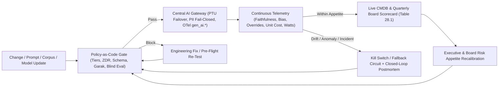

# Chapter 30: Governance Maturity Model & Roadmap

*Part VIII: Operationalizing the Guardrails*

> **In this chapter**
> - **30.1 The Five-Level AI Governance Maturity Model** — Assessing organizational capability realistically across five structured tiers while matching target maturity to workload materiality.
> - **30.2 A 30/60/90-Day Action Plan** — Sequencing pragmatic operational wins across Days 1–30, 31–60, 61–90, and Months 4–12 using every template across Appendices A–J.
> - **30.3 From Point-in-Time Sign-Off to Continuous Governance** — Replacing brittle annual checklists with living registries, Policy-as-Code gates, closed-loop telemetry, and the guardrails-enable-speed mindset.

Across twenty-nine chapters, we have unpacked the full anatomy of enterprise AI risk: foundational technical architecture, board oversight, inventory and risk tiering, data security and copyright, adversarial threats, fairness and human oversight, global regulation, third-party and lifecycle dependencies, resilience, red-teaming, incident response, KRIs, and speak-up culture. Reading three hundred pages of controls can create a predictable paralysis: *Where does our organization actually stand today, and what should we build first on Monday morning without stalling every engineering team for a year?* Attempting to launch every control simultaneously guarantees bureaucratic collapse; writing policies without engineering plumbing guarantees shadow bypasses. Closing Part VIII—and the core body of this handbook—this chapter equips leaders with a five-level maturity benchmark, a disciplined 30/60/90-day implementation sequence, and an operating blueprint for continuous governance.

---

### Illustrative Composite Scenario: From "Compliance Binder" to Continuous Guardrails in Ninety Days

*(This composite scenario is illustrative; it is not drawn from a specific organization or incident.)*

Two comparable regional insurers began building AI governance programs the same quarter. The first appointed a steering committee that spent nine months drafting a 140-page policy manual modeled on every possible future statute, freezing new vendor approvals until legal review forms reached perfection. Engineers promptly spun up unauthorized cloud model endpoints on team credit cards (`78%` shadow adoption), zombie sandboxes proliferated unmonitored, and the steering committee still could not answer the board's first question: *"How many AI tools are touching policyholder claims today?"* The second insurer ran an honest two-day maturity diagnostic using this book's intake templates. Recognizing it sat at Level 1, leadership shelved perfection: within **30 days**, IT shipped a single-click SSO workspace backed by zero-data-retention terms alongside a plain-English acceptable-use guide and a billing-reconciled starter inventory. By **Day 60**, all inference traffic routed through one gateway enforcing PII redaction, automated blind golden-dataset CI checks, and a 90-day pilot sunset gate. By **Day 90**, the team conducted a live outage-and-injection game day and delivered its first one-page quarterly KRI scorecard to the Risk Committee—turning governance into the fastest track from experiment to safe production.

---

## 30.1 The Five-Level AI Governance Maturity Model

Organizations rarely progress from chaos to full automation overnight. Software engineering learned decades ago through Paulk, Curtis, Chrissis, and Weber's foundational **Capability Maturity Model (`CMM v1.1`, 1993)** that trying to enforce advanced quantitative controls atop ad-hoc foundations produces brittle paperwork rather than repeatable execution.[^c30-01] Modern cybersecurity and enterprise risk frameworks mirror that staged insight: NIST's **Cybersecurity Framework 2.0 (`CSWP 29`, February 26, 2024)** elevates governance across its core functions and organizes organizational progression through four **Implementation Tiers** (`Partial`, `Risk Informed`, `Repeatable`, and `Adaptive`).[^c30-02] Adapted specifically for probabilistic AI alongside **NIST AI RMF 1.0**[^c30-03] and **ISO/IEC 42001:2023**,[^c30-04] Table 30.1 establishes a **Five-Level AI Governance Maturity Model** uniting technical, legal, and cultural execution.

| Maturity Level | Board Oversight & Culture | Security, Data & Lifecycle Controls | Testing, Resilience & FinOps | Overall Risk Posture |
| :--- | :--- | :--- | :--- | :--- |
| **Level 1: Ad Hoc / Shadow** | No AI committee or RACI; board lacks AI visibility (`66%` literacy gap); reactive bans spark unchecked `BYOAI` | Uninventoried APIs & shadow SaaS; public web uploads leaking IP/PII; consumer keys sitting in notebooks | Informal developer "vibe checks"; zero fallback or ZDR checks; unmonitored idle pilot burn | **Exposed & Unmapped:** Severe breach (`+$670k` shadow penalty), IP, and unexpected regulatory exposure |
| **Level 2: Foundational / Policy-Driven** | Executive owner & RACI (`App. B`); plain-English AUP (`App. E`); baseline Art. 4 literacy; v1 CMDB inventory | Billing-reconciled asset list (`App. C`); vendor ZDR checklist (`App. D`); central API gateway & secrets vault launched | Ad-hoc staging benchmarks; basic logging (`OTel`); manual fallback notes documented cleanly | **Visible & Triageable:** Core leakage vectors slowing; major reliance still rests on manual review |
| **Level 3: Defined & Gated** | Materiality tiers governing all AI (`Ch. 5/24`); role-based labs (`Table 29.1`); anonymous speak-up channel wired | Mandatory ZDR/DPA clauses; permission-aware RAG ACLs; `Appendix F` Go/No-Go gates; `FRCP 37(e)` legal-hold pause | Quarantined blind `gate-eval` sets; CI `garak` scans; fail-closed PII sidecars; 90-day pilot sunsets | **Repeatable Pre-Flight Control:** High-risk deployments blocked cleanly when unsafe; shadow demand absorbed on paved roads |
| **Level 4: Measured & Automated** | Monthly KRI/KPI telemetry (`App. G` crosswalks); quarterly `Table 28.1` Board Dashboard; `Good Catch` incentives | Automated CMDB discovery; blue/green vector re-indexing; immutable WORM `gen_ai.*` traces; IAM agent kill switches | Adaptive `PyRIT` + independent red teams; `RAGAS` drift alerts & auto-rollbacks; FinOps unit economics & ESG watts tracked | **Proactively Governed:** Regressions & bias drift trigger automated containment before external complaints arrive |
| **Level 5: Adaptive & Board-Optimized** | Continuous third-line audit validation (`IIA`); optional `ISO 42001` cert; dynamic appetite recalibration | Policy-as-Code enforcement across CI/CD, gateways, & cross-cloud DR vaults; multi-provider active portability | Live chaos & manual-shift game days; incident-to-blind-gate flywheel (`<24h`); full CSRD Scope 2/3 & regulatory readiness | **Continuous Resilience:** Governance runs invisibly at platform speed—accelerating safe enterprise AI scaling |

*Table 30.1: The Five-Level AI Governance Maturity Model aligning oversight, technical guardrails, assurance engineering, and economic accountability.*

Here leaders must avoid the classic maturity trap: **do not gold-plate every workload to Level 5**. Applying bank-grade independent red-teaming, third-line audits, and multi-cloud hot standby infrastructure to an internal marketing brainstorming assistant wastes scarce engineering bandwidth and drives teams straight back onto personal tools. Mirroring the materiality-based proportionality embedded in April 2026 U.S. banking supervision (`SR 26-2` / `OCC 2026-13` / `FIL-15-2026`), target maturity deliberately by risk tier:[^c30-05]

- **Target Level 3** globally as an enterprise floor for low-risk Tier 3 internal productivity workloads (paved SSO portal, ZDR contracts, automated baseline CI checks).
- **Target Level 4** unconditionally across Tier 1 and regulated Tier 2 deployments handling customer eligibility, personal data, financial commitments, healthcare triage, or autonomous agent writes.
- **Target Level 5** selectively for mission-critical infrastructure, heavily supervised financial/medical systems, and frontier model developers facing intense statutory scrutiny.

Confronting baseline honesty matters too. Empirical benchmarks explain why rushing out of Level 1 cannot wait: IBM Security's *Cost of a Data Breach Report 2025* documented `20%` shadow-AI involvement adding an average `+$670,000` in breach costs,[^c30-06] while Deloitte's global board survey found `31%` of boards still lack AI on their agendas and `66%` report limited or no board AI fluency.[^c30-07] To compute an unvarnished baseline score rather than grading on intention, evaluate your weakest operational link across four concrete probes: *(1) Compare cloud AI API invoices and CASB logs directly against your official CMDB inventory to expose real discovery gaps; (2) Sample your last five Tier 1 or Tier 2 releases for quarantined blind-eval evidence and independent red-team sign-offs; (3) Test whether a customer-facing safety guardrail fails closed under simulated network timeout; and (4) Check how many minutes it takes to pull a production kill switch on a live autonomous agent.* Measuring honestly where your company sits today—even if the candid average sits near `1.4`—turns abstract maturity tables into an actionable funding and sequencing mandate.

### The Guardrails

- **Run an unvarnished baseline diagnostic across engineering, security, legal, and finance:** Score each business unit honestly against Table 30.1 using hard billing, CASB, and eval evidence rather than aspirational policy slideware.
- **Assign explicit Level 3 / Level 4 / Level 5 target states per risk tier:** Prohibit both "wildcard Level 1 production" on Tier 1 models and "bloated Level 5 committee sign-off" on harmless internal productivity scripts.
- **Treat shadow discovery as a positive governance upgrade:** Never penalize business units for surfacing previously uninventoried tools during baseline discovery; onboard or replace them gracefully onto Level 2/3 paved roads.

---

## 30.2 A 30/60/90-Day Action Plan

Executive momentum evaporates when AI governance arrives as a vague multi-year transformation program. Conversely, a tightly sequenced **90-day operational sprint** captures fast visibility, removes engineering friction via paved roads, and wires core guardrails before sprawling pilots harden into unmanageable debt. The urgency is unmistakable: with `78%` of employees bringing their own tools (`BYOAI`) per Microsoft and LinkedIn,[^c30-08] Gartner warning over `40%` of agentic AI projects face cancellation by 2027 due to runaway cost and weak risk controls,[^c30-09] and `98%` of FinOps practitioners now managing AI spend actively per the FinOps Foundation's 2026 report,[^c30-10] disciplined execution in the first ninety days directly protects capital as well as compliance.

**Table 30.2** translates this entire handbook into a concrete **30/60/90-Day Action Plan** (followed by Months 4–12 institutionalization), pairing exact executive owners with ready-to-use templates in **Appendices A through I**.

| Horizon & Focus | Core Operational Deliverables | Primary Owners | Handbook References & Templates | Exit / Verification Gate |
| :--- | :--- | :--- | :--- | :--- |
| **Days 1–30: Stop the Bleeding & See the Estate** | Charter Governance Committee & RACI; launch 1-click SSO ZDR AI portal + plain-English AUP; reconcile cloud/SaaS invoices & CASB into v1 Inventory; start Art. 4 role-proportioned literacy baseline; wire Tier 1 manual kill switches | CIO, CISO, CRO, General Counsel, CHRO | Chapters 3–6, 25, 29; **App. B** (RACI), **App. C** (Intake Form), **App. E** (AUP) | `>=85%` AI spend mapped in CMDB; public ZDR portal live; `100%` Tier 1 apps hold named emergency owner |
| **Days 31–60: Paved Roads & Tiered Gates** | Enforce Risk Tiers 1–3 & Change-Materiality Matrix; mandate ZDR/exit addenda on vendor contracts; deploy central gateway (`OTel gen_ai.*` + fail-closed PII); require blind `gate-eval` + `garak` CI checks; set `Sev-1/2` response playbooks & 90-day pilot sunsets | AI Engineering, Procurement, AppSec, Privacy/DPO, FinOps | Chapters 7–15, 23–27; **App. D** (Vendor DDQ), **App. F** (Pre-Flight), **App. H** (Incident Playbook) | Zero new Tier 1/2 deploys bypass central gateway or `App. D/F`; blind `gate-eval` live in CI; `Sev-1/2` clocks mapped |
| **Days 61–90: Automate Telemetry, Drills & Board Brief** | Execute first Tier 1 adaptive red-team (`PyRIT`) & outage/manual-fallback game day; launch rolling KRIs (`App. G` crosswalks) & one-page `Table 28.1` Board Dashboard; verify `Art. 87`/`SB 53`/`Rule 21F-17` NDA carve-outs & anonymous portal | CRO, Red Team, Business Owners, Ethics/Legal, CFO | Chapters 16–22, 26–29; **App. A** (Cheat Sheets), **App. G** (Regulatory Crosswalk), **App. I** (Glossary) | First `Table 28.1` dashboard reviewed by Board Audit/Risk; Tier 1 DR fallback & incident drill signed off; zombie pilots retired at Day 90 |
| **Months 4–12: Steady-State Assurance & Scale** | Integrate third-line Internal Audit (`IIA 2025` testing); automate continuous metadata lineage & WORM evidence packs; evaluate optional external `ISO/IEC 42001` registration (`ISO 42006`); prep statutory deadlines (`EU Digital Omnibus` Annex III `Dec 2027` / Annex I `Aug 2028`) | Internal Audit, CRO, General Counsel, CIO | Chapters 20–22, 24, 28, 30; **App. A–J** integrated lifecycle | Closed third-line audit cycles; `>=95%` live inventory match; roadmap locked ahead of global statutory cutoffs |

*Table 30.2: Sequenced 30/60/90-Day Action Plan and Months 4–12 scale roadmap tying deliverables to executive accountability and handbook appendices.*

Notice how cleanly **Months 4–12** align technical milestones with shifting legal clocks. Under the **EU Digital Omnibus on AI (`Regulation (EU) 2026/1744`)**, high-risk rules for Annex III systems were deferred to **December 2, 2027** and Annex I embedded-product systems to **August 2, 2028**, while prohibited practices, AI literacy (`Art. 4`), GPAI duties, and `Article 50` synthetic-content transparency remained on active schedules.[^c30-11][^c30-12] Organizations executing Table 30.2 in ninety days gain clean multi-quarter runway ahead of 2027–2028 compliance deadlines rather than scrambling in crisis mode. Meanwhile, maturing enterprises engaging third-line internal audit under the **IIA Global Internal Audit Standards** (effective January 9, 2025)[^c30-13] and pursuing independent **ISO/IEC 42001** certification—governed cleanly by accredited registrars operating under **ISO/IEC 42006:2025**[^c30-14]—reuse the exact telemetry, evaluation artifacts, and control logs already generated automatically by engineering pipelines.

### The Guardrails

- **Sequence infrastructure enablement alongside control gates in Days 1–60:** Never roll out enforcement blocks or lengthy intake checklists before launching the 1-click ZDR enterprise workspace and `<48h` Tier 3 fast lane.
- **Anchor every 30-day milestone on verifiable artifacts, not committee meetings:** Count a milestone complete only when code commits, gateway logs, signed ZDR addenda, blind eval results, or signed drill postmortems exist cleanly in version control.
- **Eliminate orphaned pilots aggressively at Day 90:** Enforce automated token revocation and cloud GPU teardown for unpromoted proof-of-concept endpoints so FinOps savings self-fund ongoing platform guardrails.

---

## 30.3 From Point-in-Time Sign-Off to Continuous Governance

Even the sharpest 90-day implementation fails by Year 2 if an enterprise slips back into traditional annual compliance snapshots. Annual risk sign-offs evolved for static ERP releases whose code changed semi-annually and whose vendors stayed fixed for years. In AI operations, foundation-model weights shift quarterly, vendors trigger 60-day deprecation clocks, user phrasing drifts seasonally, new prompt-injection techniques publish weekly, and RAG corpora absorb thousands of altered documents every afternoon. A system cleared as low-risk on January 10 can silently violate fairness parity, data-residency guarantees, or accuracy tolerances by March 15 while its paper approval certificate still reads "Valid through December 31."

Durable AI governance must therefore mirror the architectural transition codified in **NIST Special Publication 800-137 (*Information Security Continuous Monitoring — ISCM*)**: moving from periodic point-in-time authorization toward **continuous, automated awareness** of system state, active threats, control effectiveness, and real-world risk posture supporting live authorization decisions.[^c30-15] Operationalizing continuous governance rests on four enduring architectural habits:

1. **Living, Auto-Discovered Registries:** Replace static intake spreadsheets with dynamic inventories synchronized daily against cloud GPU billing, AI gateway API tokens, SSO app assignments, and MCP tool manifests (`Chapter 5 & 28`).
2. **Policy-as-Code Enforcement in Delivery Pipelines:** Embed tier rules directly into CI/CD pipelines and gateway configs—blocking deploys lacking ZDR tags, golden blind-eval passes, schema validation wrappers, fail-closed safety sidecars, or valid executive waivers without relying on human memory (`Chapters 24–26`).
3. **Automated Drift & Incident-to-Regression Flywheels:** Wire rolling `RAGAS` metrics, `OTel gen_ai.*` unit-cost spikes, fairness slice telemetry, and human override surges directly to gateway circuit breakers and KRI escalation—feeding every incident and near-miss permanently into blind CI regression suites (`Chapters 24, 27–28`).
4. **Shared Socio-Technical Ownership (`App. A` Role Loops):** Ensure every executive and operational practitioner keeps role-specific questions sharp (codified in **Appendix A: Role-Based Cheat Sheets**), reinforced by embedded AI Champions, non-retaliatory Stop-the-Line authority, and clean third-line audit verification (`Chapters 22 & 29`).

Notice what happens inside this continuous governance loop: **guardrails stop acting as external traffic cops and become internal speed multipliers**. Engineers ship faster with confidence because automated blind evals, gateway PII scrubbers, deterministic output schemas, and one-click ZDR fallbacks absorb predictable failure modes automatically. Legal and Risk teams evaluate fewer ad-hoc exceptions because Tier 3 self-serve lanes handle routine demand safely while clear Table 26.1 and Table 28.1 metrics isolate genuine Tier 1 risks cleanly. Procurement negotiates sharper, portable contracts faster using Appendix D. Boards oversee transformation through crisp quarterly decision briefs rather than blind faith or panic bans.

That shift—from static fear to instrumented enablement—completes the operational arc of this handbook. Whether your organization stands today at Level 1 scrambling to contain off-grid consumer chatbots or at Level 4 automating global regulatory compliance across multi-agent deployments, the next move is concrete: pick your first 30-day cohort from Table 30.2, adapt the ready-to-use charter, intake, vendor, AUP, pre-flight, crosswalk, and incident-playbook templates waiting immediately in **Appendices A through J**, and put your first continuous guardrail loop into production this quarter. Guardrails do not slow enterprise AI down—they are precisely what allow an enterprise to scale AI safely without regret.

### The Guardrails

- **Replace static "annual recertification" calendars with continuous risk-triggered authorization:** Tie continued production authority directly to live telemetry health, valid blind-gate passes, active ZDR contracts, and unexpired waivers (`NIST SP 800-137`).
- **Maintain Policy-as-Code parity across internal builds and SaaS vendor integrations:** Subject both custom RAG/agent stacks and third-party vendor upgrades to automated discovery, gateway monitoring, and drift checks.
- **Review and refresh the governance charter semi-annually against evolving laws and model capabilities:** Recalibrate Tier rules, golden benchmarks, role training, and Appendix G crosswalks whenever new frontier capabilities (autonomous agents, multimodal tooling) or binding effective dates arrive.

---

## Why Every Role Cares

| Role | What Changes for Your Team | Primary Roadmap Risk if Ignored |
| :--- | :--- | :--- |
| **Board / Audit & Risk Committee** | Demand an honest Table 30.1 baseline score, approve tiered target maturity (Levels 3–5 by materiality), and review the 90-day exit metrics via Table 28.1. | Governing blindly off complacent green compliance decks while `78%` BYOAI and unmonitored agent risks compound invisibly underneath. |
| **CEO / Executive Sponsors** | Champion the 30/60/90-day sprint as an enablement paved-road initiative—funding ZDR workspace tooling alongside risk controls. | Fragmented committee turf wars that stall product innovation into 9-month binder projects while competitors scale safely. |
| **CIO / CTO / Platform Lead** | Prioritize Day-30 SSO portals and gateway telemetry before strict blocking, then wire Policy-as-Code CI/CD gates and ISCM continuous monitoring. | Unenforceable paper bans rejected by engineers, fractured cloud spend, and fragile ad-hoc production pipelines. |
| **Chief Risk Officer / Compliance** | Sequence materiality-proportional targets (`SR 26-2` / `NIST AI RMF`), connect `App. G` crosswalks ahead of 2027–2028 EU cutoffs, and maintain live KRIs. | Either over-engineering Level 5 bureaucracy for harmless Tier 3 workflows or under-governing high-risk systems into statutory violations. |
| **CFO / Procurement** | Track Days 1–30 invoice discovery, Day-60 `App. D` ZDR/exit contract clauses, and Day-90 zombie-pilot retirements yielding direct compute savings. | Unchecked token/GPU sprawl (`>40%` agentic cancellation risk) alongside non-portable vendor lock-in. |
| **Internal Audit / Ethics** | Transition from late paper sampling to verifying automated Policy-as-Code evidence trails, speak-up readiness, and `IIA 2025` / `ISO 42006` readiness. | Point-in-time audit clearances invalidated weeks later by silent vendor updates, corpus drift, or unlogged production exceptions. |

---

## Chapter Summary

| Governance Pillar | Core Objective | Key Frameworks, Metrics & Templates | Strategic Outcome |
| :--- | :--- | :--- | :--- |
| **Five-Level Maturity Model (30.1)** | Baseline actual organizational posture candidly and target Levels 3/4/5 proportionally by risk materiality | `Table 30.1` Maturity Matrix; `CMM v1.1`; `NIST CSF 2.0` (`CSWP 29`); `NIST AI RMF`; `ISO 42001`; Fed `SR 26-2`; IBM `+$670k` shadow penalty | Prevents both reckless Level 1 exposure and wasteful gold-plated bureaucracy on low-risk tools |
| **30/60/90-Day Action Plan (30.2)** | Deliver immediate visibility and ZDR paved roads in 30 days, gated pipelines in 60 days, and live drills/board reporting in 90 days | `Table 30.2` Roadmap; `Appendices A–I`; Microsoft `78%` BYOAI; Gartner `>40%` attrition; FinOps `98%` spend tracking; `EU Digital Omnibus` | Turns fragmented handbooks into sequenced execution ahead of 2027–2028 regulatory mandates |
| **Continuous Governance Flywheel (30.3)** | Shift permanently from annual point-in-time approvals to living registries, Policy-as-Code gates, and closed-loop assurance | `NIST SP 800-137` (`ISCM`); `IIA 2025` Standards; `ISO/IEC 42006:2025`; Continuous Flywheel Diagram; **Appendices A–J** | Embeds guardrails inside engineering velocity so governance accelerates safe enterprise AI |

---

## Key Takeaways

- **Baseline honestly before chasing perfection:** Most enterprises begin near Level 1–2 on **Table 30.1**; match target maturity proportionally to risk materiality (Level 3 baseline floor, Level 4 for Tier 1/high-risk, Level 5 selectively) rather than paralyzing low-risk teams.
- **Lead the first 30 days with visibility and paved roads:** Reconcile cloud billing into a v1 inventory, publish a plain-English acceptable-use standard, and ship an attractive 1-click ZDR enterprise portal *before* tightening egress blocks.
- **Treat Day 90 as the launchpad for continuous controls monitoring:** Gate CI/CD releases with Policy-as-Code blind evals, run real outage and red-team chaos drills, deliver unified quarterly KRI board scorecards, and kill stagnant 90-day zombie pilots.
- **Guardrails enable speed at enterprise scale:** When live registries, deterministic gateways, calibrated oversight, speak-up safety, and `Appendices A–J` templates operate continuously (`NIST SP 800-137`), safe innovation scales faster and cleaner than ungoverned improvisation.

---

## Questions to Ask
| Target Team | Concrete Diagnostic Question | What a Strong Answer Looks Like |
| :--- | :--- | :--- |
| **Executive Committee / CRO** | *"Which exact Table 30.1 maturity level (1–5) reflects empirical billing, shadow-AI, and test logs today—and what target tier applies cleanly to each risk class?"* | We scored candidly at Level 2.1 on discovery/evals and committed formally to Level 3 baseline across Tier 3 and Level 4 across all Tier 1 customer/decision workflows. |
| **AI Governance PMO / CIO** | *"What concrete artifacts will ship in the next 30, 60, and 90 days—and how do we avoid nine months of sterile policy drafting?"* | Day 30 delivers our SSO ZDR portal, **Appendix E** AUP, and billing-backed inventory; Day 60 adds central `OTel` gateway gates (`App. D/F`); Day 90 completes live chaos drills and our first `Table 28.1` board brief. |
| **Platform / MLOps / AppSec** | *"Which governance rules run automatically as Policy-as-Code inside our CI/CD and gateway pipelines today rather than manual email approvals?"* | ZDR enforcement, PII fail-closed routing, JSON schema validation, `garak` probes, blind `gate-eval` minimums, and 90-day sandbox token expiry all block automatically in code without waiting on manual sign-off. |
| **Legal / Regulatory Affairs** | *"How does our 90-day and Months 4–12 plan stage compliance ahead of fixed EU Digital Omnibus Annex III (`Dec 2027`) / Annex I (`Aug 2028`) and active transparency/state ADMT laws?"* | **Appendix G** crosswalks map active 2025–2026 mandates (literacy, transparency, state ADMT, whistleblowing) immediately while building automated `Annex IV`/`ISO 42001` files ahead of 2027–2028 high-risk dates. |
| **Internal Audit & CFO** | *"How do we verify continuously—between annual audits—that retired zombie savings stay reclaimed and approved Tier 1 systems have not drifted?"* | Continuous `ISCM` dashboards reconcile live billing against the CMDB weekly, surface override/bias KRIs automatically, and trigger unscheduled third-line `IIA 2025` sampling across production traces. |

---

## References

[^c30-01]: Mark C. Paulk, Bill Curtis, Mary Beth Chrissis, and Charles V. Weber, "Capability Maturity Model, Version 1.1," *IEEE Software* 10, no. 4 (July 1993): 18–27, doi:10.1109/52.219617. **Annotation:** Foundational five-level software process maturity architecture demonstrating why repeatable baseline controls must precede quantitative optimization rather than attempting advanced statistical governance atop ad-hoc foundations. [↗ Bibliography](../bibliography.md#paulk-1993-cmm)

[^c30-02]: National Institute of Standards and Technology, *The NIST Cybersecurity Framework (CSF) 2.0*, NIST Cybersecurity White Paper CSWP 29 (Gaithersburg, MD: NIST, February 26, 2024), doi:10.6028/NIST.CSWP.29. **Annotation:** Elevates `Govern` to an overarching sixth framework function alongside four organizational Implementation Tiers (`Partial`, `Risk Informed`, `Repeatable`, `Adaptive`) informing Table 30.1's tiered maturity framing. [↗ Bibliography](../bibliography.md#nist-2024-csf-2)

[^c30-03]: National Institute of Standards and Technology, *Artificial Intelligence Risk Management Framework (AI RMF 1.0)*, NIST AI 100-1 (Gaithersburg, MD: NIST, January 2023), doi:10.6028/NIST.AI.100-1. **Annotation:** Organizes enterprise socio-technical AI governance across `Govern`, `Map`, `Measure`, and `Manage` functions across all five maturity stages and roadmap horizons. [↗ Bibliography](../bibliography.md#nist-2023-ai-rmf)

[^c30-04]: International Organization for Standardization and International Electrotechnical Commission, *ISO/IEC 42001:2023, Information Technology — Artificial Intelligence — Management System* (Geneva: ISO, December 2023). **Annotation:** Certifiable Plan-Do-Check-Act AI Management System standard linking maturity progression from policy baseline (Level 2) through continuous performance evaluation and continual improvement (Levels 4–5). [↗ Bibliography](../bibliography.md#iso-2023-42001)

[^c30-05]: Board of Governors of the Federal Reserve System, Office of the Comptroller of the Currency, and Federal Deposit Insurance Corporation, *Revised Guidance on Model Risk Management*, SR 26-2 / OCC Bulletin 2026-13 / FIL-15-2026 (Washington, DC, April 17, 2026). **Annotation:** Establishes materiality-based proportionality—aligning validation and control rigor directly to model risk impact rather than uniform fixed schedules across every tier. [↗ Bibliography](../bibliography.md#fed-2026-sr26-2)

[^c30-06]: IBM Security and Ponemon Institute, *Cost of a Data Breach Report 2025* (Armonk, NY: IBM, 2025). **Annotation:** Empirically measures the financial cost of staying at Level 1 Ad Hoc governance, finding 20 percent shadow-AI breach involvement and an average +\$670,000 breach cost penalty under high shadow sprawl. [↗ Bibliography](../bibliography.md#ibm-2025-breach)

[^c30-07]: Deloitte Global Boardroom Program, *Governance of AI: A Critical Imperative for Today's Boards*, 2nd ed. (Deloitte, 2025). **Annotation:** Quantifies the executive oversight baseline challenge—66 percent of surveyed directors reporting limited/no AI fluency and 31 percent reporting AI absent from board agendas—addressed directly across Days 1–90 of Table 30.2. [↗ Bibliography](../bibliography.md#deloitte-2025-board-ai)

[^c30-08]: Microsoft and LinkedIn, *2024 Work Trend Index Annual Report: AI at Work Is Here. Now Comes the Hard Part* (May 8, 2024). **Annotation:** Demonstrates why Days 1–30 prioritize shipping an effortless SSO enterprise ZDR workspace over punitive prohibition to absorb the 78 percent BYOAI workplace reality. [↗ Bibliography](../bibliography.md#microsoft-2024-work-trend)

[^c30-09]: Gartner, Inc., "Gartner Predicts Over 40% of Agentic AI Projects Will Be Canceled by End of 2027" (Press release, June 25, 2025). **Annotation:** Highlights why the Day 60–90 roadmap embeds FinOps unit-cost tracking and mandatory 90-day pilot sunsets before stalled agentic experiments compound capital waste. [↗ Bibliography](../bibliography.md#gartner-2025-agentic)

[^c30-10]: FinOps Foundation, *State of FinOps 2026* (San Francisco: Linux Foundation / FinOps Foundation, 2026). **Annotation:** Documents 98 percent enterprise AI spend management adoption in 2026, linking financial governance directly to CI/CD token tagging and zombie-pilot decommissioning across the 90-day roadmap. [↗ Bibliography](../bibliography.md#finops-2026-state)

[^c30-11]: European Parliament and Council of the European Union, *Regulation (EU) 2026/1744 Amending Regulation (EU) 2024/1689 (Digital Omnibus on AI)*, Official Journal of the EU, July 24, 2026. **Annotation:** Establishes adjusted compliance runway timelines deferring stand-alone Annex III high-risk obligations to December 2, 2027 and Annex I embedded products to August 2, 2028 while keeping earlier core prohibitions and transparency rules active. [↗ Bibliography](../bibliography.md#eu-2026-digital-omnibus)

[^c30-12]: European Parliament and Council of the European Union, *Regulation (EU) 2024/1689 (Artificial Intelligence Act)*, Official Journal of the EU L, 2024/1689, July 12, 2024. **Annotation:** Anchor EU AI statute whose phased obligations across literacy (`Art. 4`), GPAI documentation, synthetic transparency (`Art. 50`), serious incident reporting (`Art. 73`), whistleblowing (`Art. 87`), and high-risk conformity structure the 30/60/90-day and Months 4–12 implementation plan. [↗ Bibliography](../bibliography.md#eu-2024-ai-act)

[^c30-13]: Institute of Internal Auditors, *Global Internal Audit Standards* (Lake Mary, FL: IIA, January 2024; effective January 9, 2025). **Annotation:** Guides Months 4–12 independent third-line assurance testing across AI maturity claims, continuous controls evidence, and overdue action tracking. [↗ Bibliography](../bibliography.md#iia-2025-standards)

[^c30-14]: International Organization for Standardization and International Electrotechnical Commission, *ISO/IEC 42006:2025, Information Technology — Artificial Intelligence — Requirements for Bodies Providing Audit and Certification of Artificial Intelligence Management Systems* (Geneva: ISO, July 2025). **Annotation:** Sets accredited Stage 1/Stage 2 external audit requirements for enterprises electing formal `ISO/IEC 42001` certification during Level 4–5 maturation. [↗ Bibliography](../bibliography.md#iso-2025-42006)

[^c30-15]: National Institute of Standards and Technology (Kelley Dempsey, Nirali Shah Chawla, Arnold Johnson, Ronald Johnston, Alicia Clay Jones, Angela Orebaugh, Matthew Scholl, and Kevin Stine), *Information Security Continuous Monitoring (ISCM) for Federal Information Systems and Organizations*, NIST Special Publication 800-137 (Gaithersburg, MD: NIST, September 2011), doi:10.6028/NIST.SP.800-137. **Annotation:** Establishes the architectural blueprint for continuous controls monitoring—replacing brittle annual authorization checklists with automated ongoing awareness of posture, vulnerabilities, and risk tolerances. [↗ Bibliography](../bibliography.md#nist-2011-800-137)
