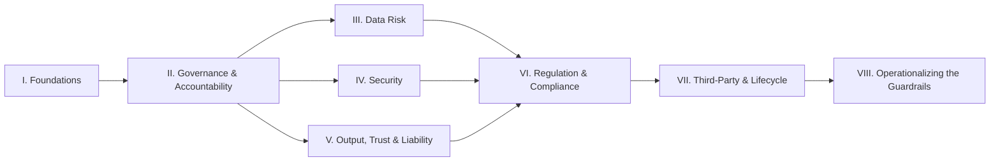

# AI Risk, Security, Governance & Compliance
## The Enterprise Guardrails Handbook: Table of Contents

> [!NOTE]
> Items marked **🆕** are new additions from this review. Items marked **↪** were in the earlier draft but have moved to a better place. Every chapter keeps the multi-stakeholder format: **The Challenge → Real-World Scenario → Stakeholder Lens → The Guardrails**.

---

## Review Summary

### What worked in the earlier draft (kept)
- The multi-stakeholder format, so each role can find what matters to them.
- Concrete failure scenarios that make abstract risks real.
- The "Traffic Light" intake model and the idea that guardrails help teams move faster.

### Gaps found and filled
| # | Gap | Why it matters | Where it's covered now |
|:-:|:---|:---|:---|
| 1 | **Governance came last** (Ch. 5) instead of first | Boards and executives need to know who is accountable before they read about specific risks | Part II |
| 2 | **Third-party / vendor AI risk** was missing | Most enterprise AI is bought or reached through an API, not built in-house | Ch. 23 |
| 3 | **Agentic AI** was covered only briefly | Agents need their own identities, secure tools/MCP connectors, and kill switches | Ch. 11 |
| 4 | **No AI incident response** | Every security program needs a plan for when a guardrail fails | Ch. 27 |
| 5 | **AI-enabled external threats** were missing | Deepfake CEO fraud and AI-written phishing are already hitting enterprises | Ch. 14 |
| 6 | **Human oversight & automation bias** were missing | Having "a human in the loop" doesn't help if that human just approves everything | Ch. 17 |
| 7 | **Transparency, disclosure & content provenance** were missing | Laws now require telling people when they're dealing with AI and labeling AI-generated content | Ch. 18 |
| 8 | **Operational resilience / concentration risk** was missing | If one model provider has an outage, many business processes can stop at once | Ch. 25 |
| 9 | **Regulation covered only the EU and US** | India, APAC, and sector regulators (RBI, SEBI, etc.) matter for global enterprises | Ch. 20–21 |
| 10 | **No dedicated testing / red-teaming chapter** | Evals are the main evidence that a system is ready for production | Ch. 26 |
| 11 | **No metrics, maturity model, or templates** | Readers need to measure progress and need tools they can start using right away | Ch. 28, 30, Appendices |
| 12 | **AI literacy & culture** were missing | The EU AI Act (Art. 4) requires AI literacy, and culture is what keeps people from turning to shadow AI | Ch. 29 |
| 13 | **Deployer-to-provider shift (Art. 25) & build/buy/fine-tune risk** | Fine-tuning, rebranding, or changing a system's purpose can legally turn a deployer into a high-risk provider | Ch. 5.6, 20.1 |
| 14 | **AI insurance & risk transfer** | Cyber, E&O, and D&O insurers are adding generative-AI exclusions that leave enterprises unexpectedly uninsured | Ch. 3.6 |
| 15 | **Contestability, redress & internal whistleblowing** | Affected people need a way to appeal AI decisions, and staff need safe channels to flag unsafe deployments | Ch. 17.4, 29.4 |
| 16 | **Sycophancy, anthropomorphism & manipulative outputs** | Overly human-like or flattering bots create psychological harm, false authority, and regulatory exposure | Ch. 15.5 |
| 17 | **e-Discovery, legal hold & AI meeting recorders** | Prompts, agent traces, and auto-generated meeting transcripts are discoverable corporate records in litigation | Ch. 22.6 |
| 18 | **M&A AI due diligence & algorithmic disgorgement** | Acquiring a firm trained on unconsented data can trigger forced model deletion ("disgorgement") | Ch. 23.5 |
| 19 | **AI FinOps, token economics & ESG compute footprint** | Runaway token spend, zombie pilots, and unreported energy/carbon footprints undermine ROI and ESG disclosures | Ch. 28.4 |

### Factual corrections to apply when drafting
> [!WARNING]
> - **Air Canada chatbot case:** *Moffatt v. Air Canada* (2024) was decided by the British Columbia **Civil Resolution Tribunal**, not a court. Describe it accurately.
> - **EU AI Act fines:** "Up to 7% of global turnover" (or €35M) applies **only to prohibited practices**. Most other violations carry up to 3% / €15M, and supplying incorrect information to authorities carries up to 1% / €7.5M.
> - **GDPR "right to explanation":** Lawyers still disagree about whether this right exists. It's more accurate to cite Art. 22 (automated decision-making) and the rights to "meaningful information about the logic involved" (Arts. 13–15).
> - **Regulatory timelines keep shifting.** For example, there have been proposals to delay EU AI Act high-risk obligations, and several US state laws have been postponed. **Check every date and status just before publication.**

---

## Handbook Structure at a Glance

---

## Front Matter
- **Foreword:** Guardrails help you go faster, they don't slow you down
- **How to Use This Handbook:** reading paths by role (see table below) 🆕
- **Executive Summary:** the top 10 enterprise AI risks on one page 🆕
- **A Shared Vocabulary:** key terms everyone should know (full glossary in Appendix I) 🆕

---

## Part I: Foundations 🆕

### Chapter 1: Why AI Risk Is Different
- 1.1 Probabilistic systems in a deterministic enterprise
- 1.2 When data becomes instructions: the root cause of prompt injection
- 1.3 How fast things change: models, vendors, and regulations shifting every quarter
- 1.4 From chatbots to agents: why the potential damage keeps growing
- 1.5 The Enterprise AI Risk Taxonomy: a one-page map of every risk in this handbook

### Chapter 2: Reference Frameworks at a Glance
- 2.1 NIST AI Risk Management Framework & Generative AI Profile (NIST AI 600-1)
- 2.2 ISO/IEC 42001 (AI Management System) and ISO/IEC 23894 (AI Risk Management)
- 2.3 OWASP Top 10 for LLM Applications & OWASP Agentic AI guidance
- 2.4 MITRE ATLAS (adversarial threat landscape for AI systems)
- 2.5 How the frameworks fit together, and which one to start with

---

## Part II: Governance & Accountability ↪ 🆕
*Moved up from the old closing chapter and expanded.*

### Chapter 3: Board & Executive Oversight 🆕
- 3.1 The board's duty of oversight for AI
- 3.2 Setting the enterprise AI risk appetite
- 3.3 Board AI literacy: what directors need to understand
- 3.4 What the board should receive: AI risk reporting and dashboards
- 3.5 Investor disclosures and the risk of "AI-washing"
- 3.6 Risk transfer and AI insurance: auditing Cyber, E&O, and D&O coverage for silent AI exclusions 🆕

### Chapter 4: The AI Governance Operating Model
- 4.1 The cross-functional AI Governance Council ↪
- 4.2 Roles & accountability: CEO, CIO, CISO, CDO, CRO, General Counsel, DPO, AI leads, business owners 🆕
- 4.3 Applying the Three Lines of Defense to AI 🆕
- 4.4 Centralized, federated, or hub-and-spoke: choosing a Center of Excellence model 🆕

### Chapter 5: Policies, Inventory & Risk Tiering
- 5.1 Turning Responsible AI principles into policies you can enforce 🆕
- 5.2 The employee AI Acceptable Use Policy 🆕
- 5.3 The central AI registry & AI Bill of Materials (AI-BOM) ↪
- 5.4 Risk-tiering method: low, medium, high, prohibited ↪
- 5.5 The Traffic Light intake process (Green / Yellow / Red lanes) ↪
- 5.6 Architectural risk selection: how governance duties shift across SaaS, RAG, fine-tuning, and custom models 🆕

---

## Part III: Data Risk

### Chapter 6: Data Leakage & Shadow AI
- 6.1 External data leakage and model-training risk
- 6.2 The Shadow AI problem
- 6.3 "Embedded AI": when existing SaaS tools quietly add AI features 🆕
- 6.4 Sanctioned AI gateways and Zero Data Retention (ZDR)
- 6.5 Data Loss Prevention (DLP) and PII redaction pipelines

### Chapter 7: Internal Over-Exposure & Permission-Aware AI
- 7.1 The "insider access" problem: AI as a super-search engine
- 7.2 Fixing file permissions before rollout 🆕
- 7.3 Data classification and sensitivity labels 🆕
- 7.4 Permission-aware retrieval (RAG that respects access control)

### Chapter 8: Data Provenance, Consent & Sovereignty 🆕
- 8.1 Lineage and provenance for training and grounding data
- 8.2 Consent and purpose limitation: is this data allowed to be used for AI?
- 8.3 Data residency, sovereignty, and cross-border transfers
- 8.4 The "right to be forgotten" in vector stores and model weights ↪
- 8.5 Synthetic data: benefits, limits, and re-identification risk

---

## Part IV: Security

### Chapter 9: The AI Threat Landscape 🆕
- 9.1 Mapping AI threats to OWASP LLM Top 10 and MITRE ATLAS
- 9.2 Threat modeling for AI systems and agents
- 9.3 Who is attacking AI systems, and why

### Chapter 10: Prompt Injection & Manipulation
- 10.1 Direct prompt injection and jailbreaks
- 10.2 Indirect prompt injection: the Trojan Horse in documents, emails, and web pages
- 10.3 System prompt leakage 🆕
- 10.4 Input/output guardrail models, and what they can't catch 🆕

### Chapter 11: Securing AI Agents (expanded) 🆕
- 11.1 Excessive agency and how much damage an agent can do
- 11.2 Non-human identities: how agents authenticate and what they're authorized to do 🆕
- 11.3 Tool and connector security (MCP servers, plugins, APIs) 🆕
- 11.4 Risks when multiple agents work together or talk to each other 🆕
- 11.5 Human approval gates and kill switches 🆕
- 11.6 Sandboxing code execution and browser agents 🆕

### Chapter 12: Model & Supply Chain Security
- 12.1 Poisoning of training data, models, and knowledge bases
- 12.2 Open-weight model provenance and scanning (malicious model files) 🆕
- 12.3 Model theft, extraction, and inversion attacks 🆕
- 12.4 Membership inference and training-data extraction 🆕
- 12.5 AI-BOM and SBOM for the AI supply chain

### Chapter 13: Infrastructure & Operational Security 🆕
- 13.1 Managing API keys and secrets for model providers
- 13.2 Unbounded consumption and "denial-of-wallet" attacks
- 13.3 Securing prompt and response logs (logs are sensitive data too)
- 13.4 Vector database security and tenant isolation

### Chapter 14: AI-Enabled External Threats 🆕
- 14.1 Deepfakes and voice cloning used for executive fraud
- 14.2 Phishing and social engineering at AI scale
- 14.3 Synthetic identities and bypassing KYC checks
- 14.4 Fighting back: using AI defensively in the Security Operations Center

---

## Part V: Output, Trust & Liability

### Chapter 15: Hallucinations & Reliability
- 15.1 Confident hallucinations in high-stakes workflows
- 15.2 Grounding with citations and permission to say "I don't know"
- 15.3 Hand rules and math to deterministic code
- 15.4 Legal liability for what your AI says (*Moffatt v. Air Canada*, corrected)
- 15.5 Sycophancy, anthropomorphism, and manipulative outputs: preventing false authority and emotional over-reliance 🆕

### Chapter 16: Bias, Fairness & Discrimination
- 16.1 Where bias comes from: data, design, and deployment
- 16.2 High-risk use cases: hiring, credit, insurance, healthcare, education
- 16.3 Fairness testing and independent bias audits 🆕

### Chapter 17: Human Oversight & Automation Bias 🆕
- 17.1 Real human control vs. rubber-stamping
- 17.2 Choosing the design: human-in-the-loop, human-on-the-loop, or human-out-of-the-loop
- 17.3 Calibrating trust: avoiding both over-reliance and outright rejection
- 17.4 Contestability and human redress: giving affected customers and employees a way to appeal AI decisions 🆕

### Chapter 18: Transparency, Disclosure & Content Provenance 🆕
- 18.1 Telling people when they're interacting with AI
- 18.2 Labeling AI-generated content: watermarking and C2PA content credentials
- 18.3 Explainability: what LLMs can realistically explain
- 18.4 Documentation: model cards, system cards, and datasheets

### Chapter 19: Intellectual Property & Licensing
- 19.1 Inbound risk: generated output that infringes someone else's rights
- 19.2 Outbound risk: who owns and can protect AI-generated work?
- 19.3 Open-weight model licenses and their usage restrictions 🆕
- 19.4 Open-source license contamination in AI-generated code 🆕
- 19.5 Vendor IP indemnification: what it covers and what it doesn't

---

## Part VI: Regulation & Compliance

### Chapter 20: The Global Regulatory Landscape
- 20.1 EU AI Act: risk tiers, deployer-to-provider shifts (Art. 25), GPAI obligations, timelines, penalties (corrected)
- 20.2 United States: federal policy and the patchwork of state and local laws (e.g., Colorado, California, NYC Local Law 144, Illinois)
- 20.3 India: DPDP Act & Rules, MeitY AI Governance Guidelines, sector regulators (RBI, SEBI, IRDAI) 🆕
- 20.4 Asia-Pacific & beyond: China, South Korea, Japan, Singapore (Model AI Governance Framework, AI Verify), UK, Canada 🆕
- 20.5 Managing compliance across jurisdictions: build once, comply many times 🆕

### Chapter 21: Sector-Specific Requirements 🆕
- 21.1 Financial services: model risk management (e.g., SR 11-7), EU DORA, RBI guidance
- 21.2 Healthcare & life sciences: HIPAA, AI-enabled medical devices
- 21.3 Employment & HR: works councils, employee monitoring, automated hiring decisions
- 21.4 Public sector and critical infrastructure

### Chapter 22: Auditability, Assessments & Evidence
- 22.1 The "black box" problem
- 22.2 Tamper-proof logging and decision replay ↪
- 22.3 Impact assessments: DPIA, Fundamental Rights Impact Assessment (FRIA), algorithmic impact assessments 🆕
- 22.4 Conformity assessments and certification (e.g., ISO/IEC 42001) 🆕
- 22.5 Preparing for internal and external AI audits 🆕
- 22.6 e-Discovery, legal hold, and retention governance for prompts, agent traces, and AI meeting transcripts 🆕

---

## Part VII: Third-Party & Lifecycle Risk 🆕

### Chapter 23: Vendor & Third-Party AI Risk 🆕
- 23.1 Due diligence for AI vendors and model providers
- 23.2 Contract clauses that matter: ZDR, training opt-out, data location, sub-processors, audit rights, incident notification, indemnity
- 23.3 Concentration risk and provider lock-in
- 23.4 Fourth-party risk: the AI vendors your vendors rely on
- 23.5 AI due diligence in M&A and investments: spotting algorithmic disgorgement, poisoned weights, and license traps 🆕

### Chapter 24: Model Lifecycle & Change Management 🆕
- 24.1 Model versioning and vendor-forced deprecation
- 24.2 Re-validating when the underlying model changes
- 24.3 Drift, degradation, and continuous monitoring ↪
- 24.4 Decommissioning AI systems safely

### Chapter 25: Operational Resilience & Business Continuity 🆕
- 25.1 Provider outages, rate limits, and routing to a fallback model
- 25.2 Graceful degradation: what happens when the AI is unavailable?
- 25.3 Including AI in business continuity and disaster recovery plans

---

## Part VIII: Operationalizing the Guardrails

### Chapter 26: Testing, Evaluation & Red-Teaming 🆕
- 26.1 Pre-deployment evals and golden datasets
- 26.2 AI red-teaming: scope, methods, and who should do it
- 26.3 Safety and security benchmarks
- 26.4 Go/no-go criteria for production

### Chapter 27: AI Incident Response 🆕
- 27.1 What counts as an "AI incident"?
- 27.2 Playbooks: prompt injection, data leak, harmful output, runaway agent
- 27.3 Regulatory notification obligations (e.g., EU AI Act serious-incident reporting, data-breach laws)
- 27.4 Post-incident review and feeding lessons back into guardrails

### Chapter 28: Metrics, KRIs & Reporting 🆕
- 28.1 Key Risk Indicators (KRIs) for AI
- 28.2 Governance KPIs: time-to-approve, how much of your AI is in the inventory, eval pass rates
- 28.3 Board-level AI risk dashboard template
- 28.4 AI FinOps, token economics, and environmental footprint: governing compute cost, zombie pilots, and ESG impact 🆕

### Chapter 29: Building a Risk-Aware AI Culture 🆕
- 29.1 AI literacy programs (incl. EU AI Act Art. 4 obligations)
- 29.2 Role-based training paths
- 29.3 Make the safe path the easy path
- 29.4 Speak-up culture and whistleblower protections for reporting unsafe AI 🆕

### Chapter 30: Governance Maturity Model & Roadmap
- 30.1 The five-level AI governance maturity model 🆕
- 30.2 A 30/60/90-day action plan 🆕
- 30.3 From point-in-time sign-off to continuous governance ↪

---

## Appendices 🆕
- **A. Role-Based Cheat Sheets:** the top questions each role should ask before approving an AI project (Board, CEO, CIO, CISO, CDO/Data Stewards, GC/DPO, AI Engineers, Business Owners)
- **B. AI Governance RACI Matrix** (template)
- **C. AI Use-Case Intake & Risk-Tiering Form** (template)
- **D. AI Vendor Due Diligence Questionnaire** (template)
- **E. Employee AI Acceptable Use Policy** (template)
- **F. Pre-Flight Production Checklist** (go/no-go rubric)
- **G. Regulatory & Framework Crosswalk** (EU AI Act ↔ NIST AI RMF ↔ ISO 42001 ↔ OWASP)
- **H. AI Incident Response Playbook** (template)
- **I. Glossary of Terms**
- **J. References & Further Reading**

---

## Reading Paths by Role

| Role | Core chapters | Recommended |
|:---|:---|:---|
| **Board Members / CEO** | 1, 3, 5, 14, 28, 30 | 20, 23, App. A |
| **CIO** | 1, 4, 5, 23, 24, 25, 30 | 11, 13, 26 |
| **CISO / Security** | 9–14, 23, 27 | 6, 7, 26 |
| **CDO / Data Stewards** | 6, 7, 8, 15, 16, 22 | 5, 19, 24 |
| **General Counsel / Compliance / DPO** | 8, 18–22, 23 | 3, 16, 27 |
| **AI Engineers / Architects** | 1, 7, 10–13, 15, 26 | 17, 18, 24 |
| **Business & Product Owners** | 1, 5, 15, 16, 17 | 18, 29 |

> [!TIP]
> **Writing an article instead of a handbook?** Use the eight Parts as article sections, pick one scenario and one guardrail per Part, and point readers to Appendix A's role-based questions as the call to action.
